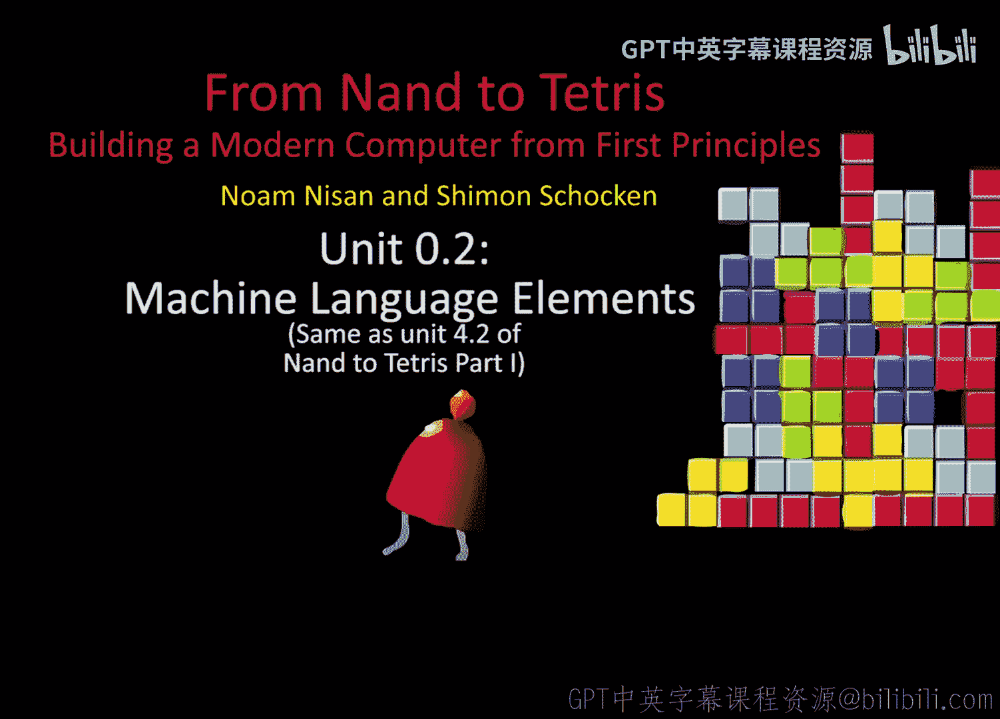

# 从零开始构建现代计算机2：单元0-2：机器语言要素 🧠

在本单元中，我们将探讨所有机器语言共有的基本要素。这为我们理解下一单元将要学习的 Hack 机器语言提供了必要的背景知识，因为 Hack 语言中的大多数元素，都以某种形式存在于其他机器语言中。我们首先对机器语言的要素进行一个概括性的描述，这个描述非常基础，省略了许多更复杂的特性，但足以帮助我们理解 Hack 机器语言。

## 机器语言的核心作用

上一节我们讨论了机器语言的通用概念及其如何控制计算机。本节中，我们来看看机器语言的具体构成要素。

首先需要记住，机器语言是计算机科学中最重要的接口。它是硬件与软件之间的桥梁，是软件控制硬件的具体方式。

这种语言需要规定硬件执行哪些操作、从哪里获取操作数据、如何控制操作流程等。原则上，这个接口通常与硬件的实际实现一一对应。硬件被设计成能直接支持其向上层软件提供的功能类型。当然，有时为了提供更好的功能（例如让编译器编写者更轻松），硬件实现可能会与机器语言稍有分离，但这不是我们讨论的重点。从基本原理出发，机器语言精确地规定了硬件能为我们做什么。

## 设计权衡：成本与性能

当我们实际设计一种机器语言时，基本考量是成本与性能的权衡。我们希望机器语言提供的操作越复杂、支持的数据类型越庞大或越高级，实际构建它的成本就越高。这里的成本包括硅片面积和硬件执行所需的时间等。在我们的课程中，我们总是倾向于最简单的权衡，展示最简单的概念，而不太担心实际性能。但在任何真实的机器中，驱动机器语言设计的核心正是这种成本与性能的权衡。

## 操作类型

每种机器语言都定义了一组操作，这些操作可分为几类。

以下是常见的操作类别：

*   **算术运算**：例如两个数的加法、减法，可能还包括乘法或除法。
*   **逻辑运算**：例如对两个位（或两个字）进行按位与（AND）操作。
*   **流程控制操作**：这些指令告诉硬件何时在程序中跳转。

不同的机器语言定义了不同的操作集合，它们在丰富程度上可能有所不同。例如，有些机器可能将除法作为基本操作提供，而其他机器可能因为硅片成本太高而选择不提供，转而由软件来实现该功能。

## 数据类型

比操作类型更重要的一个问题是：硬件能原生访问哪些数据类型？当然，处理8位数和处理64位数有很大区别。如果你的软件程序确实需要进行64位值的算术运算，那么能在一个操作中完成64位值加法的硬件，至少比需要通过一系列8位值加法来实现64位值加法的硬件快八倍。

类似地，一些计算机还可以提供更丰富的数据类型。例如，你的硬件可能直接支持浮点运算（处理非整数的实数），并提供加法、乘法、除法等基本操作。如果你要进行科学计算，处理浮点数或实数而非仅仅是整数，这样的机器当然会快得多。

## 数据寻址：核心挑战

接下来这个问题可能更重要，尽管更微妙一些：我们如何决定对哪些数据进行操作？硬件如何允许我们指定要处理的数据值？

我们面临的基本问题是，我们要处理的数据驻留在内存中，而访问内存是一项开销很大的操作。这至少体现在两个相关的方面。首先，如果你有一个大内存，指定要操作哪部分内存需要很多位来表示，因为你需要在一个非常大的内存中给出一个地址。如果我只想说“把最后两个数相加”，我将无法直接做到，因为我必须指定两个非常大的地址来告诉硬件要操作什么。

其次，与CPU本身或算术运算本身的速度相比，从大内存中访问一个值需要相对较长的时间。

## 解决方案：内存层次结构

处理这两个问题的方法，即在无需承担指定大地址和从“远处”（就时间而言）获取信息的成本的情况下，让我们能良好控制所处理数据类型的方法，就是所谓的**内存层次结构**。这早在冯·诺依曼建造第一台计算机时就已经构想出来了。

基本思想是，我们不是只有一个大内存块，而是有一系列越来越大的内存。最小的内存（寄存器）将非常容易访问。首先，因为数量很少，我们不需要指定大的地址空间。其次，因为数量很少，我们可以非常快速地从中获取信息。然后会有稍大一些的内存（通常称为缓存），以及更大的内存（有时称为主内存），甚至可能还有更大的内存（如磁盘）。每远离算术单元一步，内存就变得更大，访问它变得更困难（无论是需要更宽的地址，还是需要等待更长时间才能获取值），但那里存储的信息也更多。

不同级别的内存层次结构处理方式各不相同。我们现在要讨论的是最小的内存——通常真正位于CPU内部的**寄存器**——的处理方式。

## 寄存器：CPU内部的快速存储

几乎每个CPU都有少量非常小的内存单元，称为寄存器，它们真正位于CPU内部。它们的类型和功能是机器语言的一部分，关键在于，由于数量极少，寻址它们只需要很少的位，并且获取信息的速度极快。它们由可用的最快技术构建，并且已经在CPU内部，因此从那里获取信息没有任何延迟。

那么，我们有哪些类型的寄存器呢？

## 寄存器的用途

以下是寄存器的主要用途：

*   **存储数据**：我们可以将数字放入其中，并执行诸如“将寄存器一加到寄存器二”的操作。在这种情况下，寄存器一的内容将被加到寄存器二的内容上（如果这是我们机器语言中该操作的含义）。一旦CPU内部有了少量寄存器，我们就可以非常快速地进行大量操作。
*   **存储地址**：我们有时也可以将主内存中的一个地址放入这些寄存器之一。这允许我们指定要访问的较大内存的哪个部分，用于我们想要访问的操作。例如，如果我们有一个操作如“将寄存器一存储到由名为A的寄存器指定的内存地址”，那么当硬件执行此操作时，数字77将被写入主内存。这可能比CPU内部操作花费更多时间，但重要的是，我们写入信息的地址实际上是由A寄存器给出的。

## 寻址模式

现在我们有了这些寄存器，可以回到最初的问题：我们如何决定对哪些数据进行操作？我们如何告诉计算机一个操作（比如一个简单的加法操作）应该对什么进行操作？这里有一系列不同的可能性。

以下是四种常见的可能性（有时称为寻址模式），有些计算机还有其他可能性：

*   **寄存器寻址**：例如，我们可以说 `add R1, R2`。这意味着加法操作在两个寄存器上进行。
*   **直接内存寻址**：我们可以有一个操作说 `add R1, [200]`。在这种情况下，我们告诉计算机直接寻址，不仅指定了寄存器一，还指定了指令内部给出的内存地址200。
*   **间接寻址**：这是我们之前使用地址寄存器（A寄存器）的例子。我们访问的内存地址不是作为指令的一部分指定的，而是已经写在CPU内部先前加载了正确值的地址寄存器中。
*   **立即数寻址**：我们实际上在指令内部有一个值。例如，我们可以说 `add R1, #73`，其中73是一个常量，是指令的一部分。

所有这些都是在每条指令中告诉计算机对哪些数据进行操作的不同方式。

## 输入与输出处理

在讨论从哪里获取数据以及将数据放到哪里时，我们可能还会附带讨论一下在大多数机器语言中如何处理输入和输出。众所周知，有大量的输入和输出设备，如打印机、屏幕、各种传感器、键盘、鼠标等。

访问这些输入/输出设备的一种方法是，将控制它们的寄存器作为内存的一部分连接起来。例如，我们可能有一个鼠标，其连接方式是，每当用户移动鼠标时，最后一次移动就被写入某种寄存器，而该寄存器可以通过计算机在内存的某个特定地址访问。这使我们能够像访问内存本身一样访问输入和输出。当然，实际处理它的软件（通常是操作系统中的驱动程序）必须确切知道输入/输出设备连接到哪些地址，以及如何与之通信（读写位置的值具体代表什么含义）。

## 流程控制

我们要讨论的最后一个要素是所谓的**流程控制**。我们如何告诉硬件接下来执行哪条指令？通常这很简单。通常，如果我现在执行的是指令73，下一条指令将是74。这是正常情况。但有些情况下，我们当然需要改变控制流，而不是一条接一条地顺序执行指令。

改变流程的第一个原因是，有时我们需要跳转到另一个位置，例如执行循环，或者因为现在是时候跳转到程序的另一部分。这有时被称为**无条件跳转**。它的一个主要用途实际上是实现循环。假设我们想对值1、2、3、4、5、6等依次执行某些操作。我们的做法是，用某种寄存器保存这些值，每次我们想给R1加1（假设这是我们选择用来保存这个值的寄存器），然后我们用这个新值做任何需要做的事情。接下来我们想对R1的下一个值做同样的事情。我们这样做的方式是告诉计算机：“在执行完示例中的指令156之后，不要继续执行指令157，而是跳回指令102。”指令102基本上就是给R1加1，给我们R1的下一个值，然后继续用新值做之前做的事情。这允许你实现一个循环。机器语言总是有某种能力让软件告诉硬件再次执行某些操作、返回或跳转到不同方向。

注意，实际地址101、102和156并不那么重要。真正重要的是，当我们跳转到地址102时，它需要是我们实际意指的地址。因此，我们可以用符号化的方式来做这件事，给重要位置起个名字。例如，给位置102起名叫 `loop`，然后说 `jump loop`。这并没有真正改变什么，当我们在机器语言中用比特表示时是完全一样的，但对人类来说查看起来更方便。我们将在描述程序时采用这种方式。

还有其他情况我们需要处理流程控制，这时我们需要进行所谓的**条件跳转**。在某些情况下，我们想跳转到另一个位置，而在其他情况下，根据我们执行的上一条指令、某个寄存器的值或其他条件，我们只想继续执行下一条指令。这被称为条件跳转。例如，假设我想计算一个数的绝对值。如果这个数是正数，我只想对这个数进行一些操作。但如果这个数是负数，我想先把它变成正数，然后处理它的正数版本。我们可以通过条件跳转来实现。例如，`jump-greater-than` 指令意味着“如果R1大于0，我想让你跳转到标签 `con`（这是我编的一个名字），否则就继续”。这意味着如果我们有一个正数，我们将不会执行下一条指令（减法指令）。但如果我们有一个负数，我们将直接继续执行减法指令，该指令实际上对R1取反，使其变为正值。现在，在两种情况下，我们都继续执行相同的指令序列，并且无论如何，R1现在都是一个正值。这是另一个例子，说明我们有时需要条件跳转，而机器语言总是有某种机制来指示硬件执行这种条件跳转。

## 总结

至此，我们完成了对机器语言提供指令类型的一个非常快速、高度概括和基础的概述。现在，我们已经准备好实际讨论我们的计算机——Hack机器语言了。