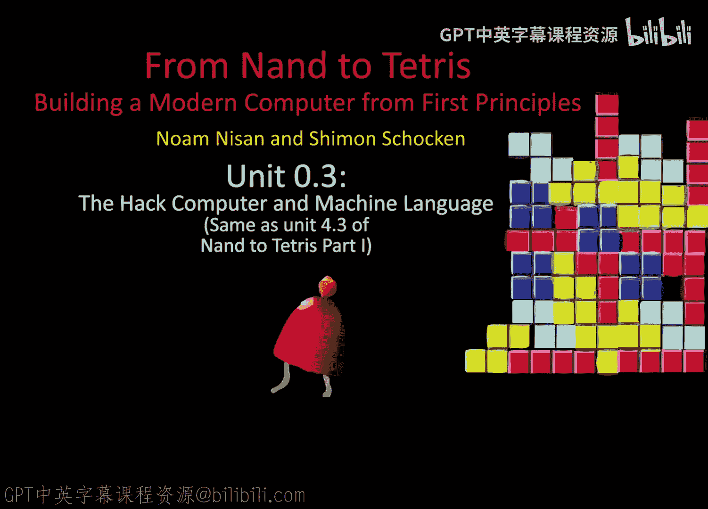

# 耶路撒冷希伯来大学《从零开始构建现代计算机2｜Build a Modern Computer from First Principles》中英字幕 p06 06_02_05_单元0-3_Hack计算机与机器语言.zh_en -BV1DA4m1w7FU_p6-

In the previous two units， we talked about machine language in general and from this unit onward。

 we are going to talk about the heCC machine language。

 which is the native code that we are going to use in order to operate the heCC computer。

Now I don't want to talk too much about the he computer itself because we're going to spend the whole week or more than than one week talking about the computer。

 but I do want to give you an overview of the how to platform on which the machine language is going to operate as Noamm described before these two things how to design and machine language design go hand in hand and there's certain duality between them and you have to know one in order to understand the other so here's an overview of the computer that you are going to build from next week onward。

 in fact you've been building this computer all along but next week we're going to actually assemble all these pieces together and we are going to have a computer which consists of three main elements we're going to have basically first of all we're going to have a 16 bit computer and a 16 bit computer is a machine in which everything consists of。

Chunks of 16 bits so if you want to store something you have to store 16 bits together。

 if you want to retrieve a piece of data， you have to retrieve 16 bits。

 if you want to move data from one place to another。

 you move them in chunks of 16 bits so this is the atomic unit of information in this computer。

Now the computer is going to consist of a data memory。

 which is a sequence of 16 bit values and each of these values is going to be stored in a memory register。

 and these registered are numbered for convenience， we can think about them as register zero。

 register one all the way to as many registers as we have in the data memory。

The instruction memory is a separate memory space that is also a sequence of 16 bit values。

And the CPU is a device which is capable of manipulating 16 bit values using mostly the AU。

 which resides inside the CPU。And finally we are going to have all sorts of buses that enable us to move data from one place to another。

 so we have a data bus that connects the CPU and the data memory。

 we have an instruction bus that moves instructions from the instruction memory to the CPU and we're going to also have some address buses which I didn't put in the picture to avoid clatutter and also we don't need this level of detail for this particular unit。

 you can think about the buses as highways of 16 lanes moving chunks of 16 bits from one place to another。

All right， so how do we control this computer Well we have software and the software is in this level of the machine。

 the software consists of machine language or the program that we write using machine language。

And when we designed this computer and when we designed this machine language。

 we decided to create two categories of instructions。

 which we call a instructions and C instructions and each one of these instructions is specified as a 16 bit number like everything else in this machine。

 so what is a heCC program， a heCC program is essentially a sequence of instructions。

 16 bit numbers written in the I'm sorry written in the heCC machine language。

What about control Well before we talk about control I have to introduce yet another element in this platform which is called a reset button。

 so we do have a reset button and here is how I cause this computer to do something useful for me I write a program the program is a set of 16 bit numbers。

I take these 16 bit numbers and somehow put them into the room。

 we'll discuss later how we actually do it， then I press the reset button and once they do this。

 the program starts running that's the basic sort of user instructions of how to to cause this computer to do something useful Now I have no idea what the computer will do it all depends on the program you know but hopefully the computer will start sounding some music or showing a video clip or compute the average of a million numbers or something like this。

 it all depends on what is written in the program。Now before we go on to talk about the machine language。

 I'd like to say a few words about some more harder artifacts that we have to be aware of。

 the heCC computer recognizes three registers。First of all theres the D register which holds a 16 bit value which represents a piece of data。

 then there's the a register which holds also a 16 bit value which represents either a data value or an address we'll talk about this later on and finally there is something called the selected memory register which is denoted by the letter M。

So it doesn't matter if I have 2 billion memory registers at any given point of time。

 only one of them is selected and I can basically ignore all the other registers that are irrelevant for what I currently do。

 I want to focus only on the currently selected register and I call this register M you know this is just a convention that we use in the specification of the heCC machine language。

All right， so now we have all the basic background that we need in order to understand the syntax of the language。

 so here's the syntax of the A instruction。U percent value or at value where value is either a nonne decimal constant or a symbol referring to such a constant and we'll discuss these symbols later on now instead of spending too much time about the formal semantics。

 let's see an example。What does at 21 mean Well if I tell the computer at 21 two things happen first of all the a register is set to 21 and second of all ReM of 21 becomes the selected RE register so we see that the a register has a very important side effect once you set the a register to a particular value like 21。

It automatically selects a particular register from the data memory and this register becomes the currently selected register。

 what I called M in the previous slide All right， so this is the operation of that's the semantics of the A instruction。

Here's an example of how we actually use this instruction let's say that we want to set Ram 100 to minus1。

 how do I do it Well the first thing that you have to do is select the register on which we want to operate and we do it by saying at00。

Once we do this， we get the side effect working and then we can say m equals minus1 because M now denotes register number 100 in the memory unit。

So that's how we use the A instruction， we always need it before we operate on the memory。

 before we do something to the memory we have to select a register so we always have to address the memory using an A instruction and that's by the way why it's called A A for addressing the C instruction is the work of the language。

 that's where most of the action takes place and the syntax of this instruction consists of three different fields which we call destination computation and a jump directive。

Now here is how it works。First of all， we compute something。And then we can do one of two things。

 we can either store the result of the computation in some destination or we can use this computation to decide if we want to jump to some other instruction in the program now this is the basic overall semantics of the same instruction now let's get more into the details of every one of these fields。

The computation can be any one of the computations that we see here。

 so we see here a set of what is sometimes called p mneummonics or symbols that represent some operation。

So we can compute the values 0，1 minus1， we can compute the current value of the d register。

 we can compute d minus1， d plus a D and A and end here is a 16 bit A， D。

 16 B or and so on and so forth and wherever you see theneumonic A。

 we can replace it also within mneumonic M， so we can do many different things using the computation field。

What about destination， well we have eight possible destinations beginning with Nll。

 which means that we don't want to store the results of the computation at all。

And we can store the result of the computation either in the currently selected RAM register or in the D register or interestingly enough。

 we can store it simultaneously both in M and in D。

 this is something which is actually quite powerful about the heCC machine language。

 we can simultaneously store the result of the computations in more than one container。

 you know we have eight different possibilities and the programmer is free to use any one of them according to what he or she wants to do。

Now what about the jump directive the jump directive takes a little while to get used to and here is how it works。

 we have eight possible conditions and these conditions always apply。

 they always compare the result of the computation to zero。And once again。

 instead of belaboring about it， I'm going to give some examples in just a few minutes。

 so this will become much clearer once we see the examples。So。

Let's say that I want to set the D register to -1。 Okay， set the D register to -1。

 I look at the language specification， and I see that I have-1 is one of the values that I can compute and D is one of the legible destinations。

 So I can simply say D equals -1。 The jump directive is optional， so I don't have to specify it。So。

 case closed。Let's move on to the next example。Let's say that I want to set Ram 300。

 register number 300 to the value of the deregister minus1。Once again。

 I look at the language specification， but before I do so， actually。I have to select。

The register on which I want to operate， you know， whenever I want to access the memory。

 I must use an A instruction to select the register of interest， so I say at 300。

And then I look at the specification and I see that I have d minus1 as one of the values that the CPU can compute for me and I have M as one of the legible destinations。

 so all I have to do is say M equals d minus1 and that is how I said register number 300 to d minus1 is and as you see I need two instructions to carry out this particular operation。

 whenever I do something to the memory I first have to use an a instruction to select the register on which I want to operate。

Okay the last example deals with a jump， you know how do I tell the computer to jump to execute a particular instruction？

Let's say that the condition that I want to use is that if d minus1 equals0， jump to execute。

The instruction which is located in round 56， know this is similar to， for example。

 a condition that terminates a loop， you know I do something in a loop and each time I check the value of d minus-1 and when it reacheses0。

 I want to jump to some other instruction。So how do I do it Well， once again。

 whenever I deal with a memory， the first thing that I have to do is use an a instruction to specify which register I want to operate on so I say at 56。

To to select the address 56 and then I look at the language specification。

 I see that I have D minus-1 as one of the possible computations。

 and I also have a J E which means jump if。The value of the computation equals0 and that's exactly what I want to do right I want to jump if the value of d -1 equals0。

 so I compute d minus-1 and I say J e。 So if the value of d minus-1 equals0 jump instead of equals I could have used the greater than less than not equal and so on。

And notice by the way that I also have an unconditional jump， you know。

 if I simply want to jump to 56 without checking any condition， all I have to say is jump。

And in fact， if I want to be more accurate， the syntax that we have in this language requires that I say zero。

Semicolon jump now this is just a convention so if I want to do an unconditional jump I do zero semicolon JMP and this will cause an unconditional jump by the way everything that I say here is describe fully in the book and in the website so you don't really have to remember any one of the details because you can refer to them later on so this has been an overall description of the heck computer language and in the next unit were going to be more specific about this language because we're going to describe two different flavors of this language what we've seen so far was the symbolic flavor of the language but we can also write all these instructions using binary codes and it's quite interesting to see how these two flavors relate to each other we'll do this in the next unit。

