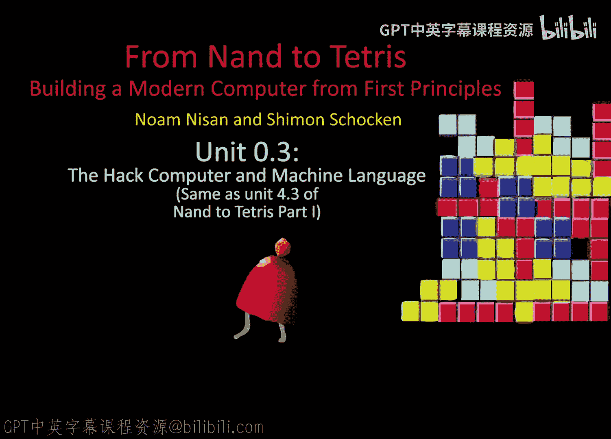

# 从零开始构建现代计算机：单元0-3：Hack计算机与机器语言 🖥️

## 概述

在本节课中，我们将学习Hack计算机平台及其机器语言。我们将了解Hack计算机的基本构成，并详细探讨其机器语言指令的两种类型：A指令和C指令。通过理解这些核心概念，你将能够编写控制这台16位计算机运行的程序。

## Hack计算机平台概览

在之前的两个单元中，我们讨论了机器语言的一般概念。从本单元开始，我们将具体探讨Hack机器语言，这是我们将用来操作Hack计算机的本地代码。

我们不打算过多讨论Hack计算机本身，因为后续会花一周甚至更多时间来讲解。但为了理解机器语言，我们需要对它的运行平台有一个概览。正如Noam之前描述的，计算机设计和机器语言设计是相辅相成的，两者之间存在某种对偶性，理解其中一个有助于理解另一个。

以下是你将从下周开始构建的计算机的概览。实际上，你一直在构建这台计算机的各个部分，下周我们将把这些部分组装起来。这台计算机主要由三个核心元素构成：

*   **16位架构**：这是一台16位计算机，意味着所有信息都以16位为基本单位进行处理。无论是存储、检索还是移动数据，都以16位块为单位。这是本计算机中信息的原子单位。
*   **数据内存**：这是一个16位值的序列，每个值存储在一个内存寄存器中。为了方便，这些寄存器被编号，我们可以将其视为寄存器0、寄存器1，一直到数据内存中拥有的所有寄存器。
*   **指令内存**：这是一个独立的内存空间，同样是一个16位值的序列。
*   **中央处理器**：这是一个能够处理16位值的设备，主要依靠其内部的算术逻辑单元。
*   **总线**：用于在不同部件间移动数据的通道。我们有连接CPU和数据内存的**数据总线**，以及将指令从指令内存移动到CPU的**指令总线**。为了简化图示，我们没有画出地址总线。你可以将总线想象成拥有16条车道的高速公路，负责在各个部件间传输16位数据块。

## 如何控制计算机？

我们通过软件来控制这台计算机。在这个机器层面，软件由机器语言构成，或者说，是我们用机器语言编写的程序。

在设计这台计算机及其机器语言时，我们决定创建两类指令，分别称为**A指令**和**C指令**。与这台机器中的所有事物一样，每条指令都表示为一个16位的数字。因此，一个Hack程序本质上就是一系列用Hack机器语言编写的16位数字指令序列。

在讨论控制流程之前，需要介绍平台上的另一个元素：**复位按钮**。

以下是让这台计算机为我执行有用任务的基本流程：
1.  我编写一个程序，该程序是一组16位数字。
2.  我通过某种方式（稍后讨论）将这些16位数字放入内存。
3.  我按下复位按钮。
4.  程序开始运行。

这就是让计算机执行任务的基本用户指令。至于计算机会做什么，完全取决于你编写的程序。它可能开始播放音乐、显示视频剪辑，或者计算一百万个数字的平均值等等。

## Hack计算机的关键寄存器

在深入讨论机器语言之前，我们需要了解Hack计算机识别的三个关键寄存器：

1.  **D寄存器**：存放一个16位值，代表一个数据。
2.  **A寄存器**：同样存放一个16位值，可以代表一个数据值或一个内存地址（稍后详述）。
3.  **选中的内存寄存器**：用字母 **M** 表示。无论数据内存中有多少个寄存器（例如20亿个），在任意给定时刻，只有一个寄存器被“选中”并处于活动状态。我们可以忽略所有其他不相关的寄存器，只关注当前选中的这个，并将其称为 **M**。这是在Hack机器语言规范中使用的一个约定。

## Hack机器语言语法

现在，我们已经具备了理解语言语法所需的基本背景知识。

### A指令

A指令的语法是：`@value`
其中，`value` 可以是一个非负十进制常数，或者一个指向此类常数的符号（符号稍后讨论）。

与其花太多时间讨论形式语义，不如看一个例子。`@21` 是什么意思？
执行 `@21` 时会发生两件事：
1.  A寄存器被设置为21。
2.  数据内存中地址为21的寄存器（RAM[21]）成为当前选中的寄存器（即M）。

我们可以看到，A寄存器有一个非常重要的副作用：一旦你将A寄存器设置为一个特定值（如21），它会自动从数据内存中选择一个特定的寄存器，该寄存器就成为当前选中的寄存器，也就是上一张幻灯片中我们称为 **M** 的那个。

以下是实际使用这条指令的例子。假设我们想将RAM[100]设置为-1，该怎么做？
首先，我们必须选择要操作的内存寄存器，通过执行 `@100` 来实现。
一旦执行了这条指令，副作用生效，M现在指向内存单元中编号为100的寄存器。然后我们就可以说 `M=-1`。

这就是A指令的用法。在对内存进行操作之前，我们总是需要它。在我们对内存做任何事情之前，必须先选择一个寄存器。因此，我们总是需要使用A指令来寻址内存，这也是它被称为“A”（Addressing，寻址）指令的原因。

### C指令

C指令是语言的核心，大部分操作都在这里进行。这条指令的语法包含三个不同的字段，我们称之为**目的地**、**计算**和**跳转**指令。

它的工作原理如下：
首先，我们计算某个值。
然后，我们可以做两件事中的一件：
1.  将计算结果存储到某个目的地。
2.  或者，利用这个计算结果来决定是否要跳转到程序中的另一条指令。

这是C指令的基本整体语义。现在让我们更深入地了解每个字段的细节。

**计算字段**可以是这里列出的任何计算。我们看到一组有时被称为助记符或符号的东西，它们代表某种操作。
我们可以计算值0、1、-1，可以计算D寄存器的当前值，可以计算D-1、D+A、D&A等等。在助记符中出现 **A** 的地方，我们也可以用 **M** 来替换。因此，使用计算字段我们可以做许多不同的事情。

**目的地字段**有8种可能的目标，从“null”（空）开始，表示我们根本不想存储计算结果。
我们可以将计算结果存储在**当前选中的RAM寄存器（M）** 中，或者存储在**D寄存器**中。有趣的是，我们还可以**同时**将结果存储在M和D中。这是Hack机器语言一个相当强大的特性：我们可以将计算结果同时存储在多个容器中。程序员可以根据他/她想做的事情，自由使用这8种可能性中的任何一种。

**跳转指令字段**需要一点时间来适应。它的工作原理如下：
我们有8种可能的条件，这些条件总是将**计算结果与0进行比较**。
同样，与其赘述，不如稍后通过例子来说明，这样会更清晰。

## 实例解析

让我们通过几个例子来巩固理解。

**例1：将D寄存器设置为-1。**
查看语言规范，我看到“-1”是我可以计算的值之一，而“D”是合法的目的地之一。因此，我可以直接写 `D=-1`。跳转指令是可选的，所以我不需要指定它。任务完成。

**例2：将RAM[300]设置为D寄存器的值减1。**
再次查看语言规范，但在那之前，实际上我必须先选择要操作的内存寄存器。每当我想要访问内存时，都必须使用一条A指令来选择感兴趣的寄存器。所以我先写 `@300`。
然后查看规范，我发现“D-1”是CPU可以为我计算的值之一，而“M”是合法的目的地之一。因此，我只需要写 `M=D-1`。这样我就将寄存器300设置为了D-1。如你所见，执行这个特定操作需要两条指令。每当我需要对内存进行操作时，首先必须使用一条A指令来选择要操作的寄存器。

**例3：实现条件跳转。**
我如何告诉计算机跳转去执行一条特定的指令？假设我想要使用的条件是：如果 `D-1` 等于0，则跳转到执行位于RAM[56]的指令。这类似于一个终止循环的条件：我在循环中做某事，每次检查 `D-1` 的值，当它达到0时，我想跳转到其他指令。
那么，我该怎么做呢？再次强调，每当我处理内存时，首先要做的是使用一条A指令来指定我想要操作的寄存器地址，所以我写 `@56` 来选择地址56。
然后查看语言规范，我看到“D-1”是可能的计算之一，并且我还有一个“JEQ”，意思是“如果计算值等于0则跳转”，这正是我想做的。我想在 `D-1` 等于0时跳转。所以我计算 `D-1` 并说 `JEQ`。除了“等于”，我还可以使用“大于”、“小于”、“不等于”等条件。
另外请注意，我还有一个**无条件跳转**。如果我只想无条件跳转到地址56，而不检查任何条件，我只需要说 `JMP`。实际上，为了更精确，这种语言的语法要求我写 `0;JMP`。这只是一种约定，所以如果我想进行无条件跳转，我就写 `0;JMP`，这将导致无条件跳转。

顺便说一下，我在这里所说的一切在教材和网站上都有完整描述，所以你实际上不需要记住任何细节，因为以后可以随时查阅。

## 总结

本节课我们一起学习了Hack计算机平台及其机器语言。我们了解了Hack计算机的基本架构，包括其16位特性、数据内存、指令内存、CPU和总线。我们重点探讨了两种核心指令：用于内存寻址的**A指令**和用于计算、存储及控制流程的**C指令**。通过实例，我们看到了如何组合这些指令来完成设置寄存器值、操作内存以及实现条件跳转等基本任务。

在下一个单元中，我们将更具体地讨论这种语言，因为我们将描述它的两种不同形式：到目前为止我们看到的是其**符号化形式**，但我们也可以用**二进制代码**来编写所有这些指令。了解这两种形式如何相互关联会非常有趣，我们将在下个单元中进行探讨。