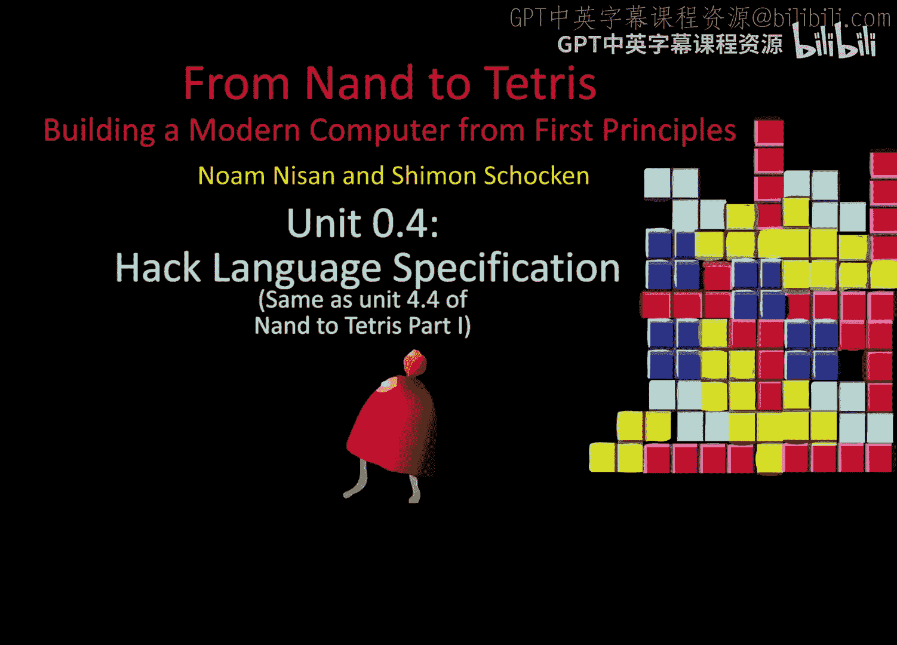

# 耶路撒冷希伯来大学《从零开始构建现代计算机2｜Build a Modern Computer from First Principles》中英字幕 p07 07_02_06_单元0-4_Hack语言规范.zh_en -BV1DA4m1w7FU_p7-

In this unit we're going to complete the description and the specification of the hec machine language。

 So once again the overall context is that we have a hardware platform consisting of instruction memory。

 CPU and a data memory and we have a machine language consisting of a instructions and C instructions。

 We describe these instructions in the previous unit and a heCC program is a sequence of such a instructions batched together and we execute them one at a time。

 that's the overall picture。Now， as it turns out， and this is true for every machine language out there。

 you can write programs in machine language using two different flavors or two different languages。

 if you will， you can write them symbolically usingneummonics and friendly symbols and that's what we see here on the left hand side at the bottom of the slide or you can write them using agreed upon binary codes。

Now， if you write programs symbolically， you need someone to translate these programs from symbols to binary code。

 and once you do this， once the program is specified in binary codes。

 you can actually take this code， load it into the computer and actually execute the code on the computer。

Now we're going to spend a whole week talking about this translation and about a very special program called an asemmbler。

 So I'm not going to spend too much time discussing the translation process。

 but I just wanted to know that it's a challenge that has to be met somewhere when you build this computer。

 So here is the symbolic and binary syntax of the a instruction。 Well。

 the symbolic syntax is something that we've seen before at certain value。

And this value can be either a number which is at most two rays to the power of 15 minus1。

 you may be wondering where this number comes from and you'll see it in just a minute。

 or it may be a symbol which refers to such number and we are going to defer the discussion of symbols to a later unit。

For example， at 21。So here's the same instruction in its binary flavor。

 We begin with a special code zero， which tells the computer that this is an a instruction。

And then we specify the same value that we had in the symbolic instruction。

 but we specified using binary code。 So altogether we get something like this example here。

 once again， the first0 is sometimes called an op code， an operation code。

And then come 15 bits that represent the value that we want to load into the a register。

 and it so happens that hopefully 10，101 is the same as 21 in binary。

 What about the same instruction Well， the same instruction as you recall the symbolic definition of the same instruction is very user friendly。

 We have a computation which we can store in a certain destination and we have an optional jump directive。

 and that's the great benefit of symbolic expression。 If we want to express it in binary。

 then we have to decide on some agreed upon codes and Nor and I have already done that when we design this language。

 So here is the 16 bit specification of the same symbolic instruction。The first one is an op code。

 it tells the computer that this is a C instruction if you recall we have only two types of instruction。

 a instruction and C instruction and that's why we need only one code or one bit to represent the op code which is either zero or one。

 so one op code means this is a C instruction then we have two bits which we don't use we don't need them and by convention we set them to one。

The next seven bits taken together specify what is the computation that I want to achieve these are the control bits that will be sent later on to the ALU and will tell the ALU which computation it has to carry out the next three bits represent the destination and finally the last three bits represent the jump condition that we call symbolically using the word jump。

So this is the sort of the different fields of the instruction in its binary flavor。

So let us discuss now the mapping between the symbolic expression of the same instruction and the binary expression of the same instruction。

 let us begin with with a comp field。 So here's a table that relates the symbolic computation mneummonic to their binary equivalentence。

What we see on the left hand side is the symbols and on the right hand side we see the binary codes。

 and we also have the a bit that you can see at the bottom of the table。So， for example。

 suppose that the computation is D plus  one。 symbolically。

 we want to cause the computer to compute D plus1。 Well， we look up the table。

 We see the D plus one somewhere in the middle of the table and we see that the D plus one is listed in the column where a equals 0。

 So we know that the a bit should be 0。Then we look up the rest of the row in this table and we see that the C bits should be 0。

1，1，1，1，1。So that's it。 That's how we represent the operation D plus one in binary。 It's 0，0。

0 or whatever it is。 I don't want to make a mistake。 just look up the table and you have it。

 So that's how you map from symbols to binary codes。Okay， moving along。

 let's talk about the destination field。A very similar idea。

 We have a mapping that gives you the symbolic pneummonics on the left hand side。

 And in the next column， you have their binary code equivalentvalence。

 which very conveniently range from 0，0，0 to 1，1，1 because we have 8 different possible destinations。

 So once again， if someone gives you a particular destination like M。

 you look it up in the table and immediately， you see that it relates to the binary code in this example。

0，11。 So that's how you can translate from symbols to binary code if you have to。Alright， finally。

 let us focus on the jump field。Almost the same as the destination， we have exactly the same concept。

 we have the mnemonics on the left hand side and we have eight different possible binary combinations in the next column once again conveniently enough。

 we have eight different jump conditions and therefore the are binary equivalents conveniently enough range from 0。

00 to 111。So that's it， this basically sums up the mapping between the symbols and the binary codes。

 if you want to put it all together， we can do it in one slide and this is a complete specification of the scene instruction in all its glory both in the symbolic rendition and in the binary rendition and if you had to write a computer program to translate from one language to the other you can begin to see how you can use this logic in order to write this program and by the way this is something that we are going to do in the last week of this course。

Now that we understand how the specific instructions look like in both binary and symbolic。

 let's move on and talk about the overall concept of a heCC program。

 Here's an example of a heCC program。At this level of the course you don't have to understand the program we are just giving you a first overview of how a program looks like and we can make some some quick observations you know。

 first of all， a heCC program is a sequence of heCC instructions This program is written using symbolic instructions。

White space is permitted， you can throw in empty lines wherever you want if you think that it improves the readability of the program。

And comments are welcome and can be used at will。And finally。

 I'd like to say that this is not a great way to write a he code。

 there are better ways to write code with less numbers and more symbols。

 and this is something that we'll do later on in the course once again。

 for now I just want you to to see an example of a typical hec program and if we want to run this program in the computer。

 we first of all must translate it into binary code。

 so we have either a human asmbler or a computer program that translates from one to the other once the program is expressed in binary code。

 we can actually load it into the computer and execute it and the program will hopefully do something useful if not we can go back debug the program。

 recompile it or reassemble it rerun it and so on。Until we are satisfied with it。

So this has been the last unit in which we talked about the heCC machine language and in the next unit we are going to talk about how we can use this language to control input output devices which are connected to the heCC computer。

