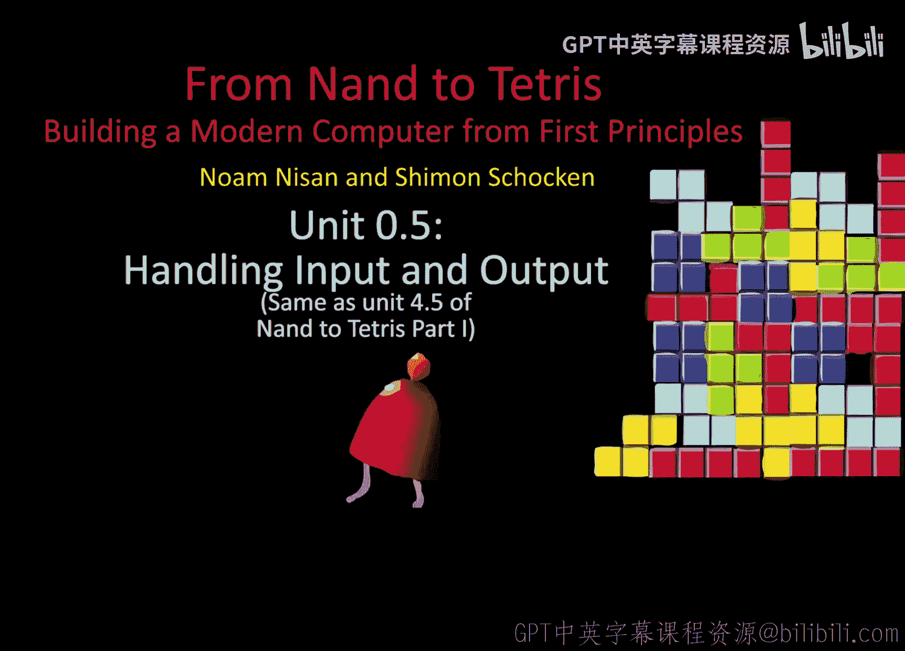

# 耶路撒冷希伯来大学《从零开始构建现代计算机2｜Build a Modern Computer from First Principles》中英字幕 p08 08_02_07_单元0-5_处理输入与输出.zh_en -BV1DA4m1w7FU_p8-

As we all know， computers are equipped with all sorts of input output devices and likewise the he computer can also be connected to some input output devices and in this unit we're going to talk about how we use machine language to control and manipulate these IO devices。

So we start with the basic architecture that we've seen all along。

 but now we are going to extend this architecture with two fancy IO devices。

 we're going to have a display on it similar to your screen and we're going to have a keyboard which is actually identical to the keyboard that you are currently using these devices are sometimes called peri because as you see in the picture they exist outside the computer they exist somewhere in the periphery of the computer and。

Here is how we actually use them Well obviously we use the IO devices in order to communicate with the user。

 we show some pictures or animations or anything that we want to show to the user using the display unit it and we acquire inputs from the user using the keyboard now obviously we have some more devices like mouse and microphones and so on。

 but for now let us talk only about the two sort of most important device units which are the the display unit and the keyboard。

How do you control these devices？Well， if you're lucky to work in a high level environment。

 know if you use languages like Java or Python， well， in that case。

 you have numerous libraries that provide all sorts of fancy way to manipulate these devices。

 you can create graphics， animation， audio， video， and so on。However。

 if you work at the low level that we are operating on， the only thing that you have is bits。

So you have to be very clever about it and you have to figure out a way to use these very Spartan zeros and ones in order to do something useful and display and acquire information from users and to users。

Now you may be wondering how do we use the high level in order to manipulate IO devices because this is also something that we have to learn and understand how these libraries work。

 how do you draw a line how do you draw a circle and so on Well this is something that we deal with in the second part of this course so if you want to learn about the softwareer hierarchy if you want to learn about the design of high-level languages and the IO libraries that extend them and how they operate。

 also how they communicate with the operating system。

 this is something that we do in the second part of this course in this part of the course。

 we deal with the hardware only so once again in this course we're going to talk about the very clever ways in which we use bits to manipulate these devices So the first thing that we'll talk about is how to manipulate。

The output or how to manipulate the display on it， also called Sc sometimes。 Well， how do you do it？

Well， the most important player in this game is something called a screen memory map and a screen memory map is a designated area which is part of the data memory of what we sometimes call RAM so the deal is such that the physical display unit is continuously refreshed from the contents of the memory map and this happens many times each second。

😊，So if I'm a programmer and I'm restricted to working with zeros and ones only。

 if I want to write something on the display unit， what I can do is simply manipulate some bits in the memory map and I can count on the fact that in the next refresh cycle。

 what I change in the memory is going to be reflected on the screen。

Now obviously I have to be very careful about it and if I want to write a text likeHello World。

 well it's going to take a lot of work， you know I have to turn on and off pixels in very specific locations in order to affect this particular output。

So we'll do some of this today and we'll do some more fancy input output operations。

 some much more fancy operations in the second part of this course， as I explained earlier。All right。

 so let's delve into the screen memory map know this is how we are used to think about display units。

 but as far as the heck computer is concerned the display unit it is the following obstruction it's a table or a matrix consisting of 256 rows and 512 columns and in each intersection of a row and a column we have what is known as a pixel。

This is a black and white screen so we can either turn the pixel on or we can turn it off。

 This is the physical display on it that the hec computer assumes。Now， how do we control it？ Well。

 as I just explained， we have something called a memory map and the memory map is a sequence of 16 bit values。

Every one of these values is sometimes called a word， so we have altogether 8 k16 bit words。

 Why do we have 8 k 16 bit words because it turns out that 8k times 16 gives something like 13000 and something and this is the number of pixels that we have on the physical display on it。

 so for every pixel on the physical display unit it。

 we have a bit that represents this pixel in the screen memory map and if I want to turn on this pixel I put one in this bit。

 if I want to turn it off I put zero in this bit。So in order to understand and control these bits judiciously。

 I have to come up with some mapping that describes exactly which bit corresponds to which pixel。

Now this is a little bit involved because on the right hand side。

 I have a two dimensional abstractstruction and on the left hand side I have a one dimensional obstruction and I somehow have to connect the two。

 so how do we do it？Well， first of all。You should notice。

 and I'd like to reemphasize the fact that when we access memory。

We can only retrieve 16 Bs in one chunk。 You know， we cannot access individual bits。

 If I want to access an individual bit， I have to figure out， first of all。

 in which word this bit resides。 so to speak。 And then I have to retrieve the entire word。

Do something to this value and you know manipulate this particular bit。

 and then I have to take this value and put it back， write it back into memory。

 So the readrite operations are always 16 bit operations。 So I take the 16 bit out。

 manipulate something and put it back。Allright so what is the mapping Well here it is The first 32 words in the memory map correspond to the first row in the display on it okay so the first pixel that we see here and actually you can see it in the picture we see that the picture begins with the four black pixels and indeed we see four ones at the top of the memory then we have01。

01 white black， white， black and so on and so forths。Okay so that's a row 0。

 Then we have row 1 all the way down to row 255 Okay so this is the first mapping that we have to bear in mind。

 Now suppose that I want to manipulate a certain pixel on the screen and pixels on the screen are characterized by a row and the column how do I map this row column pair on the right register in the memory map Well。

 here is how I do it。Well， first of all， I multiply row by 32。

 and then I compute column divided by 16。And this by the way is integer division。

 namely I throw away the remainder of the division， so for example， if column equals 18。

 then 18 divided by 16 is1 so I take the result of thisteger integer division I added up to 32 times row and this gives me the address of the register that I have to manipulate in the respective memory map。

Now。Notice the word screen。 What， What a screen means here。 Well， in the heck architecture。

 and in this course， we are going to implement the screen memory map using a chip called screen。

So we're going to have an 8K chip called Sc， which behaves exactly as a memory unit。

 know you can retrieve data from it， you can write data into it。

 and this chip will serve as our memory map。However， when we build the overall computer。

 this chip is going to be part of the data memory， so the data memory or the RA will consist of several chips and the screen will be one of them。

 you know that's exactly how we described it before we said that the memory map is part of the data memory。

But notice that once you take this screen chip and put it in a larger memory context。

 the base address of the memory map changes。So if I access the screen chip。

 I use the address that you see here， but if I access the overall RE。

 I have to take this relative address and add to it the base address of the memory map in the overall memory。

 which happens to be 16384。So this is just a technical detail， you know。

 if you want to write to the screen using the screen chip directly。

 you use the first algebraic expression and if you want to if you are told that the screen is part of a larger memory。

 you have to add up the base address。All right， so we have this 16 bit word。

And then we want to manipulate a particular bit inside it。

 which bit is it well it turns out that this bit is the column mod 16。

 it's the remainder which remains after we divide column by 16。

 so we get a number which is between 0 and 15， we manipulate this bit we turn it to 0 or to 1。

We take the resulting value and we write it back into the realm。Okay， that's。If we won't do it。

 we won't achieve anything， right， we have to somehow write it back into the memory map and in the next refresh refresh cycle。

 what we just did is going to change the pixel in the in the outside display。

I guess that some of you are kind of shocked at how much work it takes to turn honor of one pixel。

 but that's it， that's the reality， you know if you work in a very low level in the level of bits that's what you have to do in order to control the screen。

Now I didn't work out all the algebra， no this is something that you can do on your own it will take a few minutes if you want。

 but you can just you know take an example， let's say that you want to change bit the bit in the fourth row and in column number 55。

 you know work out the numbers and convince yourself that you're going to access the right bit in the memory。

Once again， I want to emphasize that one and three the fetching the value and writing the value back are regular RA operations。

 read， write， and we discussed it before when we talked about memory units in general。Okay。

 now I also want to give you an example of how this thing actually works inside our hardware simulator。

 so I'd like to load the screen chip into the hardware memory。

 manipulate it and you can see in your own eyes how it's going to actually change the screen and manipulate the pixels。

So let us load the built in screen chip， so we look for a screen。And here it is。Loaded it。

I can inspect the HDL code and see that indeed the screen chip is a built in chip。

And it's a memory chip and if I look at the input pins and the output pins I see that it has the typical memory chip interface。

 it has an in input， an out output， a load bit that must be asserted before I write operations and it has an address that enables me to select the register on which I want to operate。

Another thing that we can observe is that the screen built in chip has a gooey side effect。

 which is this panel here， which represents or simulates a physical screen consisting of 512 columns and 256 rows。

And every one of these rows is represented in the screen memory chip by 32 registers。

 as we explained in the lecture。So， let's say that we want to turn。

The first 16 pixels of row number 3。To black。 So in order to do this。

 we have to get to the register that represents the first 16 bits in row number 3。

 So we do 32 times 3。Which gives us 96。 This is the address that we have to manipulate， so。We write。

96 in the address input， we。Assert the load bit because we' are going to write something into the memory。

And we have to write 1，1，1，1，16 times。 And it turns out that1，1，1，16 times in decimal。

And to complement is -1。If you' are not convinced， we can。turnurn。The representation to binary。

 And we see that indeed， we got 16 ones。 Let's turn it back into decimal， which is easier to read。

And we see that， you know， it's very nice that we entered all these values into the memory。

 but we haven't ran the clock。 So nothing really happened。 You know， this is a marry memory device。

 So let's run the clock。😊，And we see that once we run it we get two things happen。

 first of all the memory now contains this value in address number 96。

 but also we have the side effect of seeing 16 black pixels at the beginning of row number3 in the physical screen。

Now let us write some other arbitrary value in some other arbitrary address in the screen so we go to the address input。

 we pick up some arbitrary address like3035。And let's pick up some arbitrary value like 17 that we want to write into this address。

And I'm not sure how many ones we have in 17。 Let's。Turn the binary on。

 and we see that we have only two ones。 So this is not going to be extremely visible。But in any rate。

 let's run the clock and indeed， we see that these two babies popped up right in the middle of some obscure screen location。

 which happens to correspond to the register that we manipulated in the screen memory map。

So these two pixels obviously correspond to the two ones that happen to be the only two1 bits in the binary representation of 17。

So this has been a demo of manipulating the physical screen using the respective memory map。

 the screen chip that controls it。 So the next thing that I want to talk about is the input unit。

 How do we control and manipulate the keyboard。Well， the physical keyboard。

Is connected to the computer using a cable。 if you will trace this cable。

 you will see that it goes into an area in the Ram， which is called keyboard memory map。 know。

 just like we had a screen memory map， we also have a keyboard memory map。

 and this is the representative of the keyboard inside the computer architecture。

Now it turns out that in order to represent the keyboard you don't need more than 16 bits。

 so the keyboard memory map is a single register， 16 bit register。

 which is called keyboard and this is how the connection works。

 we have a special chip called keyboard which once again is simply a 16 bit register and in the next few minutes I'm going to describe how this thing actually works so we'll do it using examples。

When a key is pressed on the keyboard， the keys scan code which is an agreed upon value travels through the cable and appears in the keyboard memory map。

 for example， if I press k there is an agreed upon value which is happens to be 75 completely well not exactly but almost an arbitrary value and this value is 75 is going to appear in its binary manifestation in the in the keyboard chip al right。

 I take my finger off and I click something else like four。Well。

 for you know it's true that it's a number but on the keyboard it's yet another symbol。

 so the scan code of 4 happens to be 52 so if I click4 I see the number 52 appearing in the keyboard memory map if I click space well space is yet another symbol。

 I see the number 32 appearing there， if I click up arrow， it's yet another symbol。

 I see the number 131 and so on and so forth every key on the keyboard has a scan key which represents this selection inside the computer using a binary code。

Allright， so what we have here is the complete character set of the he computer these are the keys that the he computer recognizes it's a subset of the keys that you have on your regular keyboard。

 but it's sufficiently rich subset for our own purposes obviously we could have represented all the other keys。

 but we decided to represent a subset of keys only and by the way if you have 16 bits you can represent numerous keys and letters in many different languages and it's more than enough。

Those of you are familiar with the notion of Unicode or ASCI can make the connection between these notions and what we do here。

 it's essentially the very same idea。And by the way， when you don't touch the keyboard。

 when the keyboard is idle， the number that we see in the memory map is zero。

 so that's how we can tell if the keyboard is actually being used。呃。

The memory map once again is this 16 bit register， and if you want to check which key is currently pressed。

 all we have to do is probe the contents of the keyboard chip。

In the head computer we probe the contents of RA in address 24。

576 because this is where the keyboard memory map happens to reside that is when we are going to build the overall computer will' do it next week we're going to connect several chips together。

 we're going to begin with some regular memory units and then we're going to add to it the screen memory chip and finally we're going to add the keyboard and the keyboard in this overall address space is going to be located in address 24576 so if I want to know if someone is pressing the keyboard I have to look up the value of this particular memory register if the register contains zero no key is pressed if the register contains some other number。

Well， I can tell which key was pressed according to the scan code， according to this number。

So to make this thing more vivid， I'd like to give you a demonstration of how。

Your physical keyboard is connected to the head computer through this keyboard memory map。

 so that's what we'll do next。Let us load the built in。Keyboard chip。And here it is。

Let's take a look at the HDL code and we see that indeed， keyboard is a built in chip。

And if you look at the chip interface， we see that it's read only chip。 It has no input pins at all。

 It has only。1 output。Which emits the value that is currently stored in the keyboard chip。Now。

 this keyboard chip also has a side effect， which is that the keyboard chip is connected to the actual keyboard that I'm using on my computer on my real computer。

And so will be the setting at your end。 If you， if you use our hardware simulator。

 the hardware simulator is。Connected to your physical regular keyboard。

 And if you touch the keyboard， if you press any key on the keyboard。

 the scan code of this key is going to be emitted by the built in keyboard chip。 So let us test this。

 And I'm taking my finger now。 and I'm。Pressing。The key G。And nothing happens。 Well。

 nothing happens because I have to enable the keyboard。 So I do it by clicking this button here。

So now let us click G and I'm holding my finger down。 and as long as I hold my finger down。

 I will see the scan code of G， which happens to be 71。Emitted by the built in keyboard chip。

 which acts as the keyboard memory map。 So I'm lifting my finger now and as you see the keyboard chip now emits the value 0。

 which means that none of the keys of the keyboard are presently pressed。Let's try another。

 another key。 I'm， I'm， I'm going to press space。So pressing space。

 and I see that the scan code of space， which happens to be 32， appears。 let me press down arrow。

And down arrow happens to be 133。 Let us press a digit。

Say8 and 8 happens to be associated with a scan code of 56 and so on and so forth。

 So this has been a demonstration of how we can figure out which key the user is currently pressing on the keyboard and once again recall that if the user is not pressing anything。

 we are going to see0。So this has been the unit in which we broadened our perspective。

 so to speak and added input output units to the computer。

 and the most important part of this unit was to give you an idea of how you as a programmer can actually control these input output units。

