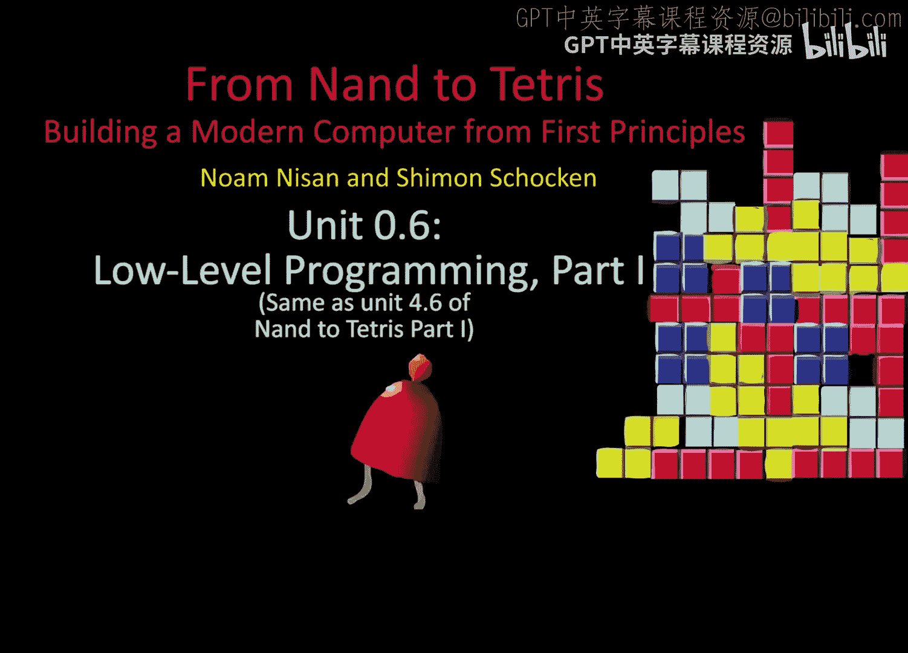

# 从零开始构建现代计算机2：单元0-6：底层编程第一部分



在本单元中，我们将开始学习如何使用Hack机器语言进行底层编程。我们将重点介绍寄存器和内存的基本操作，这是所有底层程序的基础。

## 概述

现在你已经熟悉了Hack编程语言，是时候看看我们能用这种语言做什么了。在接下来的三个单元中，我们将讨论底层编程这个广泛的主题，特别是Hack机器语言的编程。在开始之前，我们先来概述一下Hack语言中的两种指令。

我们有两种指令：
1.  **A指令**：用于将A寄存器设置为一个特定的值。
2.  **C指令**：用于做三件不同的事情：计算一个表达式、将计算结果存储到某个目的地，以及根据计算结果决定是否跳转到程序的其他区域执行（即执行`goto`操作）。

这种语言是符号化的，由助记符组成。但计算机只理解0和1，因此在执行任何用符号化Hack机器语言编写的程序之前，我们必须先将其翻译成二进制代码。这个翻译工作通常由一个叫做**汇编器**的程序来完成。

汇编器接收一个用符号语言编写的文件，并将其翻译成另一个文件，这个文件同样用符号表示，但这些符号只有0和1。生成二进制目标代码后，我们就可以将这个文件加载到Hack计算机中并最终执行预期的程序。

这是Hack汇编器。在本课程的第六周，我们实际上会构建这样一个汇编器。但现在，你只需要知道如果你需要使用它，它是可用的。

将符号程序翻译成二进制代码的另一个选项是使用提供的CPU模拟器。你可以将任何用符号化Hack语言编写的程序直接加载到CPU模拟器中。CPU模拟器是一个Java程序，它有一个图标允许你将文件加载到指令内存中。当你将这些文件加载到指令内存时，CPU模拟器会实时地将程序翻译成机器语言。一旦完成，你就可以在CPU模拟器中执行程序。因此，CPU模拟器是一个用于调试和模拟执行Hack程序的非常友好的工具。我们建议，如果你想尝试本小节中看到的代码片段，请使用提供的CPU模拟器。

那么，当我们谈论底层编程时，我们指的是什么呢？令人惊讶的是，我们指的是你在任何编程语言中都会遇到的一整套问题，比如处理内存和变量、分支、迭代、指针、输入和输出。这些惯用法在任何编程语言中都广泛使用，Hack机器语言也不例外。在本单元中，我们将开始讨论寄存器和内存。在后续单元中，我们将讨论其他稍微更高级的主题。

## 寄存器与内存操作

寄存器和内存是底层程序的基础，也是你经常需要操作的对象。我们主要操作两种位于CPU内部的标准寄存器：**D**和**A**。

*   **D寄存器**（数据寄存器）可以保存一个16位的值。
*   **A寄存器**可以保存一个数据值或一个地址，具体取决于程序员想要如何使用这个寄存器。
*   最后，我们使用字母**M**（助记符）来指代当前选中的内存寄存器。

A寄存器有一个很好的副作用：当你给它加载一个特定值时，它最终会从RAM中选择一个寄存器。这个寄存器在我们的语言中被称为M。因此，我们可以执行类似`M = -1`或`M = 0`等操作。

这些就是我们将要操作的主要寄存器。以下是一些我们可以用这些寄存器实际完成的操作示例。

以下是几个基本操作的代码示例：

1.  **将数字10存入D寄存器**：没有直接的方法可以做到这一点。我们需要间接操作：先将A寄存器设为10，然后将A的值赋给D。
    ```
    @10
    D=A
    ```

2.  **将D寄存器的值加1**：这可以直接用一条指令完成，因为C指令允许我们计算`D+1`的值，然后将结果存回D。
    ```
    D=D+1
    ```

3.  **将D设为RAM[17]的值**：要访问特定的内存寄存器，首先必须寻址（选中）该内存。我们先执行`@17`，然后设置D为所选寄存器的值。
    ```
    @17
    D=M
    ```

4.  **将D的值存入RAM[17]**：操作与上一条相反。
    ```
    @17
    M=D
    ```

5.  **将RAM[17]设为10**：这可以通过组合之前的操作来完成。首先获取常数10，然后将其存入RAM[17]。
    ```
    @10
    D=A
    @17
    M=D
    ```

6.  **将RAM[3]设为RAM[5]**：同样可以使用类似的操作组合。
    ```
    @5
    D=M
    @3
    M=D
    ```

你可以暂停视频，仔细查看这六个代码示例，并确认它们完成了预期的功能。

## 一个完整的程序示例

现在，让我们将这些内存和寄存器操作放到一个实际的程序上下文中。

这里有一个程序，旨在将两个数字相加并将结果存储在内存中的某个位置。我们假设在用户运行此程序之前，用户已将两个值（例如5和7）放入RAM[0]和RAM[1]中。运行此程序后，程序将这两个数字（本例中为5和7）相加，并将结果存储在RAM[2]中。如果一切正常，RAM[2]将包含12。选择RAM[0]、RAM[1]和RAM[2]只是任意的决定，我们决定使用RAM[0]和RAM[1]作为程序的输入，RAM[2]作为程序的输出。

我们是如何做到的呢？你可能已经猜到，我们使用了与之前非常相似的操作。

```
// 将两个数字相加
// 使用说明：将想要相加的值放入RAM[0]和RAM[1]
// 结果：RAM[2] = RAM[0] + RAM[1]

    @0
    D=M          // D = RAM[0]
    @1
    D=D+M        // D = D + RAM[1]
    @2
    M=D          // RAM[2] = D
```

如果我们运行这个程序，希望它能计算出RAM[0]和RAM[1]的和。

在继续之前，我想提醒你，Hack语言中的指令有隐含的行号。你在编写程序时看不到它们，但这些数字潜藏在后台。当你翻译这个程序并将其加载到内存中时，有一些有趣的观察需要做。首先，空白行会被忽略。真正起作用的只有那些有行号的“真实”指令。此外，重要的是要记住，我们在指令内存中看到的是这个程序的符号化视图。这样的程序本身不能在计算机上执行，因为计算机除了0和1之外无法处理其他符号。但如果你使用我们的CPU模拟器，你可以告诉模拟器以二进制形式显示指令内存的内容。如果你这样做，你会看到程序以这种形式呈现。在这种状态下，程序实际上可以在计算机上执行。然而，通常来说，当程序以符号形式编写时，思考、讨论和调试程序要容易得多。因此，我们建议你在尝试理解程序在做什么时，以符号形式进行。只有当你准备运行它时，如果你愿意，可以看一下二进制代码。但解码二进制代码在做什么是非常困难的。我们很幸运拥有所有这些符号，使我们的程序更具可读性。

考虑到这一点，我想调用CPU模拟器，并演示这个程序是如何实际执行的。

这个演示的目的是说明如何用Hack符号语言编写一个小程序，然后在CPU模拟器上运行它。

（演示过程：编写程序、保存、加载到模拟器、设置RAM[0]=5和RAM[1]=7、逐步执行指令、观察D寄存器和RAM[2]的变化，最终RAM[2]变为12，程序成功运行。）

## 程序的正确终止

看过我们刚刚进行的演示，以及在这个演示结束时遇到的问题后，让我们看看如何正确地终止一个程序。提醒一下，我们遇到的问题是指令流变得有些失控。基本上，我们告诉计算机执行每一条指令，一切都很顺利，但随后所谓的“空指令”开始起作用，计算机基本上就失控了。

如果我是一个黑客，一个坏的黑客，看到这种执行模式，我可能会说，也许我可以写一些恶意程序，把它放在这个内存下游的某个地方，然后让用户天真地运行他的程序。用户会愉快地运行他的程序，程序会做它应该做的事情，但随后在不知情的情况下，计算机会继续执行，然后“砰”的一声，我的程序就开始工作，开始做一些坏事，比如删除用户电脑上的随机文件。

那么，我们该如何避免这个潜在的问题呢？顺便说一下，这种特定的攻击被称为**空操作滑行**。空操作代表空指令或无操作码。我们从指令6开始往后的内容就是空指令。一个坏的黑客可以利用这些指令将控制流“滑行”到他控制的内存区域，然后就可能发生坏事。我们该如何避免这个问题？一般来说，我们该如何正确地终止一个程序？

有一件事你必须明白：计算机永远不会静止不动。它们总是在做些什么。即使你不碰键盘，后台也有许多进程在运行。在Hack计算机中，因为我们不希望计算机做疯狂的事情，我们不妨让计算机做一些我们控制的事情。所以，我们可以做的是用一个**无限循环**来结束程序。

我们可以添加两条命令，比如`@6`，然后在第7行，跳转到第6行。这样我们就有了一个无限循环，一切都在控制之中，因为这是我们有意让程序做的事情。因此，作为一个最佳实践建议，我们建议你用无限循环结束你的每一个程序。

```
    @END
    (END)
    0;JMP // 无限循环，程序在此终止
```

## 语言的内置符号

在本单元结束之前，我想谈谈我们尚未讨论的该语言的另一个特性。通过说明这一点，我将基本完成Hack机器语言的规范说明。该语言具有几个内置符号，如下所示。

首先，我们有一组16个所谓的**虚拟寄存器**，或者更准确地说，我们有一组16个标签，我们像使用虚拟寄存器一样使用它们。这些标签的范围是从`R0`到`R15`。

约定是这样的：每当汇编器或翻译器看到像`R3`这样的标签时，它会用数字`3`替换它。仅此而已。

你可能会问，为什么我们需要这些花哨的标签？这里有一个例子可以说明这些标签如何发挥作用。

这是一个非常简单的代码片段，我们将`RAM[5]`设置为`15`。

```
// 版本 A：直接使用数字地址
    @15
    D=A
    @5
    M=D

// 版本 B：使用虚拟寄存器标签
    @15
    D=A
    @R5
    M=D
```

让我们仔细阅读这里发生了什么。在第一对指令中，我们将A寄存器用作数据寄存器，将数字`15`放入A，然后将其移动到D。在第二对指令中，我们做了一些非常不同的事情：我们使用`@5`命令来寻址内存，选择内存寄存器5号，然后执行`M=D`。

这段代码有些令人困扰。首先，我们做了两件非常不同的事情，却使用了完全相同的语法`@数字`。我认为这有点令人不安。另一个有点麻烦的问题是，当你读一条单独的A指令时，在看到下一条指令之前，你无法知道程序员想做什么。

那么，我们如何让这件事更具可读性呢？我们的建议是：每当你想寻址内存中前16个寄存器之一时，使用标签约定。这样，任何阅读你程序的人（包括你自己）都能确切知道你想做什么。因为机器语言程序很难阅读和理解，所以我们必须尽一切努力使其更具可读性，以便你在一周或两周后再次看到你的程序时，能知道程序在做什么。所以在右边看到的第二个例子中，与左边的相比只有一个很小的区别，但它更具可读性，并且程序将有效地做完全相同的事情，因为一旦被翻译，`R5`将变成`5`，然后我们又回到了之前的状态。这就是我们推荐使用这些所谓虚拟寄存器的动机。

有一件事你必须注意：像许多其他编程语言一样，**Hack是区分大小写的**。大写的`R5`与小写的`r5`是不同的。我们建议你记住这个观察结果，因为如果你忘记了它，可能会导致各种非常奇特的错误。将来，如果你的程序没有语法问题，但你不知道这个程序在做什么，很可能是因为你拼错了某个符号。所以，当你运行自己的符号程序时，请把这一点记在心里。

语言中还有哪些其他符号呢？我们还有`SCREEN`和`KEYBOARD`，我们在之前的一个单元中讨论过，它们代表屏幕和键盘内存映射的基地址。

我们还有一组六个额外的符号，我们在本课程中并不真正使用。让我总结一下Hack语言中的内置或预定义符号：我们有16个虚拟寄存器，有两个代表输入/输出映射基地址的符号，还有一组六个符号。这些符号供那些想在Hack平台上编写虚拟机和高级语言编译器的人使用。这实际上是我们本课程第二部分（称为Nand2Tetris Part 2）中要做的事情，但在本课程中我们不会使用这六个寄存器。

## 总结

在本单元中，我们一起学习了Hack底层编程的基础，重点是寄存器和内存的操作。我们了解了A指令和C指令的基本用途，学习了如何通过直接或间接的方式操作D、A寄存器和RAM。我们通过一个完整的加法程序示例，演示了如何编写、加载和运行一个简单的Hack程序。我们还讨论了程序正确终止的重要性，并介绍了使用无限循环作为标准做法。最后，我们介绍了Hack语言的内置符号，特别是虚拟寄存器（`R0`-`R15`），它们能显著提高代码的可读性。记住，Hack语言区分大小写，这是避免错误的关键点。


下一单元，我们将探讨分支、变量和迭代，进一步扩展我们的底层编程技能。