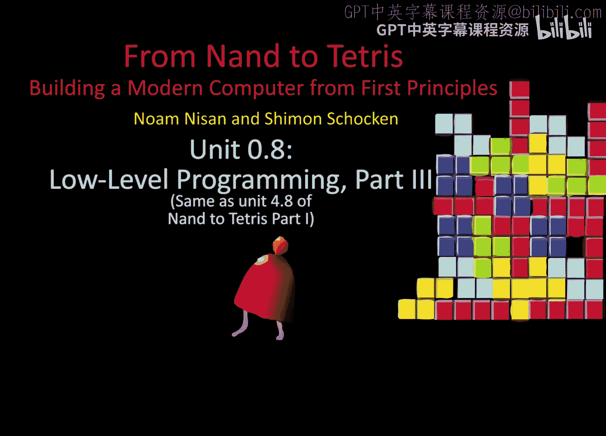

# 耶路撒冷希伯来大学《从零开始构建现代计算机2｜Build a Modern Computer from First Principles》中英字幕 p11 11_02_10_单元0-8_底层编程第三部分.zh_en -BV1DA4m1w7FU_p11-

In the previous two units， we talked about working with registers in memory， branching， variables。

 iteration。And what remains to be done in order to complete our survey of he programming is talk about how we handle something called pointers and how we write programs that manipulate our input and output devices。

 So that's what we'll do in the current unit。 Let us begin with pointers。

 And as usual I would like to start with an example in which pointers come to play。In particular。

 I want you to consider this very simple piece of code that many of you have written in at least those of you who took programming courses before before N to Tetriris so in this code segment I manipulate an array called ARR。

 I assume that this array has been declared and initialized at some point。

 and now I write a piece of code that sets the first n entries of this array to the value minus1。

If you write with a regular high level language， it's very easy to write such such a statement。

 such a false statement， and as you know by now， when you have to bring it down to the level of machine language。

 you have to work much harder to deliver the the required functionality。So how do we do it。Well。

 one thing that you have to realize。 and in fact， you realize it only when you set out to write a compiler。

Is that。The notion of arrays。Gets lost in the translation， so to speak。

So when the assembler has completed to translate this piece of code from， let's say。

 Java or Python into machine language， the machine language no longer recognizes the array obstruction and as far as the machine language is concerned。

 the array is just a segment in memory of which we know the base address of this segment and the length of the array that the programmer has decided to declare。

So if we assume that the array starts in address 00 and that we want to do something to the first 10 entries of this array。

 this is how it's going to look like in the data memory on which this program will end up executing。

We start with。2 variables。 One of them holds the base address of the array。

 and the other one is the number of entries that we want to manipulate。

 And what we would like to see is that at the end of the execution of this program。

 We would like to see the first 10 entries of this array set to -1。 This is the goal。 Thats。

 that's what we want to do。 And the question is， of course， how do we， how do we actually do it。

Alright， so let's start working on this on writing this particular program。

The beginning of the program is going to set up these variables that we just discussed。

 So we assign the number 100 to ARR to signify that the array。

 ARR begins in the memory register number 00。 and we do something similar with n。

 we assign the number 10 to n。 we initialize I to0。

 you know once again don't forget we are trying to deliver the functionality over 4 loop that begins with I equals 0。

 so we set I to 0， and then we can start actually doing going through the loop， so to speak。

 So once we do these three variable declarations and assignments。

 we have this setting ARR N and I allocated to memory registers。167， and 18。

 and we are ready to begin the actual processing。All right， so here is the actual processing。

The first segment of the loop and by the way we realize the for loop using a machine language oriented loop which begins with a label declaration called the loop and the first thing that we do is we translate the termination condition into a machine language so what used to be if I equals n go to n which is you know the end of the processing because once I you know what is I I begins with zero and go through one。

23 when when it gets to 10 in our example， we want to jump to n。

 so we have six he instructions that actually perform this semantics。

 and then we come to the heart of this loop in which we actually assign the number minus-1 which is meaningless by the way we just use it as an example we assign minus-1。

To the current entry of the array， How do we do it。Well， let us begin with a comment， you know。

 as you see， what we are doing is we are computing the value of ARR plus I。

 which is the value of the base address of this array plus the current value of the index。 Now。

 if the index begins with0。Then the first entry that we're going to operate on is RAM 100 because ARR is 100 and then I will become1 so we'll operate on Ram 101 and then I becomes2。

 will' operate on Ram 102 and so on and so forths。 How do we do it Well。

 we have to add up ARR and I and that's exactly what we do in the first for instructions。

 we say at ARR， know we address the variable called ARR， we put the value of this variable in D。

 and we say at I， we address the variable I， we add up D plus M and we put the result in the A register。

Now， this is something which is new to should be new to you because it's the first time that we actually use this capability of the language to assign something directly to a using an arithmetic operation。

Okay，Now what will happen when we do it Well， D plus M now store an address。

 So this address is assigned to a。 and by the time we say M equals -1。

 the register that will be affected is the register that a addresses。Now。

 if we do this within a loop that runs 10 times or 10，000 times in each iteration。

 the a register will acquire you know one more address and we are going to operate on a different register in the memory。

 and that's exactly what we want to do。So after we run so many iterations。

 we'll get the desired effect。And as usual， we recommend that you stop the video and convince yourself that this is actually working as as advertised。

 So variables that store memory addresses like AR R and I are called pointers in in any language。

 not not only in in he。😊，And in he， the typical logic is as follows。

 When we have to access memory using a pointer， we need some instructions like a equals something。

 something that comes from some memory register。 So the typical semantics is set the address register to the value of some memory register in which。

I do some pointer arithmetic to compute the address on which I want to operate。 Okay。

 so this in a nutshell is how we do pointer processing in in the he machine language。

In the next part of this Cate， in the next and final part of this C8。

 we will see how pointer manipulation comes to play in the when we write code that interacts with a screen and with other similar peripheral devices。

 All right so let's talk about input output。First of all， if you recall。

 we have two standard input and output devices。 We have a display unit it and a keyboard。

 and these I O devices are。Connected so to speak to two designated area in the Ram。

 One of them is called the screen memory map。 And these are 8 K of bits that represent about 13000。

Pixels on the physical display on it。 And we have a keyboard which is connected to yet another area on the memory called which we call keyboard。

Alright， so we also have these labels that record the base addresses。

 So we don't really have to remember any actual number when we set out to process。

The screen and the keyboard。Alright， so here's an example of using the screen and in particular。

 using the screen to draw a rectangle。 You know， this is like the hello world of computer graphics。

 drawing a rectangle。 How do we do it。Well this is a screenshot of our CPU emulator。

 I want to remind you that what we see here is the ro the instruction memory on the left data memory next to it。

 and then we see some simulation of a physical screen we see it in the top right hand side and the task in front of us is to draw a filled rectangle at the upper left corner of the screen and the dimensions of the rectangles are such that it has to be 16 pixels wide and Ram zero pixels long。

So RamM0 is a parameter of this program and if you look carefully at the top of the Ram in this slide。

 you will see that Ram0 has been set by the user to 50。

 So once the user puts some number like 50 in Ram0 and clicks the play icon what will happen is that the program will start running and at the end of its execution which is going to be very quick you're going to see a rectangle drawn at the top left of the screen。

 the rectangle is 16 pixels Y， this is a fixed width and the length is variable according to the input of the user。

 So this is the mission that's what we have to do。Before we look at the actual code。

 let us go into the CPU emulator and actually demonstrate this program working and then once we do it we'll talk about the code proper。

The purpose of this demo is to illustrate how we can load and execute a program that draws a rectangle at the top left corner of the screen。

So what we have here is two windows in the foreground I have the CPU emulator and in the background I have a plain text editor with the program in question loaded already into it。

 the program has been written if we read the documentation we see that the program claims to want to draw a rectangle at the screentop left corner and hopefully that's also what the commands of the program are actually doing。

We can scroll through this program and see all sorts of familiar hackCC commands written in the symbolic hackCC machine language。

 along with documentation and white space to make the code more readable and manageable。

So let's go to the CPU emulator and click the load program button， which is right here。

And look for this program， rectangle ASM here it is。Found it。Loading it。

And it's interesting to contrast the source code with what was actually loaded into into the CPU emulator。

 So let's take this window and put it right next to the loaded code。

 We see that the source contains all sorts of symbolic addresses， like at R 0。At N and so on。 Now。

 all these symbolic addresses are being translated on the fly into their concrete numeric semantics。

 So if we look at the code that was actually loaded into。The CPU emulator， instead of at R 0。

 we see at0 instead of at N， we see at 16 and so on and so forth。

 according to the rules of translation of hec symbolic programs into machine language。

 this is something that we are going to learn in unit 6。 so please don't worry about it for now。

 if you want to understand how a program works in the CPU emulator。

It's better to look at the source code and not at the code that was actually loaded into the emulator。

 so you run the program in the emulator， but you inspect and debug it in the text editor and then you reload the corrected version in order to continue to test it。

Alright， so let's put this window roughly back where it was before。And go back to the CPU emulator。

 And once again， the program is loaded。 We are told that we have to determine。

The depth or or the length of the rectangle by filling in some number in Ram 0。 So let's do that。

 And I'm going to put here the number 50。So we are going to draw a rectangle which is 16 bits or 16 pixels wide and 50 rows long。

 hopefully that's what the program is going to do so I can start executing the program by clicking this play button and each time I click a play button I execute the next command in the program and so far nothing seems to happen but perhaps we have to be slightly more patient and indeed we see that we drew one line of 16 pixels at the top left corner of the screen。

 Very nice So let's continue to execute and looks like there was a loop in the program and I'm doing it slightly more quicker and I see that I drew another line and keep on drawing another line。

Another line and so on and so forth， if I get tired of this stepwise simulation。

 I can click the fast forward and then I can just sit back and watch the program get executed。

This is fairly slow， so I can make it faster by using this slider here。

And I see now that the program runs much quicker。Then before， and it keeps on drawing rows until。

The counter of these rows will reach Ram0， which now happens to be 50。And that's it。

 we got this limit and at that stage the program executed some go to command that sent it to the end of the program where it runs an infinite loop。

 and that's exactly what I want to do at the end of every heck program。

 So once I get tired of seeing this infinite loop， I can stop the program look at the screen and convinces myself that the program has actually done what it was supposed to do。

 Now let's scroll back to the top。Of the program。And we can try some other input， let's say， 70。Or。

 let's even make it more。A larger number。 So we're going to draw。A rectangle which is 120 rows long。

 and if I'm tired to see all this animation， I can click this control here and cancel the animation at least temporarily。

And then I reset the program。And once I have cancelled animation， I can simply click fast forward。

 sit back and watch the program execute in an instance。 So let's do that。And as you see。

 a rectangle of 120 rows by 60 pixels has been drawn so-called instantaneously， of course。

 as a lowleve programmer， you know that this program required 120 iterations and in each iteration we had to execute several machine level commands。

 so this has been a demo in which we illustrated how to use the CPU emulator in order to execute a graphics oriented program。

Alright， so now that we saw that the rectangle drawing program actually works。

 let's take a look at how， how we actually do it。 And we'll start withda code， because once again。

 if you， if you get yourda code right， it's like 90% of the job done because the rest of it is translating thesda code into machine language。

 which is a relatively technical thing to do。 Alright， so。😊。

Let us focus on some subset of our CPU emulator screenshot on the right hand side we see the physical screen with a rectangle already drawn and on the left hand side we see the RAM and in particular we focus on the area of the RAM。

 which is the top of the screen memory map。And as a programmer。

 we are not terribly interested about the physical screen。

We cannot manipulate the physical screen directly， but what we can do is manipulate the screen memory map。

 And because we have this contract that whatever we write into the memory map is going to be reflected on the screen。

 we know that we can indirectly manipulate the screen and do whatever it is that we are asked to do。

Alright， so here's the pseudoda code of writing this rectangle。

 Basically we have to implement a for loop。 we have to say that you know for I goes from 0 to n where n is the value of Ram0。

 that's what the user， the number of rows that the user wanted to fill with 16 pixels。

 well for every one of these i values， we want to draw 16 black pixels at the beginning of row I。

So the rows go from， let's say，0 to 49。 and then we'll get the desired rectangle。 How do we do it。

 Well， we translate this semantics into pseudo code and we get something like the following。

We begin with some base address， which I call it ADDR。

 Actually this is going to be a running address that I'm going to use。

 So at the beginning ADDR equals screen n equals Ram0。

 you know I don't want to destroy Ram0 so I save it in a nicely in a variable that I declare to be n and then I set I to0 to count how many iterations I did so far。

 I can actually do it without this variable but I decided to do it with this variable as well。

 and here's the loop that we're going to use。As long as I。Has not reached N。

I want to set Ram AD DDR to -1。And then I want to set up for the next iteration。

 in the next iteration， I'm going to move within the memory map to the word that represents the beginning of the next line。

 and I'm going to increment I to remember where I am in the loop。

 and then I'm going to repeat this thing n times。Okay， why-1。

 Well we discussed it when we looked at the simulation，-1 in binary is 16 ones。

 which will represent 16 black pixels。 Now why do I have to to jump in this offsets of 32 because that is the way that the screen memory map is mapped on the physical screen we use the first 32 words in the map to represent an entire row of 512 pixels。

 and then we use the next 32 words to represent the next row and so on and so forths you know32 times 16 gives you 512 pixels。

 which is one row in the physical display unit， And because we're interested only in the first 16 pixels in each row。

 we can safely jump from the current word。The current word plus 32 or the index of the current word plus 32。

So this soda code should deliver the rectangle drawing and what remains to be done is to simply translate thissoda code into machine language this is by now by this stage of the course or by this stage of the lectures in this week。

 this is a relatively straightforward task I have split the program into two different fields on the screen and you can stop the video。

 at look at the code convince itself that it does what thesoda code on the previous slide advertised to be doing and one you know area of the code which is kind of interesting is this area in which I finally computed the address on which I want to operate I set this address。

Into the a register and then I operate on this particular memory register register and set it to minus1 This is very similar to what we did previously with with the pointers and it is yet another example that shows you the power of pointer manipulation。

So we basically do something very similar to what we did before。 we manipulate an array。

 but we now have all the nice side effects of what happens when you manipulate not just the regular array。

 but an array which happens to be a subset of the screen memory map。

 you get the side effect that whatever you do in the memory map is reflected on the physical screen and if you know what you're doing。

 you're going to end up drawing a rectangle。 If you don't know what you're doing。

 you're going to end up drawing something crazy， which will be interesting as an experiment。

 but then you have to debug it until youll get the desired rectangle or whatever other。

Figure you were asked to draw。So this has been the end of the the course part in this unit in which we talk about working with a screen。

 and I'd like to say a few words about working with a keyboard。And as you recall。

 the keyboard is the standard unit with which we interact with the user。

 with the user with which we acquire inputs from the user。

 so how can we write code that manipulates the keyboard？In previous units。

 we discussed how the keyboard is connected to the computer and in particular。

 the keyboard is connected to a certain register， which in the overall address space of the memory happens to be register number 24576 in the he computer architecture。

 So this register is the keyboard memory map and the setting is such that if the user presses any key on the physical keyboard。

 this scan code of this key appears in the keyboard memory map in this designated register。

 So with that in mind it's quite obvious what you have to do as a programmer in order to figure out what the user is doing with the keyboard you have to write code that accesses this particular register and inspects it。

 So to check which key is currently processed you read。Contents of the RA in address 24。

576 you don't really have to use this difficult to remember number because this number also happens to be the value of the predefined label keyboard so all you have to do really is say something like@ keyboard D equals M and then the deregister will contain the scan code that the user is currently pressing Now I wish to remind you that if the register contains0 it means that the keyboard is idle and the user is not really using it otherwise it contains the scan code of the presently pressed key。

Now this is very very lowlevel programming you know all we know is which key the user is pressing normally when you write computer programs。

 you want to let the user enter you know complete strings like a login or a password or something like that。

 so you have to accumulate several keys until the user presses enter or something like this writing code like this in low-level language is very tedious and that's why we normally do it in a high-leve language and then after we compile it into machine language we get the desired effect but at the level of programming that we do now all we want to know is once again which key the user is presently pressing。

So that's it。 We completed discussing our survey of heCC programming。 We talked about。You know。

 the classical things that we do with every programming language， working with registers， branching。

 variables， iterations， pointers， inputs and outputs。

 and this basically wraps up to do about what we want to say about low level programming。In closing。

 before we end this unit， I'd like to say a few words about compilation in general because we got very close to the notion of compilation in some of the examples that we saw this and in previous units and in particular。

You know we explained how we write a piece of code like this one in the low level of machine language and moving from one to the other is exactly what a compiler is designed to do so the compiler allows you to live so to speak within the abstractstruction of a high-level language without worrying about all the details of how this thing gets translated into machine language but by now you know that in order to do it in low level you have to work really hard to rewrite the code using within the constraints of the lowlevel language Now in the second part of the course Nanttoteris part2。

 we will actually write such a compiler we will write a compiler that can take any program that is written in a highlevel language object-based language similar to the languages that you use。

In your regular programming courses and we'll write a compiler that translates from this high level into the low level in the process we will use a virtual machine and we will use the services of a host operating system。

 and if you want to learn all these very interesting layers of obstruction。

 well you have to take or you're invited to take the second part of this course。All right。Finally。

 I think that by now， you are convinced that low level programming is， first of all， its。

 it's a very low level。 You have to work directly with the machine， but it's also。

Because it is so minimal and so spartan and because it is so fantastically expressive。

 it is also a very profound and subtle thing to do writing programs in machine language is profound is subtle and it's intellectually challenging。

😊，And。It kind of reminds me of a saying that I heard somewhere。

 which I think is very is very correct。 And the saying is that。

Simple-minded people are impressed by sophisticated things and sophisticated people are impressed by simple things and in particular。

 when the simple things are fantastically expressive， they are very impressive。

 And if you think about it， the hec language has two commands only it has the ability to represent symbols and that's it。

 And yet with this very Spartan capability， I can execute any program that comes to your mind。

 any program written in any high level language can be translated into a hec program that does exactly the same thing and this I think is rather satisfying。

😊，So this has been the end of our survey of heCC programming and in the next unit you are going to come to play。

 you're going to write some programs on your own and we'll give you some tips on how to do it easily。

