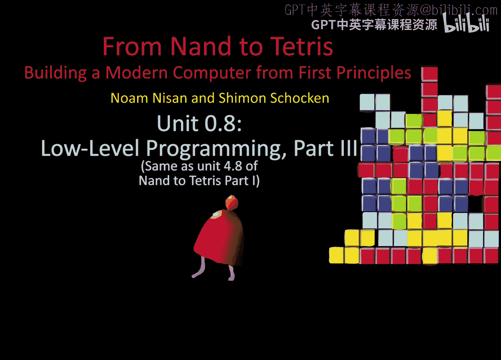

# 从零开始构建现代计算机2：单元0-8：底层编程第三部分 🖥️



在本单元中，我们将完成对Hack汇编语言编程的概览。上一节我们介绍了寄存器操作、分支、变量和迭代。本节中，我们将探讨如何处理**指针**，以及如何编写与输入/输出设备交互的程序。

## 指针处理

让我们从一个指针发挥作用的例子开始。考虑以下这段许多人在高级语言中写过的简单代码：

```c
for (int i = 0; i < n; i++) {
    arr[i] = -1;
}
```

这段代码将数组 `arr` 的前 `n` 个元素设置为 `-1`。在高级语言中这很简单，但在机器语言层面，我们需要更努力地实现这个功能。

首先需要认识到，数组的概念在翻译到机器语言时会“丢失”。对于机器语言而言，数组只是内存中的一个段，我们知道这个段的基地址和数组长度。

假设数组从地址 `100` 开始，我们想操作其前 `10` 个元素。在数据内存中，它看起来是这样的：

*   **`arr`**： 存储数组的基地址（例如 `100`）。
*   **`n`**： 存储要操作的元素数量（例如 `10`）。
*   目标是将内存地址 `100` 到 `109` 的内容设置为 `-1`。

以下是实现此功能的Hack汇编程序：

```
// 初始化变量
@100
D=A
@arr
M=D        // arr = 100 (数组基地址)
@10
D=A
@n
M=D        // n = 10
@i
M=0        // i = 0

(LOOP)
// 检查循环终止条件：if i == n goto END
@i
D=M
@n
D=D-M
@END
D;JEQ

// 核心操作：arr[i] = -1
@arr
D=M        // D = arr (基地址)
@i
A=D+M      // A = arr + i (计算目标地址)
M=-1       // RAM[A] = -1

// 递增索引 i，准备下一次迭代
@i
M=M+1

// 跳回循环开始
@LOOP
0;JMP

(END)
@END
0;JMP      // 无限循环，程序结束
```

程序的核心在于 `@arr` 和 `@i` 这两行。我们首先将基地址 `arr` 加载到 `D` 寄存器，然后加上当前索引 `i` 的值，并将结果（目标内存地址）存入 `A` 寄存器。随后，`M=-1` 指令就会将 `-1` 写入 `A` 寄存器所指向的内存位置。

像 `arr` 和 `i` 这样存储内存地址的变量，在任何语言中都被称为**指针**。在Hack中，使用指针访问内存的典型逻辑是：通过一些指令（如 `A = 某个值`）将地址寄存器设置为某个内存寄存器的值，通常还会进行指针运算来计算要操作的目标地址。

## 输入/输出处理

接下来，我们看看指针操作如何应用于编写与屏幕、键盘等外围设备交互的代码。

首先回顾一下，Hack计算机有两个标准的I/O设备：一个显示单元和一个键盘。它们分别映射到RAM中的两个特定区域：
*   **屏幕内存映射**： 一块8K的内存区域，对应物理屏幕上约13,000个像素。
*   **键盘内存映射**： 一个单独的内存地址，对应键盘的输入。

我们无需记住具体的数字地址，因为汇编器提供了预定义的标签（如 `SCREEN` 和 `KEYBOARD`）来表示这些区域的基地址。

### 屏幕操作示例：绘制矩形

一个经典的图形编程“Hello World”是在屏幕左上角绘制一个实心矩形。假设矩形的宽度固定为16像素，高度由用户存储在 `RAM[0]` 中的值决定（例如 `50`）。

程序的目标是：根据 `RAM[0]` 的值，在屏幕顶部绘制相应行数的16像素宽的黑条。

在深入代码之前，理解其工作原理至关重要：我们无法直接操纵物理屏幕，但可以通过写入**屏幕内存映射**来间接控制它。内存映射与物理像素之间存在固定对应关系。

以下是绘制矩形的伪代码：

```
n = RAM[0]          // 用户指定的矩形高度（行数）
addr = SCREEN       // 屏幕内存映射的基地址
i = 0

while (i < n):
    RAM[addr] = -1  // -1的二进制是16个1，表示16个黑色像素
    addr = addr + 32 // 移动到下一行的起始地址（每行32个字）
    i = i + 1
```

为什么地址增量是32？因为屏幕内存映射使用连续的32个字（每个字16位）来表示物理屏幕的一整行（512像素）。要绘制下一行的前16个像素，就需要跳过这32个字。

将上述伪代码翻译成Hack汇编语言，其核心部分与之前处理指针的示例非常相似：计算目标地址（`SCREEN + i*32`），将其加载到 `A` 寄存器，然后向该内存位置写入 `-1`。通过循环执行此操作，即可在屏幕上绘制出矩形。

### 键盘操作

与键盘交互则相对直接。键盘的状态被映射到内存中的一个特定地址（`RAM[24576]`，或使用标签 `KEYBOARD`）。

要检测用户当前按下了哪个键，只需读取该内存地址的内容：

```
@KEYBOARD
D=M  // D寄存器中现在包含了当前按键的扫描码
```

如果 `D` 的值为 `0`，表示键盘空闲，没有按键被按下。否则，`D` 中的值就是当前被按下键的扫描码。

需要注意的是，在底层进行编程时，我们通常只能获取**当前瞬间**的按键状态。要处理更复杂的输入（如输入字符串、等待回车键等），逻辑会变得繁琐，这正是在高级语言中处理此类任务更为方便的原因，编译器会帮我们处理这些底层细节。

## 关于编译的思考

通过本单元及之前的示例，我们已经非常接近“编译”的核心概念。我们展示了如何将高级语言代码（如 `arr[i] = -1` 或绘制矩形的循环）翻译成底层的机器语言。

**编译器**正是完成这项转换工作的工具。它允许程序员在高级语言的抽象层面进行思考和工作，而无需操心所有底层实现的细节。然而，正如我们所看到的，要在底层实现这些功能，必须在低级语言的约束下进行大量细致的工作。

在本课程的第二部分（Nand2Tetris项目第二部分），我们将亲手编写这样一个编译器。它将能够把用高级面向对象语言（类似于你日常使用的编程语言）编写的程序，翻译成Hack汇编语言等低级语言。在这个过程中，我们还会用到虚拟机和宿主操作系统的服务。如果你想深入了解这些有趣的抽象层次，欢迎继续学习本课程的第二部分。

## 总结与感悟

本节课中，我们一起学习了Hack汇编语言编程的最后两个核心概念：**指针**和**输入/输出处理**。

*   **指针**： 我们学习了如何通过内存地址（指针）来间接访问和操作数据，特别是如何通过基地址加偏移量的方式访问数组元素。
*   **I/O编程**： 我们了解了Hack计算机的屏幕和键盘如何通过内存映射与程序交互，并编写了绘制矩形和读取按键的示例代码。

至此，我们已经完成了对底层编程核心要素的概览：寄存器操作、分支、变量、迭代、指针以及I/O。

最后，我想分享一点感悟。底层编程直接与机器对话，看似非常“低级”且简约。Hack语言只有两种基本指令，却能表达任何你能想到的程序逻辑——任何高级语言程序都能被翻译成功能等价的Hack程序。这种在极度简约中蕴含的无限表达能力，是深刻、精妙且充满智力挑战的。

这让我想起一句话：“简单的人为复杂的事物所震撼，而深刻的人为简单的事物所震撼。” 当简单的事物拥有非凡的表达力时，它便显得尤为震撼。Hack语言正是这样一个令人印象深刻的例子。


我们的Hack编程概览到此结束。在下一个单元，你将亲自上阵编写程序，我们也会提供一些让这个过程更轻松的建议。