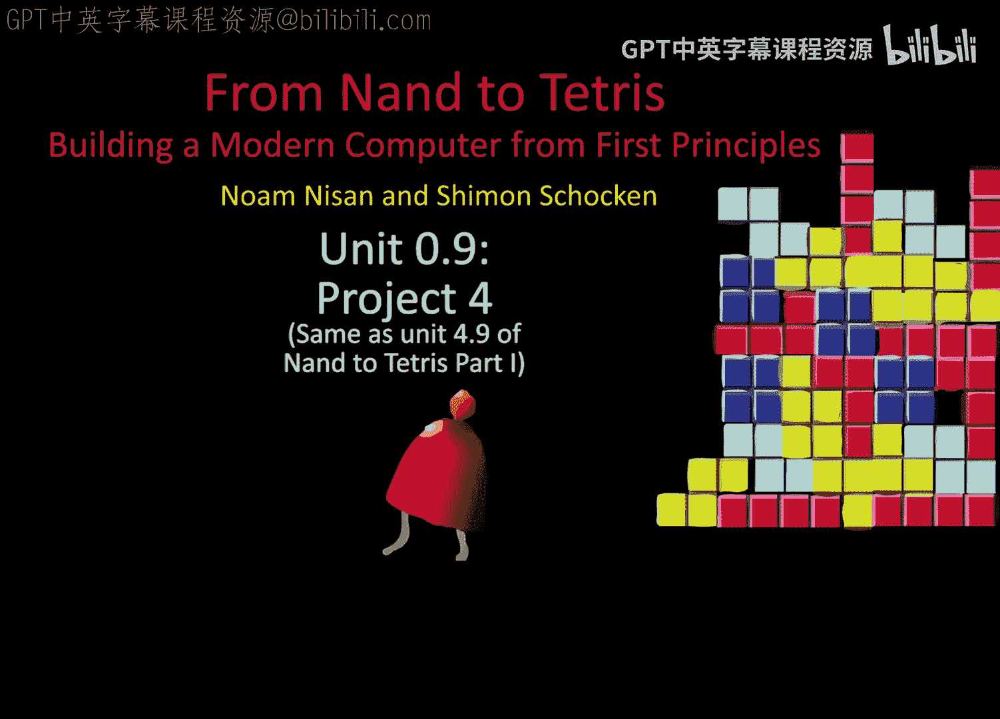

# 耶路撒冷希伯来大学《从零开始构建现代计算机2｜Build a Modern Computer from First Principles》中英字幕 p12 12_02_11_单元0-9_项目4概述.zh_en -BV1DA4m1w7FU_p12-

I wish to remind you that next week we are going to take all the chips and the logic gates that we've built in previous weeks of this course。

 and we are going to assemble them together into a unified hardware platform。

 which we call the hec computer。Now， in order to set up to this very engaging and interesting construction work。

 we decided that this week we have to give you。A good overview of what is it exactly that you're going to build and that's one reason why we decided to explore all these notions of lowlel programming。

 the heck assembly language and the heCC hardware because at this very low level of operation。

 everything is tightly coupled， when you build a computer。

 you have to think about its instruction set， when you design the machine language or the instruction set。

 you have to think about the computer。There's no way to avoid it so once again the purpose of this week was well first of all to expose you to lowle programming。

 but we also wanted to give you a feeling of the harder platform that you are actually going to implement in the next week。

And。This is also the purpose of Project4 in Project4。

 you will write two programs that will let you put your hands on the hardware and program it in a very low level in a level which is almost connected to the machine。

 so we'll do this by writing two relatively simple programs。

 the first program will affect some algebraic manipulation and the second program will interact with the user operating on both the screen and the keyboard。

Allright so without further ado here is the first program which is called malT and the purpose of this program is to compute the product or the multiplication of R0 and R1 so here's a screenshot of this program executing in the CPU emulator in fact it's a screenshot of the end of this program's execution。

 if you look carefully at the top of the RAM you will see that Ram 0 is 6 Ram1 is 7 and RamM2 is 42 and that's exactly what this program is supposed to do to multiply the first two registers in the memory and compute and place the product of these two numbers in RA2 so the assumption is that once the user has loaded this program into the data memory。

The instruction memory， the user also places two numbers in Ram0 and Re1。

Clicks the go button or the play button starts spraying。 And if everything works nicely。

The program will compute the product of these two numbers。On the right hand side in the screen area。

 we see a script that we supply together with this project and the script is designed to test the program using some pairs of numbers that we made up and obviously you can explore the script as well in order to see what kind of tests。

 we are going to subject your program to。And you know this is maybe also the place to point out that in the simulator and in the CPU emulator we use the screen as sort of a multipurpose device。

 sometimes it works as a real physical screen， sometimes we use it as a window to display our test。

 test scripts and so on。All right， so。Once again， in this area you'll see the input。

 the two inputs and the output of the program， and I guess the question that Burns right now is how do we write such a program？

Well。Recall that the hec machine language doesn't have a multiplication operation。

All we have is addition and subtraction， so we are faced with a challenge of expressing multiplication operation using addition and subtraction。

 I don't think that I have to say much more than this。 I can give you perhaps only one more hint。

 You will have to use a loop。And using this loop， you will somehow compute the the result。By the way。

 those of you who will choose to take part two of this course， N to Teris part two。

 will also go through the process of developing an operating system。

And one thing that our operating system is going to deliver to deliver is a math library that features all sorts of mathematical operations。

 and one of these mathematical operations is going to be multiplied。

And the multiplication algorithm that we will use in the operating system is extremely efficient and something that we don't expect you to do in this exercise in this exercise we simply expect you to somehow multiply the two numbers and you know maybe you can try to do it as efficiently as you can but we don't expect you to get out of your way and come up with some very fancy algorithms to carry out multiplication all right。

 so this is the first assignment and the second assignment is to write a simple interactive program。

That performs the following operation。This program。Listens to the keyboard。

And as long as the user does nothing with a keyboard， nothing happens。

But once the user touches a key on the keyboard， any key， you know， once you touch a key。

Look what happens。The program blackens the screen completely。 And once you lift your finger。

From the keyboard， the screen becomes again clear。 You put your finger again on any key on the keyboard。

 key the screen becomes black。You take your finger away， the screen becomes clear。

That's what this program is doing。 It is going through some some sort of an infinite loop。

That listens to the keyboard all the time and acts accordingly。So actually we have here。

Two separate challenges， one of them is to probe the keyboard and understand you know whether or not any key is pressed and the other challenge is to be able to blacken the screen or whiten the screen。

 which is essentially the same operation in one we write a certain value to the memory map and in the other operation we write some other value。

 what makes this exercise somewhat easy is the fact that we operate on the entire。Memory map。

 So we don't have to be picky and select a certain pixels to turn on and off。

 We simply sort of a shotgun approach。 We either turn on all the pixels or turn off all the pixels。

 So in that respect。The program is not terribly complicated and in general it's not really a terribly complicated program。

 but it's kind of fun， it allows you to see how you can control peripheral devices using standard heCC machine language code。

All right， so here is the general implementation strategy， listen to the keyboard。

To blacken or clear the screen， we write code that fills the entire screen memory map with white or black pixels。

And in order to do this， we have to address every register in the memory map and we do it using some sort of a loop that works with pointers。

In a very similar way to what we did in the previous unit when we discussed pointers manipulation。

 so you really have all the firepower that you need in order to implement this particular program。

In order to test this program on the CPU emulator， make sure that the no animation selection is selected and also we cannot provide a test script that test this program or we can。

 but we thought that it would be too complicated so you simply have to test it。As I demonstrated。

 you know， put your finger down， put your finger up。

 and hope that the screen will be blackened or whiteened and so on。You can also think if you want。

 you can think about some fancy ways to blacken or whiten the screen， you know。

 instead of going line by line， you may want to go column by column。

 you may want to create some this will be quite challenging to create some growing you swirll or I don't know。

 you can use your imagination， do whatever you want in order to blacken or whiten the screen and that's actually what is expected from you in this particular program。

All right， I want to describe some general things about the overall program development process or cycle when you want to write programs in the heCC machine language。

First of all， your programs are going to reside within regular text files that you can write with any text editor。

 so you invoke your favorite text editor， you write the program。

 you save it using the extension ASM and by convention we give our program and names that begin with capital letters so you give it a name。

 do ASM and then you load this program as is into the CPU emulator as I explained before the CPU emulator has this very nice service that when you load the program it automatically translates the program into binary code so you can next run the program on the CPU emulator and ask yourself if you're satisfied with the results if so you are done you can submit the program to us and if you' are unsatisfied with the program which will be probably the case。

In the first few iterations of debugging， then you fix the program。

 you look for errors and you fix the errors and you fix them by going back into the text editor。

 you working in the editor saving the program again， reloading it into the CPU emulator and so on。

 so it's quite convenient to have two windows opened on your screen at the same time。

 a text editor here， CPU emulator there and you can easily move between the two but don't forget to load your updated program after you fix it。

The error diagnostics of the CPU emulator is quite primitive。

 so when you load the program into the CPU emulator。

 if there's a syntax error in this program the CPU emulator will simply refuse to load it it will issue some cryptic error message something like oh。

 it will give you some very important information， it will give you the line number with the error or cared and the first error that was found and then you can go into this line number and fix the problem and once you are done with the syntax errors well then the real problems begin。

 you know these are the runtime errors which are much harder to detect and you typically detect them by watching the execution of your program seeing that something that not work properly and then once again you have to go through the same cycle。

Fix your program until it works to your satisfaction。

So this is the general mechanics of developing a program using a CPU emulator and a text editor and as you see。

 it's quite simple and friendly。Alright， finally， I want to say a few words about best practice and advice on dos and don't。

诶。There's no reason really to think about machine language programs as some sort of a strange animal。

 it's yet another example of a programming artifact。

 and all the principles that applied to writing programs in a high level language also apply at the low level we expect your programs to be short。

Or not unnecessarily long。 they should be short。 They should be efficient， They should be elegant。

 and they should be selfdeib。 So we expect you to document the programs but do it by using some judgment。

 you know， don't over document the program the best。

 I think thing to do is simply to look at our examples and to follow something similar。 So you know。

 typically。We use some high level operation to describe， you know， we start a comment。

 we write something like here， we're going to say if I is greater than N go to。

 and then we write the six or seven instructions in machine code that actually implement this semantics。

Now， here are some very important technical tips that will make your life easier。 First of all。

 you must use symbolic variables and labels。You knowOtherwise。

 your programs will be helplessly and hopelessly complex and cryptic so if you want to go to somewhere in your program。

 use a label if you want to store something repetitively make up a variable name so when you're done writing the program you know look at it and make sure that you don't see any actual addresses there。

 you have to make sure that everything is symbolic you know this is one very important virtue of well written machine language program。

 when you invent your variables and your labels is usual in programming， use sensible names。

 you know don't make cryptic names like G 531 percent or something like this use instead something like loop and stop positive negative。

 you know depending on what is it that you want to do try。To use sensible label names and likewise。

 variable names， you know， use nice names like I am some count and so on。Now， when you。

Declare or when you use these variable names， use lowercase for variables and uppercase for labels。

 If you go back to our program examples， you will see that all the labels。

 you know typically words like end and stop where uppercase and all the variables。

 I and X Y and so on where lowercase if you follow this convention which is not required by the way。

 you know it's not something that the asmbler cares about， but if you use this convention。

 you will have a very easy time for yourself to distinguish between variables and labels。

 So when you see an at command when an a command when we see some of an at sum if the sum is lowercase。

 you know it's a variable， if it's an uppercase， you know that we mean to go to a label called sum。

And finally， use indentation， once again， follow the examples that we gave in the previous units and make sure that your program are good looking and easy to read。

And it's always recommend， recommended to start with solo code。😊。

Writing machine level code is always challenging and your life will be much easier if you first you know make up the program or write the program using some sort of a high levell language that you can make up for yourself or once again follow our examples。

 once the program works nicely in pseudoda code and this is something that you have to。To check on。

 on a piece of paper， you can then translate it into machine language and continue the debugging process。

All right， where do you find everything you need， well as usual you go to the name to Tetriris website。

 you look at Project 4， all the files that you need for this exercise are described for this project I'm sorry I described in this web page and there's no need to download anything because if you downloaded the softwareer suite at the beginning of the course。

 you now have on your personal computer， you have a directory called Project/lash04 and this directory already contains all the files that you have to use and manipulate in Project 4。

So this has been the unit in which we hopefully give you some tips on how to write the programs in Project 4。

 and we now go on to the last unit in this week in which we reflect on what we did during the entire week。

