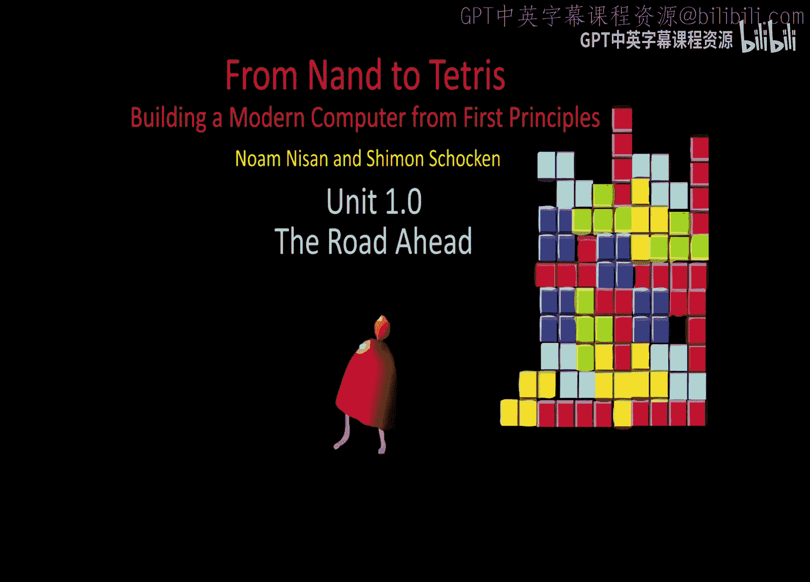

# 耶路撒冷希伯来大学《从零开始构建现代计算机2｜Build a Modern Computer from First Principles》中英字幕 p13 13_03_02_单元1-0_前路展望.zh_en -BV1DA4m1w7FU_p13-

So if everything worked according to plan， then you have already gone through a machine language primer and we are ready to move on and talk about what lies ahead。

So here's the computer that we built in Noteary S 1 and launching nanooteary part 2。

Just like many other classical courses in computer science。

 we'll start with the familiar Hello world program， which is written here in a language calledJ。

 a high level object based language that we will use in this course， Nteist part2。

And so we write this program， we put it into the he computer somehow we click something and boom the screen displays the world's hello world Well in most courses at this point students continue to develop some more interesting programs。

 but in Ntotetriris we stop right here and ask ourselves a whole set of interesting questions about what happens below the surface so to speak first of all。

 take a look at this whole notion of program execution which is nothing short of magic because after all the program is just a bunch of dead characters that I wrote on a piece of paper or using some text editor it's completely static and all of a sudden I can take this program and somehow transform it into a set of low-leve instructions that cause the computer to actually do something。

This is quite fascinating and we take it for granted。

And how did the computer know how to display the words or the images hellello world on the screen。

 How did it know to display H on the screen， and excuse me。

 how did it know to display a single pixel on the screen。 You know。

 all these are very interesting questions that we usually don't bother to think about。

And what about keywords like class function do while， I mean。

 we know exactly what we want the computer to do when we write these words。

 but how does the computer figure out what to do with them。

 How does it actually even parse our our code and understand where these words are located and even if it understands that it found the while and that while should supposed to to signify a loop。

 How does the computer know how to execute this loop。

And take a look at commands like print screen and print line。

 it looks like these commands are invoking methods or functions that exist in other classes， right。

 a class called output which is presumably not here。

 it's part of some class library or an operating system well。

How does the computer know how to test control to these methods？ And then after they do the thing。

 return control to our program。You know， all these issues and hundreds of similar other questions are extremely interesting and important and yet high level programmers don't stop for a minute to think about them。

Why are they allowed to to act in such a state of bliss of ignorance？ Well。

 the answer is that high level programmers think about their high level language as an obstruction。

And the programs that they write as far as they are concerned， are also abstractions。Now。

 being able to hide， excuse me。Being able to hide。Low level technical details from the users of your system is an extremely important principle。

 not only in computer science but in any large scale scientific or technological project。

 because you see high level programmers have enough problems of their own。

And application programming is a sufficiently interesting and challenging field of work and pleasure。

 and if we would expect high levell programmers to also think all the time about how to render pixels on the screen and pass the programs and so on。

 they will go on nuts they will not be able to focus on their own work。

 so it's actually a virtue that they don't have to think about the low level， however。

 someone has to think about it。And someone has to， at some point， at least if you know。

 if you have an inquisitive mind， then you should ask yourself， what makes these obstruction work。

And the answer is that what makes them work are things like assembler， virtual machine， compiler。

 and operating system。And closing this gap， understanding how these things work is what Nanttoterispa2 is all about。

Now， some of you might say， well， I don't understand Shimon just told me that in order to be an application programmer。

 I don't have to worry about these things， so why do I have to worry about these things？Well。

 the answer is that indeed， you can write very nice high level programs programs without。

Understanding compilers and operating systems are internals。And yet， if you do so。

 you will be stuck in a certain limited and constrained level of competence。However。

 if you will take the time。To indulge yourself in understanding how these wonderful software layers work。

 you will become a far more competent and sophisticated software developer。😊，And not only that。

 you will also become a much richer person， intellectually speaking。

 because in order to develop a VM， a compiler， and operating system。

 you have to learn how to use some incredibly beautiful algorithms， data structures。

 programming techniques and all sorts of things that will advance you tremendously not necessarily in understanding the lowleve details。

 but in general as a software developer and as a thinker and also of course。

 as an applied computer scientist。All right， so with that in mind， here's the big picture。

 these are the major stations in our journey。😊，And the last station is a high levelvel language。

 and I would like to devote this unit to discussing the end of our journey。

 you know what will happen at the end， where at the end we'll be able to write programs in the Jack language。

 which is quite similar to Java in many respects， and I would like to give you an example of how these programs will look like。

So I've chosen arbitrarily a little problem in playing with points in a two dimensional space。

 So what we see here are the points P1 and P2。And the point P3 is the vector addition of P1 and P2。

 and it looks like we are interested in the distance between P1 and P3。

 how can we perform such manipulations using J？Well。

 it turns out that someone has already written a class called a Point that includes various services which are quite useful in order to carry out such 2D manipulations。

 and this person gave me not only the class he or she also gave me the API to this class so I can use this API to write a little program that performs what you see here on the picture and here's the program。

So I open my text editor and I write these lines of code， I define a new class， I call it main。

 a new function， which is also called main， and then I declare three object variables called P1 P2 and P3。

 the type of these variables is point。And then I go on to construct P1 and P2。

 I know how to do it because I have the API so I read the constructor signature and based on this I initialize and construct these two points and assign them to the object variables P1 and P2 and then I have to add up P1 and P2 I look at the API。

 there is a plus method， so I use it according to its signature I get to construct a new point P3。

And then for debugging purposes， I print this point on the screen if this program we're running now。

 which it doesn't yet， but if it were running， I would see hopefully 46 on the screen。

And then I print line and compute the distance， the Cartesian distance between P1 and P3。

 and I print it， I do it in the same statement and once again。

 if this were executed I would see hopefully the number5 and then I return。Alright。

 so I used the point class as an obstruction and did some manipulations that did exactly what I wanted to do。

And I think that this little example here shows you the tremendous power of object based programming。

 because with something like 10 lines of code， I managed to do some very useful work。Provided。

 of course， that someone took the trouble to develop the the point class for me。 So indeed。

 what I'd like to do next is delve into the point class。 and let's do it， so。

The first thing that we do when we open up the implementation of point is that we see that we have some class level declarations。

 so the class begins by declaring that x and y are or let me put it otherwise。

 it begins by declaring that every object of type point is characterized by two numbers。

 x and y which are coordinates of this point， and then there is a class level static variable called the point count that stores how many point objects were designed or constructed so far。

And now comes the constructor。The signature is the same as we had in the API and here's the body of the constructor。

 There's nothing mysterious here。 It looks very similar to Java if or Python if you are used to these languages and the only difference I guess is that the constructor ends with an explicit return statement which is implicit in languages like Java and Python and in this explicit statement it returns。

The address of the object that it just created and this address goes right into P1 and P2 in the colors code so everything works as expected。

And let's continue to pursue this class， so this is what've we've seen before。

 there are some accessoriesors that I didn't bother to list in the API。

 here's the definition of the plus method and you can look at the algebra later if you want and convinces itself that it indeed carries out vector edition。

And let's see we also have this Cartesian distance method， which uses the poreian theorem and。

I think and then we have the print method and that's it。

Now there's an important point that Id like to make， so please look at me and note at the code。

The point is that there is no point really in trying to get too much into into the point class because the purpose of this unit is not to teach you Jack and neither is it to teach you object-based programming。

 the purpose is just to give you a flavor of what object-based programming in Jack is all about and just to give you the feeling that it looks very similar to what you probably did in other programming languages in other introductory to computer science courses。

 so Jack is quite simple and sort of plain vanilla language for those of you have some experience in programming。

All right， so to recap what we had here is two classes。

 main dot jack interacting with a point jack in order to carry out some manipulations。

And to remind you， we are now located at the last station of our journey。

 and what I'd like to pursue next is the question of how do we take this high level code。

And bring it all the way down to executable code that can actually run on our bare bone hardware。

Well， here is how we do it。We take these two classes， main and point。

And we put them in some directory on our computer， and we call it any name we want。 You know。

 I decided to call it points in plural。Then we apply the jack compiler to this entire directory。

 And as a result， we will get。Two new files that have the same prefix names， the same class names。

 but a VM extension instead of a J extension and these two files will be in the same directory as our source code and by the way if youre used to Java this is exactly what you do with Java right because you start with in Java it will be to Java classes that have a Java extension instead of a jack extension and after you apply Java the Java compiler you will get to classes are written in bytecode and the extension will be class instead of VM just a small syntactic detail and then you probably don't know it but you're going to apply something called the VM translator which in Java is done using the command Java Java itself and in our world the VM translate。

I going to translate the VM code into one file that contains many instructions in hec assembly。

 then we can take this ASM file， as you see here and give it to the assembler。

 the assembler will finally produce from it another file with a heCC extension and then we can take this file。

 put it into the computer that we built in an antiote spot1， run it andvoa。

 we're going to see the output of our program flickering on the screen in front of us。

 so that's the process of taking a highlevel program and you know moving it through the hoops until it gets into something that can be actually executed。

And during Nanttetriris Part two， not only we will do these things many times。

 well actually build all these tools ourselves。Allright， so once again。Here's the course plan。

 We start with module 0， in which。We asked you to get acquainted with Heck assembly。

 very important to do it。And once we do this， we move on to the next two modules in which we will build a virtual machine and a VM translator。

And then we'll jump to the end of the journey and we'll ask you to write some non-trivial program in Jack obviously we'll teach you a lot about how to use the Jack language。

 not too much because Jack is self- explanatory， but then you will use this language in order to develop some interactive game or some other simple program。

And then once you understand the language itself， once you get familiar with the language itself。

 we will write a compiler for this language for Jack。

 we will write the compiler using something like Java or Python。

 a language that you are you feel comfortable with。And then finally。

 in the last module of the course， we'll develop the operating system that provides all sorts of important extensions to Jack and that closes all sorts of gap gaps between highleve programming and the barebone hardware。

 so before we take off in our nanotetris part2 journey。

 I'd like to say some words of disclaimer and run a little self inspectiontion together with you。

So first of all， I wanted to know that Nanttoteti part2 is much more demanding than Nanttoteus part1。

 I think it's just as much a fun as part one， but you will have to write many programs and do lots of projects so you have to make the proper I think mental and time commitment to take you know a rigorous and challenging course although it's going to be a lot of fun and I think that you're going to to enjoy it tremendously。

 but still there's going to be a lot of work。Now， during this unit that we just went through。

I showed you several examples of high level programming， using the Jack language。

And I want to ask you the following question。 And， and please。

I want you to answer it sincerely in your heart of hearts， so to speak。

 are you comfortable seeing these programming examples do you feel comfortable with things like objects and constructors and reference variables and applying a new operation in languages like Java or C sharpp？

If the answer is yes， if you understand what classes， methods and constructors are and so on。

 then you're ready to take this course。 If the answer is no。

 then I beg that you don't take the course and instead go and take some introduction to computer science course learn the ins and outs and of highlevel programming using some decent object-based language like Java or Python and only then come back to us and complete nanoanttetripa too Of course you can enjoy the lectures or at least some of them I hope without doing any projects。

 but then this will miss the purpose of this course， So once again。If you feel comfortable， fine。

 if not， you know， you should need some preparation。 So if the answer is yes。

 then my next question is。We also saw quite a few examples of lowlel programming throughout this unit。

 So my question to you is do you feel comfortable with lowlevel programming using the heCC assembly language。

 Do you understand what a equals M is， You know what is a， What is M。

 What is the meaning of this operation， If the answer is no。

 then I request that you go back to the machine language primer。

 learn what you need from there according to my guidelines and do project 4。Do this project。

 assign it or submit it， get a grade on it， and then come back to continue to work on Nantte spot2。

If the answer to both questions is a resounding yes， then welcome aboard。

 you are ready to take nontetro Sp2 and we can move ahead and actually start the course。

 And in the next unit we' are going to talk about some compilation aspects and then。

We'll start to actually build our virtual machine。

