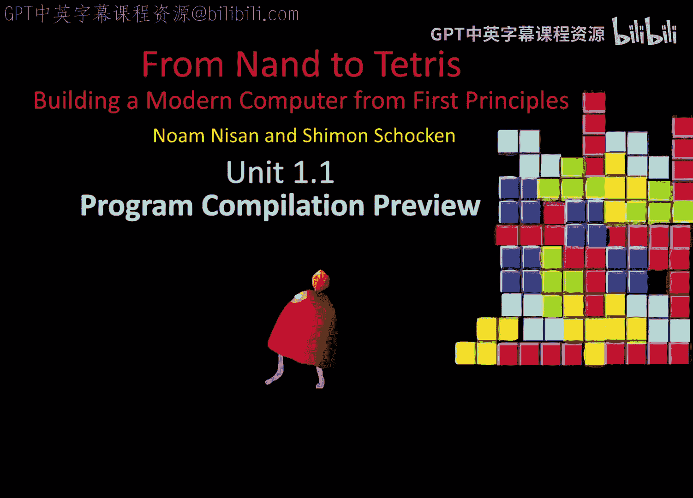

# 耶路撒冷希伯来大学《从零开始构建现代计算机2｜Build a Modern Computer from First Principles》中英字幕 p14 14_03_03_单元1-1_程序编译预览.zh_en -BV1DA4m1w7FU_p14-

Welcome to Uni 1。1 in our virtual machine module here again is the big picture。

And we already know how to deal with the hardware， we know how to write programs in the heCC assembly language。

 and we are ready to move on。And actually， we are now beginning the process of writing a compiler。4。

You know， a modern object based language。And because this is quite a substantial task。

 we will divide it into quite a few modules beginning with this module module1。

 and because in this course we do everything bottom up。

 we'll start on the right hand side of this roadmap here and we'll begin writing our VM translator。

But before we actually get into all these nitty gritty details of building the virtual machine。

 I think that it makes sense to actually take a look or have a sneak preview at the end of our journey。

And talk about， you know， the overall task of compiling a high level language。

 So let us once again review the code that we saw before in the previous unit in which we manipulate some points in a two dimensional space。

And I wish to remind you that if you run this code on a computer。

 then you'll end up seeing some output flickering on the screen。 No。

 this is not just a bunch of characters。 This is。These are points that were derived using vector algebra and the Porian theorem and so on and so forths。

 So indeed it's kind of staggering how we accomplished that。

 how we started with this substruct program on the left and ended up with something that actually runs on the computer。

 How can we make it happen？ Well， first of all， you need a computer。 So if you took Ntotetri S 1。

 you built such a computer。 But even if you had such a computer。

 you would still need to translate all the way from high level to the machine language of that computer。

 And that's what Ntootetri S 2 is all about。😊，So how do we do it Well， you know the answer。

 We need a compiler。 We need to translate from Jack in this case。

 to the heck machine language or to any other machine language that comes to your mind。

 So we need to write this compiler。 So already now we have a major problem and the problem is that the world consists of many different computers。

 So if you start with some highleve program， you would like your program to run on many different platforms on laptops。

 desktops， tablets， smartphones， digital watches and so on。

And the problem is that many of these devices use different processors and these different processor have different machine languages。

 so it's not enough to write one compiler only you have to develop many compilers。

 one for every different processor， and if you are a practicing software developers。

 you have to translate your program to many different target platforms。

 you have to maintain multiple versions of your code， which is a major pain。

So I'm pleased to tell you that there's an alternative and the battle cry of this alternative is write once。

 run anywhere as opposed to you know， write once and fix everywhere。

And the best example of this approach is probably Java。 Now。

 Java does not compile all the way down to machine language。 Instead。

 Java employs something called two tier compilation。So in the first tier。

 we can call it the top tier。 The Java compiler translates the Java program into something called in the world of Java。

 It's called byte code， but in general， we call it VM code。 Now。

 this VM code is designed to run on an obstruct artifact called a virtual machine。

 It's not a real computer。 It's an imaginary computer。

So if we want to actually execute this byte code， we have to translate it further into machine language。

 We have to realize it on some real Phon Neman machine or some real hardware device。

So in order to do this， we need the tier2， the second tier or the bottom tier of the compilation process in which we equip the target device with something called JVM implementation in the world of Java。

 the Java machine implementation。And the JVM implementation is a program that takes bytecode and translates it finally into the target code of the target platform。

And we need such a translator for every platform on which we want to execute our VM program。

And you see。The translation gap between the high level and the low level is huge。

And by introducing an intermediate level， we are decoupling this very complex process into two separate standalone sub processes。

 the compiler and the VM translator or the VM implementation。

And every one of these translators is significantly simpler than the compiler that we saw before that goes all the way from top to bottom。

 like you know for example， C++。So we have broken a very complex task into two simpler tasks which is always desirable and in fact Java should not take credit for this idea of two tier compilation because the idea is about and the practice is about 30 years old。

And in fact， if you think about it。It's almost， believe it or not， it's almost 90 years old。

 as I will comment later on toward the end of this module。So how do we do it in Jack Well。

 Jack is a Java like language which we use in this course。

And we are going to execute J programs on two different platforms。 One platform will be your own PC。

 you know whatever PC you're using and the other platform is going to be the heCC hardware that we built in part one of Nanttoteris if you didn't take Nanttoteris part one。

 don't worry about it。 you don't need the actual hack computer because the Nanttoteris software suite。

 which is now sitting on your computer includes an emulator that simulates the hec computer on your PC。

 so you can do everything that has to be done in this course using this simulator。

So how do we bridge the gap between Jack and these two target platforms where we do something very similar to what we did with Java？

We will write a compiler that compiles J programs into what we call VM code and then well equip your PC with something called VM emulator。

 which is a piece of software that knows how to take a VM program and actually execute it on your own laptop or whatever machine you're using。

At the same time in parallel to this approach， we will also write a substantial program。

 a VM translator that takes the VM code and translates it into the machine language of the heCC platform。

 And this actually will be sort of the pinnacle of module one of what we do in this particular module。

 but it will take us several units to get to get to this level， several units of instruction。

 So to sum up。In this module， in the next one， we are going to write the VM translator。

 we are going to first of all， understand what is a virtual machine。

 and then we are going to implement it。And then in modules 4 and5。

 we are going to write the compiler that will complete the overall compilation picture。

 Now I wish to remind you that the virtual machine is an obstruction， It's an imaginary artifact。

 and it's an example of what we call virtualization。

 which is one of the most important ideas in the theory and practice of computer science。And。

 you know， you cannot do cloud computing and communication networks and modern programming languages without using this notion of virtualization in a major way。

Now I can think about one person who will be delighted to see what we're doing here。

 and this is Ellan Turing， one of the most distinguished granddadies。

 if not the most distinguished grandfather of the computer science field。Almost 90 years ago。

 Tin wrote a seminal paper in which he described an abstractstruct computer。

That had the ability to basically execute computer programs abstractly。

And he also described something called universal machine。

 now it's called the universal Turing machine that can take any other machine and emulate its operations。

And by doing this， you know， by thinking about a machine that executes another machine or a program that executes and understands another program。

 you know， a program that treats another program is data。By doing this， touring really。

Put computer science on a completely new level of sophistication。Because you see this notion of。

Thinking about thinking， you know， this is a hallmark of。Intelligence， in general。You know。

 what's the difference between you and your dog， Both of you are thinking creatures。

 but you can think about thinking。 And I'm not sure that your dog can perform this trick。

So in computer science， we can write programs that analyze other programs， run other programs。

 manage them in all sorts of different ways， and this ability to sort of reason about reasoning is what makes computer science such a sophisticated and powerful field。

Now we don't have too much time to talk about it because this is a different course and with that in mind I'm reminded of some very nice quote that Turing said and that is we can only see a short distance ahead。

 but we can see plenty here that needs to be done。And I think this is a very good slogan for this course。

 and with that， I want to remind you that， you know this is our overall map。

 we have plenty of work to do。 So enough talking about thinking about thinking and let's build some computers。

So in this module we are going to focus on the virtual machine and we are going to do it in using two separate perspectives first we'll think about what the machine can do for us。

 you know this is the abstractstruct view of the machine and then we'll talk about how to actually build it。

 how to implement it and make it and make it work。This module is going to introduce lots of goodies。

 First of all， we are going to talk about compilation， as we have done already。

 We are going to understand virtualization in a very intuitive and deep way。

We will talk a lot about the VM obstruction。 and by doing this。

 you will understand how the JVM of Java works and how the virtual machine of C shop works and so on。

 We will learn how to use stacks， which is a very important data structure in the theory and practice of computer science。

 we will actually build the virtual machine。 we will implement it。

 and in doing so we will use pointers and we also do a good a good share of programming so。

A lot of fun is coming up， bear with me， and let's move on to the next unit。

