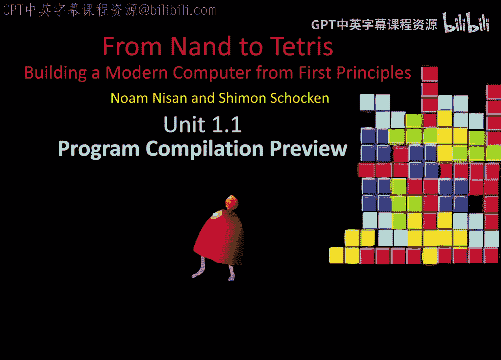
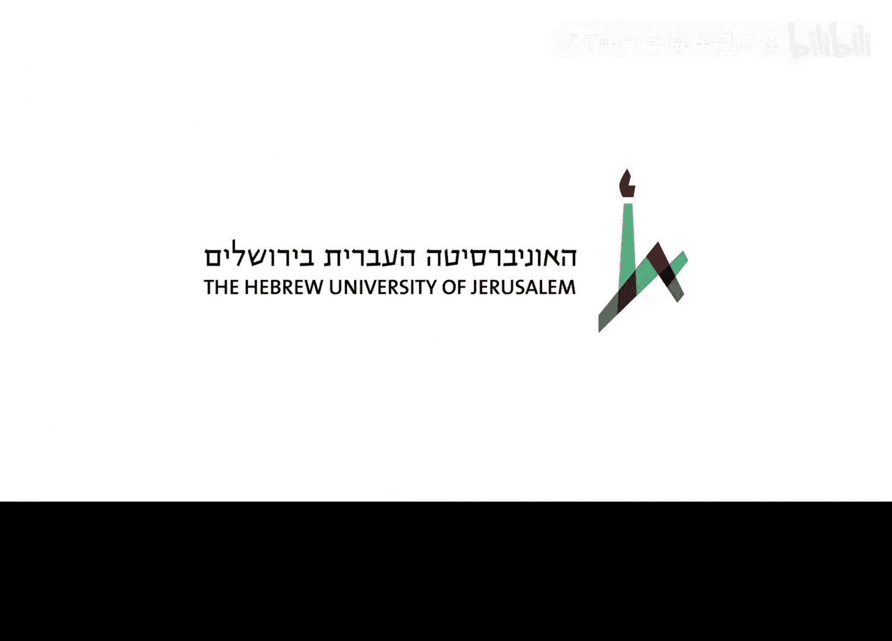

# 从零开始构建现代计算机2：1-1：程序编译预览 🚀

在本节课中，我们将预览整个高级语言编译过程，并理解“虚拟机”这一核心概念如何将复杂的编译任务分解为两个更简单的步骤。

## 概述

我们已经掌握了硬件知识，并学会了用Hack汇编语言编写程序。现在，我们将开始编写编译器的旅程。这是一个庞大的任务，因此我们将从路线图的最右侧开始，首先构建一个虚拟机翻译器。但在深入细节之前，让我们先预览一下旅程的终点：将一个高级语言程序编译并运行在计算机上的完整过程。

## 编译挑战与解决方案

上一单元中，我们看到了一个操作二维空间点的程序。这段代码在计算机上运行时，屏幕上会显示出通过向量代数和勾股定理等计算得出的动态点。这令人惊叹：我们如何从左侧的高级语言程序，最终得到能在计算机上运行的东西？

首先，你需要一台计算机。如果你完成了《从零开始构建现代计算机》第一部分，你已经构建了这样一台计算机。但即使有了计算机，你仍然需要将高级语言一路翻译成该计算机的机器语言。这正是第二部分课程的核心内容。

那么，我们如何做到这一点？答案是需要一个编译器。我们需要将（例如）Jack语言翻译成Hack机器语言，或任何你想到的其他机器语言。因此，我们需要编写这个编译器。

### 多平台兼容性问题

这里存在一个主要问题：世界由许多不同的计算机组成。你希望你的高级程序能在许多不同的平台上运行，例如笔记本电脑、台式机、平板电脑、智能手机、数字手表等。问题是，这些设备使用不同的处理器，而不同的处理器拥有不同的机器语言。因此，仅仅编写一个编译器是不够的，你必须为每个不同的处理器开发一个编译器。对于软件开发者而言，这意味着需要将程序翻译到多个目标平台，并维护代码的多个版本，这是一个巨大的痛点。

### 两阶段编译的解决方案

很高兴地告诉你，存在一种替代方案，其口号是“一次编写，到处运行”，而不是“一次编写，到处调试”。这种方法的最佳范例可能是Java。

Java并不直接一路编译到机器语言。相反，它采用了一种称为**两阶段编译**的方法。

*   **第一阶段（顶层）**：Java编译器将Java程序翻译成一种中间代码。在Java世界中，它被称为**字节码**，但通常我们称之为**虚拟机代码**。这种虚拟机代码被设计运行在一个称为**虚拟机**的抽象构件上。虚拟机不是真实的计算机，而是一台**想象中的计算机**。
*   **第二阶段（底层）**：为了实际执行这些字节码，我们必须将其进一步翻译成机器语言，即在某个真实的冯·诺依曼机器或硬件设备上实现它。为此，我们需要为目标设备配备一个**虚拟机实现**。在Java世界中，这被称为**Java虚拟机实现**。JVM实现是一个程序，它接收字节码，并最终将其翻译成目标平台的机器代码。我们需要为每一个想要运行虚拟机程序的平台准备这样一个翻译器。

### 两阶段编译的优势

高级语言和低级语言之间的翻译鸿沟是巨大的。通过引入一个中间层，我们将这个非常复杂的过程解耦为两个独立的子过程：**编译器**和**虚拟机翻译器**（或称虚拟机实现）。其中每一个翻译器的复杂度都远低于之前看到的、从顶层直接编译到底层（例如C++编译器）的单一编译器。

我们将一个非常复杂的任务分解为两个更简单的任务，这总是可取的。事实上，Java不应独占两阶段编译思想的功劳，因为这个想法和实践已有约30年历史。如果你仔细想想，它甚至（信不信由你）有近90年的历史，我将在本模块末尾对此进行说明。

## Jack语言的编译路径

Jack是本课程使用的类Java语言。我们将在两个不同的平台上执行Jack程序：一个平台是你自己的个人电脑；另一个平台是我们在《从零开始构建现代计算机》第一部分中构建的Hack硬件。如果你没有学习第一部分，也无需担心，你不需要实际的Hack计算机，因为本课程的软件套件包含一个在你的个人电脑上模拟Hack计算机的**模拟器**。

那么，我们如何弥合Jack语言与这两个目标平台之间的差距呢？我们将采用与Java非常相似的方法。

我们将编写一个编译器，将Jack程序编译成我们称之为**虚拟机代码**的中间形式。然后，我们将为你的个人电脑配备一个称为**虚拟机模拟器**的软件，它知道如何获取虚拟机程序并在你的笔记本电脑或任何你使用的机器上实际执行它。

与此同时，我们还将编写一个实质性的程序——一个**虚拟机翻译器**，它接收虚拟机代码并将其翻译成Hack平台的机器语言。这实际上将是我们在本模块中要达到的顶峰，但这需要经过几个单元的学习才能达到这个水平。

## 总结与展望

总而言之，在本模块及下一个模块中，我们将编写虚拟机翻译器。我们将首先理解什么是虚拟机，然后实现它。接着，在第4和第5模块，我们将编写编译器，以完成整个编译过程的图景。

我想提醒你，虚拟机是一个**抽象**，是一个想象中的构件，它是我们称之为**虚拟化**的最重要计算机科学理论和实践思想的范例。没有大规模地使用虚拟化概念，你无法进行云计算、通信网络和现代编程语言开发。

我能想到有一个人会很高兴看到我们在这里所做的事情，那就是艾伦·图灵，计算机科学领域最杰出的先驱之一。大约90年前，图灵写了一篇开创性的论文，描述了一台能够抽象执行计算机程序的抽象计算机。他还描述了一种被称为**通用机器**（现在称为通用图灵机）的东西，它可以模拟任何其他机器的操作。通过思考一台执行另一台机器的机器，或者一个执行和理解另一个程序的程序（即一个将另一个程序视为数据的程序），图灵真正将计算机科学提升到了一个全新的复杂高度。

这种“关于思考的思考”能力，是智能的标志。在计算机科学中，我们可以编写分析、运行、以各种方式管理其他程序的程序，这种对推理进行推理的能力，正是计算机科学成为一个如此复杂和强大领域的原因。

我们没有太多时间深入探讨，因为这是另一门课程的内容。说到这里，我想起了图灵一句非常精彩的话：“我们只能看到前方很短的距离，但我们可以看到那里有许多事情需要去做。”我认为这是本课程一个非常好的口号。

那么，在这个模块中，我们将专注于虚拟机，并从两个独立的视角进行学习：首先，思考这台机器能为我们做什么，这是机器的抽象视图；然后，讨论如何实际构建它、实现它并使其工作。

本模块将介绍许多精彩内容：
*   我们将讨论编译。
*   我们将以非常直观和深入的方式理解虚拟化。
*   我们将大量讨论虚拟机抽象。通过这样做，你将理解Java的JVM和C#的虚拟机等是如何工作的。
*   我们将学习如何使用**栈**，这是计算机科学理论和实践中非常重要的数据结构。
*   我们将实际**构建**虚拟机，实现它。在此过程中，我们将使用指针，并进行大量的编程实践。

很多乐趣即将到来，请耐心跟随，让我们进入下一个单元。