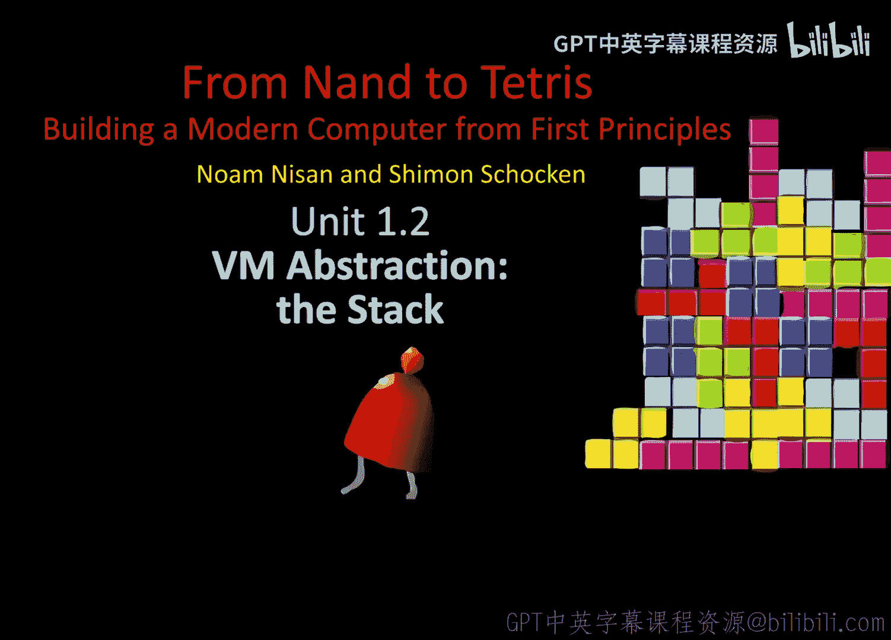
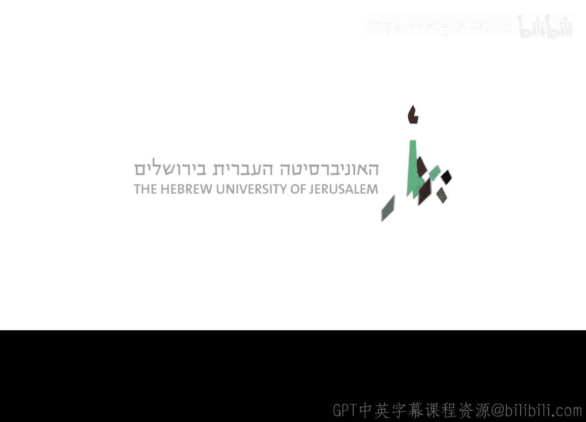

# 耶路撒冷希伯来大学《从零开始构建现代计算机2｜Build a Modern Computer from First Principles》中英字幕 p15 15_03_04_单元1-2_虚拟机抽象：栈.zh_en -BV1DA4m1w7FU_p15-

In the second unit of this module， we'll begin exploring the VM obstruction and we'll start by talking about the most important element in the abstract VM architecture。

 which is the stack。Now I wish to start with the big picture as usual and remind you that we are developing a two tier compilation process and a centerpiece of this process is the virtual machine that operates the VM code that you see here in the center of this slide。

Now， let us assume that we had a complete freedom of designing this VM language that sort of sits in the middle of this translation process。

 How would we go about designing it， Which language would we come up with。Well。

 we have to strike a balance between two conflicting objectives。 On the one hand。

 we want the VM language to be sufficiently high so that the distance so to speak between the high level and the VM level will be relatively low and therefore the translation challenge will be relatively manageable and the resulting VM compiler will be a relatively simple and elegant programs。

 On the other hand， we want the VM code and the Vm language to be sufficiently low so that the distance that we have to cover between it and the final target language。

 the lowle language will also be manageable and conveniently small so that the VM translator or the VM implementation will also be a relatively simple and elegant program。

So you know， we have to find the right balance。And years of research and practice in computer science have indicated that one architecture that hits a very good balance between these two objective is something called stack machine。

And the stack machine is an obstruction that consists of an architecture， a stack。

 and a set of operations which we can apply to this architecture。

 and this is you know this is a good summary of what we're going to do from now on。

 we're going to describe this architecture and this set of commands。 So let's begin with a stack。

 one way to think about stacks is to envision a stack of plates。That has a top， of course。And to。

Come up with some sort of a game in which we have only two allowable manipulations。

 One of them is called push， for historical reasons。

And this operation allows us to put a plate on the top of the stack and pop allows us to remove the top plate from the stack and as we do these operations。

 the top pointer moves accordingly to reflect what we have just done and the top pointer always points to sort of one position above the topmost plate in the stack。

Now， with a regular stack of plates， you know， you can sort you can take a few plates。

 sort of take them up and put another plate in the middle。 but in this stack。

 you're not allowed to do it。 You can only access the stack from the top。Now in computer science。

 stacks look somewhat different， but the idea is exactly the same。

 The stack contains some values instead of plates and these values。

 you know we can think about them as integers but in general these integers can represent anything。

 they can be strings， they can be Boolean values and so on。

 but let's think about integers to make life simple。

 and we have something called the stack pointer that points to the location in which the next value is going to be pushed。

This stack is available in a larger context called the virtual machine。

 which is also equipped with a regular sort of memory segment。

 which is very similar to the RA that we built in part one of the core。

 and you can basically think about it as an array， an array which is which offers direct access to every element in this memory space as opposed to the stack which offers only access through the stack pointer。

Now， what can we do with this architecture？ Well， suppose we do push X。 and by the way。

 we assume that we can label different location in the Ram as we please。 So if we do push X。 well。

 let's check X contains the number 7 and therefore。

We see the number 7 being added to the top of of the stack and nothing happens to the memory。 Okay。

 Another thing that we can do is pop Y， which will affect， you know。

 two separate sort of sub operations。 one sub operation will。Remove the top value from the stack。

 this3。And the second operation will take this value 3 and store it in location Y。

 So whatever it used to be location Y is going to be overred。

So these are the two fundamental operations that we are going to use in order to move data from the stack to the memory and vice versa。

Now， in addition to this， we are going to have a whole set of arithmetic commands。 For example。

 if we say add， the following thing is going to happen。

We're going to pop the two topmost values from the stack。

 we are going to add them up on the side so to speak。

 and then we're going to push the result onto the stack。

 so the result will be this you know notice that the opera runss of the addition in this case3 and 7 have been replaced by the result of the addition in this case10。

We can do something similar with another command called Neg， which will negate the topmost value。

Now it will not simply negate it， it will first of all， pop the top value。

 it will negate it on the side， and then it will push the result back onto the stack。So in general。

 if you want to apply a certain function on the stack， you have to do three different things。

 first of all you have to pop from the stack as many operas as are necessary。

 then you compute the function on these operas in a separate process and then you push the result back onto the stack。

Now， I said you， but all these things happen quotequote， automatically， it's part of the obstruction。

So the obstruction supports all these operations inherently。 you don't have to worry about them。

 All you have to do is say add， Neg and these things will take place。Now， in a similar fashion。

 we can also apply all sorts of boolean operations on the stack。 So in this example， if we say I。

We're going to implicitly。Pop the two top values， which happen to be equal。 We are going to ask。

 are they equal。 Is it true that 5 equals 5。 The answer is yes。

 So we're going to push true to the stack。 Then we can say if we want， we can say or。We will or。

 we will pop the two topmost values。 The stack will become empty。Well order them on the side。

 We'll get through， and then we'll push through back onto the stack。

 So I hope that you understand sort of the spirit of this very elegant virtual machine。 Now。

 at this point， you may well ask yourself， where do these commands come from， You know， P， pop， Ed。

 Neg eke。Or。Who gives us these commands。 You know， what's the story here？Now， actually。

 I'm not obliged to answer this question。And I can so called ask you to forget about the outside world and just focus on the VM obstruction。

 which is a sufficiently。Attractive， elegant and powerful architecture in its own right。

 it's a good abstraction in its own right， and we may well dwell on it without worrying on what exists outside this abstractstruction。

😊，And you know， you have to understand that there's a certain virtue to this bliss of ignorance because。

 you know， we can focus on what were doing now in sort of 100% level。 And that's how， you know。

 some great minds really think they are able to isolate themselves from anything else and just focus on what they currently working on。

But， you know， in this course。People who take this course。

 people like you are intelligent students who take this course because they want to understand the big picture。

So it's in the DNA of this course to ask questions like where does this come from。

 Where are we going from here and so on and so forth。

 So I allow myself to actually venture outside the context of the virtual machine and say a few words about the big picture of stack arithmetic。

 Where do these commands come from。 Well， they come from the compiler that we haven't seen yet。

 Okay so if you start with a high levelve statement like x equals 7 plus 19 the compiler that we will build later on in the course is going to translate it into in this case。

 push 17 push 19 add and pop X。And the result of executing all these operations will put in x the value of 17 plus 19。

Now， there's an interesting obstruction implementation interplay going on here。 First of all。

 the high level language， of course， is an obstruction。 It doesn't exist for real。

It can be implemented by translating it into code that operates on a stack machine。

But the stack machine is also an obstruction。And this obstruction is implemented by something else Stay tuned because you know the whole gist of this module is to understand the obstruction and implement as we'll do later later on in the module。

 All right， so here is the virtual machine in its whole glory。

 it a stack machine which is manipulated by four categories of commands， arithme eological commands。

 memory segment commands， branching commands and function commands。

And what we'll do next is talk a little bit more about arithmetic and logical commands。

So here's an example， we start with this high level code。

 which the compiler is going to translate into this VM code。

How this translation takes place is something that you shouldn't worry about at this stage of the course because we'll worry about it later on in about two or three modules from here。

Now， we do want to worry about how to execute this code because you know this is squarely within the v obstruction。

So here's an empty stack to begin with and we assume that we have a memory segment with the x and y variables。

 and then we say push2， so the stack becomes2， and then we push x。

 so the value of x is being pushed onto the stack， we subtract these two values。We get the result。

We then pushway。The stack grows。We then push 9， the stack continues to grow。

 We then add up the two topmost values， and we get， I think， 21。Then we do another edition。

And we get minus4 plus 21， which gives us 16， and finally we pop the result into D and we get a new variable D which contains the value of this computation。

So what we saw here is a typical sequence of stack machine commands executing and achieving some useful value。

Now， we could have done something very similar with logical commands。And here's an example。

 What we see at the top of this code pane here is a logical expression。

 or a Boolean expression that has a tooth value。And in order to evaluate this expression。

 the compiler will generate。This code， the code that you see here。

 So starting again with an empty stack and some X and Y assumptions。

We can execute every one of these commands one after the other。

 And what we'll end up getting is this simulation that you see here。 And if you want。

 maybe you can stop the video here。Go through the motions and convince yourself that you understand what is going on here from one transformation to another。

So， please do this。So to recap what we've done so far here are our arithmetic logical commands。

 we have three arithmetic commands， you know add， subtract and ne that always operate on the topmost value values in the stack。

 then we have three logical comparisons command equal greater than less than which also operate on the two topmost values in the stack and finally we have the three classical logical connectors or and not that also operate on the two topmost values of the stack。

Now， this doesn't look like much， right， It looks like a very sort of a Spartan set of commands。

 but here's an interesting observation。Any arithmetic and logical operation that you can dream of。

Written in any programming language can always be reduced to a subset of operations that uses these commands and executes them on a stack machine。

 and the stack machine will end up computing the value that you wanted to compute in the high level。

So this goes on to show the underlying power of this very simple virtual machine that we are building here。

All right， so with that here is once again a description of the overall VM language。

 we have said everything that we want to say about the arithme eological commands and in the next module we'll talk about memory segment commands。

