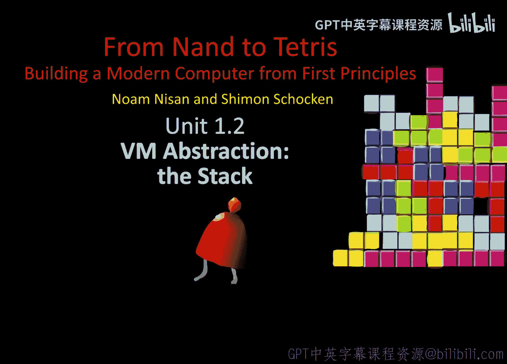

# 从零开始构建现代计算机2：单元1-2：虚拟机抽象：栈 🧱

在本节中，我们将开始探索虚拟机抽象，并首先讨论抽象虚拟机架构中最重要的元素——栈。

上一节我们介绍了课程的整体框架，本节中我们来看看虚拟机抽象的核心组成部分。

## 虚拟机设计的平衡艺术

我们正在开发一个两阶段的编译过程，其核心是运行虚拟机代码的虚拟机。假设我们有完全的自由来设计这个位于翻译过程中间的虚拟机语言，我们应该如何设计它？我们会创造出什么样的语言？

我们需要在两个相互冲突的目标之间找到平衡。一方面，我们希望虚拟机语言足够高级，这样高级语言与虚拟机语言之间的“距离”就相对较小，因此翻译的挑战相对可控，生成的虚拟机编译器也会是一个相对简单优雅的程序。另一方面，我们希望虚拟机代码和虚拟机语言足够低级，这样它与最终目标语言（低级语言）之间的“距离”也应该是可控且足够小的，以便虚拟机翻译器或虚拟机实现也能成为一个相对简单优雅的程序。

计算机科学多年的研究和实践表明，一种能在两个目标之间取得良好平衡的架构被称为**栈机器**。栈机器是一种抽象，它包含一个架构、一个栈以及一组我们可以应用于此架构的操作。接下来，我们将描述这个架构和这组命令。

## 栈的直观理解

以下是理解栈的一种方式。

我们可以将栈想象成一叠盘子。它当然有一个顶部。我们可以设想一个游戏，其中只允许两种操作。出于历史原因，其中一种操作称为 **`push`**。这个操作允许我们将一个盘子放到栈的顶部。**`pop`** 操作则允许我们从栈中移除顶部的盘子。当我们执行这些操作时，顶部指针会相应移动以反映我们刚刚所做的操作。顶部指针总是指向栈中最顶部盘子上方的一个位置。

在普通的盘子堆栈中，你可以拿起几个盘子，然后在中间放入另一个盘子。但在这个栈中，这是不允许的。你只能从顶部访问栈。

## 计算机科学中的栈

在计算机科学中，栈看起来有些不同，但理念完全相同。栈包含一些值（而不是盘子）。这些值，我们可以将它们视为整数，但通常这些整数可以代表任何东西——字符串、布尔值等等。为了简化，我们先将其视为整数。我们有一个称为**栈指针**的东西，它指向下一个值将被推入的位置。

这个栈存在于一个更大的上下文中，称为**虚拟机**。虚拟机还配备了一个常规的内存段，它非常类似于我们在课程第一部分构建的 RAM。你可以基本上将其视为一个数组，这个数组允许直接访问内存空间中的每个元素，这与栈只能通过栈指针访问形成对比。

## 栈的基本操作

那么，我们可以用这个架构做什么呢？

假设我们执行 **`push X`**。我们假设可以随意标记 RAM 中的不同位置。如果 X 包含数字 7，那么我们将看到数字 7 被添加到栈的顶部，而内存中没有任何变化。

我们可以做的另一件事是 **`pop Y`**，这将影响两个独立的子操作。一个子操作将从栈中移除顶部值（例如 3）。第二个操作将把这个值 3 存储到位置 Y 中。因此，无论位置 Y 之前是什么，都会被覆盖。

这些是我们用来在栈和内存之间移动数据的两个基本操作。

## 算术与逻辑命令

除此之外，我们还将拥有一整套算术命令。例如，如果我们说 **`add`**，将会发生以下事情：我们将从栈中弹出两个最顶部的值，在“一旁”将它们相加，然后将结果推回栈上。因此，结果将是 10。请注意，加法操作数（本例中的 3 和 7）已被加法的结果（10）所取代。

我们可以用另一个名为 **`neg`** 的命令做类似的事情，它将取反最顶部的值。它不会简单地取反，而是首先弹出顶部值，在“一旁”取反它，然后将结果推回栈上。

一般来说，如果你想在栈上应用某个函数，你必须做三件不同的事情：首先，你必须从栈中弹出所需数量的操作数；然后，你在一个单独的过程中对这些操作数计算函数；最后，你将结果推回栈上。我说“你”，但所有这些事情都是“自动”发生的，这是抽象的一部分。因此，抽象本身支持所有这些操作。你不必担心它们。你只需要说 `add`、`neg`，这些事情就会发生。

以类似的方式，我们也可以在栈上应用各种布尔操作。在这个例子中，如果我们说 **`eq`**，我们将隐式地弹出两个顶部值（它们恰好相等）。我们会问：它们相等吗？5 等于 5 是真的吗？答案是“是”，所以我们将 `true` 推入栈。然后，如果我们愿意，我们可以说 **`or`**。我们将弹出两个最顶部的值，栈将变空。在“一旁”对它们进行或运算，得到 `true`，然后将 `true` 推回栈上。

## 命令从何而来？

至此，你可能会问自己：这些命令从何而来？`push`、`pop`、`eq`、`neg`、`or`……谁给了我们这些命令？实际上，我没有义务回答这个问题。我可以要求你忘记外部世界，只关注虚拟机抽象本身，它本身就是一个足够有吸引力、优雅且强大的架构，是一个很好的抽象。我们完全可以沉浸其中，而不必担心这个抽象之外存在什么。

这种“无知的幸福”有一定的好处，因为我们可以 100% 地专注于我们现在正在做的事情。一些伟大的思想家正是这样做的，他们能够将自己与任何其他事物隔离开来，只专注于当前的工作。

但是，在本课程中，像你这样聪明的学生选修这门课是因为他们想要理解全局。所以，问“这从何而来？”、“我们将从这里走向何方？”等问题是这门课程的 DNA。因此，我允许自己冒险走出虚拟机的背景，简单谈谈栈算术的大局。

这些命令从何而来？它们来自我们尚未见过的编译器。如果你从一个高级语句开始，比如 `x = 17 + 19`，我们将在课程后期构建的编译器会将其翻译成：`push 17`、`push 19`、`add`、`pop x`。执行所有这些操作的结果将把 17 加 19 的值放入 x。

这里有一个有趣的抽象与实现的相互作用。首先，高级语言当然是一个抽象。它并不真实存在，可以通过将其翻译成在栈机器上运行的代码来实现。但栈机器也是一个抽象。而这个抽象是由其他东西实现的。请继续关注，因为理解这个抽象并实现它（我们将在本模块稍后部分进行）是整个模块的要旨。

## 虚拟机全貌

那么，这就是虚拟机的完整面貌：一个由四类命令操作的栈机器——算术逻辑命令、内存段命令、分支命令和函数命令。接下来，我们将更详细地讨论算术和逻辑命令。

以下是一个例子。我们从这个高级代码开始，编译器会将其翻译成这个虚拟机代码。这个翻译是如何发生的，在课程的现阶段你不必担心，因为我们将在两三个模块后再来讨论它。

现在，我们确实需要关心如何执行这段代码，因为这完全属于虚拟机抽象的范畴。我们从一个空栈开始，并假设我们有一个包含 x 和 y 变量的内存段。然后我们说 `push 2`，栈变为 `2`。接着我们 `push x`，x 的值被推入栈。我们 `sub` 这两个值，得到结果。然后我们 `push y`，栈增长。接着我们 `push 9`，栈继续增长。然后我们将两个最顶部的值 `add`，得到 21。然后我们再做一次 `add`，得到 -4 + 21 = 16。最后，我们将结果 `pop` 到 d，我们得到了一个包含此计算值的新变量 d。

我们在这里看到的是一个典型的栈机器命令序列，通过执行这些命令来获得某个有用的值。

我们也可以用逻辑命令做非常类似的事情。以下是一个例子。在代码窗格的顶部，我们看到一个逻辑表达式或布尔表达式，它具有真值。为了计算这个表达式，编译器将生成你在这里看到的代码。再次从一个空栈和一些关于 X 和 Y 的假设开始，我们可以一个接一个地执行这些命令中的每一个。最终我们将得到你在这里看到的模拟过程。如果你想，也许可以在这里暂停视频，逐步执行并说服自己理解这里从一个转换到另一个发生了什么。所以，请这样做。

## 命令总结

回顾我们到目前为止所做的，以下是我们的算术逻辑命令：我们有三个算术命令（`add`、`sub`、`neg`），它们总是对栈中最顶部的值进行操作；然后我们有三个逻辑比较命令（`eq`、`gt`、`lt`），它们也对栈中的两个最顶部值进行操作；最后，我们有三个经典的逻辑连接词（`or`、`and`、`not`），它们也对栈的两个最顶部值进行操作。

这看起来可能不多，对吧？看起来是一个非常精简的命令集。但这里有一个有趣的观察：任何你能想到的、用任何编程语言编写的算术和逻辑操作，总是可以简化为使用这些命令并在栈机器上执行的子集操作，而栈机器最终将计算出你在高级语言中想要计算的值。这展示了我们正在构建的这个非常简单的虚拟机所具有的潜在能力。

## 总结

本节课中我们一起学习了虚拟机抽象的核心——栈。我们探讨了栈机器的设计理念，理解了 `push` 和 `pop` 两种基本数据移动操作，并详细介绍了算术与逻辑命令（如 `add`、`sub`、`eq`、`and` 等）在栈上的执行过程。我们还初步了解了这些虚拟机命令将由未来的编译器从高级代码生成。这个看似精简的命令集，实际上具备了实现任何复杂运算的潜力，为后续构建完整的虚拟机翻译器奠定了基础。

下一节，我们将继续探讨虚拟机的另一类重要命令：内存段命令。