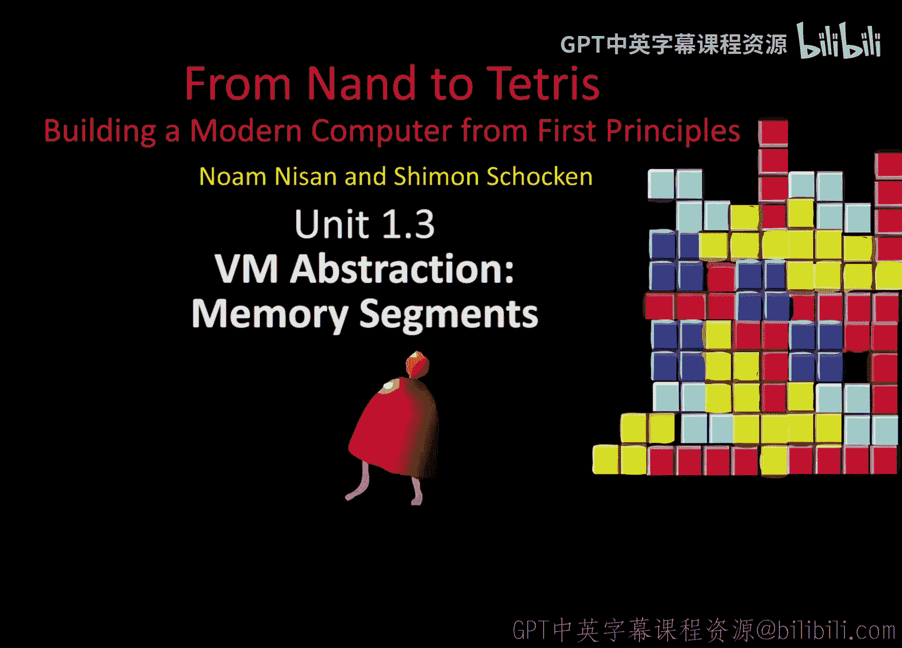
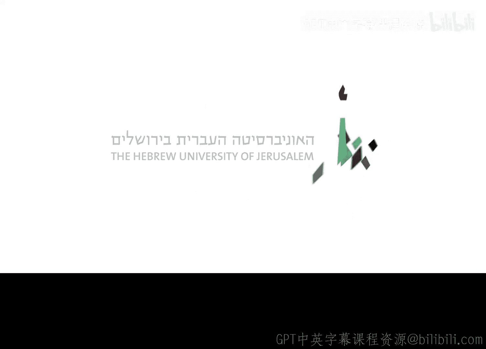

# 耶路撒冷希伯来大学《从零开始构建现代计算机2｜Build a Modern Computer from First Principles》中英字幕 p16 16_03_05_单元1-3_虚拟机抽象：内存段.zh_en -BV1DA4m1w7FU_p16-

In this unit， we are going to talk about memory segments and memory segment commands。

So here once again is our overall VM language that consists of four categories of commands。

 we already explored the arithmetic ecological commands in the previous unit and now we are going to move on to memory segment commands。

Now let's start with a big picture。We have this arbitrary example of a high level piece of code。

 and we want to translate it or compile it into VM code。

 something that we'll worry about later on in the course。Now。

 let's focus on this statement as an example， let C equals S1 plus y。The compiler will generate or。

 will。Translate it into push S1， push Y， add and pop C。 And once again。

 how the compiler does it is something that we'll worry about later。Now。

 I wanted to notice that something kind of gets lost in the translation。

If you look at the high level。We know from our experience and， you know。

 from our knowledge of the high level syntax of of this language is that。

Different variables have different roles， right， S， for example， or S1 is a static variable。

 and C happens to be let's see C happens to be a local variable， and y is an argument。

So this or these different roles or the variables is something that we also want to preserve。

 of course， in the virtual machine obstruction， if we wantt preserve it。

 things will go wrong in the execution of this program。

So we need some mechanism to record the different roles of different variables in one's program。

And we do this by introducing the notion of memory segments， which is part of our VM obstruction。

So our stack machine is going to be equipped not with a single memory segment， as we had so far。

 but rather with several memory segments with names like argument， local static and a few more。

 as you'll see later on， once we have these segments in place， the compiler。Can map。

The variables of the high level on these segments。 And in this particular example， will get。

This particular mapping。And once we have this mapping in place。

 we can use it in order to generate code。 So instead of push S1， let's see S S1 is a static variable。

 So instead of say push S1， we're going to say push static0。And instead of pushing y。

 which is argument number one， we are going to say push argument1。And instead of saying Ed， well。

 Ed is add， there's nothing to add。But instead of saying pop C， we are going to say pop local too。

So we see that you know， once we use the segments in this way。

 we are going to be able to preserve the raw semantics of these variables also in the VM obstruction。

But something interesting has happened。 We lost the variable names in the process。And indeed。

 the VM obstruction does not recognize symbolic variable names。

 All the variables are replaced by references to memory segments， as we see here。

 And this is not something which is unique to our VM， our VM， by the way， is modeled after the JVM。

 the Java Vi machine in broad terms。 and the JVM also does not have symbolic variables。

 it only has references to symbolic memory segments。 So as you see， we have extended the story。

 and instead of interacting with a single memory stream。

 we now interact with several different memory segments。

To which we also add a segment that we call constant。

 which is truly a virtual segment because it contains just the numbers，0，1，2， and so on and so forth。

And once you have these segments in place， well， the commands that you are going to use。

 the push and pop are going to take as arguments， the name of the segment that you want to operate on and the index in that segment。

 So here are some examples， push Cont 17， push local pop local 2。

 pop static 5 and so on and so forths。Now， you may ask yourself， you know。

 why do we need push constant 17， Why can't we just say push 17， Well。

 we think that it's nicer that that that it's nice that。All the VM commands。

 all the pushP commands will have the same syntax， a consistent syntax。

 and this is a very small price to pay for this consistency。It also makes compilation easier。

 as we'll see down the road。Alright， so in order to make life interesting， we actually have not four。

 but eight virtual memory segments。 Why do we need so many segments with names like local argument。

 this， that constant static pointer and temp。😊，Well， let us not forget where we are coming from。

 We are coming from the world of a high level object oriented language。

And there's a lot going on in highlevel object oriented programming， right。

 there are static variables， local variables， argument variables。

 there are there is the current object that a method is processing and this object is also a bundle of variables。

 there's an array that the method can process and so on and so forth。 So lots of semantics going on。

 and in our virtual machine， we can handle all the semantics using the eight virtual segments that you see here。

Now， the good news is that all these segments behave exactly the same way once we are within the VN obstruction。

You push a value into a memory segment by saying， push memory segment， name and index。

 And so segment can be any one of these。8 segment names。 And I is simply a non negative constant。

 What about pop， Well， it's almost the same with the exception that you cannot pop into the constant segment because。

 you know， it simply doesn't make any sense。Alright。

 so these are the push and pop commands operating on the memory segments。

 So here's a little quiz for you to practice what we've learned so far about memory segments。

This is just a typical sort of state of a virtual machine with several memory segments present with some values in them and some values in the stack and let us assume that we want to carry out the sodo operation static2 equals argument 1 now we dont you know we cannot do something like this in this syntax in the VM language。

 we have to use the available commands that we learned so far。Now， static 2 happens to be。 let's see。

 I'm sorry。 Arment 1 happens to be 12。 So at the end of the game。

 we want to see this particular machine state， which is identical to the previous one。

 except that static 2 now contains the value 12。 So the question is。

 which VM commands will make this magic happen。 So why don't you think about it for a minute or two。

 write down the commands and then。You know， continue to run the video and you will see the answer。

So here's the answer in order to move the value of argument 1 to static 2。

 we must go through the stack。 That's the only way to do it in a stack machine。

 so we push argument1 onto the stack and then we pop the topmost value。

 the value that we have just added onto static 2。And because these two commands， kind of。

Cancel each other stackwise。 We see that the stack remains the same。 You know。

 a lot of drama happened， right， we added something。 We took something away from the stack。

 but at the end of the game， the stack is intact， and we manage to move something from one segment to the other。

 And that's the only way to move values from one segment to another in our veal obstruction。

So to recap here again is our VM language in the previous unit we talked about there isthte commands in this unit we talked about the memory segment commands and we are ready to move on and start talking about how we actually implement these commands and make them work for real this will be done in the next unit。

