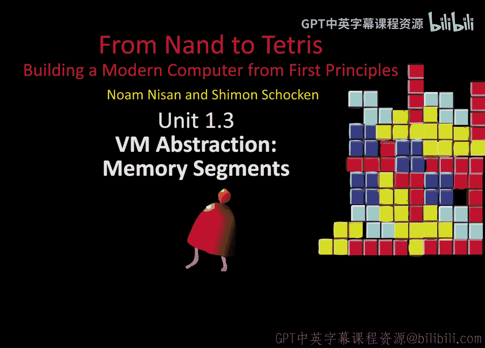

# 从零开始构建现代计算机2：单元1-3：虚拟机抽象：内存段 🧠



在本单元中，我们将学习虚拟机语言中的内存段以及相关的内存段命令。我们将了解为什么需要多个内存段，以及如何使用 `push` 和 `pop` 命令来操作它们。

## 概述

到目前为止，我们的虚拟机只与一个单一的内存段（栈）进行交互。然而，高级语言程序中的变量具有不同的角色（例如，静态变量、局部变量、参数等）。为了在虚拟机层面保留这些语义，我们需要引入**内存段**的概念。本单元将详细介绍内存段的作用、种类以及如何通过 `push` 和 `pop` 命令来操作它们。

## 从高级代码到虚拟机代码

让我们从一个高级语言代码片段开始。假设我们有如下代码：
```c
c = s1 + y;
```
其中，`s1` 是一个静态变量，`y` 是一个参数，`c` 是一个局部变量。编译器需要将此代码翻译成虚拟机代码。翻译过程会丢失变量名信息，但会保留变量的角色，这是通过映射到不同的内存段来实现的。

上一节我们介绍了算术逻辑命令，本节中我们来看看内存段命令如何帮助我们在虚拟机中保留变量的语义。

## 内存段的作用

在高级语言中，不同的变量扮演不同的角色。为了在虚拟机中保留这些角色，我们引入了多个命名的内存段，例如 `argument`、`local`、`static` 等。编译器可以将高级语言中的变量映射到这些段上。

例如，对于上面的代码，编译器会生成如下虚拟机命令：
```
push static 0
push argument 1
add
pop local 2
```
这里，`static 0` 对应 `s1`，`argument 1` 对应 `y`，`local 2` 对应 `c`。变量名虽然丢失了，但变量的语义角色通过内存段得以保留。

## 虚拟机内存段命令

我们的虚拟机语言现在扩展为包含多个内存段。所有 `push` 和 `pop` 命令现在都需要指定要操作的内存段名称以及该段内的索引。

以下是内存段命令的通用格式：
*   `push segment i`：将 `segment` 段中索引为 `i` 的值压入栈顶。
*   `pop segment i`：将栈顶的值弹出，并存入 `segment` 段中索引为 `i` 的位置。

其中，`segment` 可以是以下八种之一：`argument`、`local`、`static`、`constant`、`this`、`that`、`pointer`、`temp`。`i` 是一个非负整数。

需要注意的是，`constant` 段是一个特殊的虚拟段，它包含常数 0, 1, 2... 等。你可以从它 `push` 值，但不能向它 `pop` 值。

## 为什么需要八个内存段？

您可能会问，为什么需要这么多内存段？答案源于我们高级的、面向对象的源语言。在这种语言中，有各种语义实体：静态变量、局部变量、参数、当前对象（`this`）、数组（`that`）等等。这八个虚拟内存段为我们提供了一种机制，可以在虚拟机层面优雅地处理所有这些高级语义。

好消息是，在虚拟机抽象内部，所有这八个段的行为方式完全一致，都是通过 `push segment i` 和 `pop segment i` 命令来操作。

## 实践练习

为了巩固对内存段操作的理解，让我们来看一个简单的练习。

假设虚拟机当前状态如下：
*   `argument` 段索引 1 的值为 12。
*   `static` 段索引 2 的值为 99。
*   栈中有一些值。

我们的目标是通过虚拟机命令实现操作：`static 2 = argument 1`。执行后，`static 2` 的值应变为 12。

以下是实现此操作的步骤：
1.  首先，我们需要将 `argument 1` 的值放到栈上。
2.  然后，将这个值从栈顶存入 `static 2`。

因此，所需的虚拟机命令是：
```
push argument 1
pop static 2
```
这两条命令通过栈作为中介，完成了从一个内存段到另一个内存段的值传递，并且保持了栈的最终状态不变。

## 总结

在本单元中，我们一起学习了虚拟机抽象中的内存段。我们了解到，为了保留高级语言变量的语义角色，虚拟机需要支持多个内存段，如 `argument`、`local`、`static`、`constant` 等。我们学习了如何使用格式为 `push segment i` 和 `pop segment i` 的命令来操作这些段，并通过一个练习了解了如何通过栈来在内存段之间传递数据。


至此，我们已经介绍了虚拟机语言中的算术逻辑命令和内存段命令。在下一个单元，我们将开始探讨如何实际实现这些命令，让它们在真实的计算机上运行起来。