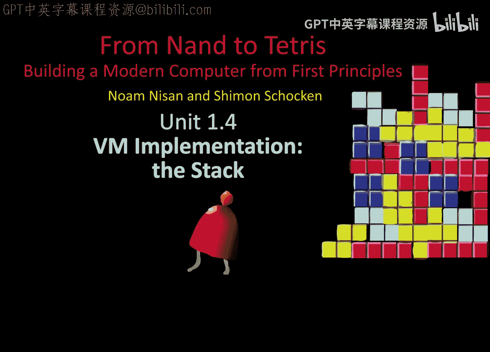

# 耶路撒冷希伯来大学《从零开始构建现代计算机2｜Build a Modern Computer from First Principles》中英字幕 p17 17_03_06_单元1-4_虚拟机实现：栈.zh_en -BV1DA4m1w7FU_p17-

Welcome to Unit 4 in the first module of the course。This is an important unit because up until now。

 we've treated the virtual machine as an obstruction。 And from now on。

 we are going to actually build it。 So to begin with， let's take another look at the VM obstruction。

And basically， I'm repeating the quiz that I gave you in the last unit。And in this quiz。

 we started with some arbitrary stack machine state and the question was which VM commands will implement the abstract operation static 2 equals argument 1 leading to this final stack machine state。

So you saw the answer and the point that I'd like to make now is that everything that you see here is completely imaginary。

 it does not exist for real， and if we want to actually execute this scenario in some you know concrete way。

 we have to realize it on some Phneummon machine。So what do we have to do， You know， let's。

 let's think about it。 If you had to do it， how would you go about it， Well， first of all。

 you have to take these four memory segments。 or actually， we have eight of them。

And we have to somehow map these memory segments on the single Ram that is available for us。

And to do it in some sensible way， right， we have to remember where each segment starts on the Ram and manage。

 you know， manage these locations and so on。And once we come up with this napping。

 we have to do something with the commands with a push and pop commands。

 we have to translate them into a sequence of machine level instructions that will operate on this world that we just built on the RAM。

So we have a lot of work ahead of us。 but as usual， we'll do things one step at a time。

 and each step will be。Relatively simple and well defined。Alright。

 so in order to carry out the implementation of the abstraction。

 I'm going to use a technique known as pointer manipulation。

 which some of you may be aware of and for some it may be a new material。

So I'd like to give you a crash course in pointer manipulation。

 and this crash course is going to last exactly one slide， so bear with me。

Let us assume that we have a typical Ram。And we decided to use the symbols P and Q to refer symbolically to the first two Ram locations。

 Ram 0 and Ram 1。Now， consider the following sodo assembly statement。 D equals asterisk P。 You know。

 what do we do here。 Well， here's the rule of the game。

 E P refers to the memory location that P points at。So the asteriskric notation。

Tells us that we want to treat P as a pointer。Now if we didn't put the asterisk。

 if we just said d equals p， then presumably we'll get the value  to57 because that's what you know P points at。

 you know P is equivalent to0， so d equals p will give us the contents of Ram0 and yet we said the asterisk p。

So when we say the P， we imply an indirect addressing operation， so we look at the value of Ram 0。

 which happens to be 257 and we treat it as an address。Next。

 we look at the value of Re at this address， which happens to be 23。

 and we store it into the D container。 So D becomes 23。 So this is the gist of indirect addressing。

Now， if we have to implement this thing in let's say， heck。

 then here are the three statements that will make it happen。We start with E P。 And by doing this。

 we。It's essentially the same as at0 because P and0 are the same thing in our assumption here。

And then we say a equals M。 you know， this will cause a to become the contents of the selected memory register。

 which is registered number 0， and therefore a will now contain 257。

Now remember that a is an address register， so once we put a certain value into a like 257 automatically we are going to select register number 257 from the Ram。

 so this will become the selected register which in the heck assembly language is represented by the letter M。

 and therefore when we next say D equals M， we're going to get the value of this register。

 the currently selected register number 257 and the value happens to be 23。Now。

 everything that we did here is quite similar to what we did in Project zero of this course。

And if you did project0， you shouldn't be surprised by what I just described。

 if you didn't do Project0， then I strongly suggest that you stop the video。

 take about an hour or two of time and do project zero。

 submit it and only after you understand how to use the heck assembly language。

 will you be able to follow the next modules and really do them effectively。

So assuming that you've done that and you understand the heck assembly language。

 let's move on to the next example。You know， what is the meaning of p minus minus and then D equals asterisk P well。

X minus minus is shorthand for x equals x minus-1 or sort of a decrement operation。

 and x plus plus is the same with increment operation。So if we do p minus minus。

 well we now treat P as a regular variable and therefore Ram 0 will become 256。

And now P points at address 256。 so if we say d equals S p we'll get the value 19。

 which happens to be the contents of the Ram in 256。

Here's another sort of final example which is kind of symmetric here we do something that looks strange we do asteriskq equals 9 well asteriskq stands for the memory location which is addressed by Q and Q happens to be 1024 so Sq stands for Ram 1024 and we want to put in it the number 9 so instead of seeing5 as we see here on the right hand side 1024 will become will contain the value 9 and if we then do Q plus plus Ram 1 will become 1025。

Now you may ask yourself， you know， why am I showing you these two particular pairs of commands？Well。

 it so happens that these two pairs of commands will be used extensively in what follows。

So I wish to once again emphasize that what we saw in this example so far is sort of high level or I call itsedo assembly code。

 and in order to actually implement it， you have to take every one of these instructions。

 Pasoda instructions and rewrite them in your assembly language， if you use the hec computer。

 you have to write the code in the he instruction set。

 if you use some other computer you have to write the same code which is seen here using the target computer。

 the target language of your computer。All right， so moving along。

 here is how we implement the stack obstruction on a real computer。This is the obstruction。

 We saw it all along， and we see here an example， an arbitrary example in which we take a stack。

We push 17， we get a different stack state， and what I want to show you next is how these two states are going to be mapped on physical memory。

So here's the host re that we are going to use。And we' are going to make two important assumptions。

 First of all， the stack pointer is going to be stored in Ram 0。

And the second assumption is that the stack is going to begin in address 256。

 which looks like an arbitrary choice， but later on you will see that this choice actually makes sense。

So with these two assumptions in mind， let us focus on the left hand side of the slide。

And the stack that we saw above the abstract stack， which is 12 and 5。

 will be mapped on the Ram beginning in address 256， as we assumed， and therefore the stack pointer。

 which always points to the next available location now contains the number 258。

Now following the push constant 17， if we look at the top。

 we end up with the abstract stack state on the top right of the slide and if we look at the bottom now you will see that within the Ram。

 the number 17 ended up located in Ram 258 which happened to be the previously available space and stack pointer has moved one position forward so now S contains 259。

So that's how we are going to model it on the Ram and of course we now have to write the assembly commands that will actually make this transformation work for us。

 so the logic or the implementation of push Con 17 is going to be as follows at S equals 17。

And the meaning of this is。You know go to the address that SP points at and put there the number 17 and then increment the address that S points at so that the stack pointer will move one position forward because we want to always point to the next available location in the stack。

So the next challenge that we have is to take these two commands and reexpress them or translate them into assembly。

 and we're going to do it using the he assembly language。 So in he it's going to be as follows。

First of all， we want to store the number 17 somewhere。And one way to do it is to say， at 7。

Using the A register as a data register， and then D equals a。

 So we'll end up having the number 17 stored in the D register。Next。

 we want to do S P or S SP equals 17 and we do it as I showed you in the pointer manipulation demonstration。

 we do atSP A equals M M equals D。 if you don't understand this logic。

 go back to the pointer manipulation crash course a few slides back and。And check it again。

 So this will accomplish the assignment of the value of D into the topmost stack location。

 And finally， we have to remember to increment the stack pointer。 So for this。

 we do atB m equals m plus1。😊，Once again， I want to remind you that if you don't understand this code。

You have to stop and convince yourself that you understand it， you have to practice it。

 you have to look back at the program that you wrote in Project zero and make sure that you understand you know this intricate business of indirect accessing addressing using the A register。

You know， note。If you look at this piece of code， we are using the A register here in two remarkably different ways in the first two instructions。

 we use the A register as a data register。You know。

 we simply we put the number 17 into8 and then we move it into D。Now。

 the air register has this automatic side effect that it always selects。

A certain location in the Ramm。 So when we say， you know， at 17。

 memoryification 17 is going to be selected， but we don't care about it。 You know。

 we we just we don't， we don't give it any attention。

Because all we want is to take the number 17 and move it into D。

 So who cares if it also selected something in the Ram。 We don't care about it。

In the next three commands。Boy， do we care， you know， in the next three commands。

 we use the a register as a classical addressing register。

 We set it up carefully using the pointer and then we0 in on M on the Ram location that the a register addresses and we put the value of D exactly where we want it to be。

So this piece of code is you know， has more to it than meets the eye， and once again。

 you have to make sure that you understand it before you continue with this module。Now。

 I would like to observe that there is nothing special about the number 17 in this particular example。

And therefore， what we saw here is a general implementation of the generic command。

Push constant I where I can be any non negative integer。 right。

 All you have to do is replace 17 with I， and everything will work perfectly well。

And that's actually what we do in the next slide in the next slide we look at the generic command。

 push constant I， and we see that in order to reexpress it in machine language。

 we have to use the twosedo commands at I'm sorry S S equals I followed by S plus plus。Now。

 who is going to do this？The VM translator is going to do it。

 You have to write a program called VM translator， which you'll probably write using Java or Python。

 This program will receive as input a stream of VM commands。Of which push constant。

 I represent one of them。And given this input command。

 your VM translator is going to reexpress it using several assembly commands。That basically。

Carry out the semantics， which is described on the right hand side。 So on the right hand side。

 we have the semantics E S equals I followed by S P plus plus。 and you have to。

Ex the semantics in assembly。And once you know how to express it in assembly。

 you can write a program that actually does it in a very general sense。

 you know for any given push constant eye command。Al right。

 so the VM translator is a program that goes from the left to the right that translates a VM code into machine language and each command like this one naturally is going to generate several assembly commands。

Alright， so this has been the module in which we began to talk about the Vm implementation。

 So far we talked about implementing one command only push constant I and in the next units of this module we'll talk about implementing all the other commands that we discussed before from an abstract perspective Now we'll talk about how we actually make them work。

