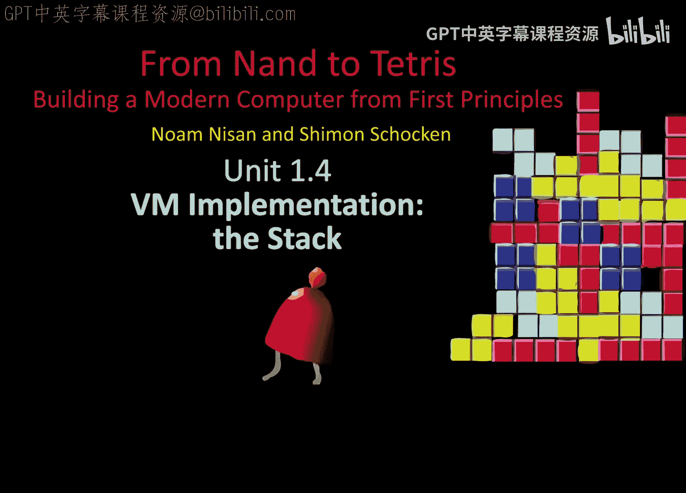

# 从零开始构建现代计算机：1-4：虚拟机实现：栈



在本节课中，我们将学习如何将抽象的虚拟机栈概念，在真实的计算机内存中实现。我们将从回顾栈的抽象操作开始，然后学习指针操作的核心概念，最后将 `push constant` 命令翻译成具体的机器指令。

---

## 栈抽象回顾

上一节我们介绍了虚拟机的抽象模型。现在，我们来看看如何实现它。首先，回顾一下栈的抽象操作。我们从一个任意的栈状态开始，目标是执行 `static 2 equals argument 1` 这样的虚拟机命令，以达到最终的栈状态。

需要明确的是，之前讨论的栈、内存段等都是抽象的，并不真实存在。为了在真实的计算机上执行这些操作，我们必须将它们映射到物理内存（RAM）上。

## 指针操作速成课

为了实现抽象，我们将使用一种称为“指针操作”的技术。以下是一个简明的介绍。

假设我们有一个典型的RAM。我们决定用符号 `P` 和 `Q` 来象征性地指代前两个RAM位置（Ram[0] 和 Ram[1]）。

考虑以下伪汇编语句：
```
D = *P
```
这里的规则是：`*P` 表示 `P` 所指向的内存位置。`*` 符号表示我们将 `P` 视为一个指针。

如果没有 `*`，`D = P` 会将 Ram[0] 的值（例如257）赋给 `D`。但有了 `*`，我们进行的是间接寻址操作：我们查看 Ram[0] 的值（257），将其视为一个地址，然后取出该地址（Ram[257]）的值（例如23），最后存入 `D` 寄存器。因此 `D` 变为 23。

要在 Hack 汇编语言中实现此操作，代码如下：
```
@P     // 等同于 @0，将地址0（P的地址）加载到A寄存器
A=M    // 将 Ram[0] 的值（257）加载到A寄存器，现在A=257，并选中 Ram[257]
D=M    // 将当前选中的 Ram[257] 的值（23）存入 D 寄存器
```

以下是另外两个在后续实现中会频繁使用的操作对：

**示例1：指针递减后取值**
```
P--        // P = P - 1，即 Ram[0] 的值减1（例如从257变为256）
D = *P     // 取出 P 新指向的地址（Ram[256]）的值（例如19）给 D
```

**示例2：指针解引用赋值后递增**
```
*Q = 9     // 将 Q 指向的地址（Ram[1024]）的值设为 9
Q++        // Q = Q + 1，即 Ram[1] 的值加1（从1024变为1025）
```

请注意，以上是高级伪代码。要实际运行，必须用目标计算机（如Hack）的汇编指令集重写每一条指令。

## 在物理内存中实现栈

现在，我们来看看如何在真实计算机上实现栈抽象。

我们做出两个重要假设：
1.  **栈指针（SP）** 将存储在 Ram[0] 中。
2.  **栈区** 将从地址 256 开始。

假设初始抽象栈包含 `[12, 5]`。在物理内存中，它们将被映射到从地址256开始的位置：Ram[256]=12，Ram[257]=5。栈指针（SP，即Ram[0]）始终指向下一个可用位置，因此其值为 258。

执行 `push constant 17` 后，抽象栈变为 `[12, 5, 17]`。在物理内存中，数字 17 被放入 Ram[258]（即之前SP指向的位置），然后栈指针递增为 259，指向新的下一个可用位置。

实现 `push constant 17` 的逻辑可以用两条伪指令描述：
1.  `*SP = 17`：将值17存入栈指针所指向的地址。
2.  `SP++`：栈指针加一，指向下一个可用位置。

## 翻译为 Hack 汇编代码

接下来，我们将上述逻辑翻译成具体的 Hack 汇编代码。

以下是 `push constant 17` 的实现：
```
// 将常数17存入D寄存器
@17
D=A

// *SP = D (将D的值存入SP指向的地址)
@SP    // A寄存器 = 0 (SP的地址)
A=M    // A寄存器 = Ram[0] (SP的值，即栈顶地址)
M=D    // Ram[A] = D (将17存入栈顶)

// SP++ (栈指针加一)
@SP
M=M+1
```

这段代码需要仔细理解：
*   前两行（`@17` 和 `D=A`）中，A寄存器被用作数据寄存器，目的是将常数17移入D寄存器。此时A寄存器选择Ram[17]的副作用被忽略。
*   中间三行（`@SP`， `A=M`， `M=D`）中，A寄存器被用作经典的地址寄存器。我们通过指针（SP）精心设置A的值，然后精确地将D的值存入A所指向的RAM位置（M）。

**重要提示**：如果你对这段代码的逻辑感到困惑，请务必回顾之前的指针操作示例，并确保你已完成并理解课程项目0。理解Hack汇编中间接寻址是学习后续内容的基础。

## 通用命令的实现

上面的例子中数字17并无特殊性。因此，我们得到的是通用命令 `push constant i`（其中 `i` 是任意非负整数）的实现模式。

通用命令 `push constant i` 的语义可描述为：
*   `*SP = i`
*   `SP++`

我们的任务就是编写一个 **VM 翻译器** 程序（可以用Java、Python等语言编写）。这个程序接收像 `push constant i` 这样的虚拟机命令流作为输入，并将其翻译（或称为“重新表达”）为实现其语义的多条汇编指令。

翻译器的工作就是从左（VM命令）到右（汇编指令），将高级抽象转化为机器可执行的低级代码。每条VM命令都会生成若干条汇编命令。

---

## 本节总结

本节课中，我们一起学习了虚拟机实现的第一步：栈的实现。
*   我们回顾了栈的抽象概念与物理实现的区别。
*   我们学习了指针操作这一核心概念，特别是间接寻址。
*   我们详细分析了如何将 `push constant` 这条虚拟机命令，通过指针操作，映射到物理内存，并最终翻译成具体的 Hack 汇编代码。
*   我们明确了 **VM 翻译器** 的角色：它是一个将VM命令流转换为机器语言指令的程序。


在接下来的单元中，我们将讨论如何实现之前介绍过的所有其他抽象命令。