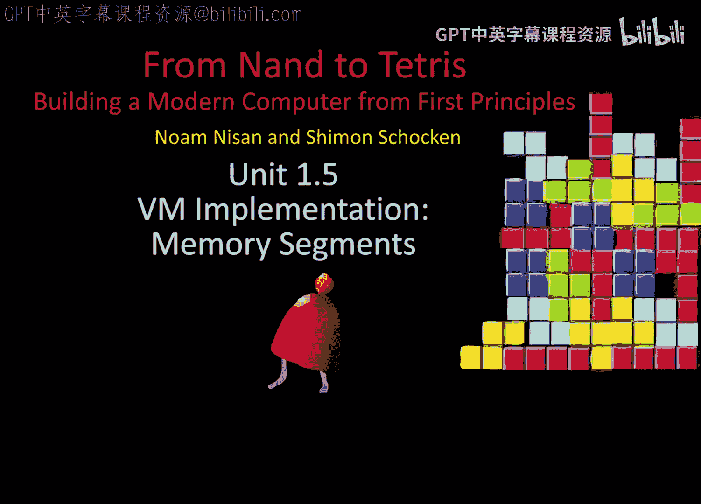

# 耶路撒冷希伯来大学《从零开始构建现代计算机2｜Build a Modern Computer from First Principles》中英字幕 p18 18_03_07_单元1-5_虚拟机实现：内存段.zh_en -BV1DA4m1w7FU_p18-

In the previous unit， we started to talk about the VM implementation and we went to the implementation of the stack architecture。

And in this unit， we'll continue with the implementation of the memory segments。Now， to remind you。

 we started this journey of the virtual machine with a stack that interacts with some abstract memory space。

 and then we replaced this abstract space with8。Me segments whose names are local argument， this。

 that constant static pointer and temp。And the question， of course。

 is how do we implement these memory segments on the host computer？Well before we get started。

 let us note that the obstruction of these memory segments is quite a uniform。

 We address any location in any segment using exactly the same syntax push pop segment name followed by and and non- negativeative integer so examples include push constantt 17 pop local 2 and so on and so forth so how should we go about implementing these memory segments well we'll do it one step at a time beginning with local now the local segment is accessed using the uniform syntax that we had all along push pop segment name index so here's the local segment in the context of our this simple example of a stack machine and how do we realize these two data structures。

On the host Ramm Well the stack is going to be implemented as we did in previous units。

 we will start the stack at 256， which is an agreed upon convention and we use a pointer that we call S to record the address of the next location the next available location in the stack and we decided that S will be mapped on Ram0 in the host memory。

Now what about the local segment Well the local segment can be placed in principle anywhere we want on the whole Ramm。

 we don't care where the local segment is going to be stored as long as we remember the base address of this block and as you see here we've decided to place the base address of the local segment in a pointer called LCL and we also decided that LCL will refer to Ram1。

So as you see in the example， the local segment begins。

 happens to begin in this arbitrary address that I made up 1015 and LCL contains the same address。

 so notice that indeed we're using two pointers， but we use them in a very different way。

 the stack pointer points to the next available location and the stack and LCL points to the base address of the local segment。

All right， so here's how we use this implementation when we set out to implement commands like P and P。

So here is you know the same Ram segment that we had before and S and LCL are mapped as we had before and following the pop local2 command here's what is going to happen S has changed to reflect the pop operation and we see that the number 5 which used to be the topmost value on the stack is now located in in local2 which happens to be 1017。

 Now how do I know that local2 is 1017 well that's simple I take the base address which is 1015 I know this information right it's always stored in LCL and I add the offset or the index2 to it and by adding up these two values I get the value of the target address on which。

I have to store the popped value。Okay， so that's how I can generalize this translation process。

 I can take the base address and add the offset to it。

Another thing which is interesting to note here is that look at address 257。

RightIt contains the value 5， but notice that this value is out of play。 You know， it it's kput。

 it's dead。 It doesn't know it， but it's dead because the stack pointer now points to 57。

 So the next push。Wwhichch will happen probably at some point is going to kill this number5。

 and that's perfectly okay。 So it's quite typical when you manage a stack that you have all sorts of garbage along the stack and yet the pointers you know indicate exactly which part of the stack are in play and which are kind of game and can be recycled at will。

😊，All right， so how can we translate the P operation where we can do it using thesedo assembly code that you see here。

 first of all we compute the target address which is LCL plus2 in this example。

 we store it in some temporary variable if we need such a variable。

Then we decrement the stack pointer。And we take the value which is stored now under the stack pointer or the value that the stack pointer points at and we put it into the address that ADDR points it。

 So this is the semantics that we want to implement and how do we implement it in assembly well that's your job to do it。

 You know you have everything that is necessary in order to translate suchsoo instructions。

 obviously you will need the hec language， you will need the a command， the C command and so on。

 So that's a little a little sort of riddle that you have to solve and once you do it you will know how to always implement pop local i commands。

So in general， indeed you have to observe that there's nothing special about this number two I can replace two with I and then everything will work just as well as it did before instead of doing you know LCL plus2 I will do LCL plus I so I managed to indeed generalize this translation completely and I know how to handle pop local I so here is the generalized translation of pop local i command what we see on the right- hand side is exactly what we had in the previous slide and the push local i command is implemented in a very similar way。

 somewhat symmetric so we compute the target address as we did before and then we carry out a push operation using sort of twosedo instructions and once again in order to actually make it happen your V and translator。

😊，Has to generate the assembly instructions that will realize this pseudocode using the hec language。

 Now， I would like to extend the picture and talk now about these four segments together。

 the local argument， this and that segments。And it always helps to sort of extend also our perspective and remember or think about where these segments come from or what purpose do they serve in the sort of larger enterprise of what we are doing。

Well think about a typical method in let's say in Java which is operating in runtime well this method typically has local variables。

 it has argument variables， typically it processes some current object。

 which is also a bundle of so-called member variables I think。

 and also the method may well process some array that also has entries which are you know data values。

So when we translate this logic into the world of the virtual machine。

 we have to preserve all these semantics。 Well， we do this with the local an argument memory segments as well as with two other segments that we call this and that。

 this segment stores the member variables or the values of the fields of the current object and the that segment stores。

 the values of the array that the current method may be processing。 So basically， you know。

 we have we are using these four segments in order to capture this semantics also at the Vm level。

 So how do we implement these four memory segments。 Well， first of all。

 let us remember that abstractly we use them exactly the same way， right， we do push and pop。😊。

Segment name， index。 and that's it。 We don't need anything beyond that。

 So they are accessed in a uniform fashion。 Well， I'm very glad to report that we also implement them in a precisely the same way。

 In addition to the stack pointer， which is always available。 We are now also going to use for。😊。

Pointers which are called LCL arg this and that。And every one of these pointers is going to do exactly what the LCL pointer did in the previous slides。

 they are all implemented precisely the same way， and every one of them holds the base address of the respective memory segment that it relates to。

And therefore， the implementation of the commands push and pop is also going to be exactly the same。

 We are going to use the same semantics that we used for the local segment。

 But instead of saying local will say segment pointer name where。You know。

 the segment pointer being you know the right， the corresponding pointer to。

To the memory segment that we are dealing with in the source code， in in the VM code。Now。

 you may well ask yourself a good question here， which is。Wait a minute。

 where exactly on the Ram these segments are going to be located。 Well， the answer is， we don't care。

Okay we don't care because you know they're going to be located somewhere and all we have to do is remember the base address of these dynamic allocations Well later in the course we'll see that deciding where to put these segments in memory is a very interesting question and we solve this question using all sorts of clever algorithms which are going to be part of the operating system and the compiler that together we'll decide where to map these segments on the wholeRA the next segment that I want to discuss is called constant。

And the context of， of， of these constants is that when the compiler。

Encountters constants in your program， in your high level source program。

It handles these constants by generating VM commands that include or that that use the the constant memory segment。

 So it is going to be。Reexpressed using operations like push constant something or pop constant something on the stack。

So how do we implement these operations Well， here's the generic push constant I command。

And there's no pop constant because， you know， it doesn't make any sense to store something in this constant and the implementation of this constant is trivial because this is a truly virtual segment。

 right， it doesn't really exist， So whenever we see a push constant i command。

 we simply generate lowle code that supplies the specified constant。

 So we do asterisk S equals you know the specified constant and then we advance the stack pointer。

So this has been the treatment of the constant segmentMoving along。

 the next segment that we are going to deal with is the static segment。Now。

 what's the story of this segment， where does it come from？Well。

 the compiler that handles your high levelve code may well encounter some static variables。

 know these are the so-called class level variables that every method in your class Cs。

 So obviously we have to treat these variables differently than in the way we treat local variables or argument variables and so on and therefore we've decided that in the virtual machine obstruction we will use a dedicated segment called static to represent static variables in the source code。

 so every operation on a static variable in the source is going to be reexpressed as a push static I or pop static I operation at the VM level。

 so here is how we're going to implement static variables。Well。

 we start with some example of VM code in which。Using static variables comes to play in the context of pop instructions。

Now， let us remember what static variables are all about。

Unlike local variables and argument variables， which are unique for each VM function。

Static variables are at the higher level of scoping。And therefore。

 all the VM functions in your program should see the same static variables。And therefore。

 since we have this functional requirement， it makes sense to store or actually it's required to store the static variable in some global space that all the code which is generated from these VM functions will see the same static variables。

And so the decision that we decided to undertake is to have the VM translator translate each reference to static I in some VM file4。

 VM into the assembly reference do I， so the prefix of this label is the name of the file and I is the index which is taken from the VM command。

 static 5 I equals 5 static 2 I equals 2。And so if we follow this convention which will become understood in just a few seconds。

 then the VN translator is going to translate P static 5 into well first there will be some code which I omitted that carries out a pop from the stack and the topmost value from the stack is going to go into I suppose the D register。

 the data register and then we have to put it into our assembly level incarnation of static 5 how do we do it well we generate a label called 4。

5。And then we say M equals D。What about the other command， Well。

 we handle it in exactly the same fashion。 only instead of five， we're going to generate two。Now。

 why is this going to actually work out？ Well， remember。Following assembly。

The heck asler by convention is going to map these references onto Ram 16， Ram 17。

 you know all the way down to Ram 255 I'm sorry，200 yeah 255 in case you have so many static variables in your program which is unlikely。

 you know typically we have just a few static program variables in a typical computer program。

So what will happen is that these references will end up being mapped to the blue area that you see here on the Ram。

 and that's exactly what we want。Because you see this blue area is outside the stack。And all。

The functions which are running in your program can take a look at this Ram area and see exactly the same thing。

 the static variables。And so。In using this trick here。

 we basically took advantage of this unique convention in the heck assembly that in the heck assembly of mappingping symbolic variables onto the Ram from position 16 onward。

And， therefore。The entries of your static segment are going to mapped on to be mapped on Ram 16。

 Ram 17， and so on in the order in which they appear in your VM code。And therefore。

 you will have this slightly peculiar situation in which static 5 in this example will go to。

Ram 16 static 2 will go to Ramm 17， you know assuming that static 2 that there are no more static variables declared and used in between So theres no one to one there is a one to one mapping。

 but the order of the indexes index values is is not you know the same as the order of the Ram entries。

 it just it' the order of appearance in the code which determines you know where each one of these variables will be mapped on the Ram。

So that's how we implement the static segment。 It's a little bit hairy， but it works。

 and it works quite well。And I'd like to sort of say makes a general observation about this implementation here。

 and that is that up until this point， up until we discussed static variables。😊。

Everything that I said in this module was completely platform， agnostic。After all。

 you know every computer has a Ram and everything that I said about implementing local argument and so on did not make any assumptions about the underlying platform。

 a side of the assumption that there is a stack somewhere。

 which is a very safe assumption because once again， we can you every computer has a stack somewhere。

And it is only here in the implementation of static variables that we take an exception to this platform independence elegance。

 and we actually take advantage of something which is unique to the heCC assembler。

 So once again up until now everything that I said can be implemented on any computer out there。

 not necessarily on the hec platform and yet if you want to implement the static segments。

 you have to find some other tricks to do it if you decide to implement our virtual machine on a computer which is not a heCC machine。

All right， moving along， the next segment that we want to discuss is T。

Now why do we need a temp segment， well it so happens that when the compiler generates code。

 when it translates your J program into VM code， it sometimes has to use some temporary variables。

So we decided that we are going to allocate an eighth place segment called T that will contain and serve these variables when needed。

Allright， so here's how we do it。 The push and the pop are uniform exactly as we had before。

 and yet temp is going to be a fixed eight plus memory segment and we decided to allocate or to map this segment on ram locations5 to 12。

 So altogether we have eight values there and therefore the translation of push and pop are going to take this base address 5 obviously into account。

 So it's almost the same as the translations that we had previously except that the base address is now five instead of one of the segment pointers。

 So that's how we implement the temp segment The last segment that we have to worry about is called pointer。

And the pointer segment is a little bit obscure and it's obscure because you can't understand really why we need it until you begin to write the compiler。

 which is something that we'll do down the road in the course。

 So for now I'm just going to explain the pointer segment as you know some sort of an almost an arbitrary rule of the game and given my explanations。

 you will have all the information in order to actually realize it on the target machine。So。

 first of all， where does this segment come from？ Well。

 it turns out that when the compiler translates a method。

 it has to remember the base addresses of the this and that segments。 You know。

 these are the segments that represent。The current object and the current array that the method may be processing。

 So we decided to keep the base addresses of this and that in this pointer in this sorry segment。

 which we decided to call pointer。So here are the rules of the game。

Pointer is a fixed memory segment。 It has only two entries，0 and1。 and therefore。

 the only push and pop commands which are applicable here are push and pop pointer 0 and 1。

 and any other integer is simply invalid in the context of pointer。Now。

 what do we do with these commands。 This was just the syntax of the commands。 Well。

 whenever the VM code tries to x as 0 0。It should result in accessing this and whenever it wants to access0 of1。

 it should result in accessing that。 So the implementation should service these push and pop commands by supplying this and that。

So with this in mind or with that in mind， as you please。

Let me say a few words about how we actually do this implementation。So the push pointer zero command。

Should be implemented as follows。 You want to create assembly code that realizes the abstractstruction S S equals this followed by S P plus plus。

If the VM command is push pointer1， you do exactly the same， but you use that instead of this。

And the handling of pop pointer is symmetrically similar。

Now I wish to remind you that the assembly code that you see here is Seelda code and you have to realize this S code using heCC assembly。

So that's how we handle the pointer segment。Now。I must admit that this segment and the way we use it and realize it may sound somewhat peculiar and strange。

 but you shouldn't worry about it because it will make perfect sense once we talk about cogeneration when we set out to write the jack compiler for now let us just strive to to create this functionality that I described here。

Now before we end this unit， I'd like to recap and observe what we are doing。

 so basically were implementing the VM language， which consists of arithmeticological commands。

 memory access commands。Branching commands and function commands By now we've implemented the first two categories of commands and the remaining two categories are going to be handled in the next module of the course。

 so before we get to this module well still have some work to do here so I'll meet you in the next unit when we talk about the VM emulator。

