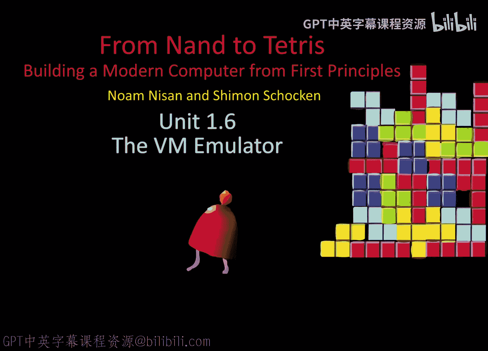
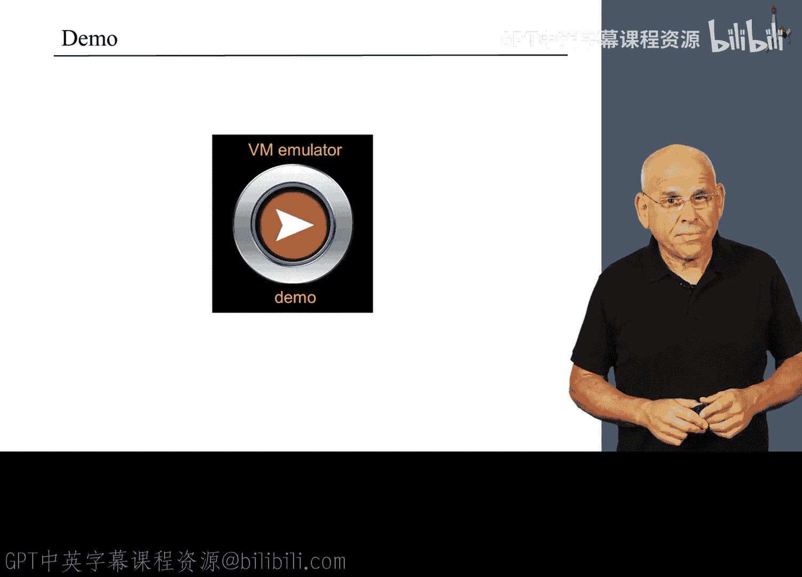
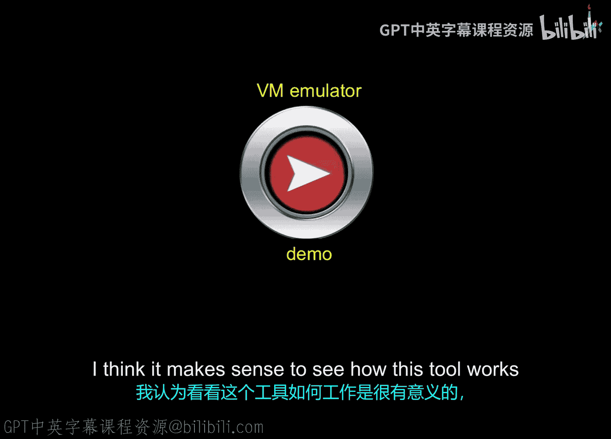
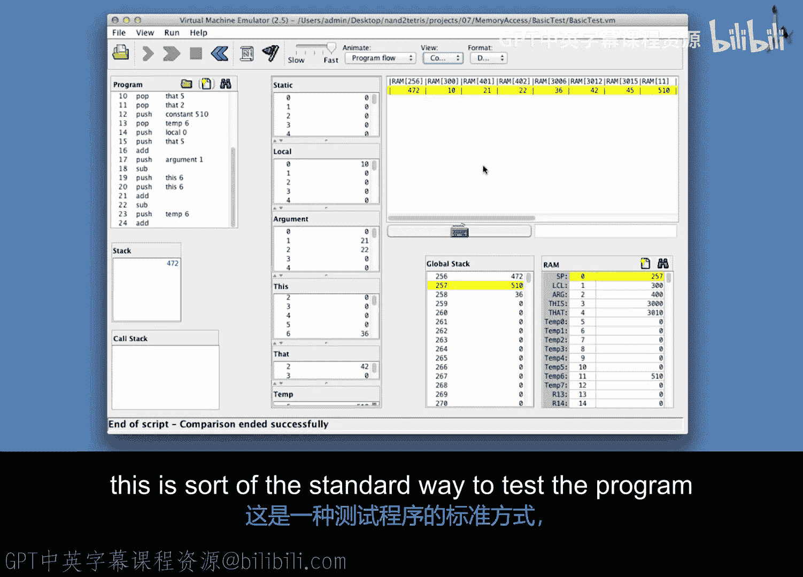
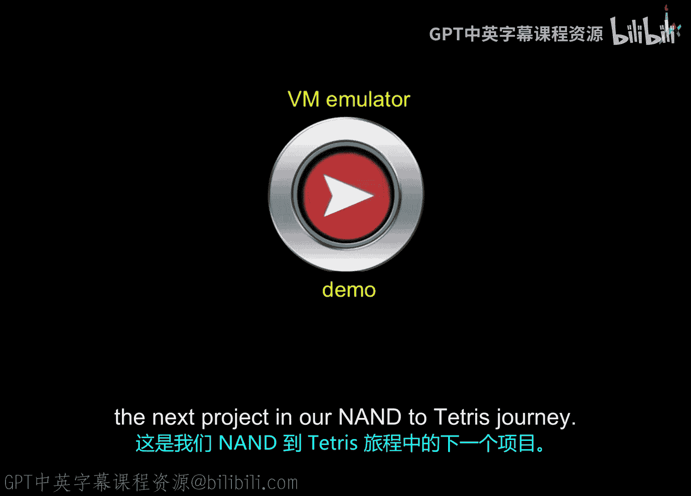
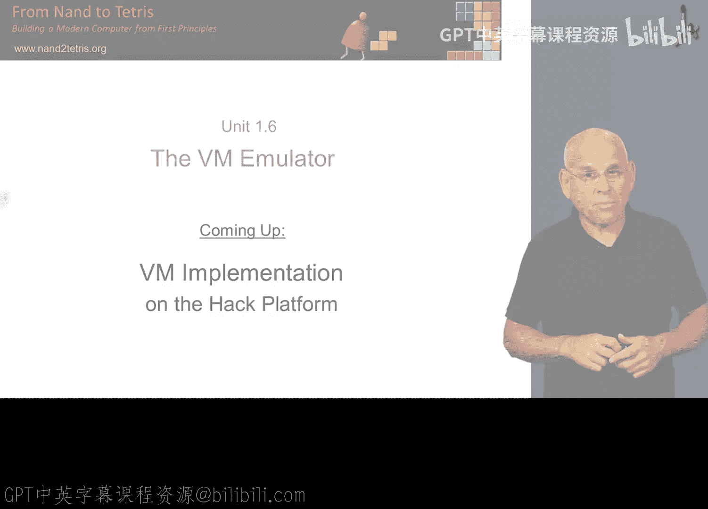

# 耶路撒冷希伯来大学《从零开始构建现代计算机2｜Build a Modern Computer from First Principles》中英字幕 p19 19_03_08_单元1-6_虚拟机模拟器.zh_en -BV1DA4m1w7FU_p19-

Welcome to Unit 16 in which we are going to discuss the VM emulator。

The VM emulator is a very versatile and useful tool that will come to play in many stages during this course。

 beginning with the present module。So let me start by placing the VM emulator in the larger scheme of what we are doing。

Now to remind you， our overall purpose is to translate highlel programs written。

 say in the jack language into machine language and in order to do it we use a two stage compilation model so in the first stage we compile from the high levelve to VM code and in the second stage we have to somehow execute this VM code on the target platform。

One way to do it is to translate the VM code into machine language and then load the binary code into the target platform。

 in this case， the he computer and execute it。And there's also a shortcut which enables you to run the VM code as is and you can do this using the VM emulator so the VM emulator is a highle program it's written in Java in our case and you can run this VM emulator on any computer including your own PC and indeed if you downloaded the Nan totetris software suite you have on your computer。

 the VM emulator that I'm going to discuss throughout this unit。

 people use the VM emulator for various purposes。First of all。

 it provides the most natural and simplest way to execute compiled J programs。

And even if this program has all sorts of visual effects like bouncing balls and playing Teetris and so on。

 you're going to get all these goodies in the VM emulator environment。

And you can also test the programs in a systematic way using supply test scripts。

 which is also a nice feature of this tool。And also people use the VM emulator in order to understand the VM obstruction。

 if you want to single step through a VM program and observe the impact of every push and pop command and so on on the virtual segments and the stack。

 the VM emulator provides a very friendly environment to do just that。And finally。

 the VM emulator also gives you a glimpse into how the VM abstraction is actually being hosted on the hostt platform。

 and this will become clearer as we go on in this unit。😊，So here's the VM emulator in all its glory。

And beginning。With the lefthand side we see some VM code loaded into the VM simulator environment。

 this is the code which presumably is now running and we also see a set of controls that enables us to control this code single step through it fast forwardward increase the speed in which the code executes and so on here we see the output that the program presumably generates in this case some bouncing ball and the VM emulator is built in such a way that this pane in which the output is displayed is kind of a multipurpose window and it can serve the user you as a means with which you can look into various files like the output file that your script is generating the script file compare file and will illustrate all these as we go along。

Then we can take a look at the stack and see how it changes in response to various push and pop commands。

 and finally we can also look at the virtual memory segments and see how they are being affected by the VM program。

There are a few more controls and features of the VM emulator that I will discuss later on。

So here's an example of what we do in general， with this tool。We take some piece of code。

 We load it into the D emulator。 And then there are a few things that we have to watch for when the code is executing。

 First of all， we have to。Understand or， you know。We view this VM emulator as some sort of a handson laboratory so we can look at the code and see how it impacts the stack and the virtual memory segments and by doing so we will understand better how the VM obstruction is working and we can also look at the right hand side of the VM emulator's GuI。

And if we take a look at this area， we'll see how the VM obstruction is actually being realized on the host platform。

 on the Ram of the host computer。So we get sort of a dual view of both the obstruction and its implementation。

 and it's very instructive and powerful because you can really see how the virtual machine works in two different layers of interest。

😊，Now the next topic that I'd like to discuss is the notion of a test script。

 which is central to Project 7 that you will have to do in the context of this module。

 So here's a test script。 It's just a plain text file typically supplied by us。

And the first thing in this test script is typically a load command。

 which tells the simulator to load a VM file into the simulator's environment so that we can execute and test it。

Now these VM files are typically supplied by us， or you can write files of your own。

 but if you want to do it， you have to use an external text editor。

And save it with some you know file name dot VM， and then you can use a load command like this one in order to load it into the simulator's environment。

 you can also load it interactively， but here were discussing the notion of a test script which does everything kind of batch style。

The next command in a test script typically defines an output file into which the test script is going to write some values during the execution of the program。

 so for now we have an empty output file。Then typically。

 the supply test scripts also load a compare file which is supplied by us and the compare file。

You know looks like different compifier look differently。

 typically e lists the names of several selected containers like selected areas in the RA or in the memory segments and so on。

 so you get the names of the containers and the current values or the values the script expects to see during the program's execution。

Now what we'll see next is some output formatting command。

 and the good news is that you don't really have to fully understand all the syntax of these test scripts because。

You know we provide all these test scripts that are written in what we call TDL testing description language。

 it's not really part of the course and we don't have to delve into it we have enough challenges elsewhere。

So once again， we just have to understand the spirit of what's going on。

And the next thing that weve see in the test script is a loop that instructs the simulator to execute the program。

 one VM command at a time， and in this particular case in the case of the basic test do VM file。

 we have 25 instructions， so 25 iterations will be enough to carry out the execution of this code。

And finally， in this particular test script， we see that we have only one output command at the end of the script。

 And when the simulator executes this command， it will。😊。

It will print to the output file all the variables that were defined in the output list command in the preamble of the script Now here's the deal。

If。The generated output file is the same as the supplied compare file。

 we say that the test is successful and the simulator will give you a positive message that the test has completed successfully if however there is some discrepancy the simulation stops and you get an error message。

So that's the basic idea of using a test script。😊，Now， as it turns out。

Because we split the development of the VM translator into two stages， project7 and project 8。

In Project7， there are some missing elements that have to be dealt with。In particular。

The programs that we run in Project 7 are。Not really programs。 They are。

 You can think about them as a sequence of instructions。

And what is missing in these programs or what is missing in these sequences in order to make them programs are what I call the function and return envelope。

And the function and return commands later on in Project 8 will cause the VM implementation to initialize the various segments that the method or the function expects to use。

 the local segment， the argument， segment， the this that and so on。So in product 7。

 these segments are not initialized anywhere and therefore someone has to take care of of these initializations and we do it using the test script。

 So as you see we write a set of commands I mean once again these test scripts are supplied to you by us and what we did is we added。

Btches of commands that initialize the virtual segments manually and anchors them on selected areas in the RA。

 So once we execute this setup stage in the test script， the VM code will run properly。

So what I'd like to do next is give you a more detailed example of the VM emulator in action。

I would like to illustrate the working of the VM emulator in the context of Project 7 because in this particular project you are required to handle several VM files and therefore I think it makes sense to see how this tool works in the context of a project that you have to do yourself。

 So what we have here is my Nanttetriris folder and let me go into projects and within projects I select Project 7。

And within these two folders， I'm going to select memory access。And within memory access。

 let us go into basic test。And I see that I have four files here。The first one is a compare file。

 The second one is a test script， the third one is VN code and the fourth one is yet another test script。

 So it's interesting。 Why do we have two test scripts here？ Well。

 this is something that I will explain later on。So let me bring up my VM emulator。

And proceed to load the VM file that we have in front of us。

 So I go to a basic test and I see that I have a basic test dot VM。I load it。And let's see。

 it looks like we have。24 commands， actually，25， including command number 0。

 So let's start executing it by single stepping through the code。

So the first command is push 10 and indeed we see that we have 10 in the stack。So， things look good。

Pop local 0。 Let's execute it。Oops， I got an error message out of segment space。Well。

 the problem is that。In this particular VM file， we don't have function declaration command at the beginning of the code。

And therefore， no one told the simulator so to speak。

 that it has to allocate memory space for the virtual memory segments， the static。

 local argument and so on。 and therefore we ran into this problem。So the quick and easy way to。

 to handle this challenge of anchoring。The memory segments in the Ram is to use test scripts。

 So instead of loading the VM code， we always recommend to load instead the test script if。

 if such is available。 So let let's do that。 And we have two test scripts here will choose this one。

 The VME dot TSD。We load it。And it seems like nothing happened。 Well。

 that's because we have a little bug in the Gui。 If you click the spa here。

You will see the test script in all its glory。 And now we can begin executing it。

 So I'm going to single step， as I did before。So， let's click。Run。

And we see that several commands got executed within the test script。And indeed。

 the test script always executes or or the simulator always executes all。

The test script commands up to a semi column。 So kma is considered a micro step。

 A semi column is considered the end of of a step， and therefore。

When we did single step we told the simulator to execute the first four commands。

 The first command was load basic test VM， so the simulator essentially reloaded the file that already happened to be in the program pane and it's very good that we reload it because normally you know we may want to do some debugging in the middle so it's always good to sort of start from fresh。

And then the test script defined an output file， used a certain compare file and so on。Well。

 all this is not terribly important to understand because， you know。

 we don't expect you to delve into the details of the code of the test script。

 You just have to understand the spirit of what is going on。 So let me click the single step again。

And we see that we executed all these commands and the first VM step。 So indeed。

 we did a push constant 10， and we see that the stack contains 10。 Very nice。 indeed。

 well execute another command。And we see that the command that we executed was pop local 0。

 and indeed， local 0 now contains 10。So， let me push 21。And push 22。Pop argument 2。 indeed。

 we see the argument 2 now contains 22。 Very nice。Push 36， pop this 6。 We see that。 well。

 we haven't yet executed it。 So let me execute it。Pop this6。 and we see that this6 now contains a 36。

 push 42， push 45， the stack contains 42 and 45。 So things seem to be sailing smoothly so far。

 And at this point， if I want， I can also take a look at the host platform and see how what I did so far is being reflected in the underlying host platform。

 which happens to be the he computer。 So I'm going to shift my attention to the host Ram。

 And I see that the stack pointer is 258。Now， this makes sense because according to the standard。

VM mapping on the hack platform。 The stack should be should begin at 2，56。 and indeed， we had。

A command in the test script that said set S B to 256。 So stack pointer was initialized to 256。

 and we now have two values in the stack。 and therefore the stack pointer should be 256 plus 2。

 which is 258。 But just to make sure， you know， I can also scroll down the Ram here。2。

56 should not be too far away。Indeed， here it is。 And lo and behold。

 I now see how the stack is hosted in the host rim。 It's right here。42。

45 and stack pointer presumably not presumably。 I know that stack pointer points at2 58。

So things look nice as far as the stack is concerned。And I can explore some other things。

 For example， it's interesting to see where the argument segment is stored。 Well， Arg is 400。

So let me use this binocular control here。And enter 400。And this takes me to address 400 in the Ram。

 And I see that what I have here is 0，21，22， which is the same as what we have here。 So on the left。

 we have the abstractstruct rendition of the。Argument segment。 And on the right。

 we have a glimpse into how this abstractstruction is actually implemented on the horse platform。

Alright， going back to the code， I can continue to single step through it。

 but this becomes a little bit tedious， so I can also fast forward。

And if this is not fast enough to my liking， and I can also use this slider to make it faster。Now。

 when we fast forward， we essentially carry out a succession of single step events。

And in every one of these single step， we carry out the test script commands up to the next semi column。

 So basically， we went to this loop here and we did 25 iterations and 25 iterations were enough because in this particular program we have only 25 instructions。

 Now， how do we know that the program actually did what it's supposed to be doing。Well。

 typically computer programs are designed to carry out something very concrete。

 like you know bouncing a ball on the screen or staging a Teris game or deciding if a given number is a prime and therefore the testing of these programs in many cases is relatively straightforward。

 but in this particular program and in other programs in Project 7。

 some of the code is rather obscure because it doesn't have some global purpose in mind。

 but rather it is written in order to test or I should say unit test specific VM operations on the stack and on some of the memory segments。

 and therefore if you want to test this program and the VM level then you can either follow each instruction in isolation interactively as we did before in this demo or you can let the supplied test script carry out the test on its own so to speak。

And in order to do this， you run the test script until it ends。

 And then if you get the nice message end of script comparison ended successfully。

 you can conclude that the program has passed the mandated the test。Now。

 the logic here is that when you execute a script file。

 whenever the simulator encounters an output command within the script。

 it compares the results of this output to the current line in the compare file。

And if the output line and the compare file line are in agreement throughout the execution of the script。

 then at the end， you're going to get this nice positive comparison ended successfully message if there is some discrepancy along the way。

 the simulation is going to stop and you're going to get an error message。Now。

 if you want to get into the details of this process， you can go to this control here。

And take a look for example， at the output file that this particular script has generated。 Now。

 in this script， we had only one output command at the very end of the script。 and indeed。

 we have only one line of output。 and this line displays the values of some select words from the memory that taken together can。

 you know， help you ascertain that the program has done what what it was supposed to do。

So we can look at the output。 We can also look at the compare file。

 and we know that the compare file will be the same as the output， because otherwise。

 we would not have gotten this nice。Completion or program completion message。 And once again。

 this is sort of the standard way to test the program。

Using the supplied test script。So this is the end of our VM emulator demo。

 There are a few bells and whistles in the features of the emulated software that I decided not to illustrate because we don't need them at the current level。

 We will need them when we start working on Project 8， the next project in our N totetriris journey。

So to recap the VM emulator has several purposes， first of all it allows us to run and test highlevel programs or compiled J programs。

 and also its a hands on lab that allows us to delve into and understand both the VM obstruction and its implementation。

So I hope that you enjoyed this basic introduction to the VM emulator and in the next unit we are going to talk about the VM implementation on the heCC platform。

