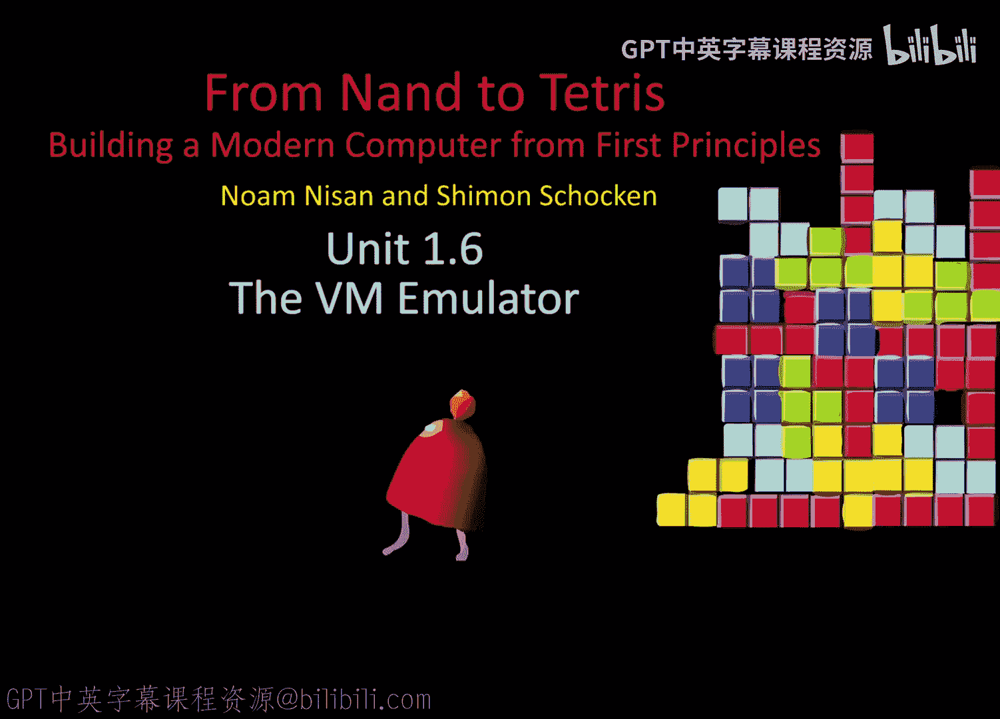
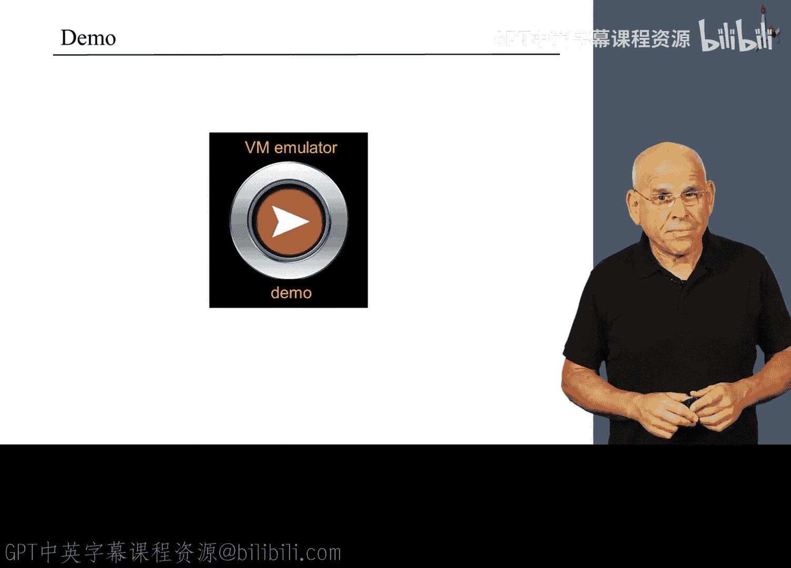
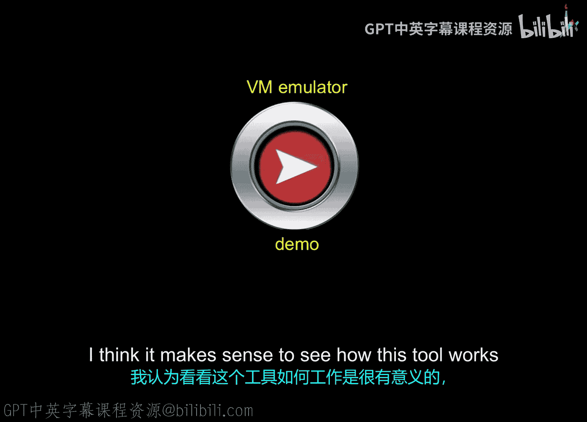
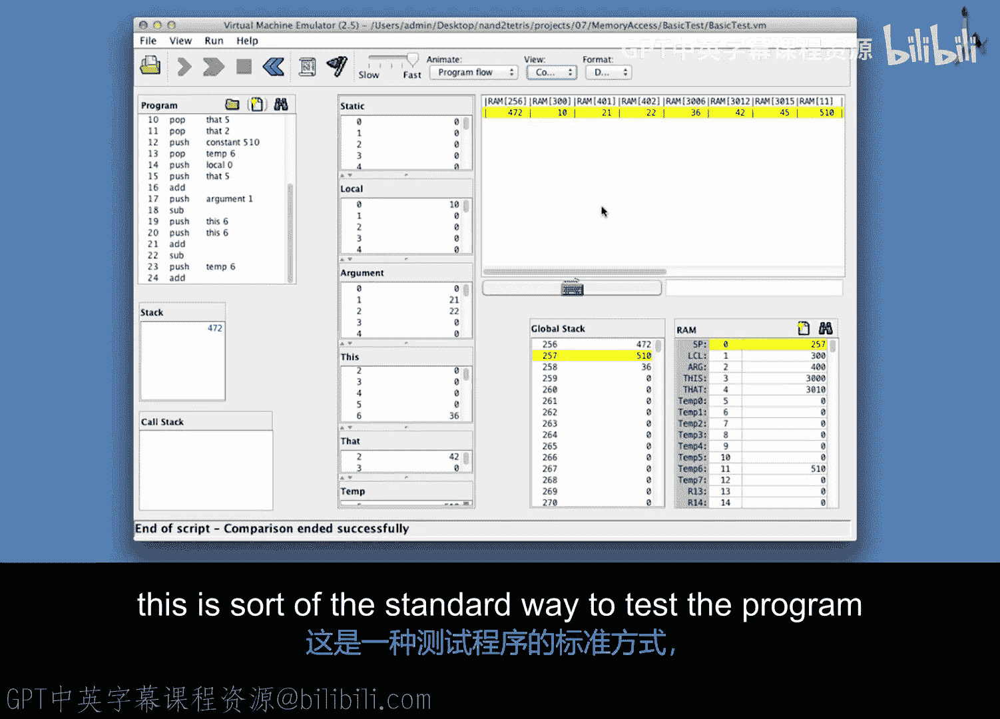
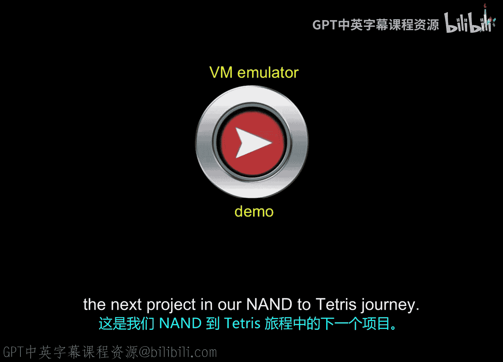
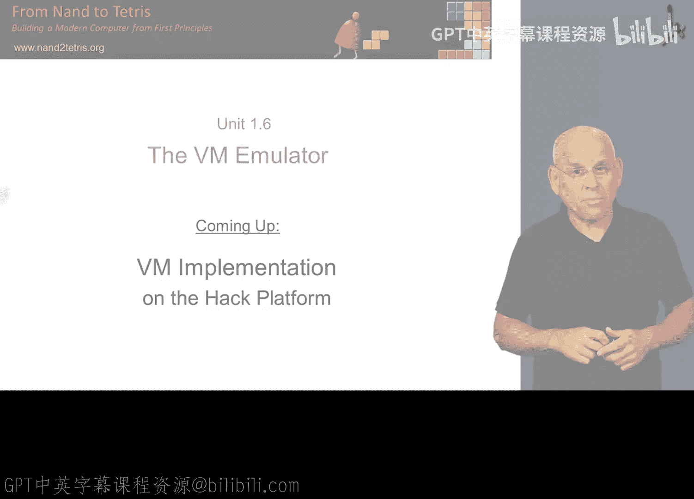

# 从零开始构建现代计算机2：单元1-6：虚拟机模拟器 🖥️

在本单元中，我们将学习虚拟机模拟器。这是一个功能多样且非常有用的工具，将在本课程的多个阶段发挥作用，从当前模块开始。

## 概述

首先，让我们将虚拟机模拟器置于我们正在进行的整体工作框架中。我们的总体目标是将用高级语言（例如Jack语言）编写的程序翻译成机器语言。为了实现这一目标，我们采用两阶段编译模型：第一阶段将高级语言编译成虚拟机代码；第二阶段，我们需要在目标平台上执行这些虚拟机代码。

一种方法是将虚拟机代码翻译成机器语言，然后将二进制代码加载到目标平台（在本课程中即Hack计算机）上执行。此外，还有一种快捷方式，允许您直接运行虚拟机代码，这可以通过虚拟机模拟器实现。虚拟机模拟器是一个高级程序，在我们的案例中是用Java编写的，您可以在任何计算机（包括您自己的个人电脑）上运行它。如果您已经下载了Nand2Tetris软件套件，那么您的电脑上就已经有了我们将在本单元讨论的虚拟机模拟器。

## 虚拟机模拟器的用途

人们使用虚拟机模拟器有多种目的。

首先，它提供了执行已编译Jack程序最自然、最简单的方式。即使程序包含各种视觉效果，如弹跳球、玩俄罗斯方块等，您也将在虚拟机模拟器环境中获得所有这些功能。

其次，您可以使用提供的测试脚本系统地测试程序，这也是该工具的一个优点。

此外，人们还使用虚拟机模拟器来理解虚拟机抽象。如果您想单步执行一个虚拟机程序，并观察每条push和pop命令等对虚拟内存段和堆栈的影响，虚拟机模拟器提供了一个非常友好的环境来实现这一点。

最后，虚拟机模拟器还能让您一窥虚拟机抽象是如何在宿主平台上实际实现的，随着本单元的深入，这一点将变得更加清晰。

## 虚拟机模拟器界面介绍

这就是虚拟机模拟器的完整界面。

在左侧，我们看到一些虚拟机代码被加载到虚拟机模拟器环境中，这些代码目前正在运行。我们还看到一组控件，允许我们控制代码的执行，例如单步执行、快进、调整代码执行速度等。

在这里，我们看到程序生成的输出，在本例中是一些弹跳球。虚拟机模拟器的设计使得这个显示输出的窗格是一个多功能窗口，它可以作为用户查看各种文件（如脚本生成的输出文件、脚本文件、比较文件等）的工具，我们将在后续过程中说明所有这些功能。

然后，我们可以查看堆栈，观察它如何响应各种push和pop命令而变化。最后，我们还可以查看虚拟内存段，观察它们如何受到虚拟机程序的影响。

虚拟机模拟器还有一些其他的控件和功能，我将在后面讨论。

## 工具使用示例

以下是我们通常使用此工具所做工作的一个示例。

我们取一段代码，将其加载到虚拟机模拟器中。当代码执行时，我们需要关注几件事情。

首先，我们将虚拟机模拟器视为一种动手实践的实验室。我们可以查看代码，观察它如何影响堆栈和虚拟内存段。通过这样做，我们将更好地理解虚拟机抽象是如何工作的。

我们还可以查看虚拟机模拟器GUI的右侧。如果我们查看这个区域，我们将看到虚拟机抽象是如何在宿主平台（宿主计算机的RAM）上实际实现的。

因此，我们获得了抽象及其实现的双重视图。这非常有指导意义且功能强大，因为您可以在两个不同的关注层面上真正看到虚拟机是如何工作的。

## 测试脚本的概念

接下来我想讨论的概念是测试脚本，这是您在本模块中需要完成的项目7的核心。

以下是一个测试脚本。它通常是一个由我们提供的纯文本文件。

测试脚本中的第一项通常是一个load命令，它指示模拟器将一个虚拟机文件加载到模拟器环境中，以便我们可以执行和测试它。

这些虚拟机文件通常由我们提供，或者您也可以编写自己的文件。但如果您想这样做，必须使用外部文本编辑器，并以类似“文件名.vm”的格式保存。然后，您可以使用像这样的load命令将其加载到模拟器环境中。您也可以交互式地加载它，但这里我们讨论的是以批处理方式完成所有事情的测试脚本概念。

测试脚本中的下一个命令通常定义一个输出文件，测试脚本将在程序执行期间向该文件写入一些值。目前，我们有一个空的输出文件。

接着，提供的测试脚本通常还会加载一个由我们提供的比较文件。比较文件看起来各不相同，通常它会列出几个选定容器（如RAM或内存段中的选定区域）的名称。因此，您会看到容器的名称以及脚本期望在程序执行期间看到的当前值或值。

接下来我们将看到的是一些输出格式化命令。好消息是，您并不需要完全理解这些测试脚本的所有语法，因为我们提供了所有这些用我们称之为TDL（测试描述语言）编写的测试脚本。这实际上不是课程的一部分，我们不需要深入探讨，我们在其他地方已经有足够的挑战了。

再次强调，我们只需要理解正在发生的事情的精神即可。

我们在测试脚本中看到的下一件事是一个循环，它指示模拟器一次执行一条虚拟机命令。在本例中，对于basic test.vm文件，我们有25条指令，因此25次迭代足以执行此代码。

最后，在这个特定的测试脚本中，我们看到在脚本末尾只有一个输出命令。当模拟器执行此命令时，它将把脚本序言中输出列表命令定义的所有变量打印到输出文件中。

规则是这样的：如果生成的输出文件与提供的比较文件相同，我们就说测试成功，模拟器将给您一个积极的消息，表明测试已成功完成。然而，如果存在任何差异，模拟将停止，您将收到错误消息。

这就是使用测试脚本的基本思想。

## 项目7中的特殊考虑

事实证明，由于我们将虚拟机翻译器的开发分为两个阶段（项目7和项目8），在项目7中，有一些缺失的元素需要处理。

具体来说，我们在项目7中运行的程序并不是真正的程序。您可以将它们视为一系列指令。为了使这些序列成为程序，缺少的是我称之为“函数与返回封装”的部分。

在项目8中，函数和返回命令将导致虚拟机实现初始化方法或函数期望使用的各种内存段（局部变量段、参数段、this、that等）。因此，在项目7中，这些内存段没有在任何地方初始化，因此必须有人负责这些初始化工作，我们使用测试脚本来完成。

正如您所见，我们编写了一组命令（再次强调，这些测试脚本是由我们提供给您的），我们添加了一些命令来手动初始化虚拟内存段，并将它们锚定在RAM中的选定区域。一旦我们在测试脚本中执行了这个设置阶段，虚拟机代码就能正常运行了。

## 虚拟机模拟器实战演示

接下来，我想在项目7的背景下更详细地演示虚拟机模拟器的实际工作，因为在这个特定项目中，您需要处理多个虚拟机文件，因此我认为看看这个工具在您必须自己完成的项目背景下如何工作是很有意义的。

以下是我的Nand2Tetris文件夹，让我进入projects目录，在projects中选择Project 7。

在这些文件夹中，我将选择memory access。在memory access中，让我们进入basic test。我看到这里有四个文件。第一个是比较文件，第二个是测试脚本，第三个是虚拟机代码，第四个是另一个测试脚本。这很有趣，为什么我们这里有两个测试脚本？我稍后会解释这一点。

让我启动我的虚拟机模拟器，并加载我们面前的虚拟机文件。

我进入basic test，看到一个basic test.vm文件。我加载它。我们看到有24条命令，实际上包括第0条命令是25条。让我们通过单步执行代码来开始执行。

第一条命令是push constant 10，确实我们看到堆栈中有10。看起来不错。

下一条是pop local 0。执行它。哎呀，我收到一个错误消息“out of segment space”。问题是，在这个特定的虚拟机文件中，代码开头没有函数声明命令，因此，没有人告诉模拟器需要为虚拟内存段（静态、局部、参数等）分配内存空间，所以我们遇到了这个问题。

解决这个将内存段锚定在RAM中的挑战的快速简便方法是使用测试脚本。因此，我们总是建议加载测试脚本，而不是直接加载虚拟机代码（如果有的话）。让我们这样做。我们这里有两个测试脚本，我们将选择这个VME.tst文件。

加载它。看起来什么都没发生。这是因为GUI中有一个小问题。如果您点击这里的空格，您将看到完整的测试脚本。现在我们可以开始执行它了。我将像之前一样单步执行。

点击“Run”。我们看到测试脚本中的几条命令被执行了。确实，模拟器总是执行测试脚本中直到分号的所有命令。逗号被视为一个微步骤，分号被视为一个步骤的结束。因此，当我们执行单步时，我们告诉模拟器执行前四条命令。

第一条命令是load basic test.vm，所以模拟器基本上重新加载了已经存在于程序窗格中的文件。这很好，因为我们可能想在中间进行一些调试，所以最好总是从新鲜状态开始。

然后，测试脚本定义了一个输出文件，使用了某个比较文件等等。所有这些并不是非常重要，因为我们不期望您深入研究测试脚本代码的细节。您只需要理解正在发生的事情的精神即可。

让我再次点击单步执行。我们看到我们执行了所有这些命令和第一个虚拟机步骤。确实，我们执行了push constant 10，并且看到堆栈中包含10。很好。

执行另一条命令。我们看到我们执行的命令是pop local 0，并且确实，local 0现在包含10。

让我执行push constant 21，push constant 22，pop argument 2。确实，我们看到argument 2现在包含22。很好。

执行push constant 36，pop this 6。我们看到this 6现在包含36。

执行push constant 42，push constant 45，堆栈包含42和45。到目前为止，一切似乎进展顺利。

此时，如果我愿意，我还可以查看宿主平台，看看我目前所做的如何反映在底层宿主平台（即Hack计算机）上。因此，我将把注意力转向宿主RAM。

我看到堆栈指针是258。这是合理的，因为根据Hack平台上的标准虚拟机映射，堆栈应该从256开始。确实，我们在测试脚本中有一条命令说“set sp 256”。所以堆栈指针被初始化为256，现在堆栈中有两个值，因此堆栈指针应该是256加2，即258。但为了确认，我也可以向下滚动RAM。256应该不远。确实，在这里。看，我现在看到了堆栈是如何在宿主RAM中实现的。它就在这里：42、45，堆栈指针指向258。

就堆栈而言，一切看起来都很好。

我可以探索其他一些事情。例如，看看参数段存储在哪里很有趣。Arg是400。让我使用这里的双筒望远镜控件，输入400。这将带我进入RAM中的地址400。我看到这里的内容是0、21、22，这与我们在这里看到的相同。因此，在左侧，我们有参数段的抽象表示。在右侧，我们看到了这个抽象结构是如何在宿主平台上实际实现的一瞥。

回到代码，我可以继续单步执行，但这变得有点繁琐，所以我也可以快进。如果这还不够快，我还可以使用这个滑块让它更快。

当我们快进时，我们本质上执行了一系列单步事件。在每一个单步中，我们执行测试脚本命令直到下一个分号。基本上，我们进入了这里的循环，并执行了25次迭代，25次迭代就足够了，因为在这个特定程序中我们只有25条指令。

现在，我们如何知道程序确实做了它应该做的事情？通常，计算机程序被设计来执行非常具体的任务，比如在屏幕上弹跳球、运行俄罗斯方块游戏或判断一个给定数字是否为质数，因此在许多情况下测试这些程序相对直接。

但是，在这个特定程序以及项目7的其他程序中，有些代码相当晦涩，因为它没有考虑某些全局目的，而是为了测试（或者我应该说单元测试）堆栈和一些内存段上的特定虚拟机操作而编写的。因此，如果您想在虚拟机级别测试这个程序，您可以像我们之前在这个演示中那样交互式地单独跟踪每条指令，或者您可以（可以说）让提供的测试脚本自行执行测试。

为了做到这一点，您运行测试脚本直到它结束。然后，如果您收到“End of script: comparison ended successfully”这样的好消息，您可以得出结论，程序已经通过了规定的测试。

这里的逻辑是，当您执行脚本文件时，每当模拟器在脚本中遇到输出命令，它就会将此输出的结果与比较文件中的当前行进行比较。如果输出行和比较文件行在脚本执行过程中始终一致，那么在最后，您将收到这个积极的“comparison ended successfully”消息。如果中途出现任何差异，模拟将停止，您将收到错误消息。

如果您想深入了解此过程的细节，可以转到这个控件，例如，查看此特定脚本生成的输出文件。在这个脚本中，我们只在脚本末尾有一个输出命令。确实，我们只有一行输出。这一行显示了一些从内存中选定的字的值，这些值共同可以帮助您确认程序已经完成了它应该做的事情。

因此，我们可以查看输出。我们也可以查看比较文件，我们知道比较文件将与输出相同，否则我们就不会收到这个漂亮的程序完成消息。再次强调，这是测试程序的标准方式。

## 总结

我们的虚拟机模拟器演示到此结束。模拟器软件中有一些额外的功能和特性我决定不演示，因为我们在当前阶段不需要它们。当我们开始进行项目8（我们Nand2Tetris旅程中的下一个项目）时，我们将需要它们。

总而言之，虚拟机模拟器有几个目的：首先，它允许我们运行和测试高级程序或已编译的Jack程序；其次，它是一个动手实践的实验室，允许我们深入研究和理解虚拟机抽象及其实现。

我希望您喜欢这个关于虚拟机模拟器的基本介绍。在下一个单元中，我们将讨论虚拟机在Hack平台上的实现。