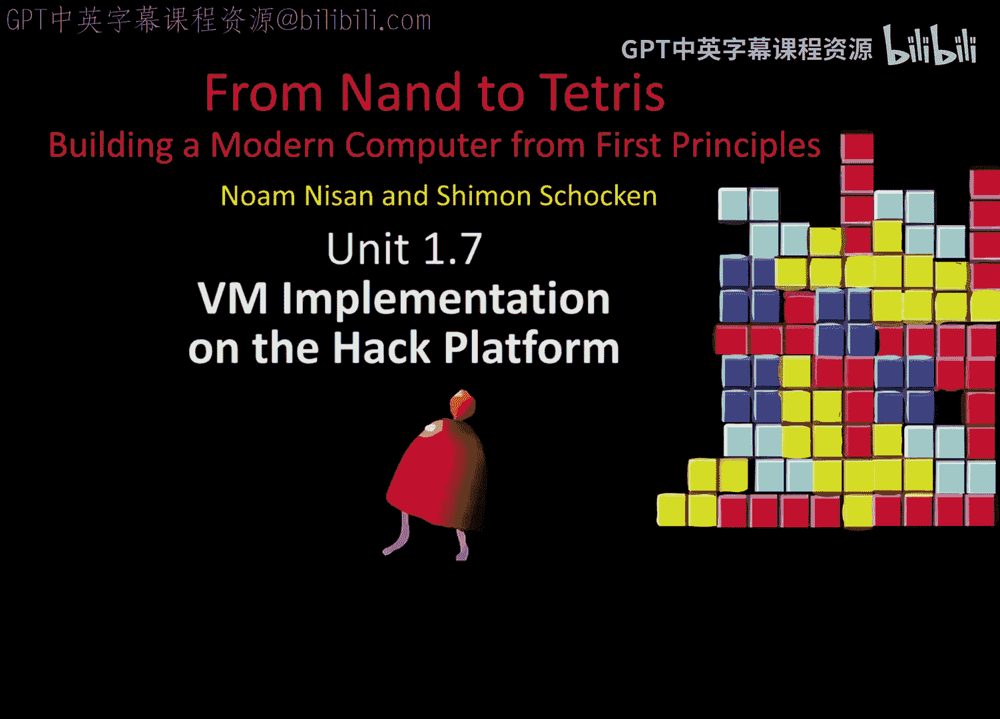

# 耶路撒冷希伯来大学《从零开始构建现代计算机2｜Build a Modern Computer from First Principles》中英字幕 p20 20_03_09_单元1-7_Hack平台上的虚拟机实现.zh_en -BV1DA4m1w7FU_p20-

In this unit， we are going to discuss how we implement the VM obstruction that we introduced so far on one specific hardware platform。

 which is the heCC computer Now to begin with， I would like to refresh your memory about what is the VM translator to begin with Well the VM translator is a program written in some highleve language like Java or Python。

And or any other language and the program gets is input， another program written in VM code。

 VM commands like pushP and so on， and then it passes this file， it passes each individual command。

 it breaks it into various lexical elements like push constant and the integer2。

 and then using these lexical elements it reexpresses these commands using assembly commands of the target platform。

 which in our case is he， and therefore we use the hec assembly language。

Now notice that what we have on the right is the output file and one thing that I recommend that you do when you get to develop this translator is that whenever you translate a particular command。

 you write，A comment that you know shows this command this will help you debug your the output of your VM translator down the road Now naturally each VM command which is high level in this context is going to be translated into several assembly commands as we saw when we talked about translation in previous units Now if you want to write you know a general purpose program that can translate any given text in in the French language into the Spanish language。

 it really helps if you first know these two languages French and Spanish likewise。

 if you want to write VM translator， you have to be competent in both the source language the target language and you also have to know something about you know where should we place the various virtual data structures like the stack。

The segments on the host computer。And how are we going to translate the highle commands into into the assembly commands So with that in mind the source language that we have to deal with is the VM language consisting of arithmetic logical and memory access commands as well as branching commands and function commands。

 but in this particular project in Project 7 we are going to focus only on the arithmetic logical and memory access commands and in the next project that will be the centerpiece of the next module project8。

We will complete the picture and handle also the branching and the function commands。

 the target of our translation is going to be a symbolic hack language and you know we went through this language in module0 and you know this language consists of two major commands。

 the A command and the C command and that's it， that's all you need in order to translate your VM programs into assembly。

Now another thing that we need to know is what is sometimes called the standard V mapping on the target platform now let me explain what I mean by you know what let me first show you the standard mapping and then we'll discuss why we actually need it。

So basically， we have to make two decisions， how to map the VM's data structures on the host RA and also how to express the commands in the host language。

Now the standard mapping。Gives you all sorts of。Information or conventions on how we propose that you achieve this mapping。

 because think about it。 You know， if I tell you to implement a VM translator， basically。

 you are free to do whatever you want。 You know， I can tell you， here's the Ram。

 do whatever you want with it。 However， it is convenient and customary to propose a certain standard napping that will ensure two things。

 First of all。If you agree to put you know the various segments in where you advise where we advise to put it in the Ram。

 then you're going to conform to you know generally accepted standards that are also accepted by developers of other software tools that run on the same computer。

 So you know if everyone respects the same rules these programs will not collide in the memory and also if you commit yourself to a certain mapping on the RAm。

 then we can write all sorts of test programs that also makes similar assumptions and by doing this。

 the team that tests the software can be another team other than that that actually develop the software which always is recommended in order to in order to perform objective testing So that's the purpose of the standard mapping。

 So here's a standard mapping of the VM on the he computer。

Basically I repeat things that we discussed in previous units but I just wanted to put them in one slide so you will have all of it in one place。

 we use the first five words for the segment pointers。

 then the next eight words serve as the implementation of the temporary the temp segment。

 then we have several I think three general purpose registers。

 then we have 250 or 240 something static variables and the rest of the memory all the way up to 2K is going to serve as the place where we're going to host or store the stack of the virtual machine。

So all these segments that we mentioned before are going to be mapped onto this REm using the logic that you see in this slide。

 you know I don't want to read all this， it's something that you can go through yourself。

And if we want to achieve this mapping， then when we write the VM translator。

 we have to use certain symbols。 Once again， certain agreed upon symbols。

 when we generate the assembly code that realizes the VM code on he。 So in particular。

 we're going to use S as a special label that stands for the stack pointer。

 we are going to use LCL A this and that as the segment pointers of the respective memory segments。

 we are going to use R 13， R 14， R 15。 whenever we need to use some。Special purpose。

 some you know general purpose registers。 And finally， if you recall。

 we describe in the previous units how we are going to use special labels specially generated labels in order to represent static variables。

 the final name dot some running index will stand for the static variable that has the same running index。

 So your VM translator， when when you write it， when you write it in order to generate assembly code。

 your code is going to use these symbols， you have to be responsible for writing code that generates these labels and uses them judiciously in order to implement in order to realize the mapping that we just describe。

 Now， finally， I would like to mention that in project 8 in which we are going to implement the remaining VM commands that we haven't implemented here。

 we are going to extend this mapping somewhat and add a few more。Pensions to it。So with that。

 this has been our unit on how to map the VM translator or the virtual machine on the host RAM and the host computer and now we'll finally come to discuss how to actually build this program using a high level language。

