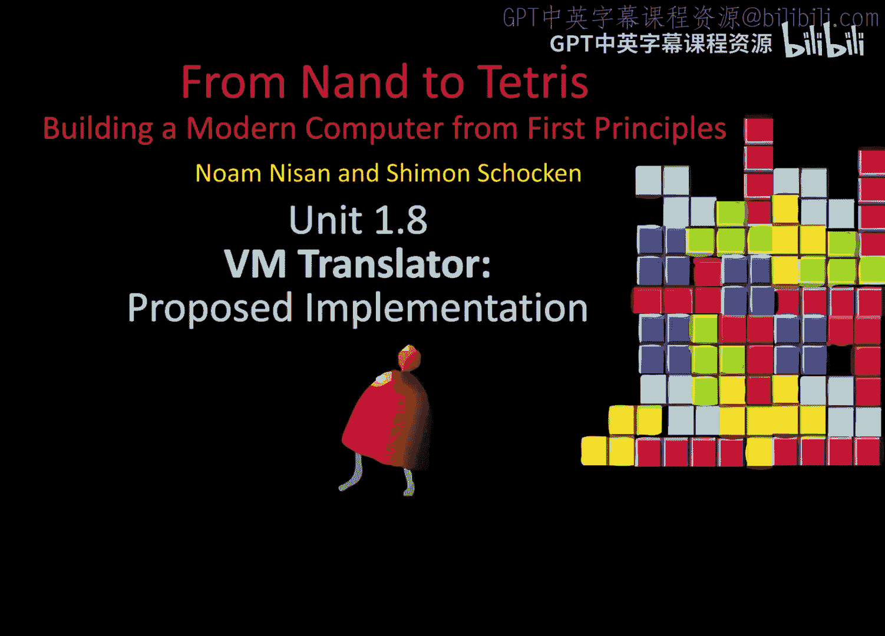

# 耶路撒冷希伯来大学《从零开始构建现代计算机2｜Build a Modern Computer from First Principles》中英字幕 p21 21_03_10_单元1-8_虚拟机翻译器建议实现方案.zh_en -BV1DA4m1w7FU_p21-

All right， so let us begin to discuss how to actually build a VM translator using some high level language。

Well， to begin with， I'd like to remind you， as I did in the previous unit what the VM translator is all about。

 It's a program that reads a given text file which contains VM commands and produces from it another text file that contains assembly commands。

 So， for example the VM translator can you know begins to pass this particular command。

 the push Con 17， breaks it into its lexical elements and builds from it。

The output at 17 d equals a and so on and so forths。 Then it moves on to the next command。

 It passes it also， and then it generates the assembly code that realizes push local2 on the target platform。

 Then it does the same with add it reads add and it does some you know hoku focus in assembly that causes a stackorienteded operation。

 pop local2 is translated into a set of assembly commands that represent pop local to and so on and so forth until the end of the input file。

 So that's what the Vm translator is all about。 What I would like to do next is show you how this VM translator will be used once you end up writing it。

 So you know let us assume that we've implemented a VM translator and we want to apply it to a particular。

Pro that we wrote before， know either a test program or some real program that we wrote in one way or another。

 and now we seek to translate this program into assembly code， how do we do it？Well。

 on my computer I open a terminal window， if this were Windows。

 I would probably do the same using the command prompt。

 and then because I wrote this VM translator using Java。

 I apply the Java runtime system my VM translator and I supply the name of the source program as a parameter to my VM translator。

And once the translation has ended， if I will look again into the current directory。

 I will see that a new file was created， this new file has the same name as my input file。

 but it has a different extension， an ASM extension and presumably this file contains the assembly code。

 which is the translation of the source VM code。Now， obviously。

 the next thing that I would do is I would。Take a very eager look into this ASM file using some plain text editor。

 and I would like to try to make sure that the code that my VN translator generated is indeed valid。

 but that's a separate story。 we'll discuss it later when we talk about compare files and and so on。

 So now that we've seen this VN translator in action。

 we are ready to talk about how to actually build the VM translator。Now。

 it really all depends on which implementation language you're going to use。

 and it can be Java or Python， for example。And whichever language you will use。

 we recommend a certain software architecture， which we think is appropriate for this project。So。

 we propose to。Develop three standalone modules， if you will， or in the world of Java。

 this will be called three different classes， a par class。

 a code writer class and a main class and the main class is just a surrogate name for the class that we saw before which will be called VM translator。

 so the main class， the VM translator has one input which is a file name dot VM and it generates as output。

 a file name do ASM as we saw in the demo that I previously showed you。Now。

 how does this main class operate Well， the logic of this main class is that it will have some。

 you know main method that does the following。 first of all。

 it constructs a parer in order to handle the input file and will discuss this parer later on。

 then it constructs a code writer to handle the generation of the code that we have to output and will discuss this code writer later as well。

And then once we have these two objects set up， we can march through the input file through file name do VM。

And handle each row in this file separately。For each of these rows， which represent a VM command。

 we can pass this row or line using our par sorry， using our parer functionality and once we pass this line into its constituent VM elements。

 we can pass you know this information to the code writer in order to generate the appropriate code in assembly that we will later put together and write to the output file。

So that's the general logic of the main class called a VM translator。

 and that's what you have to implement when you develop this particular class。Now。

 I'd like to point out that as you see。In order to implement this class。

 you have to know how to handle text files in your implementation language。 So for example。

 if you use Java， you have to know how to open a text file。

 how to read the next line from this file you have to know how to open file for output you have to know how to write strings into this output file and so on。

 and all of this， you know obviously is not part of this course， it is on you。

 we assume that you know how to handle files in your implementation language and if you don't maybe you want to take a break from this course and spend a few hours on learning how to do this。

 using Java Python or whatever language you use for this project。 Allright。

 so here's the API of the three modules actually the two remaining modules， the parer。

And the code writer， the par once again handles the passing of a single VM file。

 it reads a VM command， it breaks it into its individual elements。

 and it passes this information to the code writer。And in the process。

 it also removes all the white space and the comments from the source file。

 so it doesn't really remove them。 it simply ignores them。

 it goes over the white space and focuses only on the real essence of the file。

 which are the commands themselves。 So as usual a module consists of a set of methods and constructors and here is what we propose to do which propose to first of all。

 write a constructor whose job is to open the input file for processing。

 So it receives as a parameter， a string which is the name of the file and it goes on to open it。

Then this method has more commands， which is a Boolean。

 and it simply tells you if there are more commands to process in the input file。

If there are more commands to process， if has more commands is true。

 then we can do in advance and by advance we take the current command。

 the command that we are now looking at in the file and we turn it into what we call the current command within our program and we are going to refer to this current command in many different places。

So moving along， the command type method looks at the current command and decides if this command is an arithmeticological commands or a push or a pop or a label or a goto and so on and so forths and for every one of these command types。

The command type method returns a constant and once again other methods in our API will use this constant down the road。

 Then there are two methods called AG1 and Arg2 which return the arguments of the current command and you can read the specification to see exactly what these methods have to return。

 So this completes the description of the Passer API。Moving along here's the code writer API。

This class or this module is responsible for generating the assembly code from the past commands。

It also has a constructor and the constructor opens the output file for processing and gets ready to write onto this file。

 then theres a right arithmetic method which is responsible for writing the assembly code that implements the command which is the parameter of this method。

 and this is you where most of your work will be invested because know based on which command you are currently processing。

 you have to write assembly code and there are several such commands。

 so there's some significant work to be done with this particular method。And the next method。

 right push pop is also a heavyweight method because。Based on whether you have a push。

 a pop and the segment and the index， you have to generate assembly code that implements this particular command and finally there's a closed method that simply closes the output file and that's the end of the story。

 So this completes the API of our basic VM translator and more routines will be added to this API in the next project where we handle the rest of the VM language Now obviously what we gave here is what we think is a good architecture for the VM translator and you are welcome to add to your own code。

 more private methods which are not exposed to the outside and use these private methods to make your code more manageable elegant and readable。

And with that I want to remind you what is the big picture of what we are doing。

 we have described the implementation of a VM translator that can handle the arithmeticological and the memory access commands and what remains to be done is to complete this translator in the next project to handle also the branching commands and the function commands。

 so that's the end of this module and moving along the next module will describe how you actually have to do it and submit the project。

