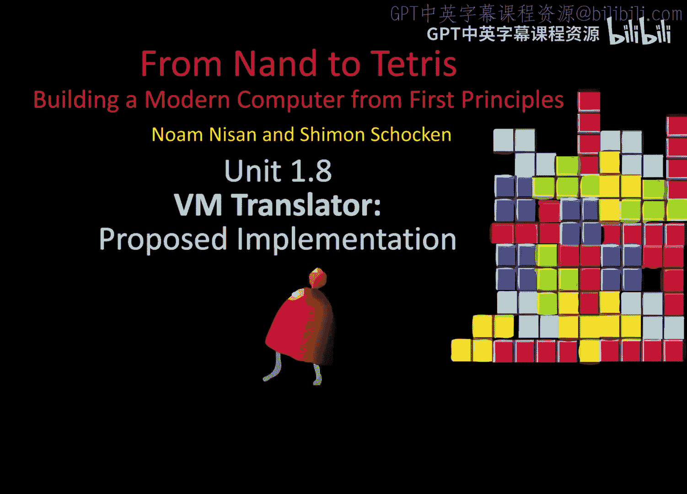

# 从零开始构建现代计算机2：单元1-8：虚拟机翻译器实现方案 💻



在本节课中，我们将学习如何实际构建一个虚拟机翻译器。我们将讨论其整体架构、核心模块的设计以及实现的具体步骤。

## 概述

虚拟机翻译器是一个程序，它读取包含虚拟机命令的文本文件，并生成包含汇编命令的另一个文本文件。其核心任务是将高级的虚拟机指令逐行翻译成底层的汇编代码。

## 虚拟机翻译器的工作原理

上一节我们介绍了虚拟机翻译器的概念，本节中我们来看看它的具体工作流程。

虚拟机翻译器的工作流程如下：
1.  读取输入的 `.vm` 文件。
2.  逐行解析文件中的虚拟机命令。
3.  根据命令类型（如算术运算、内存访问）生成对应的汇编代码。
4.  将生成的汇编代码写入输出的 `.asm` 文件。

例如，对于 `push constant 17` 这条命令，翻译器会将其解析为词法元素，并生成类似 `@17`、`D=A` 等汇编指令。接着，它会继续处理下一条命令，如 `push local 2`，并生成实现该栈操作目标的汇编代码。这个过程会持续到输入文件结束。

## 如何使用虚拟机翻译器

假设我们已经实现了一个虚拟机翻译器，并希望用它来翻译一个之前编写的程序（无论是测试程序还是实际应用）。操作步骤如下：

1.  打开终端窗口（或在Windows中使用命令提示符）。
2.  运行虚拟机翻译器程序。例如，如果使用Java编写，则通过Java运行时系统调用它，并将源程序文件名作为参数传入。
    ```bash
    java VmTranslator MyProgram.vm
    ```
3.  翻译完成后，在当前目录下会生成一个与输入文件同名但扩展名为 `.asm` 的新文件。这个文件包含了由源虚拟机代码翻译而来的汇编代码。

之后，我们可以使用纯文本编辑器查看这个 `.asm` 文件，以验证生成的汇编代码是否有效。

## 构建虚拟机翻译器的架构

现在我们已经了解了虚拟机翻译器的用途，接下来讨论如何构建它。具体实现取决于你选择的编程语言（如Java或Python）。我们推荐采用一种由三个独立模块组成的软件架构。

以下是这三个核心模块：

*   **主类 (Main Class / VM Translator)**：这是程序的入口点。它接收一个 `.vm` 文件名作为输入，并生成对应的 `.asm` 文件。
*   **解析器类 (Parser Class)**：负责处理输入文件。它读取虚拟机命令，将其分解为独立的组成部分（如命令类型、参数），并忽略空白字符和注释。
*   **代码写入器类 (CodeWriter Class)**：负责生成汇编代码。它根据解析器提供的信息，编写实现特定虚拟机命令的汇编指令。

主类 `VM Translator` 的运行逻辑如下：
1.  构造一个 `Parser` 对象来处理输入文件。
2.  构造一个 `CodeWriter` 对象来处理输出代码的生成。
3.  遍历输入文件的每一行（每条虚拟机命令）。
4.  对于每一行，使用 `Parser` 的功能进行解析。
5.  将解析得到的信息传递给 `CodeWriter`，以生成相应的汇编代码。
6.  将所有生成的汇编代码整合并写入输出文件。

在实现这个主类时，你需要掌握所用编程语言中处理文本文件的方法（例如，在Java中如何打开、读取、写入文件）。这是完成本项目的基础。

## 模块API详解

以下是 `Parser` 和 `CodeWriter` 这两个核心模块的应用程序接口（API）设计。

### 解析器 (Parser) API

解析器模块负责解析单个VM文件。它读取VM命令，将其分解为各个组成部分，并将信息传递给代码写入器。在此过程中，它会忽略源文件中的所有空白和注释。

其核心方法包括：

*   **构造函数 Parser(String fileName)**：打开输入文件/流以进行处理。
*   **boolean hasMoreCommands()**：检查输入中是否还有更多命令。
*   **void advance()**：从输入中读取下一条命令，使其成为当前命令。仅当 `hasMoreCommands()` 为真时才调用此方法。
*   **CommandType commandType()**：返回当前命令的类型。它是一个枚举常量，如 `C_ARITHMETIC`、`C_PUSH`、`C_POP` 等。
*   **String arg1()**：返回当前命令的第一个参数。对于算术命令，返回操作命令本身（如 “add”）。对于其他命令类型，返回内存段（如 “local”）。
*   **int arg2()**：返回当前命令的第二个参数（一个整数）。仅对 `C_PUSH`、`C_POP`、`C_FUNCTION`、`C_CALL` 命令有效。

### 代码写入器 (CodeWriter) API

这个类/模块负责根据解析后的命令生成汇编代码。

其核心方法包括：

*   **构造函数 CodeWriter(String fileName)**：打开输出文件/流并准备写入。
*   **void writeArithmetic(String command)**：编写实现给定算术命令的汇编代码。这是主要的工作部分之一，需要为不同的算术/逻辑命令生成对应的汇编指令。
*   **void writePushPop(CommandType command, String segment, int index)**：编写实现 `push` 或 `pop` 命令的汇编代码。这是另一个核心方法，需要根据内存段（如 `local`、`argument`、`static` 等）和索引生成相应的内存访问指令。
*   **void close()**：关闭输出文件。

这个API构成了基础虚拟机翻译器的核心。在下一个处理完整VM语言（包括分支和函数命令）的项目中，还会向此API添加更多例程。

我们在此提供的是一个推荐的架构。你可以在自己的代码中添加更多的私有方法（不对外暴露），以使代码更易于管理、更优雅、更可读。

## 总结


本节课中我们一起学习了虚拟机翻译器的实现方案。我们描述了能够处理算术逻辑和内存访问命令的虚拟机翻译器的实现架构。剩下的工作是在下一个项目中完善这个翻译器，以同时处理分支命令和函数命令。接下来的模块将具体描述如何完成并提交该项目。