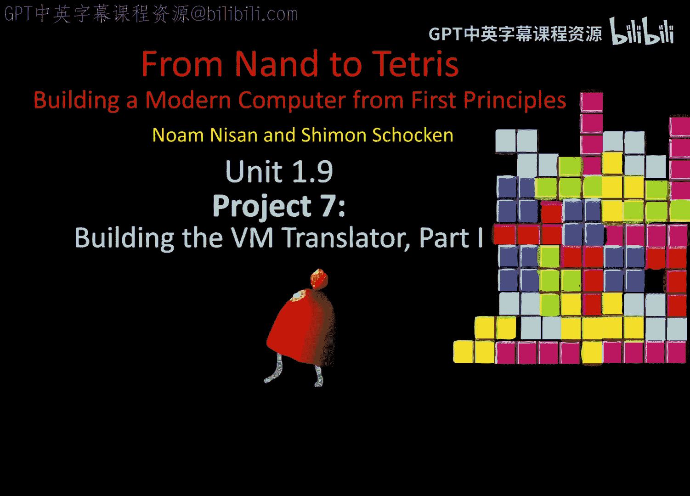
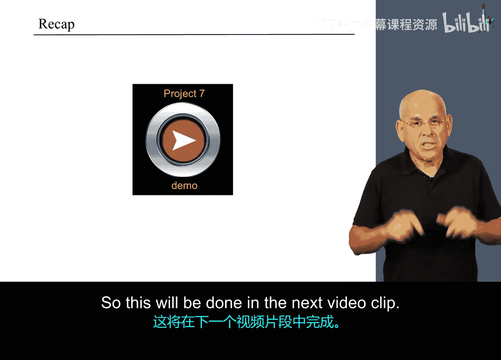
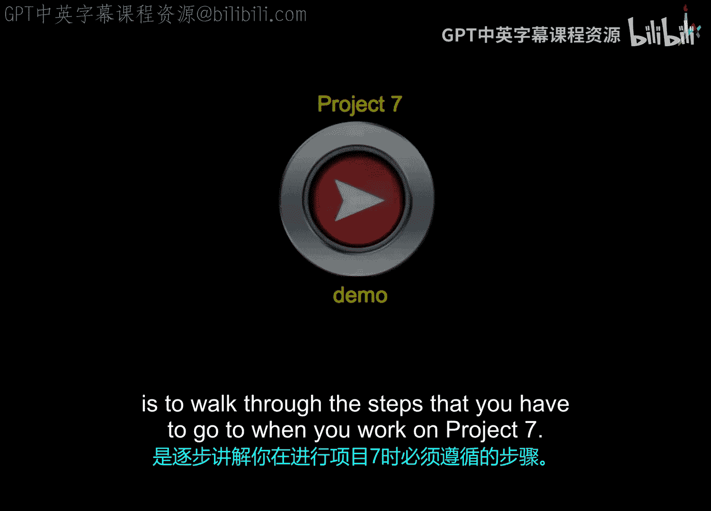
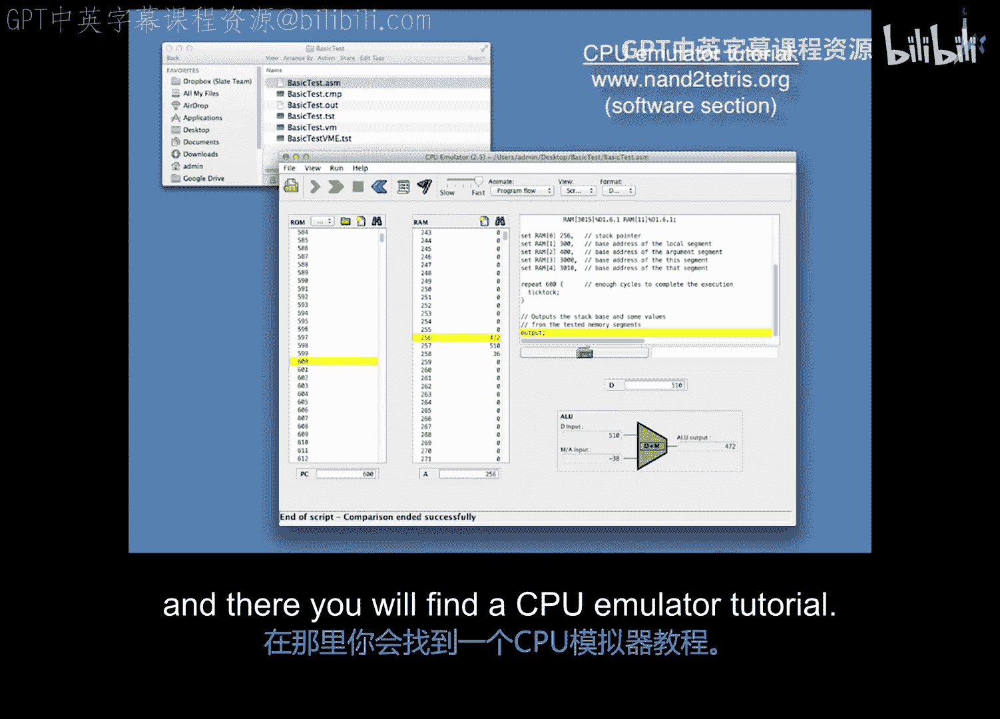
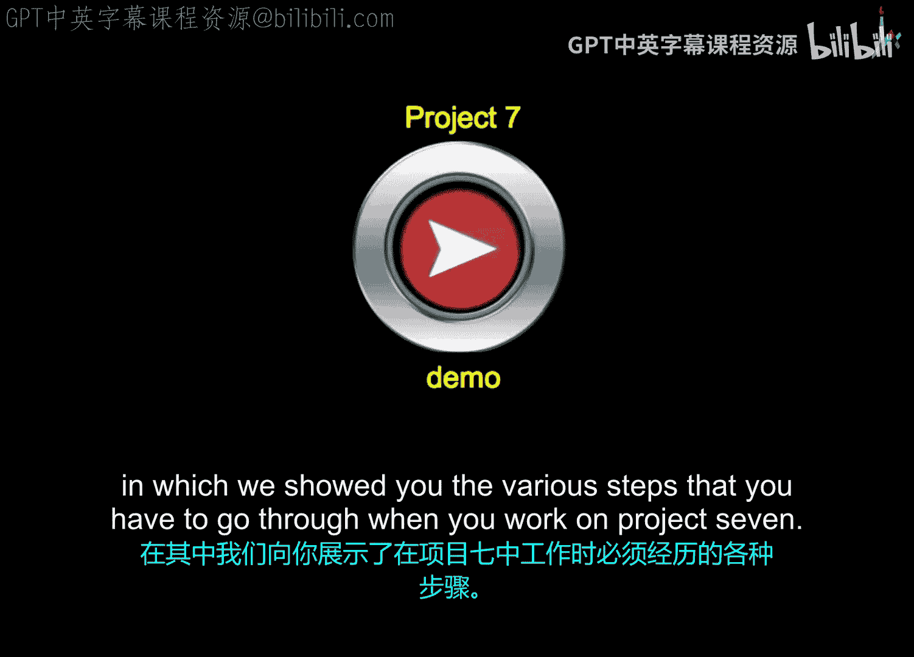
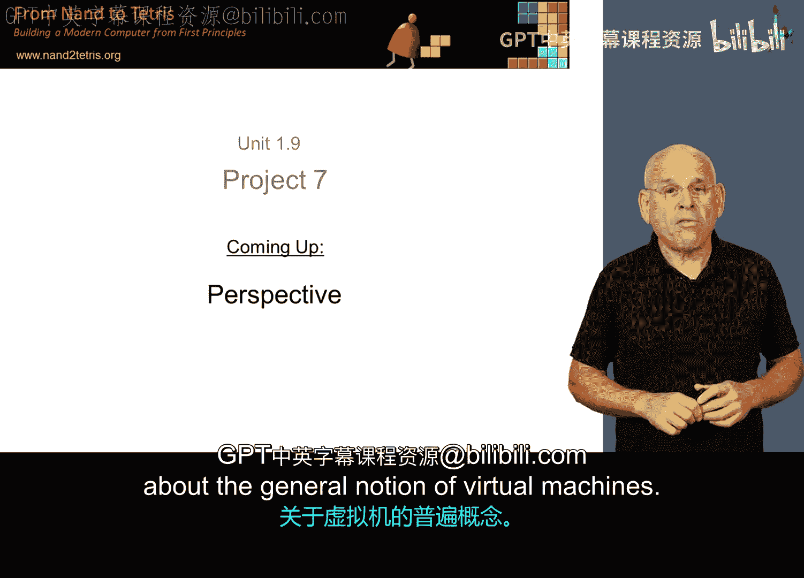
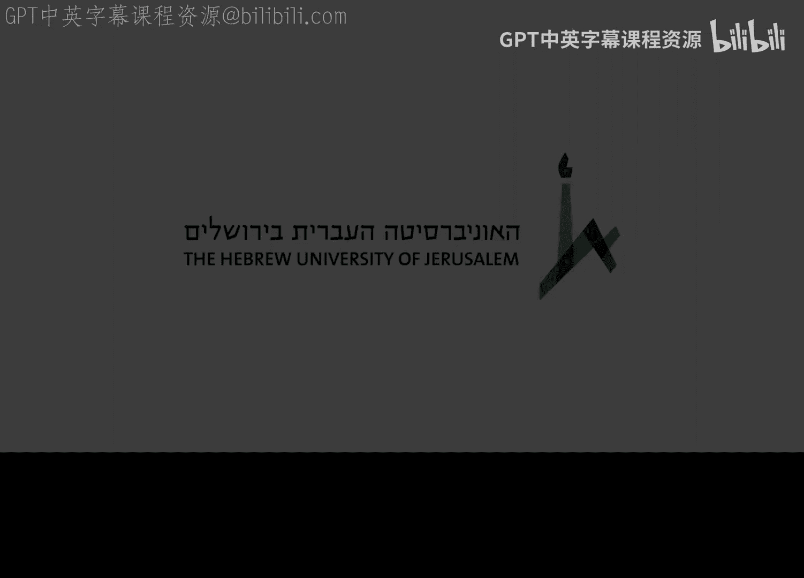

# 耶路撒冷希伯来大学《从零开始构建现代计算机2｜Build a Modern Computer from First Principles》中英字幕 p22 22_03_11_单元1-9_项目7：构建虚拟机翻译器第一部分.zh_en -BV1DA4m1w7FU_p22-

In this unit， we discuss Project 7 in which we build the first part of our VM translator。Now。

 since this is the first project in the course， I'd like to say a few words about the big picture。

And what you see here is the overall Nan totetriris journey。Which starts， you know。

 if we think about it top down， it starts with some human thought or some fantasies about developing。

 let's say， a Teettriris game or a pong game or something like this。

And then you go through several stages of construction。

Until you end up with a program that actually runs on a real computer。Now， to remind you。

 we decided to divide this overall journey into two different parts， two different courses。And。

In nano part 1， we've built the hardware platform。Wwhich is the host computer on which we can actually execute programs this course in part two we build the elaborate softwareer hierarchy that sits on top of the host how platform and enables us to write programs in a highlevel language like Jack or Java or Python and then translate them all the way down into machine language。

 generating code that can actually execute on the platform that we built in part1。Now。

We decided to split this overall journey into six standalone projects。

Which are numbered Project 7 all the way up to project 12， and we also have Project 0。

 which is kind of optional and was the focus of the first module of the course。

And in this particular module， we are going to focus on Project 7 in which we build the first stage of a full blown VM translator that can translate programs from VM code to machine language。

 and I also listed project0 because we are going to use some tools that come to play in project0 and they will serve us in Project 7 as well。

Now to remind you， the VM code is written in the VM language and the VM language consists of four categories of commands。

 of which in Project 7， we're going to focus only on the first two。

So we are going to develop a basic VM translator that is capable of translating VM programs that include arithmetic logical and memory access commands into machine language and in the next project in Project 8。

 we're going to deal with the rest of the VM language and complete the picture of building the fullbl VM translator So here's an example of a VM program which is stored in some VM file。

It is actually a set or a sequence of VM commands， and the goal of Project 7 is to write a program in a language like Java or Python。

 a program which is called a VM translator that goes through this input file and translates it into assembly code。

So here's the translation of the first VM command。And then we continue to go through the input file and for each VM command we provide or we write the translation of this command into the output ASM file。

And noticeice that just a little detail that I recommend that your VM translator will always emit a comment that specifies which command it is now translating。

 If you do this， then debugging will be much easier because when you read。The produced assembly file。

 you can sort of see and relate。The assembly called to the commands that generated it。

So that's the overall goal。Now the question is， how do you test the translation。

 how can you tell or ascertain that the VN translator actually generates legible machine level code？

Well， you can take this code， the code that was generated and load it into the target platform。

 In our case， the head computer， run it and convince itself that the code is doing what the source code intended to do。

 So going back to the overall picture。We can once again take the code。

 load it into the machine level， and run it。Now， if we didn't take nanotetri part  one。And also。

 if you did take it。There's an alternative way of doing it。 Instead of using the actual he computer。

 we can use a supplied CPU emulator that can run hec programs。

 as is and do exactly what the host platform would do for real。And if you use the CPUMulator。

 you can run it on any computer， including your own PC and indeed if you downloaded the Antetriris software suiteite。

 you have this program available to you and we use it actually in Project zero and that's why I listed Project0 as an element of Project 7 as well。

 so we can use the CPMulator to test that the resulting code does what it's supposed to do。All right。

 now I'd like to go through our development plan， which is a little bit elaborate and explain what we have to do in every step of the way。

So first of all， we supply five VM programs and each one of them is designed to test some specific features of the VM translator that you are building in Project 7 every one of these programs is stored in a separate directory。

 so there are five directories that have the same name as the name of the program and here's an example of one of these directories called basic test。

Now the most important file in this basic test directory is the VM program itself。

 you know that's the program that we have to translate and the other files provide some other purposes that will that I'll explain later on。

 so here's the contract。Your job is to write a VM to hack translator。

Which conforms to the standard VM to hack mapping that we described in unit 1，7。Now。

 you have to use the VM translator in order to translate every one of the five VM files that we supplied in this project and for every one of these translations you have to generate an assembly program and then when you execute the resulting assembly program on the VM emulator。

The output file that our script is going to produce from your code has to be the same as the supplied Comp file if this is the case。

 you pass the test and you can go on to translate the next VM program and go through the same routine。

So let me go through the exact steps that I recommend that you go through when you test every one of these five programs。

Well， first of all， there's an optional stage。That I recommend that you go through in which you take this VM program and you play with it in the VM emulator。

And I recommend that you do it in order to get acquainted with the VN program and understand what it is designed to do。

Now it's not really directly relevant to this project because this project translates the program into assembly and the VM translator doesn't really care what the program is doing。

 It is simply it views it as a translation task from one file to another。 however。

 if you spend a few minutes playing with this program。

 it will give you a lot of good context for the subsequent translation task。 All right。

 so the next thing that you have to do once you understand what the VM program is doing。

You invoke your VM translator， the program that you wrote and you translate it into an assembly program。

 which is stored in a separate ASM file Now the next thing that I recommend you do is take this resulting ASM file load it into some text editor and convince itself that the file looks good after all。

 this file was generated by your VN translator and you want to make sure that it generates some legible VM commands。

 if there's any problem， you have to go back to the VN translator and fix it and repeat this process。

 Once you've completed this visual inspection， you can load the ASM file into the CPU emulator and proceed to execute and inspect the results。

 Unfortunately， the last stage stage4 will not work out and it will not work because the source VM code as well as the assembly code that you。

Translator generated from it expects to use the stack and the virtual memory segments。

 And there's nothing in the source code that actually initializes these virtual segments and the stack on the host platform。

 So instead you have to load the test script， the supply test script into the CPU emulator。

 execute it， inspect the results。 And if there's a problem。

You can go back to stage Ju and fix your VM translator if you use the test script instead of the assembly file。

 the test script will take care of all the required initializations and then the translated code will actually execute on the CPU emulator correctly。

Allright， now you have to use all sorts of tools and resources in this project and the first thing that you need are the test programs and the Comp filess they are available in the project directory on your computer。

You have to experiment with the supplied test scripts， I'm sorry with the supplied the VM programs。

 you can do it using the supplied VM emulator。 you have to translate these VM programs into assembly。

 you do it by using your VM translator， the VM translator that you are developing。

And then in order to test the resulting code， you use the supplied CPU emulator。

 as we just explained。And in order to develop the VN translator。

 you need some resources like a highlevel language， Java， Python and so on。

 we recommend that you take a look at some tutorials that we provide in the Nanttetriris website。

 the VM emulator tutorial， the CPU emulator tutorial。

 and you can also consult Cha 7 in the Nanttetriris book， the elements of computing systems。

 so this is an elaborate project and you have all these tools that will help you complete it successfully。

All right， now there are some testing challenges that you we have to address and I actually described them already。

 so I'd like to summarize them again。The code that we provide in the VM files is missing what I call the function return envelope。

 And therefore， this code does not initialize the stack and the Vm segments on the whole platform。

 So these missing items will be supplied in or completed in project 8。 And for now。

 we use a test script that plugs these plugs these holes manually。

 So the test script starts with the usual preamble commands that we don't have to fully understand。

 It's not once again part of the course。 Then we have a set of commands that。Enchor。

 the virtual memory segments and the stack on the whole Ram。

 And then we have a loop that actually executes the resulting machine level code。 So we see that。

We use these commands in order to manually do what Project8 will do automatically when we get to work on it in the next module。

All right。What I'd like to do next is to recap and go through everything that I said so far in the context of actually using the tools that you have to use in Project 7。

 So this will be done in the next video clip。

The purpose of this demo is to walk through the steps that you have to go to when you work on project 7。

So I have here my antitetriris folder。 Let's go into project 7。And within Project 7。

 we'll go into memory access and into basic test。And let me resize the window for better focus。

And we see that what we have here are four files， a compare file。

A test script designed for the CPU emulator。Then we have the VM code that we have to translate into assembly。

And finally， we have yet another test script designed for the VM emulator。

 The star of the process here is basic test dot VM。 This is the program that we have to translate。

 So let's take a look at it。Well， we see that we have here a set of VM commands which are designed to carry out various operations on the stack and the virtual segments。

 constant local argument this that and so on。 So the challenge that we are facing is to translate this VM code into assembly code and then use the CPU emulator to run the assembly code and ascertain that the resulting code actually carries out what the VM code was supposed to do。

 and so before we actually go through this translation process and testing process。

 it makes sense to try to play a little bit with the source code and understand what the source code is designed to do。

So let me bring up my VM emulator and load into it the basic test。VM E script。And as I said before。

 I think in one of my demos， there's a little glitch in the output goi。

 So sometimes you have to click。The output pain， in order to see。Its or reveal its contents。

And so here is the test script， and we can begin executing it。So let's do a single step。

Through the test script。And we see that several things happened。 First of all， the。

Basic test dot VM file was loaded into the simulator。

And we also see that the test script has created a new output file called basic test dot out。

 I suspect that at this stage， the output file is empty because nothing really happened yet。

In the execution of the code， then indeed， I can take a look at it。 So let's do that。

And we see that the output file contains some labels of Ram locations。

 but no values associated with them， and there are no values because the code did not run yet。

So let us know， select the fast execution page and then fast forward through the script。

And at this stage， I can kind of sit back and watch what is going on。

Which is rather difficult because the script runs rather quickly。

But now I can go into the virtual segments and the hostRAm and explore what happened with this program and I don't really want to get into this because we already gave quite a detailed demo of the VM emulator I believe we did it in unit 1。

6 and in fact we illustrated the VM emulator in the context of this very same program So there's no need to repeat this material here。

Instead， I will minimize now the V M emulator。And turn to the next step in the project。

 which is translating the VM test file into assembly。 Now。

 I wish to remind you that the essence of Project 7 is writing a VM translator。

And my VM translator has been written in Java。 So in order to use it。

 I'm going to bring up my terminal window。And type a Java。VM translator。

That's the name of my translator program。 And then I'm going to supply a parameter。

 which is the name of the file that I want to translate， which happens to be basic。Test。VM。Alright。

 let's enter this command。And as you see， a new file has been created and this file is basic test dot ASSM written in the hec assembly language。

Now， it may be interesting to take a look at the contents of this file。 so let's do that。

So this is the assembly file that was created and generated by my VM translator。

 Let me scroll downward within this file。And I see that altogether it contains about 200 lines of hec assembly commands。

 Now I remind myself that the original source VM test file contained about what I think 25 lines of code and so the translation ratio is about 1 to8。

 in other words， every VM command generates upon translation generates about on average about 8。

Hck assembly commands。 Now， it may well happen that your VM translator is better written than mine。

 and therefore it may generate tighter assembly code and achieve a better translation ratio。Now。

 the next thing I'd like to do is test that the generated assembly code is actually correct。

 In other words， I want to ascertain that this code。

Carryries out what the source code are thought to do。And in order to do this， I'm going to invoke。

My CPUU emulator。So here is my CPU emulator into which I'm going to load the supplied basic test dot T SD。

Scrip file。This one。And as usual， I will click my output pane in order to reveal its contents。

And let's see。 I will single step the first batch of scripting commands。And in response。

 the CPU emulator has loaded the assembly program that was generated by my VN translator into the emulator environment。

 It's right here。So now I can execute this program and see what happens so let's click fast forward and now I can kind of sit back and watch the code that was generated by my program execute and I see that execution continues because there's nothing that tells it to stop in the code。

And at some point。Right here。Execution has stopped and the execution stopped because the supply test script is programmed to execute 600 clock cycles。

And therefore， at some point， it kind of forces the program to stop。Now。

 how do I know that the program has run successfully？ Well， first of all。

 I got this very nice message that tells me that I have fulfilled the contract。

The translated assembly code has passed the test that was mandated by the supplied test scripts。Now。

 if youre not sure how to use the CPU emulator， you can go back to module 0 and look for a unit called。

 I believe， lowlevel programming Part1 and somewhere within this unit you will find a CPU emulator demo that you are welcome to look at and if you wish you can also go to the NAtetri website and there you will find a CPU emulator tutorial。

So this has been the demo in which we showed you the various steps that you have to go through when you work on project 7。

 So to recap in this project。

And in this module as well， we began developing a VM translator。In Project7。

 we are focusing only on the arithme ecological commands and the memory access commands。

 so we develop a program which is capable of translating these commands into machine level instructions that carry out the same thing on the host platform。

And in the next module and in project 8， we're going to complete the VM translator by extending the VM translator to handle also the branching commands and the function and return commands and by doing this well have a full scale VM translator which will serve as the backend of our jack compiler you know the program that enables us to write highleve programs and。

Translate them all the way down to machine language。

 So this is basically the end of the operational part of module 1。 And in the last and final unit。

 we'll discuss some perspectives and observations about the general notion of virtual machines。

