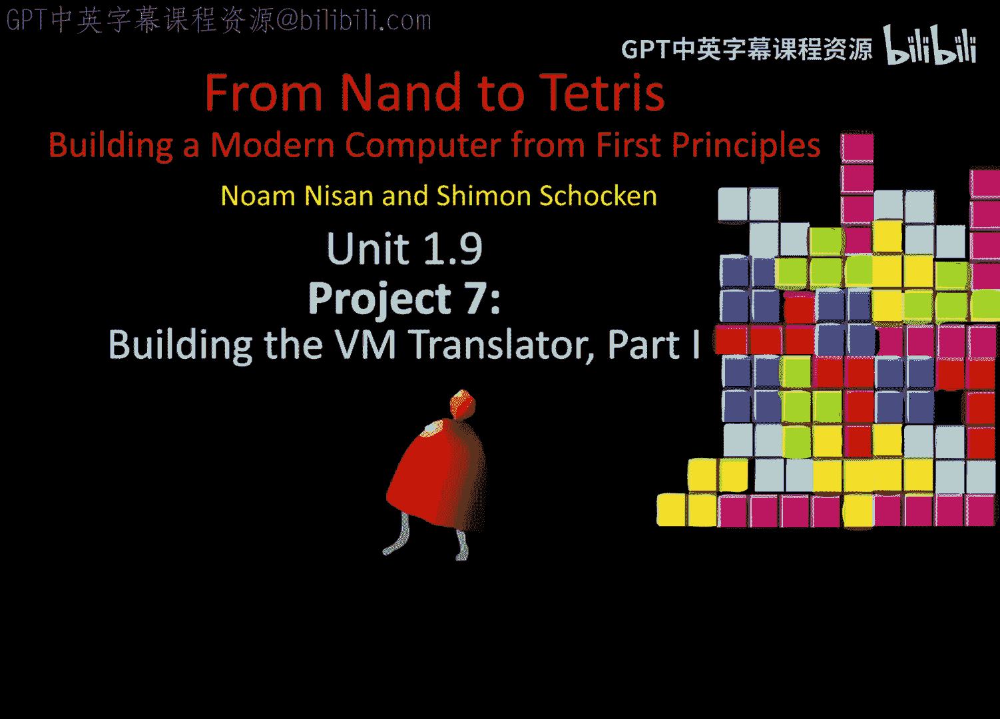
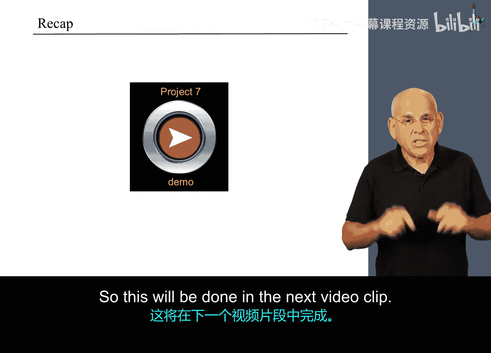
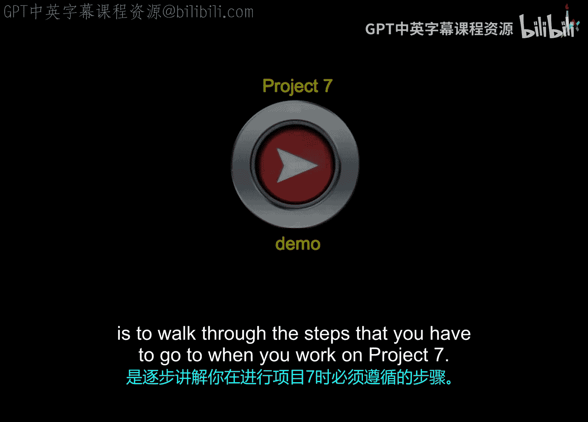
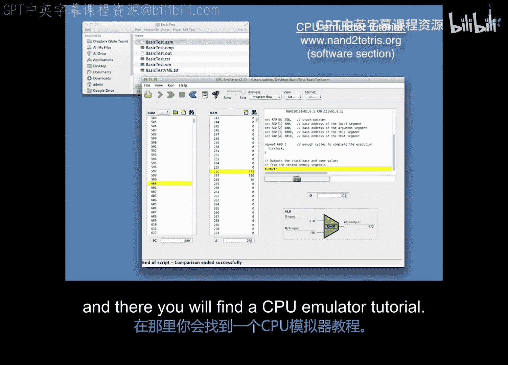
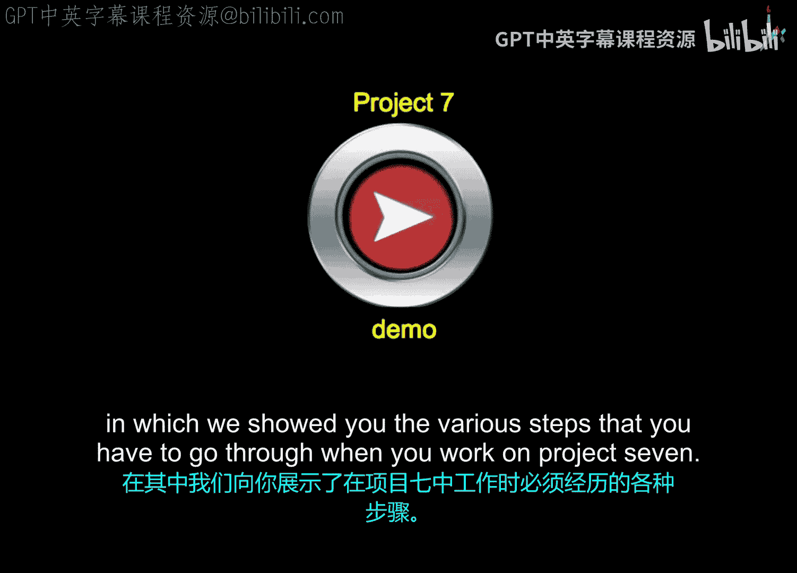
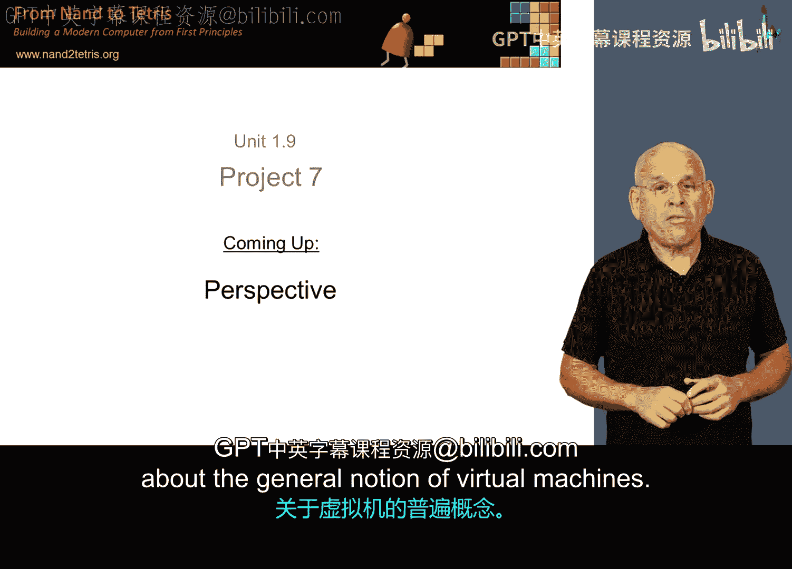

# 从零开始构建现代计算机2：1-9：项目7：构建虚拟机翻译器第一部分 🧱

在本节课中，我们将学习如何构建虚拟机翻译器的第一部分。我们将了解项目的整体目标、开发计划、测试方法以及所需工具。通过本教程，你将能够编写一个程序，将虚拟机代码中的算术逻辑和内存访问命令翻译成机器语言。

## 概述

在项目7中，我们的目标是构建一个虚拟机翻译器的初始部分。这个翻译器能够将用虚拟机语言编写的程序，特别是其中的算术逻辑和内存访问命令，翻译成可以在我们之前构建的硬件平台上运行的机器语言。

## 整体架构与项目背景

上一节我们介绍了项目的总体目标。现在，让我们回顾一下构建现代计算机的完整旅程。

整个旅程始于一个高层次的想法，例如开发一个游戏。然后，我们通过多个构建阶段，最终得到一个能在真实计算机上运行的程序。我们将这个旅程分为两个部分：第一部分构建了硬件平台（即主机），第二部分则构建了运行在主机之上的复杂软件层次结构。

这个软件层次结构使我们能够使用像Jack、Java或Python这样的高级语言编写程序，然后将它们一路翻译成机器语言，生成可以在第一部分构建的平台上执行的代码。

我们将这个旅程划分为六个独立的项目，编号从项目7到项目12。此外，还有一个可选的项目0，它是本课程第一个模块的重点。

在本模块中，我们将专注于项目7。在这个项目中，我们将构建一个完整虚拟机翻译器的第一阶段。项目0中介绍的一些工具也将在项目7中发挥作用。

虚拟机代码是用虚拟机语言编写的。虚拟机语言包含四类命令。在项目7中，我们只关注前两类命令。

我们将开发一个基本的虚拟机翻译器，它能够将包含算术逻辑和内存访问命令的虚拟机程序翻译成机器语言。在下一个项目（项目8）中，我们将处理虚拟机语言的其余部分，完成完整虚拟机翻译器的构建。

## 项目目标与示例

以下是项目7的具体目标示例。

假设有一个存储在某个`.vm`文件中的虚拟机程序，它实际上是一系列虚拟机命令。项目7的目标是使用Java或Python等语言编写一个名为“虚拟机翻译器”的程序。这个程序会读取这个输入文件，并将其翻译成汇编代码。

例如，这是第一个虚拟机命令的翻译结果。然后，翻译器会继续处理输入文件，为每个虚拟机命令生成对应的汇编代码，并输出到一个`.asm`文件中。

请注意，建议你的虚拟机翻译器在输出时总是附带一条注释，说明它正在翻译哪个命令。这样做会使调试变得更容易，因为当你阅读生成的汇编文件时，可以清楚地看到是哪条命令生成了哪段汇编代码。

## 测试翻译结果

那么，如何测试翻译是否正确呢？如何确认虚拟机翻译器生成了可读的机器级代码？

你可以将生成的代码加载到目标平台（在我们的案例中是Hack计算机）上运行，并验证代码是否按照源代码的意图执行。

回顾整体架构，我们可以再次将代码加载到机器层面并运行。如果你没有学习过第一部分课程，或者即使你学习过，也有另一种测试方法：我们可以使用提供的CPU模拟器来运行Hack程序。CPU模拟器可以在任何计算机（包括你自己的个人电脑）上运行，其行为与实际硬件平台完全一致。

如果你下载了Nand2Tetris软件套件，你就可以使用这个程序。我们在项目0中已经使用过它，这也是为什么我将项目0列为项目7的一部分。我们可以使用CPU模拟器来测试生成的代码是否按预期工作。

## 详细开发计划

接下来，让我们详细了解一下开发计划，并解释在每个步骤中需要做什么。

首先，我们提供了五个虚拟机程序。每个程序都旨在测试你在项目7中构建的虚拟机翻译器的某些特定功能。每个程序都存储在一个单独的目录中，因此有五个目录，目录名与程序名相同。这里有一个名为`BasicTest`的目录示例。

在这个`BasicTest`目录中，最重要的文件是虚拟机程序本身，也就是我们需要翻译的程序。其他文件则用于其他目的，我稍后会解释。

你的任务是编写一个符合我们在第1.7单元中描述的“虚拟机到Hack”标准映射的翻译器。你必须使用这个虚拟机翻译器来翻译我们在这个项目中提供的五个虚拟机文件中的每一个。对于每一次翻译，你都需要生成一个汇编程序。然后，当你在虚拟机模拟器上执行生成的汇编程序时，你的代码生成的输出文件必须与提供的比较文件相同。如果满足这个条件，你就通过了测试，可以继续翻译下一个虚拟机程序，并重复相同的流程。

以下是测试这五个程序时，我建议你遵循的具体步骤。

首先，有一个可选阶段。我建议你在这个阶段使用虚拟机模拟器运行这个虚拟机程序。我建议你这样做是为了熟悉虚拟机程序，并理解它的设计目的。

虽然这与本项目没有直接关系，因为本项目是将程序翻译成汇编，而虚拟机翻译器并不关心程序在做什么，它只是将其视为一个文件到文件的翻译任务。然而，如果你花几分钟时间运行这个程序，它将为后续的翻译任务提供很多有用的背景信息。

一旦你理解了虚拟机程序的功能，接下来你需要调用你编写的虚拟机翻译器，将其翻译成一个汇编程序，并存储在一个单独的`.asm`文件中。

然后，我建议你进行下一步：将生成的`.asm`文件加载到某个文本编辑器中，并确认文件看起来没问题。毕竟，这个文件是你的虚拟机翻译器生成的，你需要确保它生成了一些可读的虚拟机命令。如果有任何问题，你必须返回修改虚拟机翻译器，并重复这个过程。

完成视觉检查后，你可以将`.asm`文件加载到CPU模拟器中，并继续执行和检查结果。

不幸的是，最后一个阶段（阶段4）不会成功。这是因为源代码以及你的翻译器从中生成的汇编代码都期望使用栈和虚拟内存段。而源代码中没有任何内容实际初始化主机平台上的这些虚拟段和栈。

因此，你必须将提供的测试脚本加载到CPU模拟器中，执行它，并检查结果。如果有问题，你可以返回阶段2修复你的虚拟机翻译器。如果你使用测试脚本而不是汇编文件，测试脚本将负责所有必需的初始化，然后翻译后的代码就能在CPU模拟器上正确执行。

## 项目所需工具与资源

在本项目中，你需要使用各种工具和资源。首先，你需要测试程序和比较文件，它们可以在你计算机上的项目目录中找到。

你必须使用提供的虚拟机模拟器来试验提供的虚拟机程序。你需要使用你正在开发的虚拟机翻译器将这些虚拟机程序翻译成汇编。

然后，为了测试生成的代码，你需要使用提供的CPU模拟器，正如我们刚才解释的那样。为了开发虚拟机翻译器，你需要一些资源，如高级语言（Java、Python等）。我们建议你查看Nand2Tetris网站上提供的一些教程，如虚拟机模拟器教程、CPU模拟器教程。你也可以参考《计算机系统要素》一书的第7章。

这是一个复杂的项目，但你有所有这些工具来帮助你成功完成它。

## 测试挑战与解决方案

现在，我们需要解决一些测试挑战，我之前已经描述过，但我想再次总结一下。

我们提供的虚拟机文件中的代码缺少我称之为“函数返回封装”的部分。因此，这段代码没有初始化整个平台上的栈和虚拟机段。这些缺失的部分将在项目8中补充完成。目前，我们使用一个测试脚本来手动填补这些空白。

测试脚本以通常的前导命令开始，我们不需要完全理解这些命令，这同样不属于本课程的核心内容。然后是一组命令，用于将虚拟内存段和栈锚定到整个RAM上。接着是一个循环，实际执行生成的机器级代码。

我们看到，我们使用这些命令来手动完成项目8在下一个模块中将要自动完成的工作。

## 工具使用演示

接下来，我想通过实际演示你在项目7中必须使用的工具，来回顾和梳理到目前为止所讲的一切。这将在下一个视频片段中完成。

本演示的目的是逐步讲解你在进行项目7时必须遵循的步骤。

这是我的Nand2Tetris文件夹。让我们进入项目7。在项目7中，我们进入`MemoryAccess`目录，再进入`BasicTest`目录。让我调整窗口大小以便更好地聚焦。

我们看到这里有四个文件：一个比较文件、一个为CPU模拟器设计的测试脚本、我们需要翻译成汇编的虚拟机代码，以及另一个为虚拟机模拟器设计的测试脚本。

这个过程的核心是`BasicTest.vm`。这是我们需要翻译的程序。让我们看一下它。

我们看到这里有一组虚拟机命令，旨在对栈和虚拟段（如constant、local、argument、this、that等）执行各种操作。我们面临的挑战是将这段虚拟机代码翻译成汇编代码，然后使用CPU模拟器运行汇编代码，并确认生成的代码确实执行了虚拟机代码应该执行的操作。

因此，在我们实际进行这个翻译和测试过程之前，先尝试运行一下源代码并理解其设计目的是有意义的。

让我打开我的虚拟机模拟器，并将`BasicTest.vm`脚本加载进去。正如我之前所说，我认为在我的某个演示中，输出显示有一个小故障。所以有时你需要点击输出面板才能看到或显示其内容。

这就是测试脚本，我们可以开始执行它。让我们单步执行测试脚本。

我们看到发生了几件事。首先，`BasicTest.vm`文件被加载到模拟器中。我们还看到测试脚本创建了一个名为`BasicTest.out`的新输出文件。我怀疑在这个阶段，输出文件是空的，因为代码的执行还没有真正开始。

然后，我确实可以查看它。让我们这样做。我们看到输出文件包含一些RAM位置的标签，但没有与之关联的值。没有值是因为代码还没有运行。

现在，让我们选择快速执行页面，然后快速执行脚本。

在这个阶段，我可以坐下来观察发生了什么。这相当困难，因为脚本运行得相当快。

但现在我可以进入虚拟段和主机RAM，探索这个程序发生了什么。我并不想深入探讨这一点，因为我相信我们在第1.6单元已经对虚拟机模拟器进行了相当详细的演示，事实上，我们正是在这个相同程序的背景下演示了虚拟机模拟器。所以这里没有必要重复这些内容。

相反，我现在将最小化虚拟机模拟器，转向项目的下一步：将虚拟机测试文件翻译成汇编。

我想提醒你，项目7的核心是编写一个虚拟机翻译器。我的虚拟机翻译器是用Java编写的。为了使用它，我将打开我的终端窗口，输入`java VMtranslator`。这是我的翻译器程序的名字。然后我将提供一个参数，即我要翻译的文件名，也就是`BasicTest.vm`。

输入这个命令。如你所见，一个新文件已经创建，这个文件是`BasicTest.asm`，用Hack汇编语言编写。

现在，查看一下这个文件的内容可能很有趣。让我们这样做。

这就是我的虚拟机翻译器生成和创建的汇编文件。让我在这个文件中向下滚动。我看到它总共包含大约200行Hack汇编命令。

现在我提醒自己，原始的虚拟机测试文件大约包含25行代码，所以翻译比率大约是1:8。换句话说，每个虚拟机命令在翻译后平均生成大约8条Hack汇编命令。很可能你的虚拟机翻译器写得比我的更好，因此它可能生成更紧凑的汇编代码，并达到更好的翻译比率。

接下来我想做的是测试生成的汇编代码实际上是正确的。换句话说，我想确认这段代码执行了源代码应该执行的操作。为了做到这一点，我将调用我的CPU模拟器。

这是我的CPU模拟器，我将把提供的`BasicTest.tst`脚本文件加载进去。就是这个。像往常一样，我将点击我的输出面板以显示其内容。

让我们看看。我将单步执行第一批脚本命令。作为响应，CPU模拟器已经将由我的虚拟机翻译器生成的汇编程序加载到模拟器环境中。就在这里。

现在我可以执行这个程序，看看会发生什么。让我们点击快速执行，现在我可以坐下来观看由我的程序生成的代码执行。我看到执行在继续，因为代码中没有告诉它停止的内容。

在某个时刻，就在这里，执行停止了。执行停止是因为提供的测试脚本被编程为执行600个时钟周期。因此，在某个时刻，它强制程序停止。

那么，我怎么知道程序运行成功了呢？首先，我收到了这条非常好的消息，它告诉我我已经履行了合同。翻译后的汇编代码通过了提供的测试脚本所要求的测试。

如果你不确定如何使用CPU模拟器，你可以回到模块0，查找一个名为“低级编程第一部分”的单元，在该单元中某处，你会找到一个CPU模拟器演示，欢迎你查看。如果你愿意，你也可以访问Nand2Tetris网站，在那里你会找到一个CPU模拟器教程。

## 总结

这就是演示，我们向你展示了在进行项目7时必须经历的各种步骤。

回顾一下，在本项目中，以及在本模块中，我们开始开发一个虚拟机翻译器。在项目7中，我们只关注算术逻辑命令和内存访问命令。因此，我们开发了一个程序，能够将这些命令翻译成在主机平台上执行相同操作的机器级指令。

在下一个模块和项目8中，我们将通过扩展虚拟机翻译器以处理分支命令以及函数和返回命令，来完成虚拟机翻译器的构建。通过这样做，我们将拥有一个完整的虚拟机翻译器，它将作为我们Jack编译器的后端，使我们能够编写高级程序，并将它们一路翻译成机器语言。

这基本上是模块1操作部分的结束。在最后一个单元中，我们将讨论关于虚拟机一般概念的一些观点和观察。