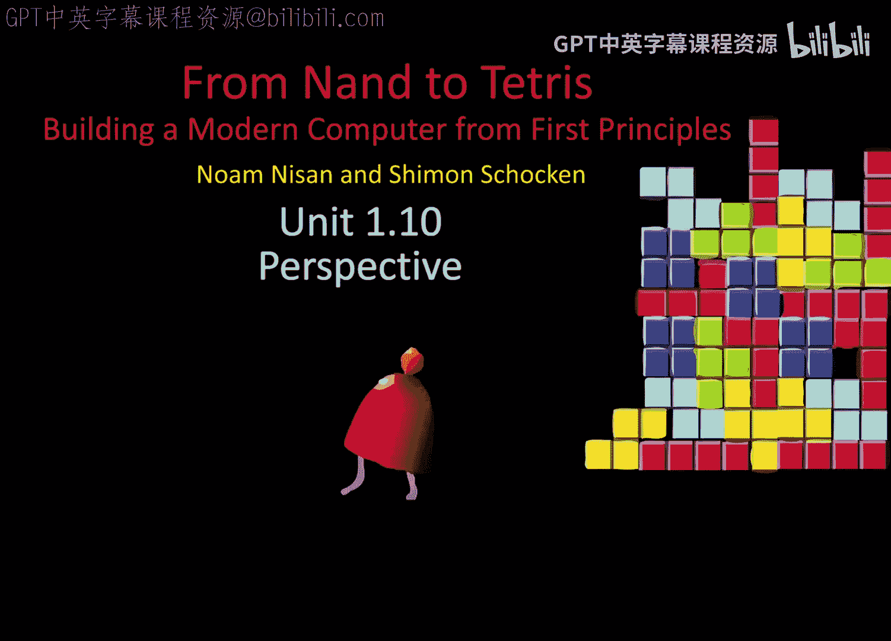
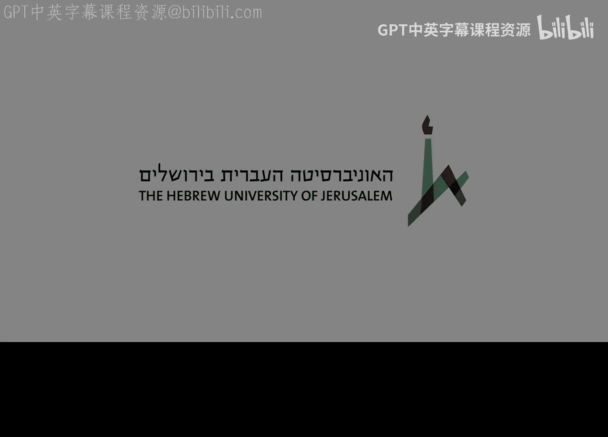

# 耶路撒冷希伯来大学《从零开始构建现代计算机2｜Build a Modern Computer from First Principles》中英字幕 p23 23_03_12_单元1-10_视角.zh_en -BV1DA4m1w7FU_p23-

Welcome to the last unit of the first module in Nototerus Part 2。When we designed this course。

 Nor and I decided that each module in the course will end with what we call a perspectives unit。

This concluding unit has several purposes。First of all。

 we wish to use this unit in order to say a few words about all sorts of things that we left out from the discussion。

For example， if we decided not to deal with efficiency， we'd like to put it on the table explicitly。

And we do this because we feel that it's important to not only celebrate what we did do in our projects and modules。

 but also to acknowledge what was left out and what is very important to include if you want to turn this。

 let's say， into a commercial product。And another purpose of the perspective units is to provide a historical context。

And to connect， you what we do in Ntetriris to all sorts of well known hardware and software concepts that you may be familiar with。

 and if not， we will introduce them to you during these units。

And this will help you appreciate the fact that what we do in Nantuttetriris has not only a very exciting historical legacy。

 but also far reaching practical implications。As you probably saw。

 none to Tetriris is a nitty gritty course in which you have to work and develop stuff all the time。

We want to use these units to take a break from the trenches and the salt mines， you know。

 to get out， breathe some air， understand， you know where we're coming from。

 where we're going to and connect what we do once again to to our， you know， environment。

Now these perspective units are going to be question driven。

 that is we will read two or three questions that typically come up from learners when we teach these modules and we'll try to answer them。

So let's see what is the first question？You mentioned that the VM is a rather old idea。How old is it。

Well， as you may know， the personal computer era began in full swing in the late 1970s。

And this happened when both Apple and IBM introduced to the market to personal computers that very quickly became widely popular。

These early PCs came out with almost no software on them。Now， during the same period。

 there was a programming language called Pascal， which was quite popular。

But it ran only on mainframe and what was known as mini computers。

So people began to develop Pascal compilers for the new lines of IBM and Apple PCs。However。

 these machines used different processor， in different chipets and different operating systems。

 and therefore different Pascal compilers had to be developed。

So if you were a software developer back then and you wanted your accounting software or your computer game that you developed to run on every PC out there。

 well， you had to use different compilers and you had to maintain and support multiple versions of your software。

 and clearly this led to numerous headaches and bugs and complaints and developer frustration。Also。

 IBM and Apple were rival companies and they had no interest whatsoever to help developers port their software to the other machine。

Now， in order to deal with this crossplform challenge and frustration at the right level。

 which is the infrastructure level， several researchers and practitioners began to toy and specify toy with and specify an early virtual machine architecture and language。

 which was called Pcode。This Pcode， just like our own VM language。

 was based on a stack machine obstruction。So in order to realize this obstruction on both IBM and Apple computers。

 the pickled language was implemented on both lines of these machines。

One implementation was designed to translate PO programs into the Intel X86 instruction set。

 which was used by the CPUs of IBMPs， and another implementation translated the very same PO programs into the Motorola 68。

000 instruction set， which was the CPU which was used by Apple computers back then。

So you see that the whole concept was very similar to our own VM language and VM translator。

 The basic idea is to create a cool processing obstruction， a virtual machine。

 and then to realize it on you know as many hardware platforms as we want in our course。

 we do it on the hec platform。So following these P code implementations back in the 1970s。

 actually it was already in the beginning of the 1980s。

 other people went on to develop PEcal compilers that generated P code instead of machine language。

And so for the first time， the same Pascal program， you know。

 whether it was a computer game or whatever， the same program could run as is on both IBM and Apple machines。

 each using its own platform specific P code implementation。Of course。

 this whole scheme was based on the assumption that the customer's computer will be equipped with a suitable client based P code implementation。

And indeed， during this time， these Pcode implementations were widely distributed and freely over the Internet。

 so many people downloaded them and installed them on their computers。

 so the whole scheme worked very nicely。So historically。

 this was perhaps the first time that the notion of high level language began to realize its full potential in a world consisting of different hardware platforms and different machine languages。

And you can see how the notion of an abstractstruct virtual machine played such a central and sort of overarching role in this cross platform vision。

Now in particular， the VM language or the VM architecture provides an intermediate architecture or intermediate layer that hides you all the gory。

 not all， but most of the gory details of the target hardware from the high level language。

And this will become critically important when we'll set out to develop a compiler in this course later on in some of the future modules。

Alright， so this was a long answer on。The first question and the second question is。

How close is our VM to Java JVM？So， let's see。Java's virtual machine is also based on an intermediate language。

 which in the Java case is called Btecode。And obviously。

 there are quite a few technical differences between our VM language and this byte code。For example。

 our language recognizes only one data type， a 16 bit integer。

 and yet Java bytecode commands are designed to manipulate integers， floating point。

 double precision and all sorts of other additional data types。

 so in that respect it's much richer than our own VM language Also Java bytecode offers all sorts of high level obstructions that are VM language lacks like multiplication and division as well as lowlel commands like bitwise operations and so on。

 So you know it has more expressive power。And yet， in its most essential elements。

 these two languages are quite similar。Both languages are stack based， both use a push and pop。

 and both access their memory using virtual memory segments instead of symbolic variables。Now。

 it may be interesting to track the historical motivation for founding the Java language on a two tier compilation model。

 you know， one that uses a virtual machine as an intermediate layer。Well， you see。

 Java was developed in the mid 1990s by people who worked in a mighty company called Sun Microsystems。

And I kind of chuckle when I mention Sun， because when I was at your average age。

 Sun was a revered company。 And now it's no more。Well， actually。

 it is buried somewhere in the bowels of Oracle。Who acquired Sun very wisely， I think， back in 2010。

But， you know， going back to the mid and90s， when the story of Java began。

The world of business and office applications was completely dominated by a company called Microsoft。

And Sun， which was the Archer rival of Microsoft， wanted to distinguish itself by dominating everything else。

And in order to achieve this dominance， Sun decided to create a new programming language。

In which one could write programs that， you know， will travel through the internet and execute on any possible mobile device and digital appliance out there。

 whether it is a PC， a digital television， a refrigerator， a washing machine， a sprinter system。

 a toaster， whatever。Sun wanted to connect everything。

 and it wanted everything to be connected to sun。And so they decided to base this vision on a universal VM architecture that could be implemented with relative ease on any given hardware platform and digital device out there。

Now， if the whole thing sounds to you quite similar to Pcode， then you're absolutely right。

 It was the same problem。Cross platform compatibility in the same VM solution approach only on a much bigger world class megalomanonic scale。

So， the basic idea。Which still prevails is that a Java compiler first generates Btecode。

 and this bytecode can be deployed through the internet to any connected device。

And once it reaches its destination， there will be a client side JVM or a VM implementation that executes the code on the client device。

 how by translating the VM code into the device's machine language just like we did with our own VM translator。

Now， going back to the mid 90s， it turns out that historically。

These are lofty ideas of sun were ahead of their time。

And the beginning of Java was somewhat sluggish。But then something completely unexpected happened。

The cell phone happened。And before you could say iPhone or Samsung。

 the world was flooded by numerous cell phone models using dozens of different processors。

 chipets and operating systems。So all of a sudden。The precinct Java vision of running the same software on many different devices became extremely relevant。

And it happened in a new setting， cell phones。You know。

 something that neither Sun nor Microsoft nor Intel could possibly imagine。

So with a delay of about 10 years， Java， all of a sudden became， you know。

 the right thing in the right time。And so there's no wonder that it also quickly became the language of choice for developing apps for mobile devices。

 and up until now I think the Java is still the most popular programming language in the Android space。

So all of this goes show that if you come up with an elegant and clean idea， in our case。

 an obstruct hardware independent virtual machine， then， you know。

 someone at some point will pick up this idea。You know。

 either you or someone else and turn it into an extremely useful and practical technology。You know。

 nothing can stop a good idea。 It has a life of its own。All right。

 now I would like to conclude this module with a note about efficiency。Throughout this module。

 our contract called for developing a VM translator without requiring that the generated machine code will be either compact or efficient。

Obviously， this is a very serious oversight because you see you have to realize that a VM translator is a mission critical program。

 it's a program that in one way or another lies in the very core of most PCs。

 tablets and cell phones out there。And you know it may be called the JVM or KVM or ART or CLR at the end of the day。

 it's a VM translator。And therefore， if your VM translator generates inefficient and lengthy code。

 then all the apps that run on top of it will become sluggish and users will get frustrated。

So in reality， developers of VM translators work very hard to generate low level code。

 which is as tight and efficient as possible， and that's something that up until now in nonetoteriPA 2 we've completely ignored。

Also， I would like to point out that the stack architecture that we use so carefully in this course is not really a necessary ingredient of a virtual machine。

 for example， the JVM which is installed these days on an Android devices uses another abstract architecture which is called register machine。

This register machine is perhaps less elegant and beautiful than our own stack architecture。

 but arguably， it generates code， which is better optimized for processors of mobile devices。

 You see when it comes to efficiency。😊，Developers of mission critical software layers are very oppounistic。

 and they use anything that works better and faster。

 So we can go on and on with these questions and discussions。

 And there is no one around here to tell me to shut up。😊。

So I'm going to force myself to stop and we' meet again in the next module in which we'll continue to develop our VM obstruction and implementation。

 and this will be module 2。

