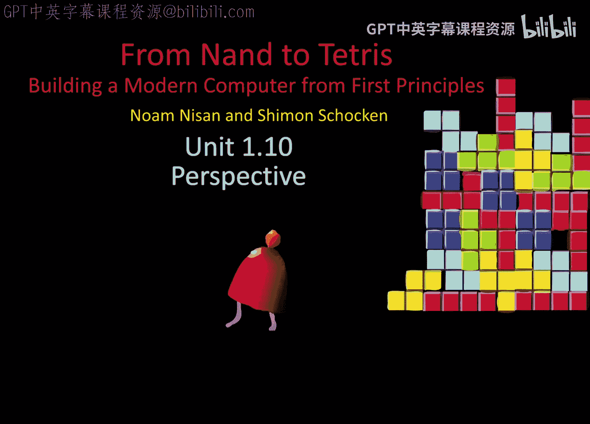
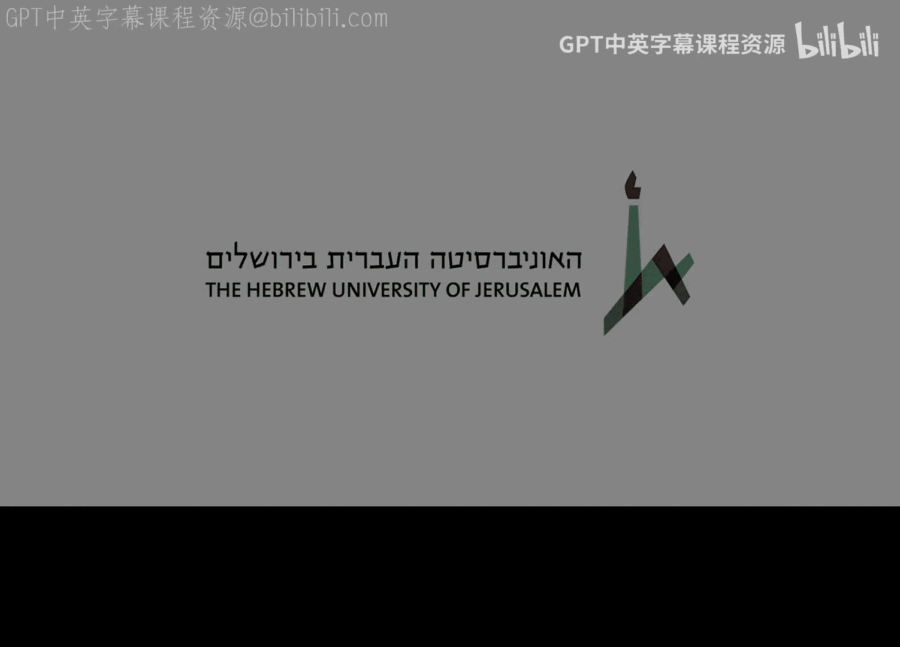

# 从零开始构建现代计算机2：单元1-10：视角 🧭

在本单元中，我们将回顾第一模块的学习内容，并从更广阔的视角审视虚拟机的概念。我们将探讨其历史背景、与现实世界技术（如Java虚拟机）的联系，并讨论在课程项目中暂时忽略但实际至关重要的因素，例如效率。

---

上一节我们完成了虚拟机翻译器的构建。本节中，我们将通过回答几个常见问题，来深入理解虚拟机概念的背景与意义。

以下是本单元将探讨的几个核心问题。

*   虚拟机是一个相当古老的想法。它有多古老？
*   我们的虚拟机与Java虚拟机（JVM）有多接近？
*   关于效率问题，我们需要注意什么？

---

### 虚拟机是一个相当古老的想法。它有多古老？

个人计算机时代在20世纪70年代末全面兴起。当时，苹果和IBM公司推出的个人电脑迅速流行起来。这些早期的PC几乎没有任何预装软件。

同期，一种名为Pascal的编程语言在大型机和微型计算机上相当流行。人们开始为新的IBM和苹果PC开发Pascal编译器。然而，这些机器使用不同的处理器、芯片组和操作系统，因此必须开发不同的Pascal编译器。

当时的软件开发者若想让其软件（如会计软件或电脑游戏）在所有PC上运行，就必须使用不同的编译器，并维护和支持软件的多个版本。这导致了诸多问题。IBM和苹果是竞争对手，它们无意帮助开发者将软件移植到对方的机器上。

为了在基础设施层面应对这一跨平台挑战，一些研究者和实践者开始构思并规范一种早期的虚拟机架构和语言，称为P-code。与我们的VM语言类似，P-code基于**栈机抽象**。

为了实现这一抽象，P-code语言在IBM和苹果的机器上分别得到了实现。一个实现将P-code程序翻译成IBMPC所用CPU的Intel x86指令集，另一个实现则将相同的P-code程序翻译成苹果电脑当时使用的Motorola 68000指令集。

这与我们自己的VM语言和VM翻译器的概念非常相似。基本思想是创建一个酷的处理抽象——一台虚拟机，然后在任意多的硬件平台上实现它。在我们的课程中，我们在Hack平台上实现了它。

随后，其他人开发了能生成P-code而非机器语言的Pascal编译器。于是，同一个Pascal程序首次能够不加修改地在IBM和苹果机器上运行，每台机器使用其平台特定的P-code实现。当然，整个方案基于一个假设：用户的计算机需安装合适的、基于客户端的P-code实现。当时，这些P-code实现通过互联网广泛且免费地分发，因此整个方案运行良好。

从历史上看，这或许是高级语言的概念在一个由不同硬件平台和不同机器语言组成的世界中，首次充分发挥其潜力。你可以看到，抽象的虚拟机概念在这个跨平台愿景中扮演了多么核心和 overarching 的角色。

具体来说，VM语言或VM架构提供了一个中间架构或中间层，它将目标硬件的许多复杂细节对高级语言隐藏起来。当我们在本课程后续的一些模块中着手开发编译器时，这一点将变得至关重要。

---

### 我们的虚拟机与Java虚拟机（JVM）有多接近？

Java的虚拟机同样基于一种中间语言，在Java中称为字节码。显然，我们的VM语言和字节码之间存在不少技术差异。

例如，我们的语言只识别一种数据类型：16位整数。而Java字节码指令设计用于操作整数、浮点数、双精度数等多种其他数据类型，在这方面比我们的VM语言丰富得多。此外，Java字节码提供了我们的VM语言所缺乏的各种高级抽象（如乘法和除法）以及低级命令（如位运算等），因此具有更强的表达能力。

然而，在其最本质的要素上，这两种语言非常相似。两种语言都是**基于栈的**，都使用**push**和**pop**操作，并且都通过虚拟内存段而非符号变量来访问内存。

追溯Java语言建立在两层编译模型（即使用虚拟机作为中间层）上的历史动机可能很有趣。Java由一家名为Sun Microsystems的强大公司的员工在20世纪90年代中期开发。当时的商业和办公应用世界完全由微软公司主导。作为微软的主要竞争对手，Sun希望通过主导其他一切来脱颖而出。

为了实现这一主导地位，Sun决定创建一种新的编程语言。用这种语言编写的程序可以通过互联网传输，并在任何可能的移动设备和数字设备上执行，无论是PC、数字电视、冰箱、洗衣机、汽车系统还是烤面包机。Sun希望连接一切，并希望一切都连接到Sun。因此，他们决定将这一愿景建立在一个通用的VM架构上，该架构可以相对容易地在任何给定的硬件平台和数字设备上实现。

如果这听起来与P-code非常相似，那么你完全正确。这是相同的问题——跨平台兼容性，以及相同的VM解决方案思路，只是规模更大、更具世界级的雄心。其基本思想（至今仍然盛行）是：Java编译器首先生成字节码，然后这些字节码可以通过互联网部署到任何连接的设备。一旦到达目的地，客户端将有一个JVM或VM实现，通过将VM代码翻译成设备的机器语言来执行代码，就像我们用自己的VM翻译器所做的那样。

回到90年代中期，Sun的这些崇高想法在历史上是超前的，Java的起步有些缓慢。但随后发生了完全意想不到的事情：手机出现了。世界迅速被众多使用不同处理器、芯片组和操作系统的手机型号所淹没。于是，Sun关于在不同设备上运行相同软件的Java愿景突然变得极具现实意义，并且发生在一个新的领域——手机。这个领域是Sun、微软或英特尔都未曾预料到的。

因此，在大约延迟了10年之后，Java突然成为了在正确时间出现的正确事物。难怪它也迅速成为为移动设备开发应用程序的首选语言，直到现在，Java仍然是Android领域最流行的编程语言。

这一切都表明，如果你提出了一个优雅而简洁的想法（在我们的案例中，是一个抽象的、硬件无关的虚拟机），那么，在某个时刻，总会有人（可能是你，也可能是其他人）将这个想法拾起，并将其转化为极其有用和实用的技术。一个好的想法自有其生命力，无可阻挡。

---

### 关于效率问题，我们需要注意什么？

在本模块中，我们的约定是开发一个VM翻译器，而不要求生成的机器代码紧凑或高效。显然，这是一个非常严重的疏忽，因为必须认识到，VM翻译器是一个关键任务程序，它以某种方式存在于大多数PC、平板电脑和手机的核心。它可能被称为JVM、KVM、ART或CLR，但归根结底，它是一个VM翻译器。因此，如果你的VM翻译器生成低效且冗长的代码，那么运行在其上的所有应用程序都会变得迟缓，用户会感到沮丧。

在现实中，VM翻译器的开发者会非常努力地生成尽可能紧凑和高效的低级代码，而这一点在Nand2Tetris项目2中，我们至今完全忽略了。

此外，我想指出，我们在本课程中精心使用的栈架构并非虚拟机的必要组成部分。例如，如今安装在Android设备上的JVM使用另一种称为**寄存器机**的抽象架构。这种寄存器机可能不如我们自己的栈架构优雅和美观，但可以说，它为移动设备的处理器生成了更优化的代码。在效率方面，关键任务软件层的开发者非常务实，他们会使用任何工作得更好、更快的东西。

---

本节课中，我们一起学习了虚拟机概念的历史渊源，了解了它与Java虚拟机（JVM）的异同，并认识到在实际开发中，代码生成效率是虚拟机实现不可忽视的关键因素。这些视角帮助我们更好地理解抽象计算模型在连接软件与硬件、实现跨平台兼容性方面的核心价值。我们将在下一个模块中继续完善我们的虚拟机抽象与实现。