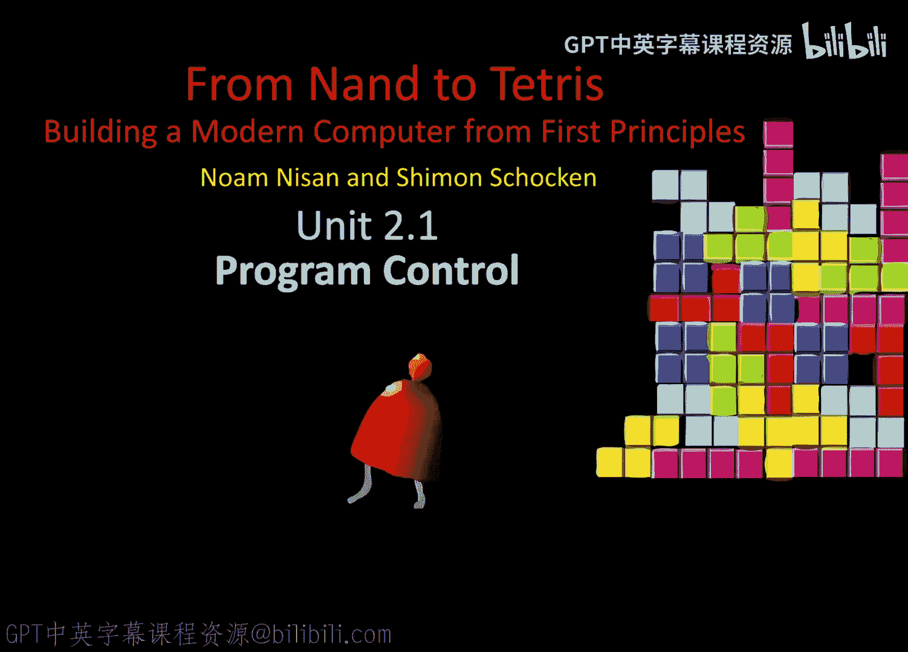
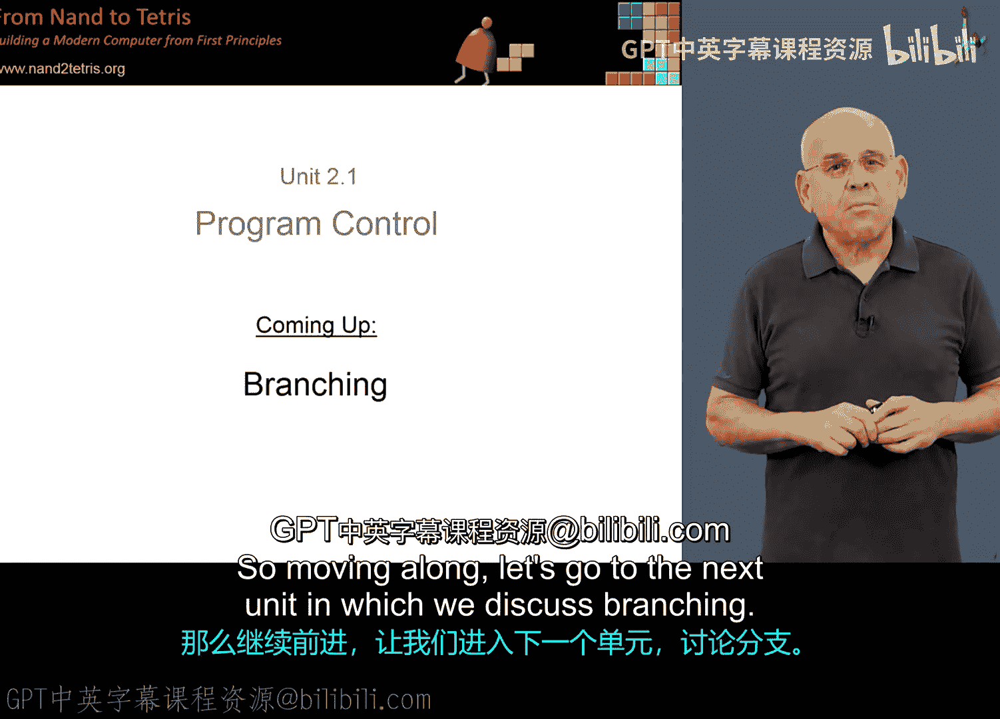

# 耶路撒冷希伯来大学《从零开始构建现代计算机2｜Build a Modern Computer from First Principles》中英字幕 p24 24_04_02_单元2-1_程序控制.zh_en -BV1DA4m1w7FU_p24-

Welcome to Module 2 in which we will complete the construction of our virtual machine。

In the previous module， we dealt with what we called arithmeticological commands and memory segment commands。

And notice that what we did provides a very limited view of programming right everything was kind of predetermined and we did push。

 pop， add， subtract and so on。 and we assume that the program continues in some steadfast linear fashion。

 Well， today we'll begin to discuss the notion of program control in which the flow of control of the program takes you know all sorts of twists and turns due to if commands。

 go to commands， function calling commands and so on。 So let's start with an example。

Here is a mathematical expression， which is well known to anybody who had some high school math。

And here is the same expression expressed in some high level language。

 And notice that the high level expression is almost as good as the real thing。 that is。You know。

 that's why we call it high level language because it allows programmers to write programs in a style which is very similar to the way we think about these applications。

 in this case， mathematical expressions。Now， this expression that I have here。

B square minus 4AC is widely used in know some branches of mathematics。

 so perhaps I can generalize what I have here and use a new function called I call it disc for a discriminant because that's the name of this expression in mathematics and if I have to compute this expression many times in my program。

 it may make sense to refactor it into a method， give this method or function a name。

 we call it square root and use it whenever the need arises。

So let's kind of step back and see what we' are doing in a sort of a greater perspective of。

Of programming theory。 Well， square root power and disk are abstractstructions。

 They are not part of the basic language， right， the basic language。

 whether it's Java or Python or whatever， has a limited syntax and the limited repertore of commands。

 But here。I'm allowed to invent so called new commands as I please， which is wonderful， right。

 whenever I need a new function， I just make it up。

 as I just did with this function that I called disk。😊，And I should ask myself。

 what about the implementation of these functions。 I mean， it's very nice to write this and。

 you know， put parentheses and assume that someone will deliver this computation。 but。

 but who will at the end of the line provide this realize this function。 Well。

 the beauty of this practice is that it doesn't really matter I can invent new abstractions。 It will。

 and assume that at some point。😊，Someone will implement them。 This。

 someone will either be myself on another day or， you know later on today or next week。

 or someone else will do it for me。 You know， if I'm。

 if I'm a team leader in in some software development company I can assign one of my team members to do it for me and so on and so forth。

 The beauty of this is that the story of implementing these functions is completely separate from the story of using them。

 And I can begin using them before they even implement it。

 because I can assume that they will provide some value and I don't care which value。

I can continue to write my program and even debug it using some dummy values and so on。

 So this is a very elegant practice。 And the bottom line is this observation that the basic language can be extended at will。

😊，In fact， you know， the basic language is very limited。 It has only so many commands。

 but these extensions are infinite， right， I can make the language， you know。

 as sophisticated as I please。And this idea of giving the programmer the freedom to add more functionality to the language is perhaps。

You know， I'm afraid to say it， but it may be the greatest idea in high levelvel languages。

 in fact in programming in general， the idea that you can extend the language as you please。

 another aspect of program control in addition to functions is the notion of branching and using this example of computing the so-called discriminant because of some mathematical reasons it makes sense to first check if a is not equal zero and only then compute this computation。

Otherwise do something else， the logic here is not really important。

And if I write this and and I give it to a compiler。

 well the compiler will generate this sodo VM code。

 how the compiler achieves this magic is something that will be dealt with in modules four and5。

 I think of the code。 so you don't have to worry about it right now。

 you don't have to understand how this transformation took place。

 but if you look at the code that was generated， you will realize that we have a whole set of new commands that we haven't seen before。

And these commands boil down to branching commands， which are go to。

 if go to and label three branching commands and function commands， which boil down to call。

 function and return。So this in a nutshell is what we are going to do in this module。

 we are going to discuss these commands and we're going to discuss them from two different perspectives。

 One of them will be understanding the abstractstruction。

 that is we have to understand how to do branching and function column and return within the VM language。

 you know this is something which。Can be probably as completely new to most of you because we know how to do branching and function con return in an language like Java or Python。

 but when we go down to the level of the virtual machine， there are other rules of how to do it。

 so we'll have to learn how to do it。And then we will also have to learn how to actually implement these functions。

 how to make them actually work and deliver their effect。So two very different things， right。

 obstruction and implementation。Al right， so in the course of learning all these new things well go through some very important take home lessons。

 first of all， we will learn once again the obstruction and implementation of branching and function commands and it will understand how they actually work。

 we will spend a lot of time going through the function call and return。Dense， if you will， which is。

A very intricate and fascinating process that happens behind the scene。

And in the process of running this dance， the computer also has to sort of。

Alloccate memory to the to the main actors of this dance。

 which are the functions that calling and returning from each other。

 so we'll have to understand how memory is allocated dynamically to executing functions and we'll continue to talk about stack processing in actually even much more detailed fashion than we did so far and obviously we'll have to deal with pointers and we'll have to complete the VM implementation which is。

A very interesting programming assignment。 So altogether were here for a in which you will completely understand how functions call and each other and return safely from these ventures and you will also have a very rewarding programming assignment。

 So moving along， let's go to the next unit in which we discuss branching。😊。

