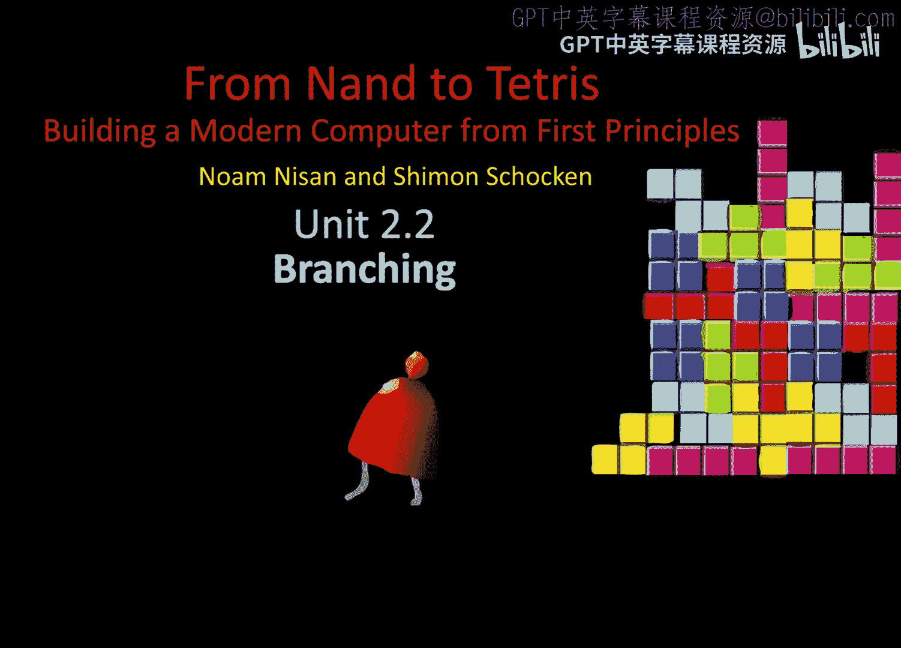

# 耶路撒冷希伯来大学《从零开始构建现代计算机2｜Build a Modern Computer from First Principles》中英字幕 p25 25_04_03_单元2-2_分支结构.zh_en -BV1DA4m1w7FU_p25-

Here's the big picture of our VM language in the previous module we dealt with arithmetic logical commands and with memory segment commands。

 and now we are beginning to deal with branching commands。

So branching is actually a relatively easy concept to comprehend so far， you know， without branching。

 our program was completely linear。 Every command executed after the previous one。

 but with branching， we can introduce all sorts of。ANo nonlinear path。

In the flow of control of the program。 so the program can progress linearly。

 and then all of a sudden there's a go to and we continue the program from some other instruction and the go tos can go forward。

 they can go backward if we go both forward and backward， we can implement loops。

 So this branching gives me a lot of flexibility。 So every one of you who used if statements or while statements has experience the notion of branching without maybe call it without using the word branching。

 So at the low level we have two kinds of branching we have what we call unconditional branching and conditional branching。

 So we'll spend a few minutes talking about each one of these flavors of branching and we'll start with an example。

 So here's an example of a high level function that computes。

The multiplication or the product of two given values， X and Y。

And it computes it using repetitive addition。 So we take X。 We put it into some。Container。

 which we call sum， and then we increment some with x y times and in order to count y times we use yet another variable called n。

 which starts with one and you can read the code and and understand this it's rather trivial。

I should point out though that this implementation of multiplication is very naive and very inefficient Later on we will show dramatically more efficient multiplication of implementation of multiply all right。

 so this is our multifunction and we have this while loop here and once we compile this high level code into VM code。

 the Vm I'm sorry the compiler will generate the code that you see on the right hand side。

So you see that what the compiler is doing is it's taking this while loop。

And rewrites it using go to commands and in order to achieve this rewriting。

 the compiler also has to invent and generate some labels and insert the labels you know in the right places。

 So one label goes where the while was and another label goes you know。

 where the while ends and and the compiler has all this knowledge of how to do it。 Now， once again。

 as I said in the previous unit。 you don't have to worry at this point how the compiler actually achieves this magic because we are going to deal with it extensively later on in the course。

 So all I want to do is focus on the VM code and see， you know。

 how these go to commands are being used。 didn I don't even have to tell you all this。

Sorry about the high level function。 But I do it because I wanted to understand the context of where these。

Weird VM commands come from， they come from compilation。So let's focus on the go to command。

 We see an example。 We have several examples of go to in this code。

 So I'm just highlighting one of them and the syntax is trivial right。

 you say go to label and you expect the computer to jump to execute the command just after label in the code。

 So if you say go to loop the next command that will be executed is let me see push n would be the next command because that's the command just after the label loop。

 All right，  moving along what about conditional branching。

 conditional branching is more interesting because it depends on evaluating the truth value of some condition So if you go back to the high levelve code we see that we had the condition there。

 The condition was。As long as it is not true that n is greater than y， do this and that。 right。

 So what we have here is the command。 if go to end loop， that's what the compiler has generated。

And notice that， whenever。We wish to use a conditional go to command。 We must， first。

Push onto the stack， a certain condition or a certain expression that describes the condition。

 and this expression will have to be evaluated before the condition will go to。

 because otherwise we will not know whether or not the condition is satisfied。So once again。

 the rules of the game are that you push the expression and then when the program runs。

 this expression will end up being evaluated and a certain truth value will remain on the stack and then based on this truth value。

 the if go to command will know whether or not a jump has to actually materialize。

And we see that in this particular example， if you look at the high levelve code。

 the condition is n greater than y and indeed when you look at the generated code we see that we have a push n push why GT just before if go to command and these three VM commands taken together。

 implement in the VM language， the same logic as n greater than y。

 So once the computer will evaluate push and push y GT。

 it will get the truth value that will determine if a conditional jump should actually materialize all right。

 so to recap we have three branching commands go to if go to and label you know without which we could not generate all these labels。

And the implementation of these commands is such that when the VM translator will will be asked to implement these commands or to realize them。

 it will have to generate assembly code that affects the same go to operations in assembly。Now。

 I assume that， you know， you went to the trouble of reviewing assembly language as we requested in。

In module 0 of the course。 and if you did that， you should know that the implementation should be extremely simple because the assembly language also has go to commands whose flavor and style of execution is almost the same as the go to commands of the VM language and therefore the translation in this case of。

VM branching commands to branching an assembly is a rather simple exercise and we expect you to do it on your own。

Alright， so without further ado， we've dealt with these commands in the previous module。

 we've dealt with with these commands in the current unit and we are ready to tackle the function commands which are the real essence of this module。

 so that's what we'll do starting with the next unit。

