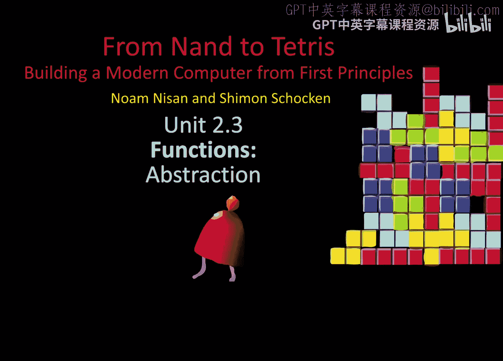

# 耶路撒冷希伯来大学《从零开始构建现代计算机2｜Build a Modern Computer from First Principles》中英字幕 p26 26_04_04_单元2-3_函数抽象.zh_en -BV1DA4m1w7FU_p26-

In this unit， we'll begin to discuss functions and we'll start with the abstract view of functions。

 which is to say that， you know， if you were a VM programmer。

 how would you use functions in your code。 So as you well know。

 high level functions can be extended using。Subroutines， functions， procedures， methods and so on。

 And you may ask yourself where all these names come from。 Well。

 different languages use different terminology to describe what we will call functions。 And you know。

 we don't have to dwell on this。 Everyone understands what is a function。

 It's kind of a black box artifact。 you give it some arguments， push a button。

 a function does something and returns a value。 That's a function。 And once again。

 different languages for historical reasons。 call these functions with with different names。Al right。

 so moving to our VM language， we already took care of all the commands that you see here。

 and now we are finally beginning to talk about how to use and how to implement the notion of functions。

All right， so here's an example of where functions come to play。

 The high levelvel code may say something like square root of a certain value which is the result of evaluating this algebraic expression and when the compiler is x to translate this code。

 it will produce the following presoo Vm code。 Well first of all。

 we have to evaluate the expression within the parentheses So how do we do it Well we start with push x push 17 subtract I mean this will give us the result of x minus-17。

 then we do push5， I'm sorry push x push 5 and then we do something that you haven't seen before we call the function math dot multiply。

And meth do multiply is a function which resides in a class called mathth。

 which is part of the operating system that surrounds our virtual machine。

 so our virtual machine is allowed to interact with this operating system and because multiply is not part of the VM language we are lucky to have a multiply method that knows how to compute the product of two numbers。

 So we use the services of this function。Now， multiply will operate on x and 5。 It will。

Replace x and 5 with the result of x times 5， that's the rules of the game。

 and then I can carry out the addition of the result of the multiplication and the value of x。

 then I can call the square root function which is also part of the mathth library of the host operating system。

 and so on and so forth。So we see that the VM language features， you know two types of operators。

 if you will， you know， first of all， there are the fixed operations which are the part of the language。

Ed， subtract， and so on。 but there are only so many such operations。

If you want to use other operations， well， you either use functions that someone else has already written like Math dot multiply in the Math dot square root。

 or you can write functions of your own。And once again。

 you have this wonderful freedom to create and use as many functions as you fancy in that respect。

 the VM language is unlimited， you can extend it as you please， which is incredible。😊。

And here's another interesting observation。Applying a primitive operator like Sub。

 as we see in this example， has exactly the same look and feel as applying an obstruct function like Math dot multiply or Math dota square root。

In both cases， the rules of the game are as follows。

 and it's very important to to listen and understand what I say。

 The rules of the game are such that if you want。To call a function that expects to get。

Let's say three arguments。 Then here's what you do。 You push the three arguments onto the stack。

And you call the function。And then， some magic happens。

And the result of the function is going to replace these three values that you pushed earlier onto the stack。

The values or the arguments that you pushed disappear。And instead。

 what appears on the stack is the return value of this function。

If you will follow this logic through the example， you will see that it makes perfect sense。

 And I recommend that you will now。pauseuse the video。Take a blank sheet of paper。

 draw an empty stack on it and just go through the motions here。

 go through every command and see how the stack grows and shrinks。

 you know until it comes back with with the right value， which is the result of this computation。

You can make some assumptions about the values of value of X if you want to make your life easier。

 But it， it's not really。 that's not important。 What's important is to understand。

You know that once again。Calling a function and calling a built in command has exactly the same look and feel。

And this is， you know， some very elegant feature of the language。

 which I hope you appreciate just as much as I do。All right。

 so how do we define a function in the VM language Well。

 here's the function in its source view in some you know high level program So what we have chosen to do here is to revisit the multiplication function that we used in the previous module so you know this is our own multiplication。

 So we are going to shortcut the multiplication method of the operating system me and we'll use this one instead。

 because you know I want you to see the code。And repeating a comment that I said before。

 which is completely peripheral to this discussion。

 This implementation of multiply is very naive and inefficient。 The math multiply， however， is。

 is a very sophisticated and efficient operation and we'll discuss it when we develop the operating system in the last module of this course。

 All right， so。The compiler goes to work。transranslates this high levelve mal into Pasoda VM code and what you see on the right hand side is the final real VM code that will actually be generated the Pasoda VM code I'll show you just so that we can easily discuss the example。

 but as you know， we don't have any symbolic variables in VM programs so。

The real thing is shown on the right hand side。 Now one interesting observation here。

 where it's not interesting， it's technical is that the function definition syntax begins with the word function。

 then comes the name of the function mal and then comes an integer which is either 0。

12 or you know some other positive or non- negativegative numbers and this integer informs the implementation。

 how many local variables。 this function is going to use so function mal2 implies here starts a function。

 the name of this function is mal and it is going to use two local variables。

 Now why we have to mention how many local variables we need is something that will understand in the next unit not in this one。

Alright， so what I do here is repeat the same malfunction that you saw before in its VM version。

 and I also added line numbers just for reference so we can we can have some common language I also want to introduce some code that shows how we use the this malfunction。

 So here's a function called main that at some point includes the command call mal2。And。

Notice the syntax call mal2。 This syntax implies the following call。 I'm going to call a function。

The name of the function that I want to call is malt。

And the following number informs how many arguments were pushed onto the stack before staging this call。

So notice what the VM programmer did here。 the VM programmer pushed。The constant 8。

Then then she pushed the constant5， and then she called mal。

 So the V implementation knows that not only we have to invoke the mal function。

 we have to pass to it， the arguments8 and 5。 we know that we pushed because the programmer involved me that she pushed two arguments onto the stack。

 Now in the function calling terminology， the calling function is is sometimes called color and the called function is sometimes called call。

 So I'm going to use these terms interchangeably throughout the following examples。 Now。

 what I'd like to do next is to go through some runtime simulation that will。

Sort of flesh out how this program actually， how this code actually gets executed。

 So let us begin with the main view of of the world。 So I'm going to stop this simulation。

 this imaginative simulation in certain points of interest。

 So what happens after line 3 was executed。 So let's look at the code in lines 1，2， and 3。

 I pushed 3，8 and 5。 So the stack is going to contain 3，8 and 5。

 And then we commence the call we commenced the command call Mal 2。Well。

 this is a rather dramatic turn of events because the main function says I now have to call some other function。

 and therefore， we have to。P the main function on hold and go to execute this other function。

 which which we call mal。 So here is the view of the mal function。

 And let's see what happens after line 0。 After line 0 gets executed， I get several things。

 first of all， I get an empty stack。 Now， when I say I， I mean， I am now the malfunction。

The second thing that I get is an argument segment and notice that this argument segment contains the exact two values that were pushed by the caller。

 so I get to see these values and not only to see them， I know how to call them。

 they are called argument zero in argument1 for me in my world。

And then another thing that I get is two local variables which are initialized to0 Now why do I get two local variables because look at the function declaration command。

 it was function Mal2， so the V implementation prepared for me a segment called local with two local variables which are initialized to0。

So moving along what happens after line 7 is executed Well。

 let's go through all the the commands from 0 to 7。 We do a push constant 0。

 so we push 0 to the stack and we pop this0 onto local0。

 so that's not terribly interesting because local zero was0 before so it will remain  zero fine。

Then we push one onto the stack and we pop it onto local one。

 so the local segment is going to look like this， right0 and1。Then there's a label loop， great。

 And the following thing is push local one onto the stack。 But actually before that。

 the argument segment remains the same because we didn't touch it。

 So let me sort of put it on the screen。 and now going back to commander 6。

 we push local one onto the stack。 and then we push argument1 onto the stack。

 So what we'll get Local one is one argument1 is 5。 We get these two numbers 1 and 5。😊。

And then we go through this whole loop in which we compute the product of the two given numbers and the two given numbers are the arguments。

 8 and 5， so we compute their product， we get 40， believe me， I check this code。

And according to the code that was shown in the previous slide。

 the product is accumulated into local0。 So what happens after line 20， Well。

 now we are at the end of this computation。 So local local 0 contains the product 40。

 Local one contains the value of what we call n in the high level code。

 You have to go to the previous slide to see。 and we stop when n exceeds the second argument。

 The second argument is 5。 So。Local one would be six， that's how we know to stop the code。

And the stack now contains 40 y because we did push local0， look at instruction number 20。

 this instruction takes the value of local zero and puts it onto the stack。Now。

 we do it because we want to return this value to the color。And indeed， the next command is return。

And the beamm implementation knows how to handle return and in particular when we say return。

 thevem implementation takes the topmost value in the stack of the coli and it does the following trick。

 it takes this value and it puts it on the stack of the collar instead of the arguments that were pushed previously。

So now we go back to the main function， the malfunction is gone and foregone。

And all its memory resources have been recycled in a process that we haven't seen yet。

 And now going back to the view of main， I get this right， because， you know， I pushed 8 and 5。

 I called Malt。 I got 40。 That's， you know， what I expected to get。And then at client 5 of main。

 I add up these two numbers and I get 43。Very nice， indeed。

So notice the difference between the abstract view of of main and what actually transpired， right。

 Ma pushed to arguments， said multiply boom， you know， it got the result。

 It went on to computeed as if nothing happened， but in real， a lot happened behind the scene。

 So how should we make this abstractstruction actually work。嗯。

What we see here is exactly the same code that we had before。

And I'd like to now take the view of the implementation。 I mean。

 what do we have to do in order to make this magic work。And let us begin with a call， right。

 that's where the story began。We call the function。

A new momentous event that we are now dealing with。Well。

 here is what I have to do for each function call during runtime。

 the implementation has to do the following things。 First of all。

 it has to somehow pass the parameters。 We also call them arguments from the call to the call。

 Somehow we have to make this handshake。Then we have to determine the return address within the calls code。

 because think about it。 We are going now to venture into a new adventure。

And when this adventure is going to be completed， we have to return exactly to the next command in the callers code。

 so we have to remember this address somehow we have to remember where to return。

 so we determine the return address。Then we save the return address somewhere I mean。

 what is you know when you say remember it has no meaning right。

 we have to save it somewhere in memory。And we also have to save the current state of the caller and the state consists of you know the working stack of the call。

 the memory segments。 Everything has to be saved so that when we return to the caller'ers code。

 we will be able to sort of recreate the private world of main and continue executing as if nothing happened。

 right so we have to save the state of the call， which includes the return address and only then we can allow ourselves to jump to execute the call function。

 So all this has somehow has to happen in order to implement and service a call command。Now。

 what about return。Return is also quite involved， right。

 because here is what I have to do whenever as an implementation。

 whenever I have to deliver a return command。 So let's see。

I have to return to the call the value that was complete， that was computed by the call function。

Okay。And here you see that there is an underlying assumption， an implicit assumption。

 which I had to make it explicit， but I'll do it now。It is required that the call。

 the called the call function always pushes a value before it returns。 Now。

 this is parts of the rules of our game。 before you make a return。

 you must push a value onto the stack， and this is a return value。

 So the implementation knows that the topmost value on the stack must be the return value。

 So it knows that it has to return this value somehow transport this value back to the call。

After doing this， by the way， instead of just saying transporting back to the collar。

 what it actually has to do， it has to take this return value and put it at the topmost value。

 It has to push it onto the stack of the collar。 That's what it has to do。

 But before it makes it push， it has to remove the arguments， right， as I explained before。

 So it's even more involved than that。And then after doing this return， the return value。

 because the implementation is a good citizen， it has to recycle the memory segments and the memory resources and the stack and all the you know the。

Stuff that was used by the call function because the call function is irrelevant now。

Then we have to reinstate or recreate the world of the call。

 which is consisting of its saved working stack and memory segments。

 and only then we can jump to the return address in the calls code and continue executing it as if nothing happened。

So this is the view of the implementation。And what we'll do in the next three units is we will actually make this implementation work。

