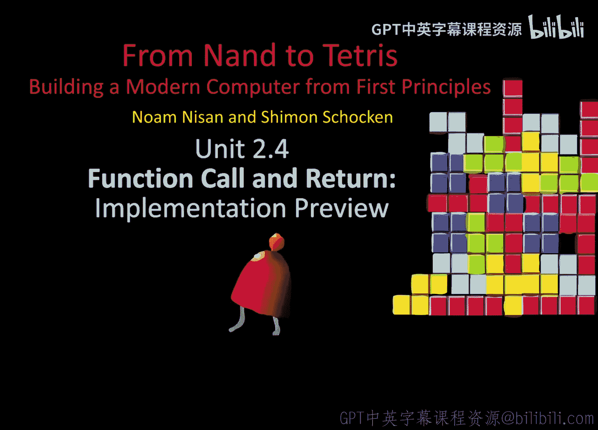
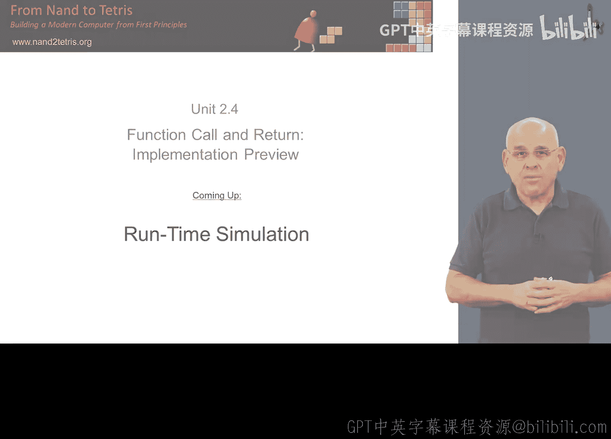

# 耶路撒冷希伯来大学《从零开始构建现代计算机2｜Build a Modern Computer from First Principles》中英字幕 p27 27_04_05_单元2-4_函数调用与返回实现预览.zh_en -BV1DA4m1w7FU_p27-

With unit 4， we start a sequence of three units in which we are going to explain how the function calling return protocol。

 if you will， is is implemented it。 Now this implementation is nontrivial and actually it's quite fascinating and somewhat technical。

 and therefore we decided to devote three units to explaining how we have to do it。

 So we'll begin with a preview in this unit， then we'll do a simulation to see how it actually works behind the scene and then finally we'll discuss how to actually make it happen。

 So I'd like to begin by saying a few words about the notion of function execution。As you well know。

 a computer program typically consists of several functions or a Java program consists of several methods。

 typically， and if the program is doing something not trivial。

 it may well consist of dozens of methods which are spread over multiple classes and so on。And yet。

 at any given point of time， only a very small subset of these methods are actually doing something。

 know， for example， P calls bar and bar calls square root and square root may call something else。

And。All these functions that participate in this in this example of execution are。

 we call all these functions taken together the calling chain。 So the calling chain is， you know。

 a completely obstruct notion that describes， you know， the chain of of command。 So to speak。

 So full called bar bar called square root。 And And that's， that's where we are presently at。Now。

Think about it from an implementation standpoint。 every one of these functions has some state。

 It has some private world。And this private world must be maintained as long as this function exists on the calling chain。

 So what is this state that I refer to Well， the function state is also you know an imaginary concept that we use in order to refer to the functions working stack and memory segments。

And so taken together we call these things states and here is what we have to do with this state when the function enters its execution。

 when the function starts running， we have to create a state for this function。

 we have to give it an empty working stack， we have to give it its local segment and argument segment and so on。

 and then the function starts doing its things。And as long as the function works。

 we have to maintain this state in particular if this function we' call another function。

 we have to save this state somewhere and know how to return to it when this function ends its execution。

Now， when the function returns， well， then at this point， we don't need the state anymore。

 so we can recycle it in order to be good citizens and in order to make sure that the memory will not be completely consumed。

So that's what we have to do with the functions state， so in general when a call calls a coli。

 we will have now two states right we'll have the state of the call。

 we'll have the state of the Qli once the Qli starts running。

 the state of the call has to be saved somewhere and when the Qli terminates。

 we can return reinstate the caller state and continue its execution。So how should we do all this。

 How should we maintain the states of all the functions up the calling chain because remember。

 you know the calling chain is not just two functions。

 It can be this function calling this one calling this one calling that one calling it may be you know several functions deep。

And we have to repeat what you see on the slide here for every one of these couples of calling and Col and Colee。

So what should we do， What do you think， What should we do to save all these states？ Well。

 think about it。And then we make one observation and the observation is that the calling pattern is lifeel。

 which stands for lu in first out， right？The only function that can return is the function which is currently running。

 right， which is the function at the end of the calling chain。

And all the other functions are waiting for it to return。 So once this one returned。

 the calling chain shorts， and then this function does something。 And then it returns。

 and the calling chain， you know， shorts。And so on。 So it grows like this。 You know。

 let me sort of go this way。 It， it grows like this。 And then this one returns。

 then this one returns。And then this one returns。 So it grows this way and returns this way。 And。

 you know， I do this。Does this remind you of something？Hey， that's a stack， right？ I mean。

 what I describe here。Looks like the stack that we dealt with all along。

 So maybe we can use the stack in order to save and retrieve all these function states。

 What I'd like to do next is to illustrate how this ingenious usage of of the stack is going to help me save and reinstate。

The states of。Of of the call of the calling function。

So let us start as usual with the big picture and the big picture is that we want to compute the product of 17 and 212。

 How do we do it？ Well， the function is doing something。 It sets up for the call。

And then it says call Malt2， informing the implementation that two arguments were pushed onto the stack and then boom。

 something happens and I'm going to get the product of these two numbers。That's the view of the call。

 right？So the net effect of this operation is that the function arguments have been replaced with the functions value。

 which is exactly。What I want。And now to the gory details。And the details are。You know， this follows。

 the function is running， doing something， right。 So at some point。

 it prepares to call another function。 So it pushes some values， right？ Now。

 if I'm the implementation， which is doing all this。 you know。

 I don't know really that the function is preparing to do anything。 but at some point。

 the function says call full n as。 Okay， and N as is the number of arguments that are pushed onto the stack。

 Well， once I see this command， I know how many arguments we're pushed onto the stack and and it may be。

 you know， so many arguments。And I call it by the variable N a。And at this point。

 I know where I can set。The， the arg。Pointer， remember the segment pointer a。 Well。

 it should be right here， right， The arg pointer should refer to the base address of the arguments segments in memory。

 So from now on， I know that what is above the arg is the working stack of the color and what what is below the arg are the arguments of the coli。

 I mean， the arguments that the coli is going to use。 Now。

 what else do have to do as the venm implementation。 Well。

 recall that previously we said that before we jump to execute the call function。

 We have to save the state of the color。Now， what is the state of the color。

 It consists of the working stack of the collar and the current segments that it uses。 Well。

 the working stack is saved right， I mean， look at the stack。 It's right there。

 The working stack of the collar is already on the stack， so。It's safe where it is。😊。

And now I have to save the segments。 and I also have to save the return address within the callers code。

 Now， taken together， we call these things。The functions frame。 Okay。

 so the frame is just a fancy word that we use in order to refer to the return address and the saved memory segments of the color。

Now， you know， put yourself in the shoes of the VM implementation， it can access all these pointers。

 I mean， all these pointers are available， right， the Arg， the LCL， this and that they are available。

 so I simply push them onto the stack。And this way I save the base addressess of these segments。

 and therefore I will be able to return to them later on。The next thing that I can do is finally。

 you know， after I took care to do all these very responsible things。

 I can happily jump to execute Fos code。So that's what I do when I have to field or or service a call command。

So we came here because there was a jump to execute the full function。 Now， think about it。

 if I jump to execute F， well， I'm going to hit the command function， Nverses。

 the beginning of the full function。 n vs informing how many local variables I expect to have。

 I now is is full。So the V implementation looks at this and and it has to you know service this command and it does it as follows。

 Well first of all， it creates a local variables segment for the called function。

 Now I know exactly how many variables I need。 I need N vs variables and I also have to initialize them to zero。

 so let's do that。 I push N v zeros onto the stack。And once I do it， I also know that from now on。

 I can refer to these values on the stack as local0， local one and so on。 If I want。

 I can use these this syntax to refer to these to these words in the memory。 And once I do it。

 the call function is ready to take off and start running。

 So let's assume that the call function is running and doing its things and in the process。

 it grows its working stack and it it now has a working stack of its own。😊，And then at some point。

 it is going to return because， you know， all functions return at some point。 So at some point。

 the call function is going to prepare to return。 Now， the preparation from the。

 from the call function standpoint。Requires that I push a return value onto the stack。 So we do this。

 Not we push a return value at the bottom of the stack。And then I say， return。

So now the V implementation has to service the return command， has to implement this command。

 how do we do it？Well， here's what we have to do。First of all。

 we have to take the topmost value from the stack， which we know is the return value because these are the rules of the game。

 and we have to copy it onto argument0。Why， because in the net effect of this operation。

 I want to replace the values of the arguments that the call pushed with the return values。

 So we do this right， we take the return value and we copy it onto the word which can be referred to using argument0。

The next thing that we do is we want to restore the segment pointers of the callers， right。

 We want to take the saved LCL， the saved a， the saved this。

 the saved that and turn them into the current LCL a this and that by doing this I'm going to reconnect so to speak with with these memory segments。

 then I want to clear the stack of the call function。

 which is no longer relevant because the call function is going to die in just a few milliseconds。

 Then I have to set the stack pointer for the call and the stack pointer for the call should be located just after the return value right just after argument0。

 And after I do this I have to finally jump to the return address in the callers code and continue executing the calls code So after I do all this here is what happens。

 I get the return value。And the stack pointer is positioned just after this return value。

 And as far as the quality is concerned， he's back in business and he can continue to do what he did before。

 Now， before we go on， I'd like to make。Some peripheral comments。呃。First of all， you know。

 this may sound very complex。And indeed， it is complex。And。

It shouldn't be surprising that it's complex because if you think about it。

 we are actually building here a little brain。A very primitive brain， but a brain nonetheless。

 because you know， it reminds me of， you know， let's say you have a robot which is designed to clean your rugs。

Well， that's very nice。 So the robot is roaming around， cleaning its rugs。

 cleaning your rugs and it does it because you know it runs a program that tells it how to clean the rugs。

Now， I assume that at some point in the future version of these robots。

 you will be able to sort of sit back at your home and watch the robot does its cleaning and then at some point you will be able to say。

 hey， robot， make me a cup of tea and the robot will have to stop。And， you know。

 start running another function that you know， turnss it around and。Leads it to make a cup of tea。

 and then it will take the cup of tea and give it back to the master。 and then it will say， okay。

 so this thing is finished。 Now I have to go back to where。 oh yeah。

 there was another function of cleaning the rug。 So I'm jumping to this function。

My world is restored。 I have all my memory segments， and then I can continue cleaning the rugs， okay。

So that's what we are implementing here。 We are implementing a little brain that can do several things and not necessarily at the same time。

 but it has this wonderful capacity to stop what it's doing now， start doing something else。

 And by the way， while he was doing the cup of tea， I could have stopped it and say。

 you know what before you do the cup of tea。 You know， go answer the the doorbell And。

 and so it will put this thing on hold。 They will go to answer the doorbell。 And there was say， okay。

 where was I， I was making a cup of tea， will go back to make a cup of tea， Give the cup of tea。

 Where am I now， Yeah， I'm supposed to go back to do the rugs。 So。😊。

We have to implement here something which is very sophisticated。

 So there's no wonder that the implementation is， is not trivial。

So that's one thing that I wanted to say。 And the other thing is that。

We are now in a position to introduce this notion of what we call the global stack。

And think about it。 You know， above this stack that we are growing here。

 there are more states of functions that are up the calling chain， right Because in this example。

 we talked only about the cho and the Koli。 But there are many other pairs of choalas and Koli up the callingning chain。

 and we have to maintain all these states also。 So we get。You know， a very large stack。

 which we call the global stack that contains everything and contains all the information which we need in order to implement and service the runtime of this program。

 not only the current function， but the entire program。Now。

I can refer to some segment of some subset of this global stack here using the term block。

 which I just made up。And notice what the block contains the block is we can call it it's the world of the currently running function okay now what does it include。

 I am now the currently running function， so my block contains， first of all， my argument segment。

 you see at the top， we see argument， zero argument， these are my arguments。

Then the block contains some gray material that I don't deal with at all because this is some saved information that belongs to my collar。

You know， so I know， none of my business。Then I have my local segments。

 and then I have my working stack。 This is my world。 You know。

 I can operate within this world and do whatever is necessary。

 So this is the block of the currently running function and the global stack contains many more such blocks。

 you know one block for every function up the calling chain。😊，So that's the global step。And。

And before we go on， actually， two more comments。First of all。

 notice that the saved frame of the color contains only four memory segments， right， local argument。

 this and that。And if you remember from previous from the previous module。

 we actually have8 memory segments， right， So we also have constant。Temp。Pointer。

And what did I forget， Consant temp。Pointer。And static。 Okay， so I argue that， you know。

 these four segments， constant1 point and static don't have to be saved， okay， and。You know。

 you can think about it yourself why we don't have to save them。

 They don't belong to the world of the function。 They belong to some other。

Parts of the machine that we are building。 if you don't completely see it。

 you will see it in the future units。 So we save only the segments which are relevant to the current functions。

 This is one observation that I want to make。 And the other one， which is kind of more general。

 is that what we really see here， is the stack in all its glory， right， because。😊。

The stack is such a remarkable data structure。 It not only allows me to run all my Jabraic operations and logical operations on on the stack。

 but I use the very same stack not only to execute everything in the program。

 but also to execute all the the behind the scene apparatus that is needed in order to service this program。

 which is currently running， which is really remarkable。 I think about it。 We have here both。😊。

Sort of the operational memory of the count running function and program。

 And we also have everything else， the return address and the memory segments and everything else is saved on the same stack and everything else。

😊，And everything works perfectly。So this is really。A brilliant apparatus。 I mean， this whole idea of。

Of using the stack to， to support the runtime of， of a computer program。

 We really see why the stack is so effective。Okay， so that's the global stack。

 And I want to recap what we did in this unit。 Basically。

 we described how to compute a function in the world of the VM。Very simple。

 From an abstract standpoint， All you have to do is push as many arguments as the function requires。

 And then all you have to do is say， call full and then boom。 you're going to get the result， right。

 And the result is going to be。The value of this function evaluated in these arguments。

 and it's going to replace the arguments。That you pushed and that's it。

 so from the abstract standpoint。Life is very， very simple。From the implementation standpoint。

 oh boy， you know， we just went through what has to be done and we haven't even gotten to the details yet。

 which we'll get to in the next unit， so it's incredible to think about the difference between the obstruct view of the world which is kind of sort of an armchair view of calling a function call this function。

 boom it happens， I get the result and all the work that has to be done you know behind the scene and the call doesn't doesn't care。

 I mean it just does the call and gets the result。And this reminds me of this saying by Arthur C。

 Clark that any sufficiently advanced technology is indistinguishable from magic。

 because from the abstract sentom point， we had a magic and。😊，呃。

And you know how much work we had to put to make it happen。 So we can also say that， you know。

 any sufficiently advanced magic is also indistinguishable from a lot of work behind the scene。

And in the next two units， we will continue to talk about this lot of work which still has to be done in order to implement the function call and return protocol。

