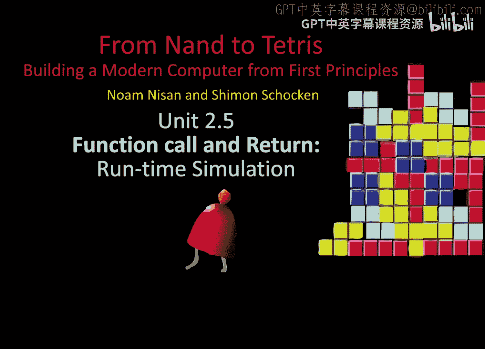

# 耶路撒冷希伯来大学《从零开始构建现代计算机2｜Build a Modern Computer from First Principles》中英字幕 p28 28_04_06_单元2-5_函数调用与返回运行时模拟.zh_en -BV1DA4m1w7FU_p28-

I wish to remind you that because the function core return implementation is。Rather， a Harry。

We decided to describe it in three separate units， and we went through a preview of what has to be done。

And I suppose that by now， you understood maybe 50% of what I explained。In the next unit in this one。

 you will understand another half of the remaining 50%， and then in the third one。

 you will understand everything。So what I'd like to do next is to simulate a function calling return protocol in progress。

 so let's see how it actually works。And to illustrate it will take。

An example of a recursive function， factorial， and this is how the function may be written in some high level language like C or Java。

And I'm sure that you've seen this function before， so I'm not going to spend any time on it。

And what I do want to show you is what the compiler will do with this function and basically the compiler。

 if applied to this source code， will generate the following VM code。

 assuming that it's a two tier compiler like that of Java C sharpharp。And some other languages。

 so let's see。We start by compiling the main function and we want to compute factorctorial 3。So。

 we push 3。We call factorial and return， that's what we were asked to do。Moving along。

 I now have to compile the factorctorial functions， so we start with the function declaration。

 function factorial。And then we evaluate the condition n equals one and because we have to do things in the VM way。

 we push n， we push one， we ask if they're equal and if they're equal。

 we go to base case which is a label that the compiler is going to generate and insert into the generated the code stream later on okay so。

If we have to go to， we'll go to a base case and notice， by the way， that when we push n。

 push1 and do I， the I is going to consume these two values right and return through false。

 And based on this， we're going to make the jump。 And now we have to implement the else part of the if。

 So in the else part， we have to evaluate the expression。

 actually return the value of the expression n times factorial n minus-1。 So we push n。

And then we turn to compute factorial n -1， well how do we do it， we push n， we push1， we sub。

 we get n -1， we call factorial on this value and then we call the malfunction that we wrote before in order to multiply the result of the factorial and n and we return。

So that's the end of the else。 and finally we need to implement the base case and so we put this label that we generated before we label base case and in the base case it's very simple。

 we push one and return because that's what the source code wants to do and that's the end of the story。

 we also need to implement the mal function。Because we decided to use mal instead of mathth multiply。

 it doesn't really matter， but I decided to omit the code of mal。

 which in the context of factorial is kind of a service function。

 you know we use it just to multiply things and it's not terribly interesting。Alright。

 so that's the soda code of factorial。 and heres the final code and we'll now go to explore how it actually works。

But actually， before we do this， I'd like to say to， to issue， to。

 to say something peripheral and to point out that once again， you know。

I've shown you how the compiler plays its magic， but I didn't say how it actually does it。 You。

 I showed you the result of the magic。😊，And you may be wondering how is the compiler。

 you know how it knows how to generate these labels and so on and so forth， don't worry about it。

 we'll spend a whole module in fact two modules explaining how the compiler operates。

But we can stop for a minute in order to appreciate。The beauty of this compiler。Because look at it。

 when the source code consists of something like， I don't know，10 commands。

And the target code consists of something like 20 commands， and it's remarkable， right。

 We are compiling a highlevel program， and the target code is only twice as long as the source。 See。

 that's the beauty of a twoter compiler。 We don't have to compile all the way to machine language。

 If we had to compile all the way to machine language。

 then there would be no way that I could possibly explain to you the target code。

 But here we compile to a super elegant intermediate Vm language。

 and therefore the result is very elegant。 and the compiler doesn't have to work hard。

 So the compilation task is not immense， you know， moving from Java to byte code moving from a jack code to our VM code is not such a big deal。

 I mean， lots of work， but still very manageable。😊，Well get to it once again in modules4 and5。

 So stay tuned。 we'll get back to this later。 So what I described so far was a so-called compile time。

 and now I'd like to to turn to explain what happens in runtime。

 when in runtime we are executing this program。 So main starts running and it informs that it has zero local variables。

 which is very nice and then main pushes so it starts with an empty stack it pushes three So we get three on the stack。

And then we have the call factorial1 command and notice that the one informs that one argument was pushed onto the stack so we can refer to the topmost value now in the stack as argument zero because we know that this value should serve as an argument。

 right？Well， now we have to service the call command。 So here's what we do。

 The first thing that we do is we have to save。The frame of main onto the stack。 So we save it。

 Okay now the blue dot is something that I added for a cosmetic and pedagogic effects and the blue dot shows the return address in the given code。

And notice that this is exactly where we want to return to after factorial finished its operation。

 right， we want to compute factorial and go to the next command， the next command is return。

 and therefore the blue dot is correctly positioned in the code， and we save this return address。

 the blue on the stack。And then moving along， we jump to execute factorctorial。

And so we have zero local variables。 So we don't have to add anything to the stack。

 And then we do the following operations。 push argument 0。 So argument 0 is 3。 So we push 3。

We push one。 We ask if they are equal。 They are not equal because three does not equal1。

 and therefore we don't go to base case。 know the if go to does not work， is's not relevant。And also。

 notice that the I has consumed these two values， argument0 and constant one。

The overall effect of these four commands on the stack is mill。 No effect。 So moving along。

 we now have to look at the commands， push argument 0。So， we push 3。Right。

 and then push argument 0 again and subtract  one from it。

 So we're going to get 3 and 2 on to on the stack。 And then we get to the command。Call factorial 1。

 So once again， we inform。The implementation that one argument has been pushed onto the stack。

 we can refer to it as argument 0， and we want to issue a call command。

 So the implementation is going to save the current the frame of the current function。

 the current instance of the factorctorial function and the return address is the green right because that's where I want to return to after the factorctorial returns。

 So we save the green also and we jump to the fctorial function。Well， we do a push argument  zero。

 which is2 now。And then we push constant1 and we ask is it true that two equals one no。

 so we ignore the base goal the impact on the the net impact on the on the stack is is nil So we happily move to evaluate these commands or implement these commands。

 So push argument0， it is two， and then we push argument 0 again， we de duct1， we get one。

 and then we call factorial one informing that one argument has been pushed onto the stack so we know that we can call this argument 0。

And we have to save the state of factorials。 So we save the state， including the return address。

 which is the Violet dot， right， because after the call， we want to return to the next instruction。

 So the violet point is properly positioned in the code and I save it on the stack。

So now we go to a function of factorial 0。And let's see。 we push argument 0 onto the stack。

 which is one。We push one onto the stack and then we ask are these two values equal。

 is it true that one equals one。 The answer is yes， it's true。

 So we are going to do the jump and we are going to jump to the base case right So we jump to the base case and here I see that I have to push the constant one So we push it okay we push the constant one and now we have to do a return。

 Now this is the first time that we have to to do a return or that the return or cares in this simulation。

And here's what the implementation does when it encounters this return command。 First of all。

 it gets the return address off the stack。 can it can pop it。

 you know we'll see later how we do it exactly but we get the return address。

 which is the violet and we know exactly where we have to return。

 You see this I place this arrow here， which is going to tell me exactly where I have to return when I finish my little business here。

 So the next thing I want to do is copy the return value。

 which I know is the topmost value onto a0 So I copy one onto a0 and I get one。

 it looks very uninteresting because one became one， but in fact it's not the same one。

 It's this new one that was copied right。And then I have to do， let's see I have to multiply right。

 I have to call mouth2 Now I'm not going to show you what happens when I call multiply。

 but if I did show you I had to show you know all the stack growing and so on。

 I will omit this and I will just record the result of multiplying these two values and the result is2 right so two and one I'm going to replace with two。

And so I call Mal2，2 and1 are replaced with the result of mal， which is2。

 and I omitted all the details and then I have to do another return。Right。And so let's see。

 I have to do another return。 So I get the return address。Which is the green。And once again。

 I know exactly where I have to return to right， I position this blue arrow next to my intended return value and then I have to do the copy。

 I take the topmost value which is2 and I copy it onto ag0 and so I get2 I can get rid of of the frame which is normal relevant and I jump to the return address where I find the command call mal2。

So once again omitting the details I call mal I do two times3 I get6 That's the result okay and the next command that I hit in the code is return right well the return is implemented by first of all consulting the frame and I see that the return address is blue so I put my marker on the blue command。

Then I copy the 6 on arg 0。 I get the result 6， I。Get rid， I recycle what is got free。

 and I jump to the blue marker， and I do the return。So at the end of the story。啊I。Pushed。

II wanted to compute three factorial， so I pushed3。I call factorial and boom。 I got 6， right。

 This is the view of of the call。And notice how the color is completely oblivious of all the drama that took part behind the scene。

 I mean， it's unbelievable how much work we had to do in order to get this result。

 six right factorctorial of three。And just imagine what would have happened if we did something like call factorctorial 50。

 right， would have to do this 50 times， and the stack would groan50 times。

 And then it will return because that's the nature of factorctorial， right， It grows。

 And then it sort of it drills down， and then it drills up。

And so you can also imagine what happens if I do call factorial 200。

 I will probably get a stack overflow right， I mean。

 the stack will will become too large at some point and so。

And so this is what I wanted to show you in the runtime simulation of。

Of the protocol that I just described and in the next unit。

 we are going to finally implement it using using code， I mean。

 well actually write the code that implements this function call and return implementation。

And you will be surprised by the simplicity of this code。

