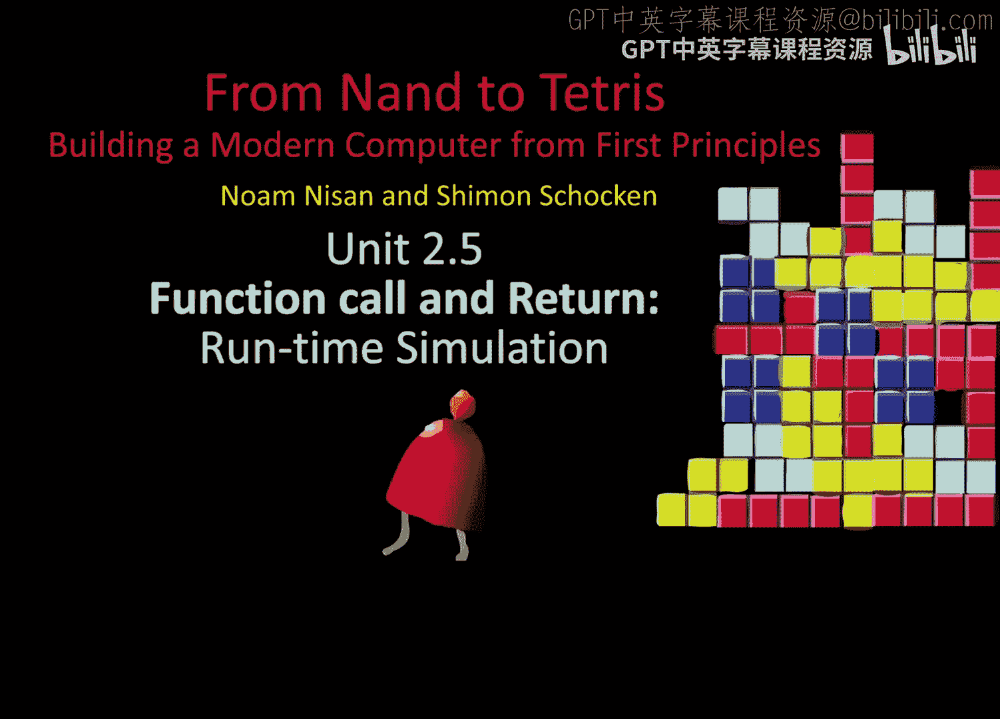

# 从零开始构建现代计算机：2-5：函数调用与返回运行时模拟 🧠



在本节课中，我们将通过一个具体的例子——递归计算阶乘，来模拟函数调用与返回协议在程序运行时的具体过程。我们将看到高级语言代码如何被编译成虚拟机指令，以及这些指令在栈上如何执行，从而理解函数调用背后的机制。

上一节我们介绍了函数调用与返回协议的基本概念，本节中我们来看看这个协议在实际程序运行中是如何工作的。

## 编译时：从高级语言到虚拟机代码

为了理解运行时行为，我们首先需要知道编译器如何将高级语言代码（如C或Java）翻译成虚拟机指令。我们以计算 `factorial(3)` 为例。

以下是阶乘函数的源代码：
```c
int factorial(int n) {
    if (n == 1) {
        return 1;
    } else {
        return n * factorial(n - 1);
    }
}
```

编译器会将其编译成以下虚拟机代码。我们首先编译主函数 `main`，它需要计算 `factorial(3)`。

以下是 `main` 函数对应的虚拟机代码：
```
push constant 3
call factorial 1
return
```

接下来，我们编译 `factorial` 函数本身。

以下是 `factorial` 函数对应的虚拟机代码：
```
function factorial 0
push argument 0
push constant 1
eq
if-goto BASE_CASE
push argument 0
push argument 0
push constant 1
sub
call factorial 1
call mult 2
return
label BASE_CASE
push constant 1
return
```

**代码解析**：
*   `function factorial 0` 声明函数并指明有0个局部变量。
*   `push argument 0` 和 `push constant 1` 将参数 `n` 和常数1压入栈。
*   `eq` 指令比较这两个值是否相等，结果（真或假）会留在栈顶。
*   `if-goto BASE_CASE` 如果比较结果为真（即 `n==1`），则跳转到标签 `BASE_CASE` 处执行，这是递归的基本情况。
*   如果不相等，则执行 `else` 部分：再次将 `n` 压栈，然后计算 `n-1` 并压栈，接着递归调用 `factorial`，最后调用乘法函数 `mult` 计算 `n * factorial(n-1)`。
*   标签 `BASE_CASE` 标记了基本情况的开始：将返回值1压栈，然后返回。

值得注意的是，这种两阶段编译（从高级语言到虚拟机代码）非常优雅。源程序可能只有10条语句，而目标虚拟机代码可能只有20条左右，这使得编译过程可控且高效。我们将在后续的第4和第5单元详细讲解编译器本身的工作原理。

## 运行时：栈上的执行模拟

现在，让我们进入核心部分，模拟上述虚拟机代码在运行时栈上的执行过程。程序从 `main` 函数开始。

### 第一步：`main` 函数调用 `factorial(3)`

1.  `main` 函数开始执行，它被告知有0个局部变量。
2.  栈初始为空。`push constant 3` 指令将常数3压入栈。
3.  接着执行 `call factorial 1`。这条指令告知系统：已有一个参数（即数字3）被压入栈，可以将其作为 `argument 0` 引用。
4.  处理 `call` 指令时，运行时系统需要保存当前函数（`main`）的帧状态（包括返回地址）到栈上。返回地址指向 `call` 指令之后的下一条指令（即 `return`）。
5.  保存完毕后，程序跳转到 `factorial` 函数的代码开始执行。

### 第二步：执行 `factorial(3)` 的实例

1.  进入 `factorial` 函数，它被告知有0个局部变量，因此栈帧无需为局部变量分配空间。
2.  执行 `push argument 0`（值为3）和 `push constant 1`，然后执行 `eq` 比较。由于 `3 != 1`，比较结果为假，`if-goto` 跳转不会发生。`eq` 指令会消耗栈顶的两个值（3和1），因此这几条指令对栈的净影响为零。
3.  程序继续执行 `else` 部分：
    *   `push argument 0`：再次将3压栈。
    *   `push argument 0` 和 `push constant 1` 以及 `sub`：计算 `3-1`，得到2并压栈。现在栈上有两个值：3（第一个乘数）和2（即将递归调用的参数）。
    *   `call factorial 1`：再次调用 `factorial`，并告知有一个参数（值2）在栈上。

### 第三步：递归调用 `factorial(2)` 和 `factorial(1)`

1.  处理 `call factorial 1` 指令时，系统保存当前 `factorial` 函数实例的帧状态和返回地址（指向乘法调用 `call mult 2` 的位置），然后跳转。
2.  类似地执行 `factorial(2)`。比较 `2 == 1` 为假，继续 `else` 部分，计算 `2-1=1`，然后 `call factorial 1`。
3.  进入 `factorial(1)` 的实例。比较 `1 == 1` 为真，因此 `if-goto` 发生跳转，直接来到 `BASE_CASE` 标签处。
4.  在基本情况中，执行 `push constant 1`，将返回值1压栈，然后遇到 `return` 指令。

### 第四步：处理返回（Return Protocol）

这是模拟中第一次遇到 `return` 指令，协议开始发挥作用。

1.  **获取返回地址**：系统从保存的帧信息中弹出返回地址（对应 `factorial(1)` 调用后的位置）。
2.  **复制返回值**：系统知道栈顶的值（我们刚刚压入的1）就是函数的返回值。它将该值复制到专用的返回值寄存器或位置（例如 `ARG[0]` 所指向的调用者栈帧中的特定位置）。
3.  **清理栈帧**：当前函数实例的栈帧（包括局部变量、保存的状态等）被回收，栈指针调整。
4.  **跳转**：程序计数器跳转到之前获取的返回地址，继续执行。

### 第五步：回溯与计算

1.  程序返回到 `factorial(2)` 实例中 `call factorial 1` 之后的位置，即准备执行 `call mult 2`。
2.  `call mult 2` 指令调用乘法函数，计算 `2 * 1`（`factorial(2)` 中的 `n` 是2，递归调用 `factorial(1)` 的返回值是1）。我们省略乘法函数内部的详细栈操作，直接记录结果2被放回栈顶，取代原来的两个操作数。
3.  `factorial(2)` 紧接着执行 `return`。重复返回协议：获取返回地址（指向 `factorial(3)` 实例中的 `call mult 2`），复制返回值2，清理栈帧，跳转。
4.  程序返回到 `factorial(3)` 实例，执行 `call mult 2`，计算 `3 * 2`，得到结果6。
5.  最后，`factorial(3)` 执行 `return`，将返回值6复制回 `main` 函数栈帧的指定位置，清理栈帧，并跳转回 `main` 函数中 `call factorial 1` 之后的位置。
6.  `main` 函数获得返回值6，然后执行自己的 `return` 指令（或进行其他操作）。

## 总结与展望

本节课中我们一起学习了函数调用与返回协议的运行时模拟。我们追踪了一个递归阶乘函数 `factorial(3)` 的完整执行过程，从 `main` 函数的调用开始，经过多次递归调用、栈帧的保存与增长，到触发基本情况后，再通过返回协议一步步回溯、计算并清理栈帧，最终将结果6返回给调用者。

这个过程清晰地展示了：
*   **栈的增长与收缩**：每次函数调用都会压入新的帧，每次返回都会弹出该帧。
*   **返回协议的关键步骤**：获取地址、复制返回值、清理帧、跳转。
*   **递归的实现机制**：正是通过这种标准的调用/返回协议和栈管理，递归才得以实现。


尽管背后的栈操作非常复杂，但对于高级语言程序员来说，这一切都是透明的。他们只需简单地写下 `factorial(3)`，就能得到结果6。在下一单元，我们将最终动手**用代码实现**这个函数调用与返回协议。你会发现，实现它的代码本身可能出乎意料地简洁明了。