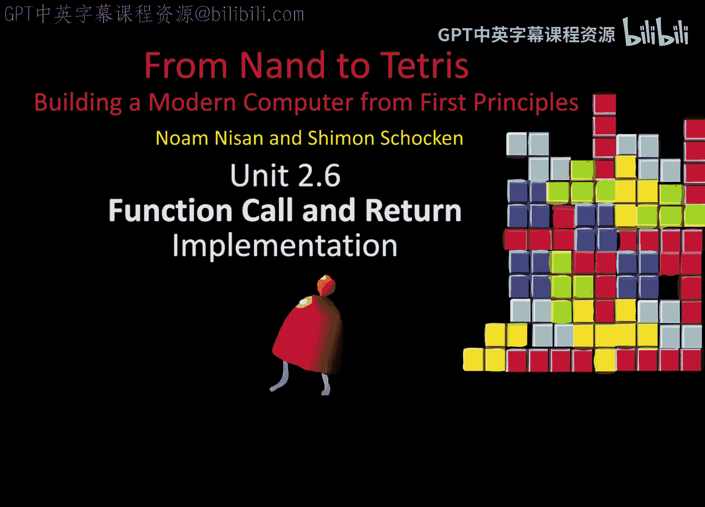

# 耶路撒冷希伯来大学《从零开始构建现代计算机2｜Build a Modern Computer from First Principles》中英字幕 p29 29_04_07_单元2-6_函数调用与返回实现.zh_en -BV1DA4m1w7FU_p29-

If you recall， we decided to present the function call and return implementation using three different units。

 and we already went through the preview of what we want to do。 We gave sort of an informal runtime。

Experience of the function call return in action。And in this unit。

 we are going to actually describe how we're going to make it happen。

 how we're going to implement it。So let's get started。 Well， we begin with some VM code。

 which is quite arbitrary and uninteresting。And yet we are going to use it to illustrate a few things。

 So we have a function called food dot。And another function called bar dot mal。

 And we assume that these functions emanate， or they come from。Presumably two different classes。

 right？ I mean， VM code， as I explained several times， is something which is。

Typically written by compilers。And therefore， it is safe to assume that if this is compiled J code。

 then the compiler was applied to a directory that included two different class files namedF and bar and Fo and bar had at least one function written in them and we see these functions here。

 F。t mainin and bar dotM。And we see that。At some point in mains code。

 it computes this expression that we see in the comments。 So it pushes。

193 it calls Bardot Mal and then Barott Mal does some work。And pushes a return value and returns。

 So there's nothing really new here except that I emphasize the fact that a function may well call another function which historically belong to a different class。

 but once you know everything is compiled into VM code we lose this notion of classes and what we get is just a long list of functions that have full names。

 which is the class name。A dot functioning。All right。

 so we have a call and callee and that's the typical situation that we discussed and we have the typical function call and return commands that we are dealing with all the time。

And here is the contract by which these two parties must play。

 So let's begin with the caller's view of what is going on here。Before I call another function。

I must push as many arguments as the function expects to get。 So， you know， if I call square root。

I know that I have to push one argument if I call mal I know that I have to push two arguments and so on。

 so the assumption is that whoever wrote this VM code， whether it's a human being or a compiler。

 well， you know he knows what he' is doing so he knows how many arguments to push Next I invoke the function by saying call function name N As。

 whereas N As is the number of arguments that I push before。After the called function returns。

 the argument values that I pushed before the call are going to be replaced with the return value that always exists。

 So I know that when the function returns。Something new is going to be at the top of my stack。

 and something new is the return value。After the call function returns。

 all my memory segments magically are exactly the same as they were before the call。

 except that temp is undefined and some values of my static segment may have changed because you know the static segment is visible by all other functions in the application。

 so it may be that some function。😊，That I called or functions that were called by function。

 by the function that I called changed some statics。 And that's， that's just fine。 All right， now。

 what is the contract from the Cols perspective， Let's see。Before I start running。

 my argument segment has been initialized with the argument values that were passed by the call。

 you know， I don't care how I just know that it's there and it's available to me。

My local variable segment has been initialized and all my locals begin with zeros。

 once again I don't care how， but it's there。My static segment has been set to the static segment of the class to which I belong。

え。And since it's a compiled class， it's the VM file to which I belong， memory segments。

 this that pointer and temp are undefined upon entry， my code may well use them。

 but it's responsible to store some sensible values in them in case I intend to use them and finally my working stack is empty。

One more thing that is very important in the contract is that before。Issuing a return command。

 I hereby agree that I'm going to push a value onto the stack。 So once again。

 we see something that we said several times the function must return something before it returns now。

Must push something onto the stack before it returns Now。

 think about the situation in which this function began its life as as a void method。

 I suppose it was a void method or void function at the jack level you know and void functions are not supposed to return a value and we just said that you must return a value。

 Well， indeed this is the case。 even if you're a void function。

 you must return a value so you push something you know you can push zero and it's the color's responsibility to do something with this return value。

 So if the call knows that he called a function which is supposed to be void it can simply toss away the the value that was returned by the col if you didn't completely understand what I said here about this observation about void functions then don't worry about it will get to it again。

When we talk about the compiler， So we describe the function call and return protocol from the perspectives of the call and the callee。

And now we tend to describe the perspective of the implementation。

 which is the third party in this dance here。Now one way to realize a VM implementation is to write a VM translator and a VM translator is a program that reads the VM code and translates it into assembly。

 and in our case it's a hec assembly。And so the VM translator will go through the code and focusing on you know the function commands。

 it will， for example， when it reaches the call bar mouth2。

 it will generate code that realizes this call when it gets to the function command。

 it will generate code that realizes the function same with the return and what we do from now until the end of the unit is that will0 in on any one of these things that I just described and will explain what exactly the VM translator does Now the big picture is that the VM translator is going to generate code that you know reading what is written here。

 it's going to save the call state the state of the food dot main function。

 then it's going to do a few more things to set up for the function call。And finally。

 it's going to say go to。The name of the function。So presumably the VM translator at some point will generate a label which is the name of this function and indeed if you look if you take a few more lines down the target code you will see the label bar dot mouth。

 so this is how we represent the entry point to a function。In in assembly。

 in the translated assembly code。 All right， so now we're going to explain exactly what we have to do with this pseudo code here on the right。

 So let's see handling a call。We begin with some global stack that includes all sorts of stuff and it also obviously at the tip of the stack we see the working stack of the the current function。

 so the call the current function is doing all sorts of things and then all of a sudden we encounter a call some other function command and we we have to implement this command using assembly what do we do。

Well， since the call command includes the NAs parameter。

 we know exactly how many arguments have been pushed before， right Narchs。

 so we know how many of the values on the stack are actually should be treated as arguments and here is what I do。

Okay， the first thing is I push a label。Onto the stack。And。Later on。

 I'm going to use the same label as the label to which I'm going to return。

After the cold function terminates， so let's keep this in the back of our mind。

 I push some label that I generated。We see it on the stack now， then I push LCL。To save。

 you know the state of the local segment， my local segment。

 I push my a saving the state of my argument segment。 I push this。 I push that。

And then I reposition Arg。 Now， let's think about it。 You know。

 Arg should be repositioned for the called function。

Now where should we reposition Arg well obviously we should reposition it at the beginning of the Arg segment which is right here right now where is this address well I can calculate it because I know how many things I pushed I pushed five values so I do S minus-5 and then previously the color pushed N arg's argument so I know exactly where to position A for the called function。

Then I do LCL equals S。And that's where I'm going to start to push the local variables of the called function。

 so that's just fine。And finally， I go to execute the call function so I go to execute the call function by simply writing the command in assembly go to and the name of the call function。

And now I do something very tricky。 I insert into the generated the code stream。

 the label that I pushed before， right， remember， I generated the label。

 I gave it some agreed upon name that I have to agree exactly you know on all these things at some point。

😊，And then I push it。 So first， I generate it。I'm sorry。 First I generate it， I push it to the stack。

 and then later on I output it or I emit it into the generated code stream。

 So that's exactly what I have to do in order to implement a call command。

 Now just to explain what is going on here， this is。Pcedo assembly code。

And you have to take this cellda code and translate it on a piece of paper into actual he code。

 Should you decide to implement this thing on the hec platform。All right， moving along。

 we know how to handle call。 So now I want to treat the function command。

 you know the command that signifies that a function begins in in the code。

 so let's read the big picture， the big picture is such that you know whenever we hit a function command。

 the first thing that the translator does is it takes the function name and generates a label。

And this label will serve as the entry point to the translated the assembly code of this function。

And then we simply have to write some assembly code that handles the setting up of the functions execution。

So let's see how we do that。Here is my stack and。The stack is exactly as it was after the call happened because remember。

 you know when do we hit the function command， we hit the function command always just after a call command。

 right call， and then I hit the function。So this is the same state as we had at the end of the handling of the call。

And now we encounter the function function name n barss， which inform how many variables。

 how many local variables the call function expects to have All right so what can I do。

 I can generate the following assembly code。 first of all。

 I take the function name and generate this label， as I said before， and I put it。

 I write it into the generated the code stream， and then I repeat n vs time push0。

 right I know how many local variables I have to to create。

 And so I create them and I simply push as many zeros as necessary。

 and I basically build the local segment of the called function。

 and that's it right that's all I have to do。 and now the function can start doing it。Sa thing。

So it will do its thing and at some point it will want to return， right。

 and this will happen in our example here。And now I have to handle the return command。

 So reading the big picture， I have to generate a code that moves the return value to the call。

Reen states， the call state， and then does a go to。Fo's return address， which is。

The return value in the callers code， if you look at the middle of the code pane of the generator。

 the assembly code， you will see this address there right full dollar R ET dot1。

 So presumably you know this is the return value that the VM translator created when it handled the call if you recall the call command involved generating a return address。

 And so I see that I go to exactly this return address and question of course， is how do I know。

How to do it。 And， And that's what you'll see in the next slide。 Allright so。嗯。

The called function did some work， right， and it。Grew its working stack and working stack includes all sorts of stuff that the call function。

Created。And then I have a return command。Now， because everyone is assumed to play by the rules。

 I know that once I hit a return command， I know for sure that the value at the top of the stack must be a return value。

Because everyone plays by the rules， right and a function must push。A return value before it returns。

 so the next thing that I have to do is as follows and this is a little bit involved。

 but it's really not terribly complicated。First of all， I'm going to create some temporary variable。

 which I call end frame and I'm going to assign the value of LCL to it。

 so if you look at the stack diagram you will see that end frame indeed points at the end of the frame in the host RA。

The stack is is is obviously stored in the whole stream somewhere。 All right。

 now the return address must be the contents of the word end frame-5， right so。End frame。

 which is like LCL。 If you go-5， you hit exactly the address of the return address， right。

 the address of the return address。 Now I need the asterisk because I want to look inside this word and this is how I get the return address and I put it in yet another temporary variable。

 which I call R ET ADDR return address and I sort of put it aside for now。

 and I have to do all these things in assembly right， Allright。

 so the next thing that I do is I reposition the return value for the color。

Now where should the return value should be the return value should be copied onto a0 right and I already have a pointer that is located right on arg0 and this is the pointer ARG。

 so I have to perform the pseudo command ARG equals P because you know the pop。Is going to。

Retrive the return value， you know， off the stack， and then I take this value， and I put it in arg。

 So the result， look at the stack diagram。 The result is going to be this。

 I popped the return value and I copied it onto arg。

 Okay or to the to the address that that arg refers to。 Al right，  moving along。

 I know where the stack pointer should be。 the stack pointer should be just after arg， because。

 you know， this is the view that the call expects to get。

 the color expects to see a return value and then continue to do his work。 So S becomes a a plus one。

 And now I can begin to recover the various segments that I saved on the stack before。 So that。

Should be end frame minus-1， the contents of end frame -1， this should be end frame -2。

 arg should be endframe minus-3， and LCL should be end frame-4。So I recovered all my memory segments。

 and finally， I can jump to the return address。 Where do I jump， I jump to the address that I。😊。

Retrieevd before that I popped from the stack before and and put it in the variable R， E T A DDR。

 Okay， so this is the logic that I have to now implement in assembly。 I mean。

 you have to implement an assembly when you write the VM translator。 Now。

 another thing that I want you to notice is that once I've set S P。Below Arg。

 I basically communicate implicitly that everything below S is， you know， it's just game， right。

 It's like it's recycled。 It's dead。 It's irrelevant because， you know， the next push is going to。😊。

To override the memory location where S shows and then S is going to be down and then the next push will do this。

You know， all the the entire block， which is marked as recycled is no longer relevant。

 so effectively that's the situation that now the collar is going to see。

 The collar is going to see the return value。At the top of its working stack and the stack pointer is going to show to point at the next word in the memory。

 and that's exactly what we wanted。So we did it， we showed how to implement return。

 and basically we showed how to implement every one of the function calling commands。So to recap。

 this is our global stack。And we showed how to generate the assembly code that when executed。

 will end up building and maintaining this global stack during runtime。

And we didn't give you the actual assembly code， but we did give you Cdo assembly。And this code。

 when you write it in heck， will actually do everything which is necessary in order to build this complicated world that we described in the last three units。

And the last comment I want to make， which I think is interesting。

 is that the code that I showed you is completely language and platform independent。

So you don't even have to commit yourself to the heCC platform。

 you know the specification that I gave you here is actually a specification on how to implement the VM our VM language on any given target platform。

 we didn't say anything about where this thing is going to be stored in memory or how I wanted to which assembly language I wanted to use。

 use whatever you want， and this is important because we just gave a universal recipe for implementing our VM language on any hardware platform。

 any computer out there， but of course in this course we'll do it in heEC because simply this is the computer that we are playing with in this particular course。

All right， so basically up until this point we implemented three quarters of the language and with this unit。

 we are now putting a check mark also on the function commands and we are done implementing the VM language。

In the next unit， we will add a few more technical details on how to do it on the hec platform。

And I'll see you there。

