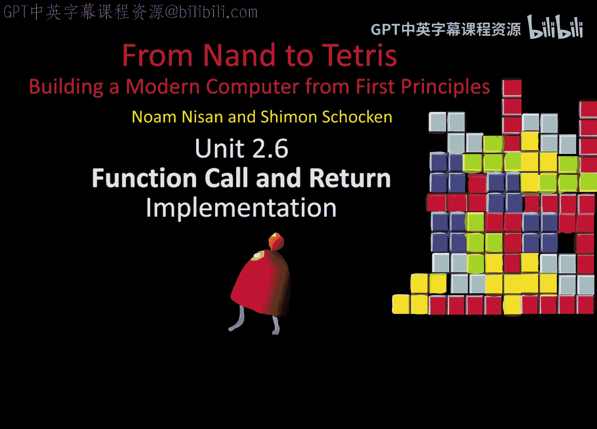

# 从零开始构建现代计算机2：单元2-6：函数调用与返回实现 🧩

在本节课中，我们将学习如何实现虚拟机（VM）语言中的函数调用与返回机制。我们将从调用者、被调用者和实现者三个视角，详细解析函数调用的协议，并了解如何将VM命令翻译成汇编代码。

---

## 调用者视角 📞

上一节我们预览了函数调用的流程，本节中我们来看看调用者需要遵守的协议。

在调用另一个函数之前，调用者必须完成以下步骤：

*   **推送参数**：根据被调用函数的期望，推送相应数量的参数到堆栈上。
*   **发起调用**：使用 `call functionName nArgs` 命令，其中 `nArgs` 是之前推送的参数数量。
*   **处理返回值**：当被调用函数返回后，调用者之前推送的参数将被一个返回值替换。这个返回值将位于调用者堆栈的顶部。
*   **内存状态**：函数返回后，除了 `temp` 段未定义以及 `static` 段可能被修改外，调用者所有的内存段（`local`， `argument`， `this`， `that`）都应恢复到调用前的状态。

---

## 被调用者视角 🛠️

现在，我们切换到被调用者的视角，看看它在开始执行时需要满足哪些条件。

在被调用函数开始执行时，其运行环境由调用者设置完毕，具体包括：

*   **参数段**：已用调用者传递的参数值初始化。
*   **局部变量段**：已初始化，所有局部变量的初始值为0。
*   **静态段**：已设置为该函数所属VM文件（即原始类）的静态段。
*   **指针与临时段**：`this`、`that` 和 `temp` 指针在入口处未定义，函数若需使用，需自行设置合理值。
*   **工作堆栈**：为空。
*   **返回值**：在发出 `return` 命令**之前**，被调用函数**必须**将一个值推送到堆栈顶部作为返回值。即使是 `void` 函数，也需要推送一个值（例如0），调用者可以选择忽略它。

---

## 实现者视角 ⚙️

了解了调用双方的协议后，我们来看看作为第三方的VM翻译器如何实现这些命令。VM翻译器的任务是将VM代码逐行翻译成目标平台的汇编代码（本课程中为Hack汇编）。

以下是VM翻译器处理关键命令的逻辑。

### 处理 `call` 命令

当VM翻译器遇到 `call functionName nArgs` 命令时，它需要生成汇编代码来保存当前函数状态、设置新函数的帧并跳转。

以下是需要生成的伪汇编逻辑：
1.  **生成并推送返回地址标签**：创建一个唯一的返回地址标签（如 `Foo$ret.1`）并推入堆栈。
2.  **保存调用者状态**：将调用者当前的 `LCL`、`ARG`、`THIS`、`THAT` 指针值依次推入堆栈保存。
3.  **重定位 `ARG` 指针**：为被调用函数设置新的 `ARG` 指针。其位置应为：`当前SP - nArgs - 5`。
4.  **重定位 `LCL` 指针**：将 `LCL` 设置为当前 `SP` 的位置，作为新函数局部变量段的起点。
5.  **跳转到函数入口**：生成 `goto functionName` 指令。
6.  **注入返回地址标签**：在生成的代码流中插入第1步创建的返回地址标签。

### 处理 `function` 命令

当VM翻译器遇到 `function functionName nVars` 命令时，它需要为函数设置执行环境。

以下是需要生成的伪汇编逻辑：
1.  **生成函数入口标签**：在代码中生成标签 `(functionName)`，作为函数的入口点。
2.  **初始化局部变量**：根据 `nVars` 参数，循环 `nVars` 次，生成 `push 0` 指令，将所有局部变量初始化为0。

### 处理 `return` 命令

当VM翻译器遇到 `return` 命令时，它需要将控制权交还给调用者，并传递返回值。

以下是需要生成的伪汇编逻辑：
1.  **保存帧尾地址**：将当前 `LCL` 的值存入一个临时变量（如 `endFrame`），它指向当前帧的末尾。
2.  **获取返回地址**：从 `endFrame - 5` 的内存位置取出调用前保存的返回地址，存入另一个临时变量（如 `retAddr`）。
3.  **放置返回值**：将堆栈顶部的返回值弹出，并放置到调用者 `ARG` 指针所指向的位置（即调用者视角下的第一个参数位置，现在用于接收返回值）。
4.  **恢复堆栈指针**：将堆栈指针 `SP` 设置为 `ARG + 1`，指向返回值之后的位置。
5.  **恢复调用者状态**：依次从堆栈中恢复调用者的 `THAT`、`THIS`、`ARG`、`LCL` 指针值。它们的地址分别是 `endFrame-1`， `endFrame-2`， `endFrame-3`， `endFrame-4`。
6.  **跳转返回**：使用 `goto retAddr` 指令跳转回调用者的返回地址继续执行。

---

## 总结与展望 🎯

本节课中我们一起学习了虚拟机语言中函数调用与返回的完整实现机制。

我们首先从**调用者**和**被调用者**的角度明确了双方必须遵守的协议。然后，我们从**实现者**（VM翻译器）的角度，详细剖析了如何处理 `call`、`function`、`return` 这三个关键命令。我们使用伪代码描述了保存状态、设置新帧、传递返回值以及恢复现场的核心逻辑。

重要的是，我们所描述的方案是**与语言和平台无关**的通用实现规范。它定义了如何在任何目标硬件上实现我们的VM语言。在本课程中，我们将在接下来的单元中，基于Hack计算机平台，将这些逻辑转化为具体的Hack汇编代码。

至此，我们已经完成了虚拟机语言绝大部分功能的实现。在下一个单元，我们将补充在Hack平台上实现这些功能的具体技术细节。