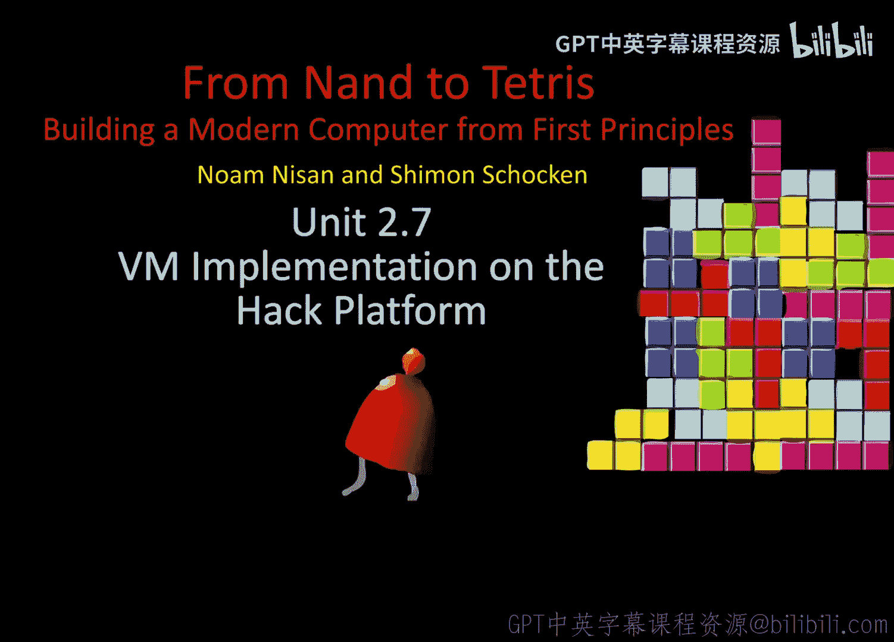
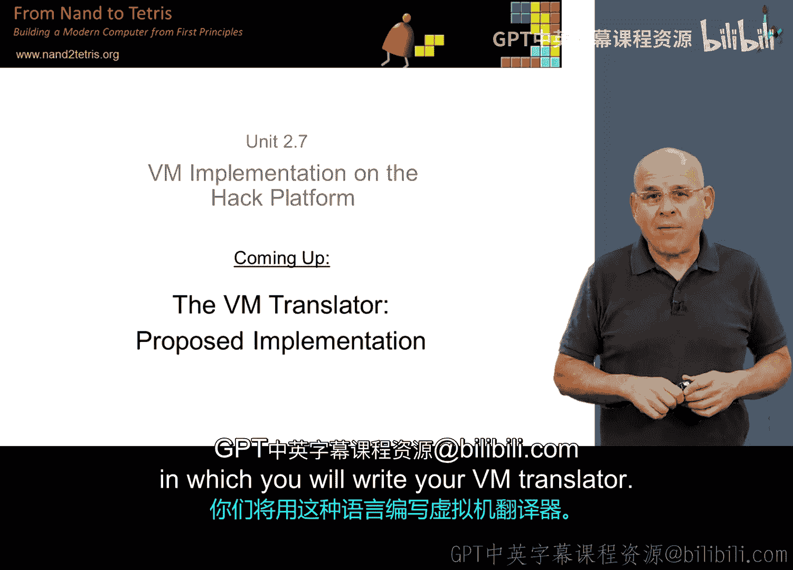

# 耶路撒冷希伯来大学《从零开始构建现代计算机2｜Build a Modern Computer from First Principles》中英字幕 p30 30_04_08_单元2-7_Hack平台上的虚拟机实现.zh_en -BV1DA4m1w7FU_p30-

All right， we are approaching the end of this module and in this unit we are going to discuss how to implement the VM translator on the heCC platform。

And。This is indeed a turning point in this module because up until now I did not commit myself。

To the hack platform。 And I described in very general terms how to implement our VM。

 our virtual machine on any given computer platform。

 So now I'm going to make a commitment to a certain target platform， which will be the hack computer。

 So I have to give you some information on on how how to do it。 So let us begin with a big picture。

 which is extremely important。 And the picture is that we begin with some jack program presumably。

And the J program is stored as one or more jack files which are put in a certain directory or you may call it folder and this directory has a name I call it micropro and then I'm going to apply the J compiler to this entire directory and the jack compiler is going to create two in this example two new files which would be the VM translations of the jack files so one will be called by default food。

vm and the other one is going to be called bar dovm and every method constructor and function in the source code is going to be translated into a VM function。

In the target code， now this process is something that you don't have to worry about because we're going to discuss it at length later on in the course when we build the compiler。

But from now on is certainly our business， because now we are in the world of the VM。

 and we have to translate this code further。 That's what the VM translator is all about。

 And the VM translator is going to do something dramatic。 It's going to take all these。

Different standalone functions and kind of weave them into， well， weave is not a good word。

 but it will transform them into a single assembly file， so。

Notice how several things got lost in the translation， when we translated from Jack to the VM。

 we lost the notion of constructors， methods and functions because everything became functions。

And when we translated from the VM to assembly， we lost the notion of functions because now we just have a long stream of assembly commands and we have to use assembly in order to capture the semantics of the source VM code。

 so this VM translator is actually the program that we are developing in the current project and in the previous one。

So。That's the big picture and we are going to write the assembly code on the right hand side using heCC assemblyly because I made this decision that I'm going to implement it on the heCC platform。

And。In order to do it， I have to comply to certain conventions。 And the first convention is booting。

 You know， how do I。What should I do when this when I turn on the computer。

 how will the computer know to execute my my program？

 So here are the assumptions that that I request to make。

First of all there should be a VM programming convention and the convention is that one file in any VM program must be named main do VM and one VM function within this file must be named main so this is something that the compiler has to take care of because the compiler is going to to write this VM code and it's going to be taken care of quote unquote automatically because we have the same requirement at the jack level when we you will see that when we write J programs we also require that at least one class will be named main and one function in this class should be named main also so this convention is going to we're going to get it for free quote unquote。

All right， then we need a certain convention in the implementation in our case， in the VM translator。

 when the VN translator when the V implementation starts running or is reset。

It has to start executing。An argumentless operating system function called Ss dot in it。

So the VM implementation must begin with this code， you know， it must call Cs in it。

And sis in it is already programmed at the lowest level， which is not our business right now。

 So sis in it is already programmed to call。Main dot main and enter an infinite loop。 So sis in it。

 once it starts running will end up causing the programmerss program to start running as well。

 The main dot main will start running。 and then the whole tris game。

 whatever it is will start executing in front of us。Finally。

 we need some hardware platform convention to comply to。

 and that is what is known as the bootstrap code okay we have to somehow call cis in it。

 so the cis in it will be able to call main name。And so we request that the code that you see here will be stored ins。

 in the target computers， instruction memory beginning in address 0。🤢。

Because the computer that we build， the hec computer is programmed to start executing the program which is stored in the instruction memory beginning with address 0 that's you know one of the operational rules of the heCC computer and not only he most computers in the world comply to this convention here so the first thing that the computer will do is it will set S to 256 and by doing this it will determine that the stack should begin in this address in the whole strand and then it will call cis in it。

 these two things must be must be done in machine language in assembly。And that's it。

 And from this point， onward。Let the show begin。 Everything will roll smoothly because the VM translator。

We'll know what to do with every VM command。 know， that's what we did in the last in all the units。

 actually in this module。All right， now in order to generate code that complies to all the explanations that I gave before。

 we have to propose some standard mapping on the heCC platform I explained in the previous module。

 why we need a standard mapping and indeed if you recall this is just a summary of everything that we did so far。

 use the heCCRAM and we use it to store you know all the pointers that you see here。

 using this scheme here， I'm not going to explain it because we went through it in detail。

Throughout the units。But now I also want you to show。

 I want you to see this thing in the overall context of the wholeRA。

 so this is the entire wholeRA of the he computer， it consists of about 32。

000 words and the top 2K words are what we've been discussing all the time。

 that's the blue stuff on the left。And then we have several other areas on the on the whole strandm。

 which which we call heap memory mapped I O and some unused space。

 and as far as the VM implementation is concerned we worry only about the top2 k of the Ram and everything else is something that is going to be used for for other purposes。

 you know， purposes that that are not within the jurisdiction of the VM implementation。

 So well move on to the last slide in this。Unit。And that is a documentation of all the special symbols that your VM translator ought to use。

 So first of all， in the previous module， we decided to use these special。Symbols。

And I'm not going to repeat this information now and in order to implement everything that I described in this module。

 we are going to use a few more conventions that you see here we' are going to use three more types of special symbols for generating labels and what I have here is just a screenshot from the book that the companies this this course。

 you're welcome to read this information on your own。

 I'm not going to dwell on it because it's very technical and not extremely interesting So now it's on you to write the VM translator and generate all the code which is necessary in order to implement the VM language and in the next unit will describe how to actually do it using an implementation language like Java or Python。

In which you will write your VM translator。

