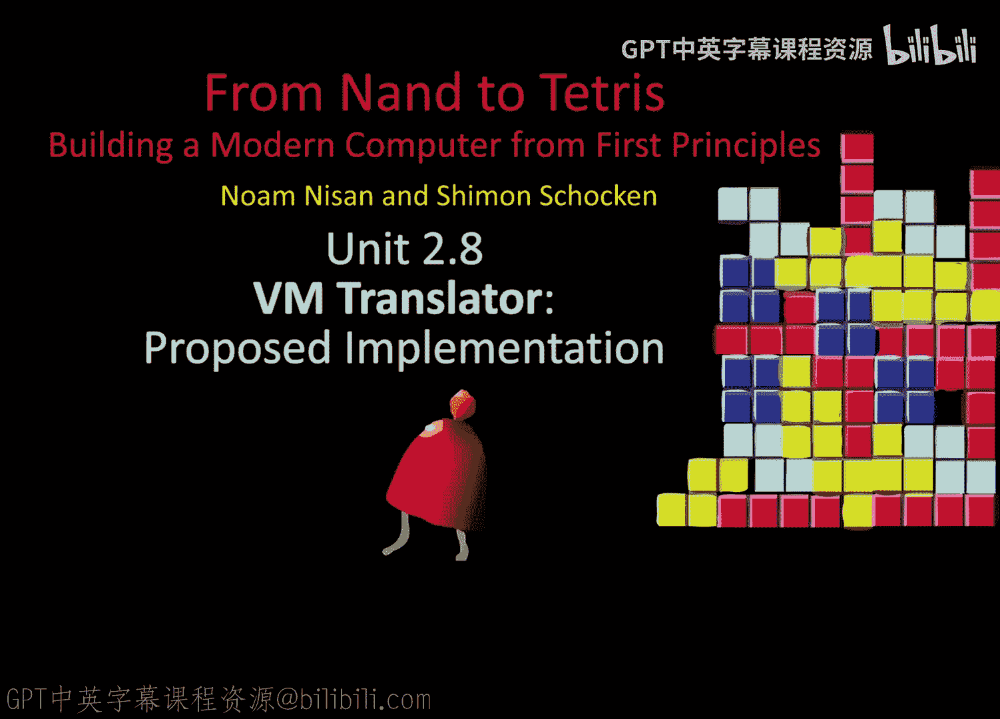
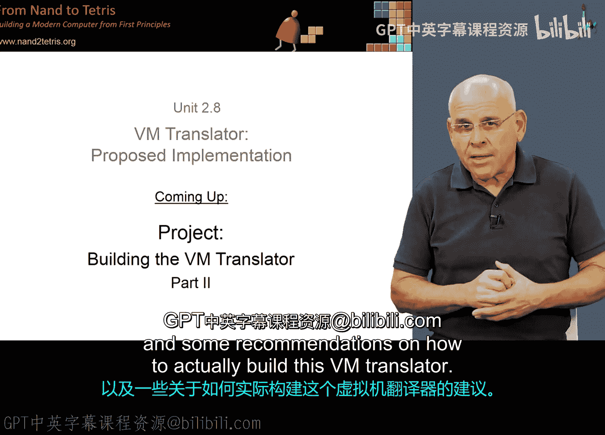
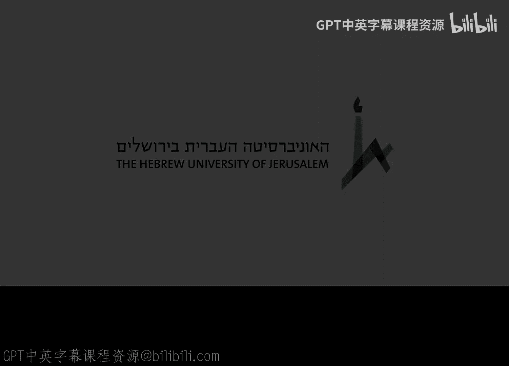

# 耶路撒冷希伯来大学《从零开始构建现代计算机2｜Build a Modern Computer from First Principles》中英字幕 p31 31_04_09_单元2-8_虚拟机翻译器建议实现方案.zh_en -BV1DA4m1w7FU_p31-

So we are approaching the end of this module and I think that you will agree with me that this module has been both long and challenging and for me personally it was also challenging from a physical standpoint because you see I tape something like eight such units in a stretch。

 so I end up standing on my feet for several hours in front of the camera and normally I'm okay doing it because I feel more energized when I speak standing rather than sitting but about two weeks ago I broke my leg in a biking accident and now I wear this brace and it's kind of aching to stand too many hours So I will sit for a while will do this unit sitting and then I guess I return to standing so。

In this unit， we are going to propose an implementation for your VM translator。And to remind you。

 the VM translator is a program that starts with some VM code and simply translates it into assembly code。

 and so it goes through the first command， let's say push constant 17 and it generates code that affects the same semantics in assembly。

 and then it it finds the command， go to loop and it generates code that implements this go to command。

 does the same with call moving along， it generates code that implements the function command。

 then the push， then the return， and so on until it hits the end of the input source file。

So that's the nature of the VM translator， you shouldn't be surprised because you've already written a basic VM translator and this basic translator is going to be extended in this project into what we call the final VM translator so basically we' are going to take the program that you wrote in the previous project and add more functionality to it。

All right， now to remind you， the source that we are translating is the VM language， obviously。

And the target that code that we are generating is written in the heCC assembly code。

 and in doing all this we have to comply to using the specialist symbols that I described in the previous unit。

And with that， we are ready to describe our proposed implementation。 So here again。

 is a diagram that describes the VM translator in action。 And we see that。😊，In the previous project。

 if you recall， you were asked to write a VM translator that translates a single given VM file well in this project one of the things that we want to extend is the ability to handle more than one VM file。

 so the VM translator that you write should be able to also handle a directory that contains one or more VM files as we see in this diagram here。

 and in any event it always will generate a single assembly file that contains the sort of sequence of all the functions that we are translating。

So the proposed implementation that I outline here is exactly the same as or contains exactly the same modules that we had in the previous project。

 Paer， code writer， and Ma， and let us describe every one of these modules in turn。

The main module receives as input some string that stands either for a single file or for the name of a directory or folder if you will that contains presumably one or more VM files。

 so it's one of the two， and if you use a language like Java or Python。

 there are capabilities in these languages to decide if a certain string stands for a single file or a directory。

The output of the program should be a file name， dot ASM file that contains the assembly code that we are going to generate。

The process that the main program is going to carry out is the following。 First of all。

 it will construct a code writer in order to handle the output file。

 which is still empty at this stage。And then it is going to ask itself if the input is a file or a directory。

 if the input represents a single file， then it will construct a parer to handle this input file。

 and then it will go into a loop that marches through every command in the input file passes it and handles the hands over the lexical elements to the code writer in order to generate the assembly code。

If the input is a directory， it will do what we just described for every VM file in that directory and that's the end of the story。

 that's what the main module should do and as you can see it is not a very complex extension of what we did in the previous project。

All right， moving along， the parer as usual handles the processing or the passing of a single VM file。

 it reads a VM command， breaks it into its lexical elements。

 and removes all the white space and command in the process and this parer is exactly the same as the one that we developed in the previous project。

 we don't have to touch it however we just want to make sure that the parer also handles the commands that we introduced in this module which are the branching and function commands。

Now， if you followed the requirement that we set in the previous project。

 your par should handle these commands as well， but if for some reason you didn't do it。

 this is the time to include them。All right， so the parer is done and finally we have to extend the code writer。

So the API of the basic code writer that we developed in the previous project is shown here on the screen。

To this API we have to add some some additional functionality。

 First of all we have we have a method called set file name which we will use to inform the code writer that the processing of a new VM file has just started and we are going to pass the name of this file as an argument then we are going to have another method whose job is to write the booting code that will enable the VM to start working as specified in the standard mapping of the VM on the hec platform so right in it is responsible for writing this code。

And then there will be three methods called right label， right go and right if。

 which produce the assembly code， which takes care of the commands label go to an if and finally three methods called right function。

 right code and right return which produce the assembly code that knows how to take care of the respective VM commands。

 and that's it once you do that you will have a fully functioning VM translator and you have implemented a virtual machine。

Now the most challenging part in writing this VM translator is writing these six methods。

 write label right go to write if， I mean these three methods are relatively simple because generating assembly code that implements if and go to is not a big deal。

 but then we have to generate the assembly code for function call and return and in doing this you have to follow you know all the logic that we explained in the previous units in order to to build this incredible。

You know， cathedral， the stack， which moves up and down in order to implement the function call and return protocol。

So this has been the end of of this module and in the next one。

We will discuss the project materials and some recommendations on how to actually build this VM translator。

