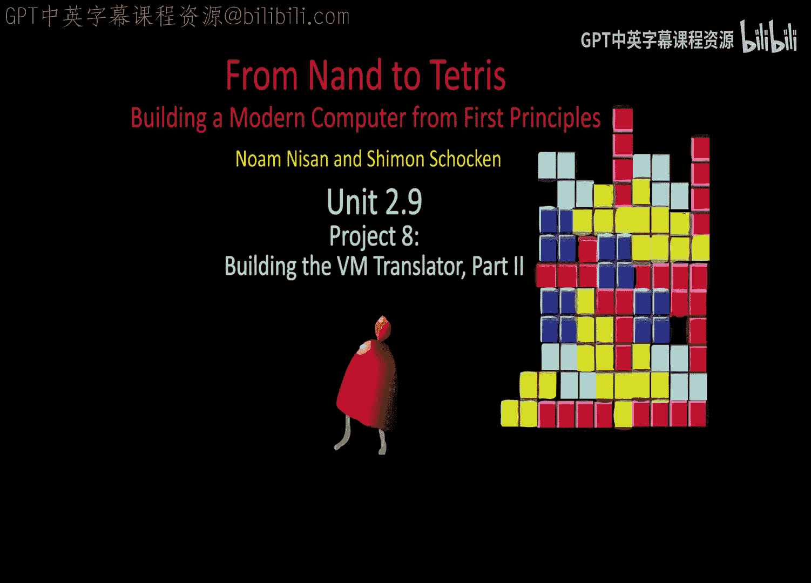
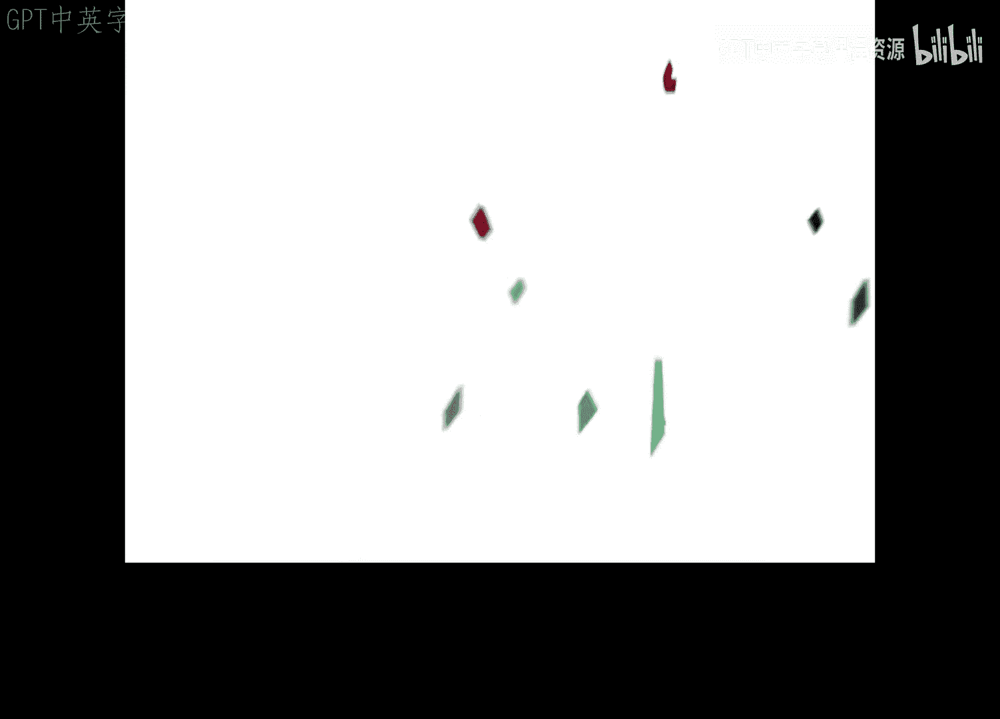

# 耶路撒冷希伯来大学《从零开始构建现代计算机2｜Build a Modern Computer from First Principles》中英字幕 p32 32_04_10_单元2-9_项目8：构建虚拟机翻译器第二部分.zh_en -BV1DA4m1w7FU_p32-

So welcome to Project 8 in which we'll get our hands dirty and complete the construction of the VM translator now I wish to remind you that this is the second project in this course and yet it is numbered project 8 because we wanted to create a numbering scheme which continues the numbering of the projects in Nanttoteris part1 we don't assume that you took Nanttoterispot1 but we just wanted to have some global numbers numbering scheme going on al right so to remind you this is where you're at in our grand journey map we want to build a VM translator which is capable of translating programs from the VM language into lower level programs written in the heCC assembly language。

And we decided to separate this substantial development task into two separate projects。

 Project 7 that you've already completed and project 8 that we are building now and each project is responsible for handling a different subset of VM commands。

 So now the challenge is to implement the branching and the function commands。

 and that's what Project 8 is all about。 So suppose you've already developed your VM translator and now you want to test it。

 How can you do it。Well， as usual， we're going to supply a whole set of VM programs and request that you use them to test your translator。

 so you have to take every one of these programs， translate them using your translator and produce in the process another sort of lower level program written in the heCC assembly code。

And then we can take this code and simply execute it on the target platform after we translate it further into a binary code。

Now alternatively， instead of using the hec platform， we can use the CPU emulator。

 which is significantly more user friendly because you know you don't have to translate it into machine code。

 you can run the assembly as is and for other reasons so that's what we recommend to do and now you look at the results of the program if the program performs what the VM code sought to perform originally。

 then we are happy and we say that the translator has passed the test and in fact we do much more than that because we provide elaborate test scripts and compare files and so the testing procedure will be very well managed。

 you don't have to worry about it too much yourself you just have to concentrate on writing a wellbehaving VM translator。

Alright， so here is the set of programs that we supply in Project8。

 if you will look at the Project 8 folder on your computer。

 assuming that you've downloaded the Antetriris softwareft suiteite。

 you will see two directories named program flow and function calls and each one of these directories contains several subdirecties。

 if you look for example at basic loop， you will see that basic loop contains four different files。

The star of whom is the VM program。 I mean that's sort of that's the beef right That's what we want to to translate。

 but we have， as usual， several other programs and I'm sorry files and here is what we recommend to do Very similar to what you did in Project7。

 We recommend that you first invoke the VM emulator and use the supplied Xxx VmeE test script to load the VM program into the simulator and play with it a little bit。

 even though it's a testing program， it makes sense to understand what the program seeks to do。

 this will just give you some background information about the test context。

 once you understand what the program wants to do。 you don't have to get into the details。

 you just have to get a feeling of the program' intended operation。

 then you should use your translator to translate it。

Into an assembly file whose name by default will be Xxx doasM。 When I say by default。

 you know your VM translator has to make this default happen。

And finally you can now load and run the XXX test script in the CPU emulator and this script will run the generated code。

 the code that was generated by your translated， it will execute it and it will compare the output of this code to our supplied Comp file。

 if the comparison will be positive， you will get a nice message and you can proceed to run the next test。

 if not， then presumably you have to fix a few things in your VM translator。All right。

 so that's the basic routine and with that let's take a look at the basic loop。vM test file。

 as you see from the documentation， this is a VM program。

That wants to sum up the numbers1 plus 2 all the way up to argument 0 and push the result onto the stack。

So presumably someone is going to initialize argument0 for us in particular there is a test script called basic loop dot TSD and indeed as you see this test script which is stored in a separate file is going to initialize the virtual memory segments as well as argument zero and then it will execute the machine code that will be generated after you translate the code that you are now going to see Well this was quite a twisted sentence。

All right， so here's the code。You can read it if you want。 It's not terribly important。

Because here's what this code is doing。 It is a simple loop that implements some sort of a while。

 if you will， as long as you know we begin by setting a counter variable to argument zero as long as counter is greater than one we add counter to sum and we then decrement counter。

 go to check again if it's still greater than zero and so on and so forth。

 so nothing sophisticated here。What is more important is that this program or this file is designed to test the ability of your VN translator to handle label and if go to commands。

 you know this is the most important purpose of this test file and everything else is irrelevant details。

So this is a basic loop and you know you can ask yourself where this VM code is coming from well I don't remember if we wrote it ourselves or if we wrote a jack program and compiled it into this VM code it's not terribly important。

 what's important once again is that this program is designed to perform a relatively simple test of your ability to handle branching commands。

So with that， let's move forward and take a look at the Fibonacci series test script。

I'm sorry test files so here's the VM program it seeks to compute the first argument zero elements of the Fibonacci series。

 so if argument0 will be for example5， it will compute the first Fibonacci element， the second。

 the third you know all the way up to5 and it will put these values in the Ramm starting at the address which is stored in argument1。

So once again， someone has to initialize argument 0 an argument one for us and in particular there is a test script called Fibonaciasius。

tSD， and it will do these initializations and then it will run the code that will be produced by your VN translator from what we are now going to see。

So we begin by。Approaching or manipulating some esoteric virtual segments like pointer and that。

 and we don't really expect you to understand exactly what we are doing here because。

How to use pointer and that judiciously is something that we're going to explore later on in the course。

 So for now， suffice suffice it to say that what we do in this code is the following logic。

 we compute。The Fibonacci array， so ARR at I equals AR at I minus1 plus ARR at I minus-2。

 which is the classical Fibonacci transformation or function。And once again。

 what's important for our purpose is that this VM program is designed to test the ability of your VM translator to handle label。

 go to if go to as well as you know many other commands in the VM language。

 so that's the story about Fibonacci series， I wish to emphasize once again that you don't have to spend too much time understanding the details of this program because the details of the semantics are not terribly important for our translation task。

 which is what we are focusing on right now。All right。

This completes the testing of the branching commands。

 and now we move on to test your ability to handle functions。

 which is far more challenging in terms of the time that you spent on implementing your VN translator。

 I assume。All right， so simple function is a bunch of for familiar files and here is a simple function do VM。

 it performs a simple and completely meaningless and arbitrary calculation whose purpose is something that we'll see in a minute and it returns the value of this calculation。

And there is a test script that initializes the segments and executes the code。

 So here's the function。And you see that he does some a， not， sub and so on。Not important。

 not interesting。 What is interesting is that this function here or this VM code is designed to test the ability of your VM translator to handle the function and return VM commands。

 Now， this is。A relatively simple test because there's no call in the picture right the function is doing its thing。

 but no one invokes the function， no one tries to pass parameters to this function。

 There is no return value that goes back to the call。

 we decided to unit test first the function and return commands only and then test the call command using a separate test file。

And in fact， that's the next thing that we're going to do。

So actually the next thing if you look at the screen is a directory called nestested call。

 I will skip this directory and go straight into Fibonacci element and then I will go back to to nested call promised so here is my Fibonacci element directory and as you see there's something new here and what is new is that this is the first time I believe that we see more than one VM program or VM file in the same directory。

😊，So as you know， when we have more than one VM file in the directory。

 we have to translate the entire directory。 That's the contract that we requested that you implement in your VM translator so once you see the prompt on your computer you know it should vary from one computer to another。

 you write VM translator， if you know you wrote this program let's say in Java and then you provide the name of the directory the result should be a single file called a Fibonacci element do ASM it is the responsibility of your VM translator to produce this file and now we can take this file and test it further。

All right， so with that， let us explore what we have in these two VM files beginning with main。So。

Main contains a single function。Called Fibonacci。 And this function computes the n element of the Fibonacci series。

 and he does it。Recursively， as opposed to what we did before， which was using an array。

 And by the way， this program has nothing to do with the program that we used before。

 which was called， I think Fibonacci series。 Of course there is a mathematical relationship between them。

 but it's a completely different program and and a rather different algorithm。

 So how do we compute the n element of the Fibonacci series。 Well， heres how we do it。

 we do it using recursion。 So you know， if you stop the tape and and look carefully at the code。

 you will see that we are calling the Fibonacci function is calling the Fibonacci function twice and thus what we do here is we implement the logic that you see here in this callout and classical recursive computation of Fibonacci element。

There's nothing terribly。Important here， as far as our limited context of testing your VM translator but。

You know， if you want， can you can try to understand this code deeper， not terribly important。

 What's important is that it serves to test our translator。Alright。

 so this is the same program abbreviated， and we have to invoke it。 somehow。 we have to。

To call this function。So we do it using the CsVM file， another test file in this directory。

And this file， we decided that it will have a single function only called Ss in it。那。

You may remember that according to our convention， Cs in it should call the function main dot main。

And then the application starts running， however， in project8 we decided to use this function differently and in particular we use Cs in it in order to invoke all sorts of test functions as we please now this whole setting is very useful because by convention when you start running the VM implementation。

 it should call Siss in it so。SoAnd then in it we'll call the test function。

 so things are well laid out。So here's what we do。 We decide to test the Fibonacci element function using。

 say， the number 4。 So we wanted to compute the fourth element of the Fibonacci series。

 So we push for。Call the function。And then we enter an infinite loop， why， because， you know。

 we decided that this would be the standard， the standard way to implement cysts in it。

you know when we complete building the whole computer and the operating system and everything。

 Cs in it will be the first function that starts running when the computer is booted up and it is the origin of everything so to speak so sis in it calls main dot Ma and then Teris starts or your search engine starts or whatever it is that you decided to write using our platform。

All right， so notice that。😊，This test here is designed to test the handling of the function。

 return and call commands， and as well as many other commands that can be found in these two VM files。

And we also test that your VM implementation， the VM translator that you wrote initializes and handles the memory segments correctly。

 you know up until now we provided test scripts that have set the virtual segments manually now it is your responsibility to handle it using your VM translator and finally we also test that the bootstip code of your VM implementation initializes the stack the stack pointer and calls Cs in it。

If you're not sure what I'm talking about， you have to look back at the units that define what the translator is supposed to do and you will see all the details there。

All right， so this is going to be quite an elaborateorator test and I hope that your VM translator will pass it without too much trouble。

And yet。When we first released all these tests to the public domain and people started using it。

 our colleague， Mark Ambrost， who。Contributed tons of good stuff to this cause。

 Mark pointed out that。The testing gap between the simple function and the Fibonacci element is too big and that we may need some additional testing done in the middle between these two testing stages and so Mark went ahead and developed another test which I now want to look at and this test is called a nested call。

And everything that you see here was designed by Mark， so you see that we have a set of files。

 a single VM file， CVM， and then a set of corresponding test files as well as two HTML files now。

This test。Once again， it closes some gaps between simple function and the Fibonacci element in terms of the different things that Mark decided to test。

 and we recommend that you do this test in case simple function passes and Fibonacci element fails if that is the case。

You may want to go back and use nested coal in order to localize the problems in your VM translator better。

And finally， this test is very well documented using the two HTML files here that Mark has written。

 so we just suggest that you， if you needed， read those files and follow Mark's guidelines。All right。

 so that's what I wanted to say about function calling。

And the last test that we have to run is called a statics test。And that's what we see here。

 once again it consists of several VM files and therefore once again we have to apply your VM translator to the entire directory and the result once again will be a single file written in a heCC assembly language。

And let's see what is the problem to which this thing is the solution？Well， first of all。

 here is Class 1。 VM。And we see that this program stores to supply the arguments in static0 and static1。

So it's not a terribly interesting function， is it？And here's how it does it。 You know。

 it pushes argument 0， pops static 0， does the same with argument 1。 and then before returning。

 it pushes 0 onto the stack。 Why we do it is not terribly important at this point we'll discuss it at length later When we write the compiler。

 So don't worry about this strange looking push before the return。

Then there's one more function in this file called class1 dot get and this function computes and returns the difference between static0 and static1。

 And as you see there's nothing mysterious here， everything is。Is straightforward。 Okay。

 so that's class 1 VM。Now what about class2 well here is the code of class2 and if you will stop the tape and look at it。

 you will realize that what we have here are two identical files almost。

 I mean they have exactly the same logic except for some maybe a syntactic differences。

And yet remember that even though we have two separate VM files。

 each one of them has to maintain its own static segment， and that's what this test is all about。

 the test is going to call different functions from two files and make sure that the static segments of these two files are handled appropriately。

So how do we do it Well here are the two files that we just saw abbreviated， we introduce a cis。

vm file that has a cis in it and Ss in it pushes6 and8。And then calls the set function of class1。

So we expect that class 1 will populate its static segment with 6 and8。

And then notice that the call also does a pop temp zero。Looks like a strange thing to do。

 don't worry about it， we'll deal with it when we write the compiler。

And then we do exactly the same with class 2。 We also call the set function of class 2 with 23 and 15 as parameters。

And once again， we dump we do proper temp 0。 and finally we call the two get methods of class1 and class 2。

And that's it。 We enter this infinite loop。And if you go back to the logic of that was presented before at the end of all this fruit salad here。

 we should expect to see on the stack the results of 6-8 and 23- 15。

 which I believe is 2 followed by。Seven isn't or8。So we should see on the stack two and eight。

If we see something else， it means that either my arithmetic is not good or your VM translator is not well functioning。

Alright， so。This。Test here is designed to check that the static segments of different files are handled correctly and once you will pass this test you are done with all the official tests of Project 8 obviously we could have supplied additional testing materials for a more complete test but this is probably more than enough in the context of this course。

All right， now what tools and resources will you need？Well， first of all。

 you will need all the test programs and the compare files and you will find them in your computer in the project directory。

You can look at chapter8 in the book that covers everything that we did in this module in one place in a compact way。

 and then you will need a whole set of resources that we used also in Project7。

 so I'm not going to repeat them here。It's exactly the same stuff that we did in Project7。All right。

 so this has been a description of Project 8， I wish you good luck with this project and I will see you in the next unit。

😊。

