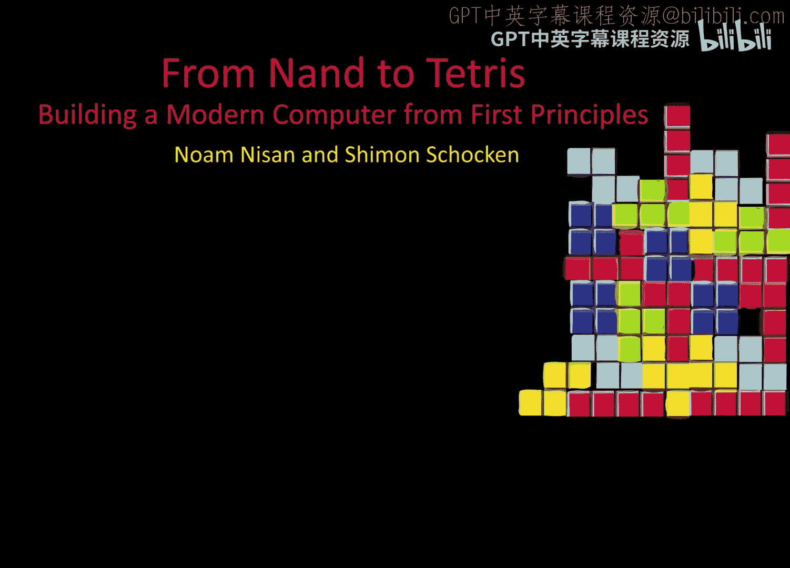

# 耶路撒冷希伯来大学《从零开始构建现代计算机2｜Build a Modern Computer from First Principles》中英字幕 p33 33_04_11_单元2-10_视角.zh_en -BV1DA4m1w7FU_p33-

So welcome to the last unit of Mo 2。Called perspective。And to remind you。

 we are using these perspective units to provide some historical context and gossip a little bit about the industry and explain why the stuff that we do in Ntotetriris is extremely applicable and practical outside the context of this course。

So we' are doing this using questions that we normally get when。

When we teach this course and the first question is。How useful is this VM language。

 Does it really make the writing of compilers easy。Well嗯。The VM language is surprisingly powerful。

And in order to appreciate it， you can take a second look at some of the jack applications that we showed during this module。

And compare。compare the jack code of these applications with the VM code which was generated by the J compiler when it translated these jack programs into the VM language。

 if you will do so and if you will do some line counting。

You will realize that each line of high level jet code generates an average of about four lines of compiled VM code。

 which is quite quite remarkable。So， even， you know， without knowing much about compilation。

 because we haven't discussed compilation yet。You should be impressed， I think。

 by the compactness and readability of the VM code， which is generated by the J compiler。

So the question arises， which is， how does this compiler get away with generating so little code？

Well， the answer is that this is a two tier compiler。And therefore。

 the compiler can happily assume that there is another agent。

 a VM implementation that handles all the translation tasks from the VM level all the way down to machine language。

And that's exactly the VM translator that we've built in the last two modules。In fact。

If you take a big picture approach， we have just finished developing the second back end part of the overall compilation model。

So the good news is that when we will get to write the rest of the compiler in modules4 and 5。

 we will have far less work to do compared to say writing a C++ compiler which forces you to translate everything all the way from C++ down to machine language without an intermediate level。

And therefore， the hard work that you did in the last two modules will pay off big time later in the course when you will get to develop the front end part of the compilation model。

 which we call simply compiler。And that's the part that generates the VM code that we discussed and implemented in this module and the previous one。

 So， you know， to wrap up。The virtual machine is an extremely powerful and practical idea。

Which is a very important piece of the Java architecture， the C sharp architecture。And in fact。

 today， Microsoft also has a two tier compiler for C++。

 so if you want you can also translate C++ programs into an intermediate VM layer。

 but know if you do so you're going to lose a lot of efficiency。

 which is the hallmark of using C++ at the first place。So let's see what is the next question。嗯。Well。

 in fact， it's directly relevant to what I just discussed。 What about efficiency？

Why is Cus bus more efficient than Java？ Well， obviously。

 any two stage translation model entails additional overhead and results in more lines of less efficient machine code。

If you are not convinced， you know， try translating something from English to French by first translating from English to Spanish and then from Spanish to French。

 obviously。The second technique will be more cumbersome and it will yield more cumbersome results。So。

 you know， which is more desirable？A two tier Java program that eventually generates 1 thousand0 lines of machine code or an equivalent C++ program that does the same thing with 300 lines of machine code。

 you know that run three times faster， which is more desirable。Well。

 the pragmatic answer is that today's computers are amazingly swift。😊。

And therefore in many important applications， a drop of 300% in efficiency is not really noticeable。

And of course there are many areas like real time signal processing and embedded systems in which every efficiency gain is cherished and important。

 and for these applications， languages like C and C++ are indispensable and much more applicable than Java。

But in numerous other domains， the elegance and security。

Provided by languages like Java and C sharpharp and Python more than compensate for the loss in efficiency。

Which once again is hardly noticeable in numerous applications out there。 So moving along。

 let's see what is the third question。Security。Why is Java more secure than C++？

And what does this has to do with our VM architecture。Well。

You may know that VM code is sometimes referred to as managed code。

And I think that this term was first introduced by Microsoft。嗯。Once again， as you may know。

 the centerpiece of the dotnet framework is a virtual machine called CLR。

 It stands for common language runtime。 This is the equivalent of Javas JVM。

So C sharpp compilers generate VM code， which in the world of Microsoft is known as IL intermediate language。

 and this IL code， similar to Btecode， is designed to be handled further by some CLR implementation。

So to distinguish between code that is handled by the CLR like C sharpp。

Encode the trends directly on the target howed platform like C++。

Microsoft calls the former manage code and the letter unmanaged code。And so this notion of managed。

 which， which really stuck not only in Microsoft， but by anyone who uses the VM artifact。

 This notion of managed comes from the observation that。

When the code runs on some virtual machine environment like the CLR or the JVM or our own VN translator。

 we can do all sorts of useful things with this code， in addition for just executing it blindly。

For example， we can inspect the VM code and look for security breaches。

It's much easier to analyze the semantics of VM programs compared to machine language programs which are far more elaborate and cryptic also。

Let's not forget that VM code must be handled by some virtual machine implementation。

So we can design this implementation in a way that creates what is sometimes called a sendbox effect。

 the idea is that during runtime executing programs can never reach out of this sendbox and mess up with toys that they are not allowed to manipulate like the host Ram。

And that's extremely important in a world in which software is routinely downloaded off the Internet to your computer or to your cell phone without even you knowing this。

 and this software comes from all sorts of unknown sources。So in that respect。

 the V implementation that runs on your PC or on your cell phone can be viewed not only as an enabling technology。

 but also as a security layer that protects your device from malicious code。And that's， you know。

 another very important advantage of the VM model。All right。

 I wish to end this module with a general observation about the virtue of separating obstruction from implementation。

 which is something that we emphasize in almost every unit and module in our nanote risk courses。

Recall that VM functions。Access their memory segments using commands like push argument 2。

 pop local  one， pushes Sta 7 and so on。Now， in doing so。

 VM functions have no idea whatsoever how these values are actually represented on the wholeRA or how they are saved and reinstated during the function call and return protocol。

In other words， the VM code treats memory segments as obstructions without worrying at all how this obstruction is actually realized by the VM implementation。

Now， this complete separation of obstruction implementation implies that it implies many important things。

 but one of them is that developers of compilers that generate VM code don't have to bother at all about how this VM code will end up running and they don't have to bother at all about the host platform。

The host platform for them is a virtual machine。And that's very important because compiler developers have enough problems of their own to worry about。

 as you will soon realize in the next three modules when you will develop our own compiler。But。

 you know， cheer up。You have just completed developing the first half of a compiler for a high level object based programming language。

 That's incredible。😊，This is a tremendous achievement， and you should feel very proud of yourself。😊。

And with this feeling of pride， we are wrapping up module 2。

 and I will see it again in module 3 in which we present our high level language。

