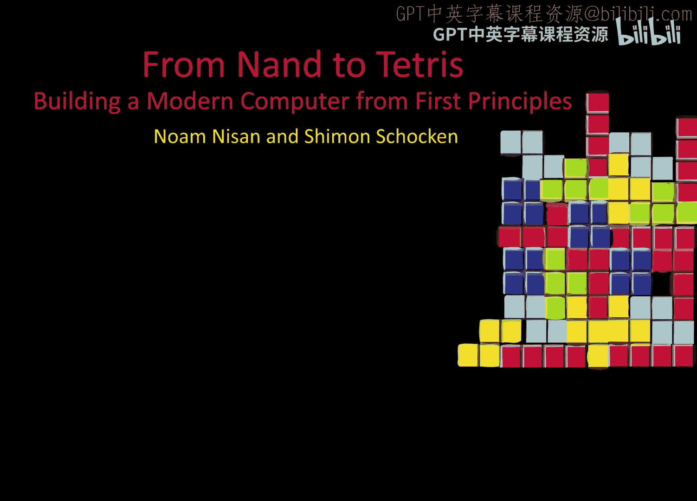
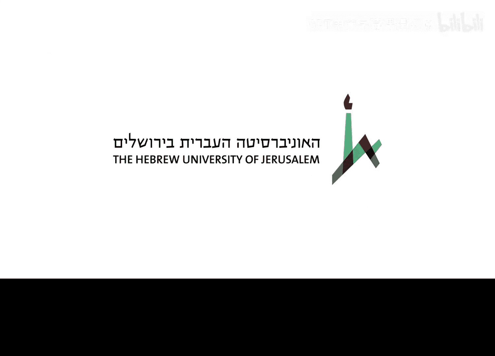

# 从零开始构建现代计算机2：单元2-10：视角 🧭

在本单元中，我们将探讨虚拟机（VM）语言的实际应用、效率权衡、安全性优势，以及抽象与实现分离的核心价值。我们将通过解答课程中常见的几个问题来展开讨论。

---

## 概述

在本节课中，我们将学习虚拟机模型在现实世界中的重要性。我们将探讨VM语言的实用性、其与C++等语言在效率上的对比、它如何提供更强的安全性，以及抽象层带来的巨大好处。

---

## VM语言的实用性

上一节我们介绍了虚拟机翻译器的构建。本节中我们来看看VM语言本身的实际效用。

VM语言出人意料地强大。为了体会这一点，你可以回顾本模块中展示的一些Jack应用程序。比较这些应用的Jack高级代码与J编译器将其翻译成VM语言后生成的VM代码。

如果你进行行数统计，你会发现平均每行高级Jack代码会生成大约四行编译后的VM代码。这非常了不起。即使我们尚未深入讨论编译原理，J编译器生成的VM代码的紧凑性和可读性也应给你留下深刻印象。

那么问题来了：这个编译器是如何做到生成如此少的代码的？

答案是：这是一个**两级编译器**。因此，编译器可以放心地假设存在另一个代理——即VM实现——来处理从VM层到机器语言的所有翻译任务。这正是我们在前两个模块中构建的VM翻译器。

实际上，从宏观角度看，我们刚刚完成了整个编译模型的第二个后端部分。好消息是，当我们在第4和第5模块中编写编译器的其余部分时，与编写必须将C++直接翻译到机器语言（没有中间层）的C++编译器相比，我们的工作量将少得多。

因此，你在前两个模块付出的辛勤工作，将在课程后期开发编译模型的前端部分（我们简称为“编译器”）时得到巨大回报。这个前端部分负责生成我们在本模块和前一个模块中讨论和实现的VM代码。

总而言之，虚拟机是一个极其强大且实用的概念。它是Java架构、C#架构中非常重要的一环。事实上，如今微软也为C++提供了两级编译器，但请注意，这样做会损失很多效率，而这正是使用C++的首要优势。

---

## 效率权衡

接下来，我们看看一个直接相关的问题：效率。为什么C++比Java更高效？

显然，任何**两级翻译模型**都会带来额外的开销，并导致生成更多行、效率更低的机器代码。如果你不信，可以尝试先将英语翻译成西班牙语，再从西班牙语翻译成法语，与直接英译法相比，第二种方法会更繁琐，结果也更冗长。

那么，哪个更理想？是一个最终生成1000行机器代码的两级Java程序，还是一个只用300行机器代码完成相同任务、运行速度快三倍的等效C++程序？

务实的答案是：当今的计算机速度惊人。因此，在许多重要应用中，300%的效率下降并不明显。当然，在实时信号处理和嵌入式系统等领域，任何效率提升都至关重要，对于这些应用，像C和C++这样的语言是不可或缺的，也比Java更适用。

但在其他众多领域，Java、C#和Python等语言所提供的优雅性和安全性，足以弥补效率上的损失，而这种损失在许多应用中几乎察觉不到。

---

## 安全性优势

让我们继续看第三个问题：安全性。为什么Java比C++更安全？这与我们的VM架构有什么关系？

你可能知道，VM代码有时被称为**托管代码**。我认为这个术语最早由微软引入。同样，你可能知道，.NET框架的核心是一个名为CLR（公共语言运行时）的虚拟机，它相当于Java的JVM。因此，C#编译器生成VM代码（在微软世界中称为IL，即中间语言），这种IL代码与字节码类似，设计为由某个CLR实现进一步处理。

为了区分由CLR处理的代码（如C#）和直接在目标硬件平台上运行的代码（如C++），微软将前者称为**托管代码**，后者称为**非托管代码**。“托管”这个概念不仅限于微软，任何使用VM技术的人都会用到它。

“托管”这个概念源于一个观察：当代码在诸如CLR、JVM或我们自己的VM翻译器这样的虚拟机环境中运行时，除了盲目执行代码外，我们还可以做各种有用的事情。例如，我们可以检查VM代码以寻找安全漏洞。与分析更为复杂和晦涩的机器语言程序相比，分析VM程序的语义要容易得多。

我们不要忘记，VM代码必须由某个虚拟机实现来处理。因此，我们可以设计这个实现，以创建所谓的**沙箱效应**。其思想是，在运行时，执行中的程序永远无法越出这个沙箱，去操纵它们不被允许操作的东西（比如宿主机的内存）。在一个软件经常在你不知情的情况下从互联网下载到你的电脑或手机的世界里，这一点极其重要，而且这些软件来源不明。

因此，从这个角度看，运行在你PC或手机上的VM实现，不仅可以被视为一种赋能技术，也可以被视为一层安全保护，保护你的设备免受恶意代码侵害。这是VM模型的另一个非常重要的优势。

---

## 抽象与实现的分离

最后，我想以对**抽象与实现分离**这一优点的总体观察来结束本模块，这也是我们Nand to Tetris课程中几乎每个单元和模块都强调的一点。

回想一下，VM函数使用诸如 `push argument 2`、`pop local 1`、`push static 7` 等命令来访问其内存段。这样做时，VM函数完全不知道这些值在主机内存中是如何实际表示的，也不知道在函数调用和返回协议中它们是如何被保存和恢复的。

换句话说，VM代码将内存段视为**抽象**，而完全不关心这个抽象是如何被VM实现**具体实现**的。

这种抽象与实现的完全分离意味着许多重要的事情，其中之一是：生成VM代码的编译器开发者完全不必操心这些VM代码最终将如何运行，也完全不必操心主机平台。对他们来说，主机平台就是一台虚拟机。这非常重要，因为编译器开发者有足够多自己的问题需要担心，在接下来三个模块中开发我们自己的编译器时，你将很快意识到这一点。

但是，请振作起来。你已经完成了为一个基于对象的高级编程语言开发编译器的前半部分。这非常了不起！这是一个巨大的成就，你应该为自己感到骄傲。

---

## 总结

本节课中，我们一起学习了：
1.  **VM语言的强大实用性**，它得益于两级编译模型，使得高级语言编译器的工作得以简化。
2.  **效率与优雅的权衡**，认识到在当今硬件条件下，VM模型带来的效率损失在许多场景下是可接受的，而其带来的开发优势显著。
3.  **托管代码的安全性**，VM实现通过代码检查和沙箱机制，为系统提供了重要的安全保护层。
4.  **抽象与实现分离的核心价值**，它允许编译器开发者忽略底层细节，专注于语言本身的翻译，这是软件工程中的一个基本原则。

带着这份自豪感，我们结束了模块2的学习。我们将在模块3中再次相见，届时我们将介绍我们的高级语言。