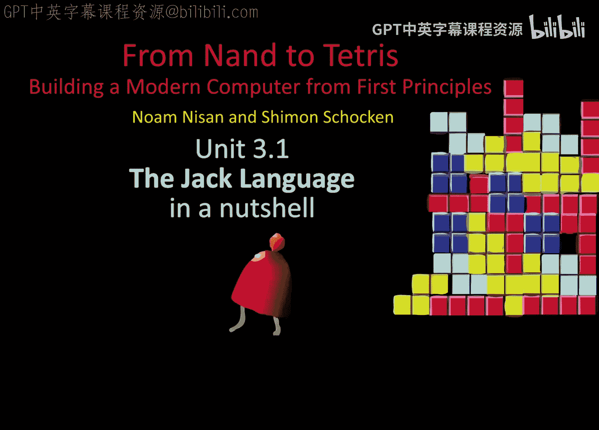
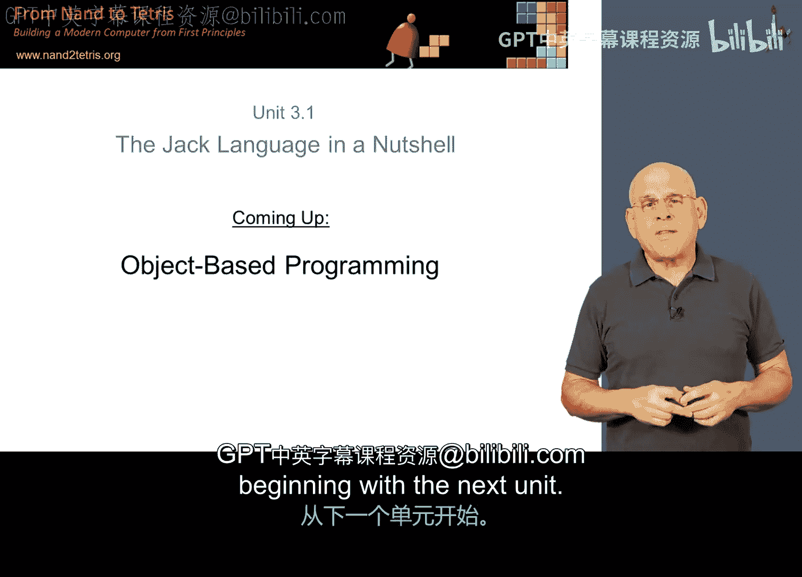

# 耶路撒冷希伯来大学《从零开始构建现代计算机2｜Build a Modern Computer from First Principles》中英字幕 p34 34_05_02_单元3-1_Jack语言概览.zh_en -BV1DA4m1w7FU_p34-

Welcome to Module3 of Notetriris in which we are going to discuss highlevel programming in languages like Java and Python。

 however we will not discuss these languages directly instead well deal with a Jack language because we want you to participate in this fascinating process of not only using a highlevel language but also designing it from scratch and writing a compiler for it and that's exactly what we'll do in Notetriris we'll build a language Jack from the ground up however in this module we'll provide a top down description of this language and in general here's the big picture of the course。

And here is also the agenda of what we should expect from now on。

 this is the beginning of the end of the course。And we see that in the next two modules in module4 and 5。

 we are going to build the J compiler and in the following module。

 we' are going to build an operating system from the hackCCJ framework。And therefore。

 it makes a lot of sense to begin by learning Jack because Jack is going to play a dominant role in everything that we do from now on。

 we're going to write a Jack compiler and also the operating system that accompanies Jack is going to be written in Jack itself。

 you know， just like the operating system which accompanies C UniX is written in the C programming language。

Allright so with that in mind let us review once again some jack code that we saw at the introduction module to the course。

 there's no need really to read the code or try to understand it will show many more examples later on in the module for now I just want to observe by looking at this code that Jack is a simple Java-like language if you wrote programs in Java everything should look kind of familiar it has some peculiar syntax which will explain later on it is an object-based language with no support for inheritance it is a multipurpose language it can be used to design any application that comes to your mind it lends itself nicely in particular to simple interactive apps like Tetris snake space invaders and so on and it can be learned and I should add also unlearned。

In about an hour， which is extremely important because J in itself is not an end。

 but rather a means through which we are going to learn a lot about how to write a compiler and how to write an operating system。

All right so the take home lessons of this module are many first of all you will learn how highleve languages are designed and and implemented we will learn how to handle primitive and class types behind the scene。

 how to create represent and dispose objects and you know this will give you a lot of insight about you know all sorts of possible bugs like stack overflow and。

Memory leaks and so on。 we learn how to deal with strings and collections like rays and lists。

 and we will also learn how the highle language interacts with a host operating system as well as many more things about highlevel languages。

 In addition， you will continue to develop your programming skills will write a non-trivial program using the jack language and will continue to discuss this super important obstruction implementation principle which sort of is threaded throughout the Ntetri courses。

 Jack is by and large a selfexplanatory language and therefore I think that the best way to introduce it is to see some examples。

 So we'll go through for examples and in each one I will use the example in order to。

Introduce some features of the language， so let us start with the hello world。

AndHello world is a program that we saw before， if we execute， we get this very imaginative text。

 Hello world on the screen， but for now what I'd like to observe is that in Jack we have three kinds of comments we have API comments which can be processed by some external tool like Java doc。

 I mean we could have written similar JackDo tool， we have a block comments which are delimited by these two delimiters and we have inline comments which are used for internal documentation。

In addition， we have whiteSp， you know we can use as many space characters as we want in our code and we exploit this white space and the fact that it's ignored by the compiler in order to use indentation and indentation of course is super important in order to help us make sense of our code and the code of other programmers。

All right， moving along， let's see another example of a J program。

 a more interesting one And this program wants to read a set of numbers and compute their average Now in order to illustrate this program we need an output device so here it is。

 So let's start to look at the code we begin by declaring a bunch of variables an array variable called a and three integer variables and then we go on to ask the user how many numbers you what do you want to enter and the user says3 or let us assume that the user says3 well based on this information we construct an array of size3 we set some variable to0 and then we enter loop in which we continue to prompt the user to enter numbers let us assume that the user enter the numbers。

12，8 and 5 and let's see the average of 25 is 8 point something and indeed when we print the average we get the result eight which makes sense because inject or in this program and inject in general we deal only with the integer data types when it comes to numbers so what we've seen here is an example of procedure or processing。

 nothing here is super interesting it is very similar to any other language that you played with in the past but still we can make some important observations okay first of all。

 a J program or a J application is defined as a collection of classes one or more classes and one of these classes must be called main。

And within this main class there should be at least one function and this function must be called a main with the lowercase M and this main dot main serves as the entry point to the J application。

 So if you had this class residing in some directory or folder on your computer along with some other classes。

 if you would tell the runtime system to execute this directory。

 it will start executing everything from main dot main。All right， moving along。

 we see that we have control structures and indeed the jack language provides control structures like if。

 while， and do， and obviously whenever you want to do something meaningful you have to use these structures。

We also see that we have array processing and in Jack arrays are implemented as instances of an array class。

 which is part of the host operating system and interestingly Jack arrays are not typed so they can contain any value of any type that you can think of within the very same array。

 which is a little bit peculiar， but we will use it in all sorts of interesting ways down the road。

What else do we see here， We see that we have some operating system calls right and methods like keyboard do readingient and output do print screen and so on well these methods belong to the host operating system and we can use them at will in our jack code and we'll have a lot to say about this down the road。

 What else well we also have data types and if we focus on these three lines of code we see that we have primitive data types like int that appears in this program and in other programs you will see more data types like car and Boolean and we also have some class types or we may have class types like the array class that I mentioned before this is also a legitimate type in inject programs so inject programs you will often see。

Class types， which come from the operating system， but the programmer is free to invent as many more classes and class types as he or she pleases。

 and in this sense， Jack has an unlimited data typing capability。 All right。

 so this is the end of this unit throughout the unit we saw two very simple examples of jack programming and in fact what we saw is how an objectoriented language can be used to write code that has no object and no object orientation but just you know very simple plain sequential processing and the next examples will will begin to push the limit on what can be done with object based programming beginning with the next unit。

