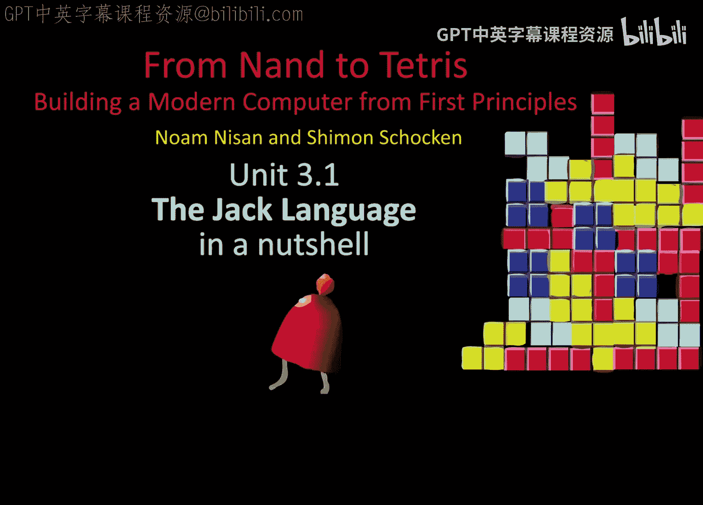
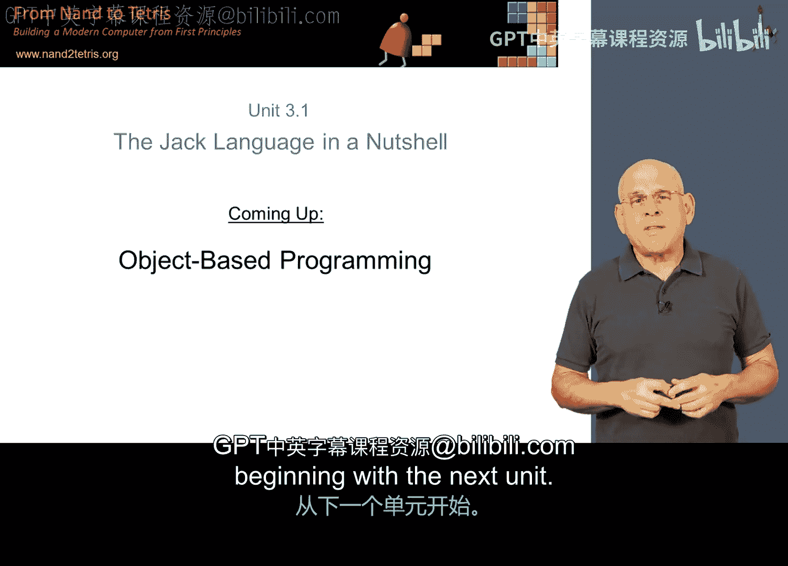

# 从零开始构建现代计算机2：3-1：Jack语言概览 🧱

在本节课中，我们将要学习高级编程语言的基础知识，并重点介绍本课程将使用的Jack语言。我们将了解Jack语言的基本结构、语法特点以及它在整个课程项目中的核心作用。

上一节我们介绍了计算机硬件与底层软件，本节中我们来看看如何从零开始构建一个高级编程语言及其编译器。

## 课程全景与议程

这是课程接近尾声的开始。我们看到，在接下来的模块4和模块5中，我们将构建Jack编译器。在随后的模块中，我们将在Hack计算机平台上构建一个操作系统。因此，现在开始学习Jack语言非常有意义，因为Jack语言将在我们后续的所有工作中扮演主导角色。我们将编写一个Jack编译器，而伴随Jack的操作系统也将用Jack语言本身编写。这类似于伴随Unix的操作系统是用C编程语言编写的一样。

## Jack语言初览

基于以上背景，让我们再次回顾一下在课程介绍模块中看到的一些Jack代码。现在无需阅读或尝试理解代码，我们将在本模块中展示更多示例。目前，我只想通过观察这段代码指出：Jack是一种简单的、类Java的语言。如果你写过Java程序，一切看起来都会有些熟悉。它有一些特殊的语法，我们稍后会解释。它是一种基于对象的语言，不支持继承。它是一种多用途语言，可以用来设计你想到的任何应用程序，尤其适合编写简单的交互式应用，如俄罗斯方块、贪吃蛇、太空入侵者等。并且，它可以在大约一小时内学会（也应该能很快“忘掉”），这一点极其重要，因为Jack语言本身不是目的，而是我们学习如何编写编译器和操作系统的重要工具。

## 本模块的学习要点

本模块的学习要点很多。首先，你将学习高级语言是如何设计和实现的。我们将学习在幕后如何处理基本类型和类类型，如何创建、表示和销毁对象。这将让你深入了解各种可能的错误，如栈溢出和内存泄漏等。我们将学习如何处理字符串和集合（如数组和列表）。我们还将学习高级语言如何与主机操作系统交互，以及关于高级语言的更多知识。此外，你将持续发展你的编程技能，使用Jack语言编写一个非平凡的程序，并继续讨论贯穿Nand2Tetris课程的、极其重要的“抽象-实现”原则。

## 通过示例学习Jack

Jack在很大程度上是一种不言自明的语言。因此，我认为介绍它的最佳方式是看一些示例。我们将浏览四个示例，在每个示例中，我将用它来介绍语言的一些特性。让我们从“Hello World”开始。

### 示例一：Hello World

“Hello World”是我们之前见过的一个程序。如果执行它，我们会在屏幕上得到这段非常有想象力的文本：“Hello world”。但现在我想指出的是，在Jack中，我们有三种注释：
*   **API注释**：可以被像Javadoc这样的外部工具处理。我们也可以编写类似的JackDoc工具。
*   **块注释**：由 `/*` 和 `*/` 这两个分隔符界定。
*   **行内注释**：用于内部文档。

此外，我们还有**空白字符**。我们可以在代码中使用任意多的空格字符。我们利用这种空白字符（编译器会忽略它）来进行缩进。缩进当然非常重要，它能帮助我们理解自己和其他程序员的代码。

### 示例二：计算平均值

接下来，让我们看另一个更有趣的Jack程序示例。这个程序想要读取一组数字并计算它们的平均值。为了演示这个程序，我们需要一个输出设备。以下是代码的要点。

我们首先声明一组变量：一个名为 `a` 的数组变量和三个整数变量。然后，我们询问用户想要输入多少个数字。假设用户说3。基于这个信息，我们构造一个大小为3的数组，将某个变量设置为0，然后进入一个循环。在循环中，我们持续提示用户输入数字。假设用户输入数字12、8和5。25的平均值是8点几，当我们打印平均值时，我们得到结果8，这是合理的，因为在Jack中（或者说在这个程序中，以及Jack语言通常处理数字时），我们只处理整数数据类型。

我们在这里看到的是一个过程或处理的例子。这里没有什么特别有趣的，它与你过去使用过的任何其他语言非常相似。但我们仍然可以做一些重要的观察。

以下是关于Jack程序结构的关键观察：
*   **程序结构**：一个Jack程序或应用被定义为一个或多个类的集合。其中一个类必须名为 `Main`。在这个 `Main` 类中，必须至少有一个函数，且该函数必须名为 `main`（小写m）。这个 `Main.main` 函数是Jack应用程序的入口点。
*   **控制结构**：Jack语言提供了控制结构，如 `if`、`while` 和 `do`。显然，当你想做有意义的事情时，必须使用这些结构。
*   **数组处理**：在Jack中，数组是作为数组类的实例实现的，该类是主机操作系统的一部分。有趣的是，Jack数组是**无类型**的，因此同一个数组可以包含你能想到的任何类型的任何值。这有点特别，但我们将在后续以各种有趣的方式使用它。
*   **操作系统调用**：我们看到了一些操作系统调用和方法，如 `Keyboard.readInt` 和 `Output.printScreen` 等。这些方法属于主机操作系统，我们可以在Jack代码中随意使用它们。
*   **数据类型**：如果我们关注这三行代码，我们看到有基本数据类型，如本程序中出现的 `int`，在其他程序中你还会看到更多数据类型，如 `char` 和 `boolean`。我们还有一些类类型，比如我之前提到的 `Array` 类，这在Jack程序中也是一个合法的类型。在Jack程序中，你经常会看到来自操作系统的类类型，但程序员可以自由地发明任意多的类和类类型。从这个意义上说，Jack具有无限的数据类型定义能力。

## 总结

本节课中我们一起学习了Jack语言的概览。在本单元中，我们看到了两个非常简单的Jack编程示例。实际上，我们看到的是一个面向对象的语言如何被用来编写没有对象、没有面向对象特性，只是非常简单、普通的顺序处理代码。下一个示例将开始探索基于对象的编程所能实现的极限，这将是下一单元的内容。