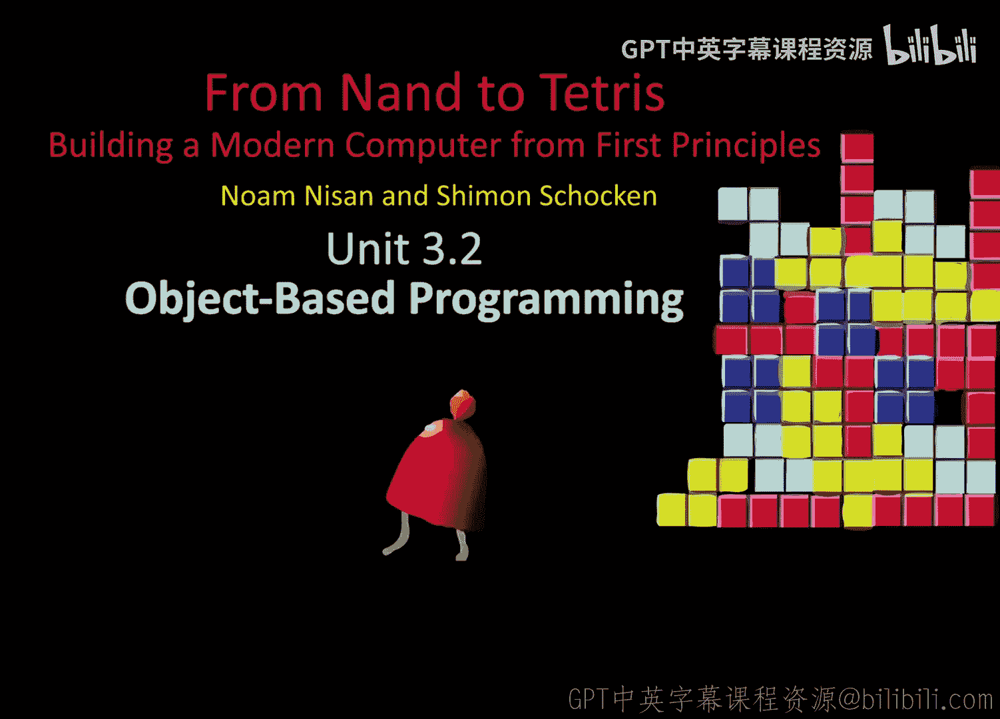

# 耶路撒冷希伯来大学《从零开始构建现代计算机2｜Build a Modern Computer from First Principles》中英字幕 p35 35_05_03_单元3-2_基于对象的编程.zh_en -BV1DA4m1w7FU_p35-

In the previous module， we saw two examples of simple procedural programming。

 and now we go on to discuss object based programming。Now， before we start。

 I'd like to say a word of caution， beginning with this module。

 you are going to see some nontri examples of computer programs， of object oriented programming。

And I'm not going to spend too much time explaining what the programs are doing。

 and that is because this course is not about programming。

 it's about how programming languages are designed and implemented。And yet。

 the best way to explain these design and implementation issues is to show many programming examples。

So I think the contract between us should be such that you should be willing to go with the flow。

 see my examples without trying to understand every statement and knowing that you know whenever you want you can stop the video and look at the code in depth。

 although I recommend doing it only at the end of the unit so that the sort of the flow of the presentation will not be impaired。

 so once again the code itself is not super important。

 what's important the principles that I will make sure to highlight everyone every once in a while。

All right， so in the previous module。One thing that we said is that Jack has a very limited primitive type system。

 it has only three types and only one numeric type which is int in Java we have I think five numeric types and yet we have only one。

 so it makes sense to extend the language with the ability to represent more numeric types。

 for example， rational numbers， so it may be nice to invent some fraction obstruction that allows us to carry out such operations as you see here without loss of accuracy so that everything will be as correct as possible。

So we can do this by introducing some fraction API as you see here。

 so what we see here is the skeleton of the class that represents fractions and provides a variety of fraction oriented functionality。

And what this API lets us do is first of all， you know we can read the code。

 we can the code here is of course just method signatures。

 so we have a constructor that allows us to create new fractions。

 we have two accessoriesors that give us access to the numerator and denominator of the current fraction we have a plus method that enables us to add up fractions。

 we have a dispose method that gets rid of the memory resources that were allocated to this fraction。

 and we have a print method that prints the method on the screen。

Now obviously if you were to design such an API， you may want to add more functionality like not only plus but also minus multiply。

 divide， invert， and so on， there are lots of things that you may want to do with fractions and yet once again this is not a course about programming and yet you know I'm going to give you enough information so that if you want。

 you can implement all these additional functionalities also。

 once again not necessarily for this course。All right so how do you use this API Well you need to write some client code and here's an example of some client code which exists in a separate jack class and this program here seeks to add up two thirds and one fifth and it does it as follows first of all it creates three pointer variables or reference variables or object variables any one of these terms is correct A B and C of type fraction。

And then it creates two fractions， A and B， A points to the fraction 2 and 3。

 the fraction characterized by 2 and 3 and B points to the fraction characterized by 1 and5。

And then we do a plus B， we print the result and we return So at the end of the story。

 when we execute this program， were going to get 13 over 15。

 which hopefully is the sum of  two thirds and one fifth。

What I'd like to do next is focus on every one of the activities that we did here in some detail so we'll talk about object construction。

 we'll talk about methods that manipulate the current object and we'll talk about object destruction。

 but before we get into these detailed explanations I'd like to make a general comment and the comment is that here once again we meet the super important obstruction implementation principle which we emphasize throughout this course。

Notice that users of the fraction obstruction need to know absolutely nothing about how the fractions are actually implemented。

 they view the fraction as a black box abstraction and they just use the services of this abstractstruction as advertised in the abstractstructions API and that's perfectly okay。

That's how you know we use obstructions in highlevel programming and yet at some point someone has to implement this obstruction this someone may be you at a different stage of the project it may be another programmer works in the same team together with you or it may be you know someone in another company that was hired in order to develop this this obstruction so let us now you know take off the hat of the application programmer that writes the client code and put on the cap of the obstruction implementer in the person who is who has to actually build the fraction obstruction and realize realize it inject so let's do that the first thing that you have to ask yourself when you design an obstruction is what kind of data。

Want to store about the objects that this class is supposed to represent where in the case of fractions。

 we need two pieces of data， which is the numerator and the denominator and we store these values in two integer typed fields and these fields are akin to what Java calls member variables and what the C sharp calls properties。

 you know these are simply variables that describe the data elements of the objects or the instances of this class moving along I show you here two accessoriesors that I wrote in order to facilitate access to these field values to the values of the current object。

Now， this is common programming practice in object oriented programming， but in Jack。

 it's absolutely necessary because。The only way to access field values from outside the class is through accessor methods so let me give you an example where this principle comes to play。

 suppose you want to create the fraction5 over 17 and you want to access numerator of this fraction Well in a language like Java you could have done this you know if if the member variable that represents numerator and denominator rep public you could have done x dot numerator and get the value of this field but in J this kind of access is disallowed and the only way to achieve the same purpose is to go through an accessor method which is good programming practice anyway so that's how we do things in jack。

All right， moving along， let us assume that we designed these two accessories they are in the class。

 I'm not showing them because they don't have enough space on each slide。

Everything that we discussed before in previous slides you know is already part of the class。

 The next part of the class is going to be a constructor。

 you know a method whose which is designed to create new objects。

 Well this constructor receives two inputs two parameters X and y and it goes on to populate the numerator and denominator of the current object with the values of x and y then it reduces the fraction which is important in case the fraction is something like8 over 16 you know we want to reduce it to one half。

And finally， it returns the base address to this object fraction， which was just created。Now。

 the reduce method is a typical method that operates on the fields of the current object。

 in this case， it reduces theffraction by using a function call called GCD。

And finally we have this function GCD which computes the greatest common denominator。

 you know going back to reduce once you compute the greatest common denominator of the numerator and the denominator you can divide both by the GD and get the reduced fraction so here is the code of GD which is a classical implementation of Euclids algorithm and with that I kind of like this slide because it shows you all the possible subroutines that are available inject and these subroutines are methods。

 constructors and functions methods are designed to operate on the current object。

 constructors are designed to create new objects which are instances of the current class and functions are methods that operate on no object in particular。

 these are equivalent to static methods in Java。😊，A few more things that we see here is。

 first of all， the keyword this， which is a standard reference to the current object。Internally。

 it's actually a memory address， it's the base address of the current object in the host RA。

And one of the rules of the game is that a jack constructor must return the base address or must return an object of the type of the surrounding class or the class to which this constructor belongs。

Now， Java constructs do exactly the same， but they do it implicitly。 you know。

 you don't have to say return this in Java， but actually believe me。

 this is what the constructor actually does after it follows a compilation。All right。

 another thing that we see here in this example is that a JA routine must always terminate with their return command。

 you know it doesn't matter if it returns a value or not， you must have a return。

 once again in Java there's no need to return explicitly。

 but once again believe me Java methods always return implicitly using some code that the compiler injected into into the translated VM code。

All right， moving along， let us take a look at this method plus this method simply adds up the current object and the other object。

 the object that was passed through it as a parameter and the addition is based on elementary school mathematics which I'm not going to dwell on。

 so this is an example of a typical method operating on fractions and you could have written if you want many more such methods to do minus multiply divide invert and so on。

Alright， the next thing that I want to explore is the print method。

 which prints the current object on the screen。 Of course。

 we don't know what is the current object So 13 over the 15 is just an example， You know， whatever。

Object you will give this method。 It will print， print it in this nice format。

 and the logic is trivial。 It prints the numerator。 It prints a slash。 It prints a denominator。

 and that's it。 I'm putting two statements in the same line。 in order to save。

Slide space in other slides， so don't worry about it。And of course， once again。

 I can add more fraction methods here if I want。And the last method that I want to discuss is dispose。

Which is necessary in order to be a good citizen and free up the resources held by a fraction when you no longer need it。

 you I'm talking to the application programmer who uses the services of the fraction class so the dispose method is implemented using a call to the host operating system and in particular we call an always routine called DalO which takes。

An address in memory and disposes the memory block that begins in this address in order to represent the current object。

 so once we passed this to DO， we are guaranteed that the memory resources that were held by by the current object will be freed for future use of our computer system。

And this is necessary in Jack because Jack has no garbage collection services like you know other languages may have。

 and therefore it is up to the programmer or it is up to the class architect to make sure that he or she includes a dispose method in every class that represents an object so that application programmers will be able to。

To use it in order to get rid of objects that are no longer necessary。Now。

 the next thing that I like to explore is how objects are really represented in memory。

And the difference between the programmer's view of the project and of the object and the systems view of the object。

 so you know so far we took the roles of an application programmer and we then took the role of the class developer now we'll take the role of a plumber that really goes you know inside the pipes and trying to understand how things really work under the hood。

All right， so I repeat here the constructor code that we saw earlier， nothing new here。

And some client code that uses the constructor by calling it twice。And programmers。

Tend to think about objects using this visual representation here。

 So we see that each fraction is represented by a block。

That includes all the field values of the current object and we also have a reference to each each of these blocks。

 which is the name of the variable that we created in order to to represent these fractions So after running the client code we get in the programmer's mind or using some documentation tool will get these two obstruct descriptions of the objects that we created。

 Now how is it really implement it。 you know under the hood。

 Well here is how it really is implemented。 we see the whole Ramm。

 we see that the ra some area of the Ram is designated to represent the stack of the currently running application and this is the working stacks you know that includes everything the variables。

 the memory segments and so on of all the all the methods up the calling chain， we have the heap。

Where we represent objects and。And arrays。 We see that we have a variable called a which contains the number 15087。

 If we treat this variable as a pointer and we look up this address in the Ramm。

 we see the number two。 If you look at the next word in the Ramm， we see the number three。

 and these two numbers are comprise the memory block that represents our first object。

 the object well， first or second doesn't matter2 over3。 And then if we look at the B variable。

 we see that it contains the address4，1，1，2。 If we look up this address。

 we get the same story Okay so this is the real representation of these objects in the whole strandm。

 all the addresses are contrived I made them up。And they are not important， obviously。

 for our discussion。Now there's some interesting issues here and the first one is how does this happen you know how does this representation how is it established。

 Well， the secret is that when the compiler is going to compile your constructor。

 it will inject some calls to the operating system and these calls are going to find available memory and allocate it to the object that was just constructed。

 so as you will see later on the course the compileroperates with with the host OS in order to deliver this functionality that we see here。

 which raises you know some more issues like well how do we know how does the OS know how to allocate memory。

 how does the OS know how to delocate memory when it is no longer necessary Well these are high questions and we will deal with them in the most elegant and satisfying。

Way later on in the course。 So stay tuned until we get to discuss them。

Now I'd like to end this unit with a general observation about Jack and you know if we can sort of look back at what we did。

 we wrote a class called fractionction and what you see here is the entire code of this class it consists of sort of like one page of code a quarter of which is comments and white space and you know this goes to show you the tremendous expressive power of objectbased programming in general and the jack language in particular we got a lot of functionality in with very little code in the next units will continue to show you some more examples of elegant objectbased programming and as usual the purpose is not to talk too much about the programming but rather to talk about the language and it's supporting infrastructure。

