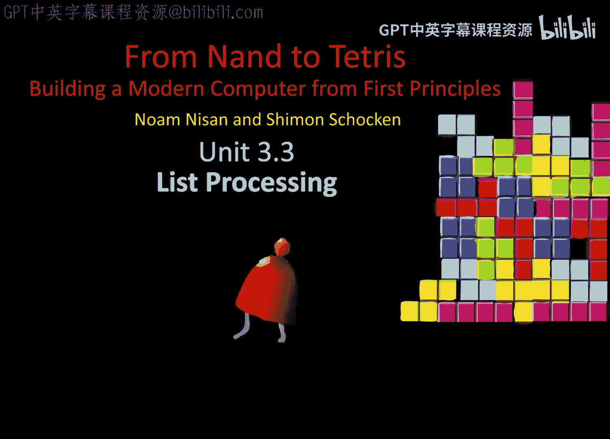

# 耶路撒冷希伯来大学《从零开始构建现代计算机2｜Build a Modern Computer from First Principles》中英字幕 p36 36_05_04_单元3-3_列表处理.zh_en -BV1DA4m1w7FU_p36-

In the previous example， we saw aject program that processed what can be called an atomic object。

 You know， a fraction is something that need not be divided into split into smaller atoms。

 so a fraction is a fraction is a fraction。However。

 we can also use object oriented programming in order to manipulate and create objects which are collections of atoms。

 so to speak， and the most generic collection of these is called list。

 which is a very important obstruction in both theoretical and applied computer science。

 so we spend a whole unit talking about list processing。So what is a list。

 A list essentially is the atom null which can be thought of as the empty set or it's an atom followed by a list and we use this notation in order to represent lists。

 So here's an example of several lists， the empty list and then five followed by the empty list empty list then three followed by five followed by empty list and so on and so forth。

 it's kind of painful to write all these parentheses。

 So instead we use abbreviated notation to describe lists， these are agreed upon notations。

 but back in our mind we remember that we actually refer to creatures that each one of which consists of an atom followed by a list。

 So this is a highly recursive data structure。And the atoms can be anything， they can be integers。

 as we have in the example here， they can be strings， they can be arrays， they can be other objects。

 they can be lists in themselves and so on and so forth。Now。

 programmers tend to think about a list as using this metaphor here。 So once again。

 this is a collection of atoms that are linked together。

 That's why it's called a linked list sometimestime。 and notice， however。

 that this whole thing is one object， right it's one object。 and in this example here。

 we have a pointer variable V that points to this object。 and the question， of course。

 is how do we create and manipulate such such collection objects。 Al right。

 so that's what we'll do in this unit。 And here is an abstractstruction of or an API of a class designed to manipulate lists。

 So we see that we have a constructor for creating the list and。

We use the terms car and kudar for historical reasons to describe the atom and the tail of the list。

 which is a list in its own right， and then we have a print method that goes through the list and prints every one of the atoms and we have a disposed method that recycles you all the memory resources held by the list which may be you know a gigantic pile of memory because this list may well contain a million such atoms and so when we don't need this list anymore。

 it makes sense to。To recycle its resources。Allright， now obviously in reality。

 you may want to add more functionality to this obstruction because you know the whole beauty of the list is that you can insert atoms in the middle of the list as you please or you can delete atoms from the middle or the beginning or at the end or you can insert a list into a list or you can pursue it from beginning to end or and to beginning there are many different things that you may want to do with the list。

 but all of them don't belong to the end to that risk course so once again this is not a course about list processing also there are you know excellent languages to do it like a list and scheme and yet in this course we'll do it in J All right。

 so here we have the list obstruction and here we have some client code that seeks to create a list the list2。

3，5 and manipulate。I will show you the code without discussing it because in the next slides I'm going to spend a few minutes discussing every line that I now go go to present so at the beginning we have four lines of code that together create the list that you see in this diagram then we print the list and when we'll do it we'll see the output 2。

35 on the screen and finally we dispose the list and return so this is the client code。

That demonstrates the three sort of quintessential things that we want to do with a list。

 which is creating it。Processing it， in this case， printing every item in the list and finally disposing it。

 And once again， there are many other things that you may want to do。 But believe me。

 all of them are derivatives of of these three operations。 as we now go to to explain。

 So let's start with create。Here's the client code。

 which is identical to what we had before and we see that it includes three calls to the list constructor right so let us open the black box and see how we can write a list class。

And the first thing is usual is to ask ourselves what kind of data does the list feature well a list consists of an atom or some piece of data and a list right so let's define two fields that represent exactly this information。

 a data field of type int because we decided to create a linked list of integers and the next item in in the list is a list。

 so we have a next pointer of type list to point at the tail。

And here is our constructor called the new and the constructor。

Asks we don't see it right but the construct ask the memory system。

 the operating system to come up with enough memory to represent this two word block。

 car and cor or data next， and then it returns the address of this block as all constructors do。

 and that's it。Okay， so let us see how。How this code actually runs and this will give us a lot of insight on how how to build a list and later on represented it in memory。

 so it all starts by creating a V pointer so you know we'll get a variable that contains something you know because you implemented the VM language you know that it will contain zero because if this is a local variable all local variables are initialized to0 so this variable does not know it yet。

 but it's going to be a pointer right now it contains the value of 0。

And then we invoke the list constructor and the list constructor is going to come back with a block of memory that represents the number 5 and null。

 and notice that we use this terminator icon to describe a null and V is going to point to the base address of the object that was returned by the constructor。

 essentially we say V equals this if you think about it because this was the return value of the constructor。

And then the next command， if you think about it for a few seconds。

 will accomplish this thing and by now the previous version of V is no longer relevant and so the next command will do exactly the same and the previous value of V is irrelevant and that's the end of the story。

Now， in closing， I'd like to point out that this list construction code can also be done using this somewhat shorter logic。

And in general， by the way， this is just one way to construct a list， right。

 I could have written additional constructors that make the list construction much easier。

 For example， I could have。Oer the constructor that takes an array and creates the list from the array。

 it's all up to the person who designs the API and implements it later。

 or up to the person who hires us to develop this obstruction。Al right。

 so we saw how to construct a list， the next thing that I want to illustrate is how we march through a list and how we do it what sometimes is called sequential processing of a list。

So I will illustrate the sequentialal processing using a print method and when we run this method we expect to see the contents of the list on the screen as we saw before and here is the body of the method。

 once again don't worry about the code don't even read it because I'm going to simulate the code and everything will become clear during the simulation so here' is the client code that calls the print method but it begins from building the list so once the list is built we're going to have the obstruction that we saw before and now the client code calls the print method on the V object。

Now， in object based programming。You know， people don't always know it。

 but once you will write the compiler in the next module， you will know it very well。

 When you call a method on an object， you are implicitly passing the object as a parameter to this method。

 So when we do V dot print we pass V to the print method。 And once the print method starts working。

 it doesn't know what V is right V is an identifier that exists outside the world of list。

 It is not defined in the list class。 Instead， we have a very special variable called this which stands for the current object。

 So now this is the point from which we are going to refer to the object that was past to it。

 So as we see in the diagram now the entry point of the list is this。

And then the code goes on to create another pointer of type list called current and it sets current to this。

 So we get this situation here， two pointers referring to the head of the list and now we enter this loop in which we S repetitively or we do as long as current is not null。

 we want to print the current atom and move forward。

 So we print the value of this atom which is two then we print a space and we move current to the next head of the tail of the list once again we see that it's not null so we print three and then we move it forward。

 it is still not null so we print5 we move it forward and finally current equals null in which case we。

Get out of the loop。 and we find a return。 We return to the calling code。

 Once we return to the calling code， of course。All the stuff of the print method is going to be recycled。

 so this and current no longer exists and once again V is being reinstated and points to the list as we had before。

So I guess there are two comments which are in order here。 First of all， notice that。

The print method is quite invasive， if you will。 You know。

 it goes into the list and it goes through every item along the list。

And there's a lot of drama going on。 And yet， as far as the client is concerned。

 the client only ask to print in the list。 And， you know， once this thing is done。

The list comes back to the client， so to speak， he never left him and he can go on and do whatever he wants with it。

So this once again is this beauty of the obstruction versus the implementation interplay。

 the obstruction is trivial， the implementation is not trivial at all。But the Klan doesn't care。

And the second comment that I'd like to make is that the printing here is not terribly important。

 the printing is just sort of a placeholder to describe methods that once again go through every item in a list and do something to all these items。

 so I could have written a very similar method that for instance。

 goes through the list and increases every value by 10% or something like this。

 so this is sort of an example of numerous processing algorithms not algorithm of methods that could be very useful in the context of lists。

All right。The last thing that I want to illustrate about list is what I call a recursive axis and well do it using the dispose method as an example。

And the purpose of dispose is to take this list and recycle everyone one of its items。

 Here is the code that does it。No need to read the code。 We'll do it in a minute。

 I just want to point out that it's a recursive method， because the dispose method。

Basically disposes the tail of the current list。And the client as usual， creates the list。

 gets this obstruction and then the client says dispose。 once again。

 when we say dispose control moves to the dispose method。

 the dispose method does not know what V is and instead now the variable。

 this points at the object that was passed to dispose and next we see that we have this if expression that says as long as next is not null do something。

 Now what is next next is the field of the current object right well next of the current object is not null。

 So we have to do dispose but the dispose now is applied to the tail of the list which is represented by next。

 So now this when we get into this。Level of the recursion。 This now points at the tail of the list。

 Once again， it's not null。 So once again， we we call ourselves。 we call dispose。 Now。

 this points at the last item in the list。 And indeed， now， next is null。And because next in now。

 we are going to move to the base case of the recursion。And we find here our acquaintance， Dioc。

 we've seen it before。 and Di knows how to take。An address in memory and recycle the block。

 which begins in this address， the memory block， which was previously assigned to represent the current object。

So once Dallog ends its work， this item is going to be recycled and we are going to return now we are going to return precisely to the position where we have to do another Dlog so we recycle this part of the list also and we do a return。

 we recycle that item and we do a return and once we do this return we get completely out of this recursive method and what used to be called this goes back to be named V。

But now V points to nothing because we basically disposed everything in this list。

 so the list is no more。So this has been an example of recursive processing of。Of lists。

 It is very natural to process lists using recursion， because the list is a recursive。

Data structure in its own right。 And here we have sort of a very clean example of a Taylor recursion。

 literally speaking。And， and yet， don't forget the recur。

 that recursion is a very inefficient operation。 And if you。

Had tried to do that with with with a big list。 You may have gotten stack overflow。

 So there are better ways to， to dispose not better， but， you know。

 more practical ways to dispose a list。 But this one once again。

 illustrates a nice way to do it using recursion。Alright， so to recap。

 we showed how to build the list， how to process it sequentially， how to process it recursively。

 And the last thing I want to say， which is very important in this course。

 is to once again open the hood and see how this list is。Instaled in memory。

The client view or the high level view of the list is this。 And yet， within the memory。

 it is stored using this example here。 It starts with。Say V。C V and V contains the address5 to 6，7。

 If we look at this address， we'll find a value 2 and a pointer to 1，4，017。 If we go there。

 we find the number3 and a pointer to。3108， we go there。 We find five and null。

 So that's how the list is stored in memory。 We don't have control over these addresses。

 They are completely arbitrary。 I made them up。 And in fact， that's what happens in practice。

 When you say new the constructor is going to cause this object to be created somewhere in memory。

 We don't care where all we want is a pointer to to the base address。

 and therefore practically the list is going to be dispersed， you know all over the memory。

And that's， that's perfectly okay because the memory is direct access and。And that's fine。

 So who makes this magic happens。 Obviously， there's some magician here that knows how to take this obstruction and map it on the sequential rim。

 and here's the secret if you are content to think about programming from a highle perspective only。

 then the simple answer is the constructor takes care of it somehow but if you are interested to go below the surface。

 as obviously we do in this course， then you should know that when the compiler translates the constructor。

 the constructors code that the highleve programmer wrote the compiler is going to inject into the code stream calls to the operating system。

 that and these calls are going to invoke routines that know how to find available memory for the new object and assign it to this。

😊，To this object and in the next modules of this course。

 when when we build the compiler and the operating system。

 you will be very pleased to see how all of this capability is going to be implemented in a very elegant and and effective way。

😊，Al right， so the next thing that we'll do in this module is describe the Jack language specification up until now we just showed the example of Jack programming。

 now we'll define the language officially and you'll be able to start using it and write programs in J。

