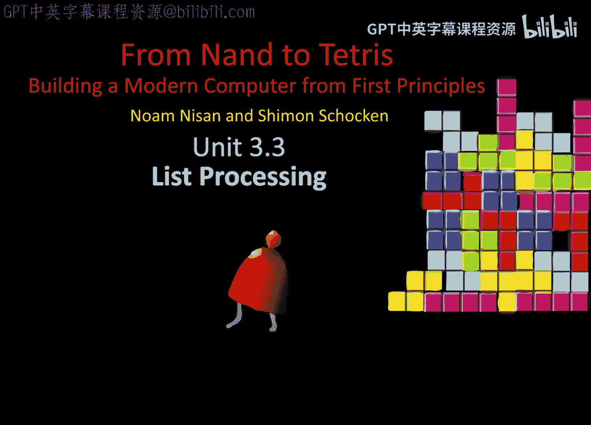

# 从零开始构建现代计算机2：单元3-3：列表处理



在本节课中，我们将学习如何使用面向对象编程来创建和操作一种称为“列表”的复合数据结构。列表是计算机科学中一个非常重要的抽象概念，它由一系列称为“原子”的基本元素组成。我们将学习如何构建列表、如何顺序处理列表以及如何递归地处理列表。

---

## 什么是列表？

上一节我们介绍了处理“原子对象”的程序。原子对象，例如一个分数，是不可再分的基本单元。

然而，我们也可以使用面向对象编程来操作和创建由多个原子组成的集合对象。最通用的集合类型就是**列表**，它在理论和应用计算机科学中都是一个非常重要的抽象。因此，我们将用整个单元来讨论列表处理。

那么，什么是列表？本质上，列表要么是原子 `null`（可以看作是空集），要么是一个**原子**后跟一个**列表**。我们使用以下符号来表示列表：
```
List = null | (atom, List)
```

以下是几个列表的例子：
*   `null` （空列表）
*   `(5, null)`
*   `(3, (5, null))`

一直写这么多括号很繁琐。因此，我们使用约定的**缩写符号**来描述列表。但在我们心中要记住，我们实际上指的是由“一个原子后跟一个列表”这种结构组成的实体。所以，这是一个高度**递归**的数据结构。

原子可以是任何东西：可以是整数（如上面的例子）、字符串、数组、其他对象，甚至可以是列表本身。

现在，程序员倾向于使用这里的隐喻来思考列表。这同样是一个由原子链接在一起的集合，因此有时也被称为**链表**。但请注意，这整个东西是一个**对象**。在这个例子中，我们有一个指针变量 `V` 指向这个对象。当然，问题在于我们如何创建和操作这样的集合对象。这就是我们将在本单元中学习的内容。

---

## 列表类的抽象接口

以下是设计用于操作列表的类的抽象接口：

```java
class List {
    // 构造函数：创建新列表
    constructor List new(int car, List cdr) {...}

    // 方法：获取列表的第一个原子（头部）
    method int car() {...}

    // 方法：获取列表的剩余部分（尾部）
    method List cdr() {...}

    // 方法：打印列表中的所有原子
    method void print() {...}

    // 方法：回收列表占用的所有内存资源
    method void dispose() {...}
}
```

我们使用术语 `car` 和 `cdr`（由于历史原因）来描述列表的**原子**（头部）和**尾部**（它本身也是一个列表）。然后我们有一个 `print` 方法，它遍历列表并打印每一个原子。我们还有一个 `dispose` 方法，用于回收列表持有的所有内存资源。因为一个列表可能包含数百万个原子，当我们不再需要这个列表时，回收其资源是有意义的。

显然，在实际应用中，你可能希望为这个抽象添加更多功能，例如在列表中间插入或删除原子、合并列表等。但本课程的重点不在于列表处理本身，因此我们只关注核心操作。我们将使用 Jack 语言来实现它。

---

## 客户端代码示例

以下是使用列表的客户端代码示例，它演示了我们希望对列表进行的三种典型操作：创建、处理（打印）和销毁。

```java
var List v;
let v = List.new(5, null);          // 创建包含 5 的列表
let v = List.new(3, v);             // 在头部添加 3
let v = List.new(2, v);             // 在头部添加 2
do v.print();                       // 输出：2 3 5
do v.dispose();                     // 回收列表内存
return;
```

这段代码首先创建了列表 `(2, (3, (5, null)))`，然后打印它（输出“2 3 5”），最后销毁它。所有其他列表操作都可以看作是这三种基本操作的衍生。接下来，我们将逐一详细解释。

---

## 构建列表

让我们从创建列表开始。上面的客户端代码包含了三次对列表构造函数的调用。现在让我们看看如何编写这个 `List` 类。

首先，我们需要定义列表包含的数据。一个列表由一个数据（原子）和一个指向下一个列表的指针组成。因此，我们定义两个字段：

```java
class List {
    field int data;  // 原子数据（本例中为整数）
    field List next; // 指向尾部（下一个列表节点）的指针
    // ... 方法定义
}
```

构造函数 `new` 会向内存系统（操作系统）请求足够的内存来存放这个两字块（`data` 和 `next`），然后返回这个内存块的地址。

现在，让我们模拟这段代码是如何运行的，这将帮助我们理解列表在内存中是如何构建和表示的。

1.  首先，声明指针变量 `v`。作为一个局部变量，它被初始化为 0（即 `null`）。
2.  第一次调用 `List.new(5, null)`。构造函数分配内存，存储数据 `5` 和指针 `null`，并返回该内存块的地址。`v` 现在指向这个新创建的对象。
3.  第二次调用 `List.new(3, v)`。构造函数分配新内存，存储数据 `3` 和指针（指向第一步创建的对象）。`v` 被更新为指向这个新对象。旧的 `v` 值（指向包含5的节点）现在由新节点的 `next` 字段引用。
4.  第三次调用 `List.new(2, v)` 过程类似，最终构建出完整的链表。

需要指出的是，这种构建列表的代码也可以用更简洁的逻辑来完成。此外，这只是构建列表的一种方式。我们可以设计其他构造函数，例如接收一个数组并从中创建列表，这完全取决于API设计者的决定。

---

## 顺序处理列表

构建好列表后，接下来我们看看如何遍历列表，这有时被称为列表的**顺序处理**。我们将通过 `print` 方法来演示。

当运行 `v.print()` 时，我们期望在屏幕上看到列表的内容。以下是 `print` 方法的主体：

```java
method void print() {
    var List current;
    let current = this;           // `this` 指向调用此方法的列表对象
    while (~(current = null)) {
        do Output.printInt(current.car());
        do Output.printChar(32); // 打印空格
        let current = current.cdr();
    }
    return;
}
```

在面向对象编程中，当你在一个对象上调用方法（如 `v.print()`）时，该对象会作为隐式参数 `this` 传递给方法。因此，在 `print` 方法内部，`this` 指向列表的头部。

1.  方法首先创建一个局部指针 `current`，并将其设置为 `this`。现在有两个指针（`this` 和 `current`）指向列表头部。
2.  进入 `while` 循环。只要 `current` 不是 `null`，就执行循环体。
3.  在循环体内，打印当前节点的数据（`current.car()`），然后打印一个空格。
4.  将 `current` 指针移动到下一个节点（`current.cdr()`）。
5.  重复步骤3和4，直到 `current` 变为 `null`，此时循环结束，方法返回。

模拟这个过程：`current` 依次指向包含 2、3、5 的节点，并打印它们，最后遇到 `null` 时退出。方法返回后，其局部变量（包括 `this` 和 `current`）被回收，而客户端变量 `v` 仍然指向原来的列表头部，列表本身没有被修改。

这里有两个重要的点：
1.  `print` 方法虽然深入列表内部进行遍历，但对客户端来说，它只是请求“打印列表”，完成后列表完好无损地返回。这体现了**抽象**与**实现**的 interplay：抽象很简单，实现可能不简单，但客户端无需关心。
2.  打印本身并不重要，它只是一个**示例**，代表了任何需要遍历列表并对每个元素执行某些操作的方法（例如，将每个值增加10%）。

---

## 递归处理列表

最后，我们来看看列表的**递归处理**，以 `dispose` 方法为例。`dispose` 的目的是回收列表及其所有节点占用的内存。

```java
method void dispose() {
    if (~(this.next = null)) {
        do this.next.dispose();
    }
    do Memory.deAlloc(this);
    return;
}
```

请注意，这是一个**递归方法**。因为列表本身是递归数据结构（一个节点指向另一个列表），所以用递归来处理它非常自然。

客户端调用 `v.dispose()` 后，控制权转移到 `dispose` 方法，`this` 指向列表头部。

1.  方法首先检查 `this.next`（尾部）是否为 `null`。
2.  如果不为 `null`，则**递归调用** `this.next.dispose()`。在递归调用中，`this` 指向下一个节点。
3.  递归会一直进行，直到到达最后一个节点（其 `next` 为 `null`）。
4.  对于最后一个节点，由于 `next` 是 `null`，跳过递归调用，直接执行 `Memory.deAlloc(this)`。这个函数（我们之前见过）回收 `this` 指向的内存块。
5.  递归返回上一层（倒数第二个节点），执行它的 `Memory.deAlloc(this)`，回收其内存。
6.  以此类推，直到最初的调用返回，整个列表的所有节点都被回收。此时，客户端变量 `v` 仍然存在，但它指向的内存已被释放，列表不复存在。

这是一个**尾递归**的清晰示例。然而，需要注意的是，递归在处理非常大的列表时可能效率低下，甚至导致栈溢出。因此，在实践中，可能会使用迭代等更实用的方式来销毁列表。但这里的递归版本很好地展示了利用数据结构递归特性的优雅处理方式。

---

## 列表在内存中的表示

在本课程中，非常重要的是再次“打开引擎盖”，看看列表在内存中是如何实现的。

客户端看到的高级视图是链接在一起的节点。而在内存内部，它是这样存储的：
*   变量 `v` 存储一个地址（例如 567）。
*   在地址 567 处，我们找到值 `2` 和一个指向下一个节点的指针（例如 14017）。
*   在地址 14017 处，我们找到值 `3` 和一个指针（例如 3108）。
*   在地址 3108 处，我们找到值 `5` 和指针 `null`。

这就是列表在内存中的存储方式。我们对这些地址没有控制权，它们完全由内存分配器决定。实际上，当你调用 `new` 时，构造函数会在内存的某个地方创建对象，我们只关心指向其基地址的指针。因此，列表节点可能分散在内存的不同位置，这完全没有问题，因为内存是直接访问的。

那么，是谁实现了这个魔法？如果你只满足于从高级视角思考编程，那么简单的答案是：构造函数以某种方式处理了它。但如果你有兴趣深入表面（正如我们本课程所做的），那么你应该知道：当编译器翻译高级程序员编写的构造函数代码时，它会向代码流中插入对操作系统的调用。这些调用将激活一些例程，这些例程知道如何为新的对象找到可用的内存并将其分配给它。在本课程的后续模块中，当我们构建编译器和操作系统时，你将很高兴地看到所有这些功能是如何以非常优雅和有效的方式实现的。

---

## 总结

本节课中，我们一起学习了列表处理的核心概念：
1.  **构建列表**：我们了解了列表的递归定义，并使用构造函数和指针逐步构建链表结构。
2.  **顺序处理列表**：我们通过 `print` 方法，学习了如何使用循环和指针遍历列表中的每一个元素。
3.  **递归处理列表**：我们通过 `dispose` 方法，展示了如何利用列表自身的递归结构，通过递归调用来处理整个列表。
4.  **内存表示**：我们探讨了链表在物理内存中是如何通过指针链接离散的节点来实现的。


列表是复杂数据结构的基石，理解其创建、遍历和销毁过程，对于掌握更高级的编程概念至关重要。