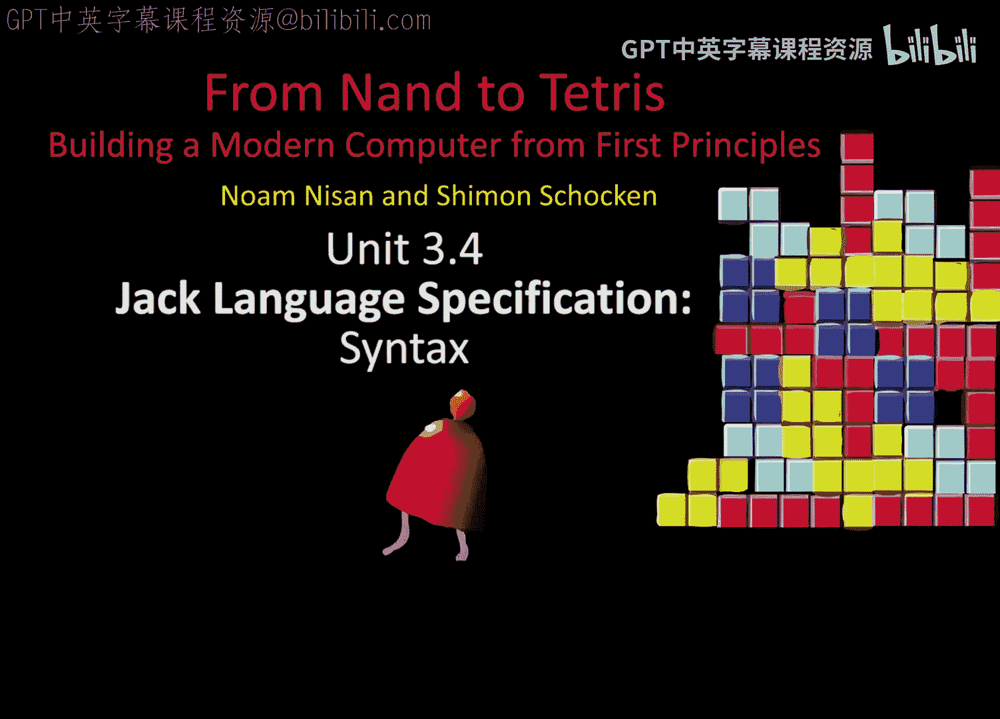

# 耶路撒冷希伯来大学《从零开始构建现代计算机2｜Build a Modern Computer from First Principles》中英字幕 p37 37_05_05_单元3-4_Jack语言规范：语法.zh_en -BV1DA4m1w7FU_p37-

We are going to discuss the syntax of the jack language in four separate units。

 beginning with the syntax of the language。And the syntax will be demonstrated using some of the examples that the programming examples that we saw before。

 So here's the code of our。Program， average computation program。

The code itself is completely meaningless in this unit we are interested in the code only from a syntactical standpoint。

 So in particular we're going to look at the items that you see here on the screen beginning with white space。

 So whitespace are comments and the spaces that we introduce into the code and as we see here。

 we have three types of comments， we discuss them in one of the previous units and I repeat here for completion the the。

The rules of jack comments okay moving along we'll now talk about keywords and in this code we have quite a few keywords in action and in the jack language altogether we have something like 20 keywords that fall into different categories as you see here in Java we have something like I think 60 or 70 keywords so you know in terms of order of magnitude it's the same number of keywords both languages are quite simple in that respect。

And some of the keywords of jack are standard， you know， keywords like while class function。

 void and other keywords are non standard like var， let and do。

The nonstandard keywords were introduced to the language intentionally in order to make the writing of the compiler easier。

 as we will do， as you will see in the next module of the course。

 so when you write programs in Jack you may be a little bit tired to use these keywords let in do。

 although you get used to it very quickly and yet when you write the compiler of the jack language you will be grateful that we have this these peculiar prefixes。

All right， moving along， each Jack program or any other program in any other language has lots of symbols in it and the symbols are all these little thing here。

And some of these symbols are used for grouping purposes。

And other symbols I use for all sorts of other purposes。 And if you want。

 you can stop the video and read this information， which is not terribly exciting。Moving along。

 the language has the capability to describe constants and we have let's see we have integer constants。

 we have string constants。Let me highlight them。 Integer constants， string constants。

 What we don't have in this example are also Boolean constants true and false。 And we also have null。

 which is a constant。 So， you know， all these different constant constants are listed。

In this right up here， which you can read later if you want。And finally。

 we have identifiers and identifiers are actually the bulk of any program that you see and in this example we have。

 as usual， most of the code is identifiers。😊，The identifiers are the names that the programmer invents when he or she creates variables。

Classes and methods and these names have certain rules on。

 you know what what constitutes a valid identifier。

 And I just want to point out once again that Jack and Java in their own right are very simple languages。

 what makes these languages powerful in particular， Java。

Is the fact that the programmer is free to create a whole world of his or her own and this world typically consists of classes and methods and APIs and most of the code the programmers write is in fact those little languages that he or she creates when they design these APIs and we see it here。

 you see we see keyboard dot readentt and so on。 you know all these little languages consists of identifiers that that the programmer has invented and that's why it's also so important to come up with good identifiers because it will make your code much more readable So to recap you know we saw all these syntax elements of the language and in the next unit we are going to discuss the data types which are available in Jack。

