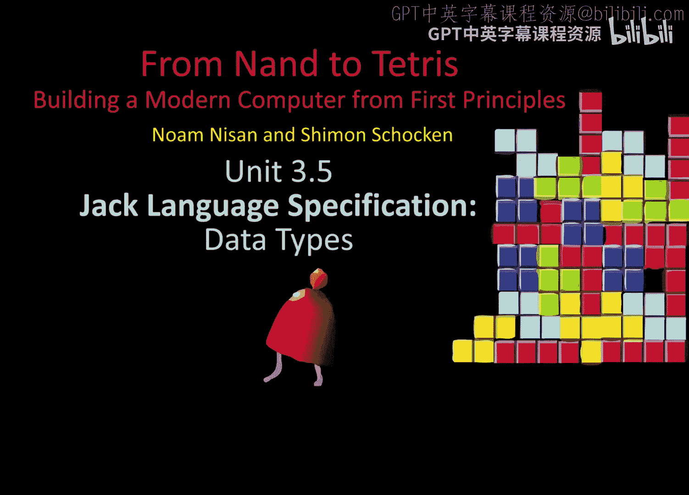
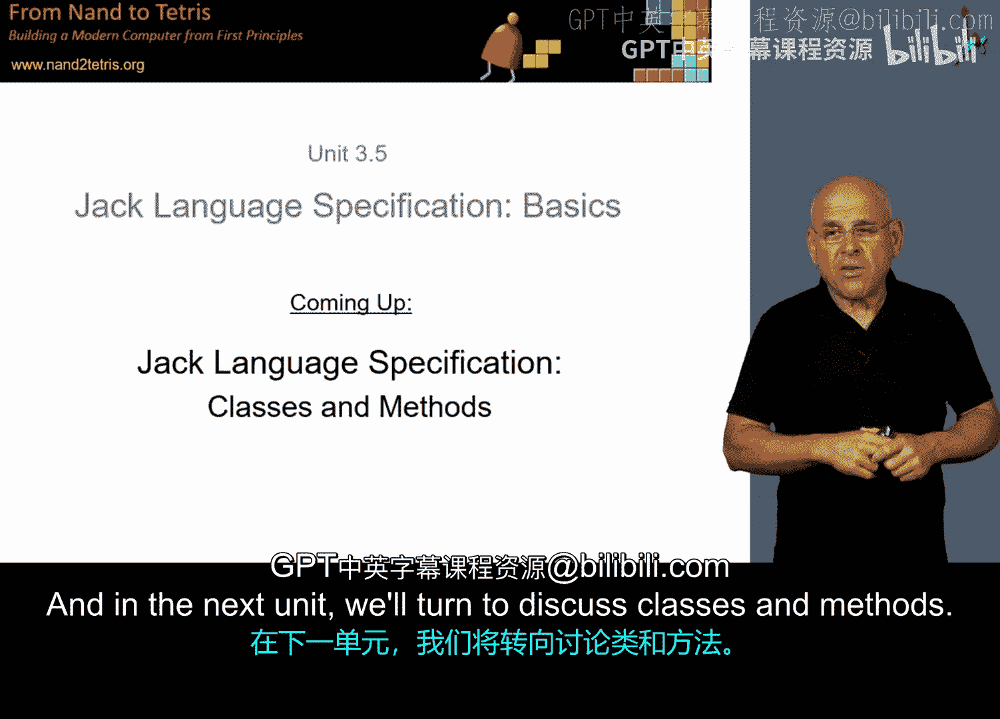

# 耶路撒冷希伯来大学《从零开始构建现代计算机2｜Build a Modern Computer from First Principles》中英字幕 p38 38_05_06_单元3-5_Jack语言规范：数据类型.zh_en -BV1DA4m1w7FU_p38-

Welcome to this discussion of the J language data types。In the previous unit。

 we talked about the language as syntax and now we'll talk about what kind of data J programs are allowed to create and manipulate and as usual we'll start with an example。

So here's some J code that does something， it's not terribly important what the program is doing。

And let us focus on these three statements here in which the programmer goes on to create an array called a。

呃。An integer variable called length and two more integer variables called I and sum。

And what we see from this is that the jack language has， first of all。

 primitive types of which we have three only。The int data type can hold values in the range of 0 to 32767。

Then we have Boolean types which are either true or false。

 and we have car types which are essentially numbers that represent characters using the Uniode character scheme or the ASCI scheme。

 which happens to be the same in the subsetstantive characters that we use in this course。

Now you may ask yourself， well， if an intvalue can be only non- negative。

 how do I represent negative numbers in J， well you can always proceed a value with minus but this will not be a constant。

 it will be actually an expression in which we apply the minus operator to the non-ne value that follows it。

 so from the programmer's perspective you know negative numbers are just as easy to use as positive ones but the implementation is somewhat a little bit more involved。

Moving along， we also have class types。 For example， in this piece of code here， we see a。

The a variable whose type is array。And there are either class types that come from the jack operating systems like string and array。

 and there may be class types that the user has created and when we say user here we mean the practicing jack programmer who may have well design classes like fraction and list and stack and whatnot。

 and therefore he or she is free to create variables that have these data types as as they please。

So like you know any other high level object based language。

 we have primitive types as well as class types。Moving along。

 I'd like to demonstrate type conversions in J which may well be quite wild。So first of all。

 characters and integers can be converted into each other at will and as needed。

This is quite similar to what can be done in other languages。

 so if we have a character variable called C， I can say c equals 33 where 33 is just an integer value and this will give me the representation of capital a according to the ASI code。

Equivalently I can also create a string called S， I can assign the string uppercase A to S with two double quotes and if I want to convert it into a character then I must use the CA at function which is part of our operating system and。

And I do it by calling the current edge function on the S character。

And this is a little bit cumbersome because you know ideally would like to say simply c equals quote a quote。

 but this idiom is not supported by the jack language。

 which you know may you know create some inconveniences to someone who wants to do a lot of string and character processing and yet it will make the writing of the compiler much easier so not much easier but easier so we will thank these concessions later on when we develop the compiler。

Now an integer can be assigned to reference variables in which case it is treated as a memory address。

 So consider this piece of code here。 we create an array called AR and then we happily say AR equals 5000 which is somewhat crazy isn't it because AR is supposed to be an array and yet the jack language supports this kind of assignment and if you do it you basically tell the system that the AR array ought to start in base address 5000。

 So from now on if you say AR sub00 equals 17。 well the compiler will generate code that will cause。

The RamM at location 5000 and 100， which is 5，000 plus 100 to become 17。

So as you see this kind of casting is quite exotic and wild and in the wrong hands it can create a havoc because it allows programmers to take control over the ra and do whatever they want with it and yet these tricks here will once again prove extremely useful when we develop the operating system later on in the course so you know it's nice that we can do all sorts of exotic hacks and we will certainly exploit them down the road。

😊，What else an object can be easily converted into an array and vice versa？So， for example。

 if I create an object X of type fraction。Then recall that fraction objects have two fields。

 numerator and denominator。 So let's put this at the back of our mind。

Then I create an array called ARR。 I construct the array to be two entries along。

And then I say error R 0 equals2 error 1 equals 5。 And now I do something strange。

 I say x equals A R， R。 So x， which is a fraction。Now points at the ARR array。And once I do this。

 I can say， for example， do x dot print。And this will invoke the print method of the fraction class on x。

 and even though x points to an array， it will treat this array as a fraction。

 and therefore it will print it as2 slash5。So once again， quite a wild casting。 and yet。

Makes perfect sense because internally， arrays and objects。Are you know， handled almost the same。

 That's why in languages like Java and you know C sharp。

 you can easily serialize an object into an array and so on。 So inject。

 this relationship is more explicit， I think， more clear。So that's it。

 that's what I wanted to say about data types in Jack and to sum up we can conclude that Jack has a rather primitive primitive set of types。

 we have only three of them， Java has eight， we have three。

 we could easily add more but we didn't find find it necessary from pedagogical values。

And the jack language is also weeklyly typed。 In fact， it's very weekly types typed。 you know。

 any variable can be assigned to any variable irrespective of its type。And on the one hand， you know。

 this sounds like chaos。 On the other hand， it provides some very interesting hacking possibilities that we will definitely use later on。

 You know， we could easily we could easily impose all sorts of restrictions and not allow to do certain things。

 but we decided not to bother about it。 so。This is the jack type system。 and in the next unit。

 well turn to discuss classes and methods。

