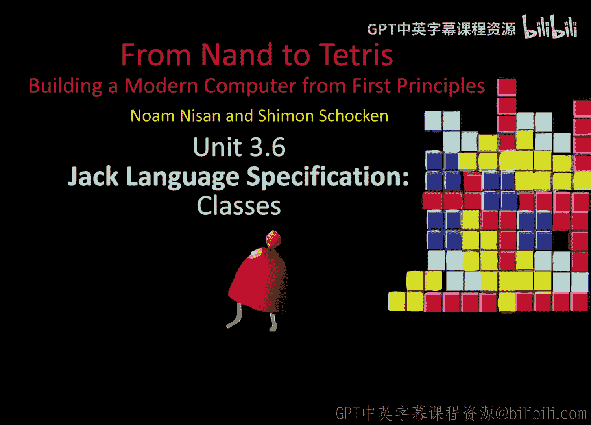
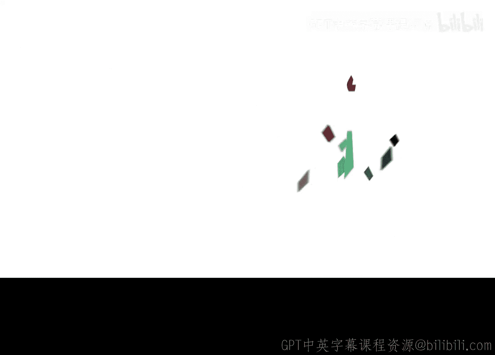

# 耶路撒冷希伯来大学《从零开始构建现代计算机2｜Build a Modern Computer from First Principles》中英字幕 p39 39_05_07_单元3-6_Jack语言规范：类.zh_en -BV1DA4m1w7FU_p39-

The next thing that we will explore in the Jack language specification is the notion of classes。Now。

 the class is the most fundamental and basic compilation unit in the Jack language， likewise in Java。

 C sharpp， C++。Each class named theF is stored in a separate J file and this file is compiled separately from all the other class files in your application and we require that the class name will be the same as the file name and we also require that the first character in the class name and the file name will be an uppercase letter。

Now， here is the general skeleton of of a class in in Jack。 It begins with a class name。

And then we have field variable declarations which are optional but if we have them。

 they will appear here， then we have another set of zero or more static variable declarations and finally will have what I call subroutin declarations and by subroutin。

 I refer to constructors methods and functions。So they should appear at the end of the class declaration and typically they capture the bulk of the class contents。

 however， we have this syntactic requirement that field and static variables if they exist in the class must appear before the subroutine declarations。

Okay what I'd like to do next is take a bit of a diversion and talk a little bit about the semantics of classes and to which purposes do do we use classes to begin with Well。

 we use them for numerous different purposes and there are courses and software architecture and software engineering that describe what is known as design patterns of classes and different purposes and morphologies of classes。

 but in my view there are two main sort of categories of classes at least that's how I think about it there are classes that provide functionality and a good example of these classes is the our OS math class which as you see you see the API here is just a library of commonly used mathematical functions and anyone you know can use these functions at will and。

The library provides the implementation， hopefully provides an efficient implementation of these functions。

 and what is special about， you know， these kinds of classes is that they contain functions only。

 there are no fields， no constructors， no methods and obviously there are no objects and therefore this class and similar classes are essentially libraries of or modules containing。

functionss。So that's you know one sort of mega category of classes and then the other mega category within which there are many more subcategories are classes that represent what we sometimes call entities or objects。

And examples of these classes that we saw already are fraction list string every one of these classes is designed to represent instances of the class right objects that are created and manipulated according to the class capabilities and inject if a class has at least one method。

 you know one or more methods， then it is bound to be a class that represents an entity and typically such a class will also contain fields and methods to represent the data of the entities and operation that are allowable on these entities。

And finally， classes that represent entities or objects can also have functions。

But if the programmer knows what he or she is doing。

 then these functions should better serve only for internal helper purposes。 You know。

 these are sometimes called in Java， I think， a private static methods。 So， for example。

 if you write a method that operates on an object。 and in the process of doing so you have to do some。

Long complex computation that repeats itself in several other methods。

 You may want to factor this computation outside to to another to a function that resides in the class and only other subroutines in the class use it。

 So that's perfectly okay。 You can create such helper functions for internal purposes。However。

 as a general advice that has nothing to do with this course。

 you should remember not to expose these helper functions to the rest of the world to other classes outside your particular class that is designed to represent objects。

 if you do want to create some functionality that is not related to objects of this class and may help other clients as well。

 you should take these functions and put them elsewhere， you should put them in separate classes。

 not in this one。So the general advice is not to mix library functionality with object representation functionality in the same class。

 you should separate them。And once again， you know， these are general software engineering。

Propositions which are not directly related to this course。And。In order to illustrate this principle。

 I will show you an example that actually violates it and this example is the fraction class that we saw earlier in the course。

 If you look at this class you will see in this slide here we have a constructor a method called reduce and a function called GCD and the method does what I just described it computes the great common divisor。

 the vior of two numbers which happened to be the numerator and the denominator and then it uses the result。

For some purpose。Now， what's wrong with it？ Well， first of all。

 in terms of syntax and J sanity and so on， everything is just fine。

 The compiler will happily translate this program and it will work perfectly。

 but from an aesthetics design and practical matters。 this is a bad solution because GD。

Is a very general function and it has you know lots of things to offer outside the context of fractions。

 In other words， other classes that do all sorts of other things， for instance。

 with the prime numbers would benefit from being able to access this GCD function and therefore it makes perfect sense to refactor or this GCD code and put it in a separate class。

 and this class may well be the math class of our operating system or your own math class which is a library of mathematical function。

 So here's an example of you know two classes。That are exactly the classes I described before。

 fractionction represents an object， and math is a library of mathematical operations。

 GD being one of them。 So this is a much better solution。 It has。Many good benefits。

 one of them is that the fraction class will be tighter and more focused more to the point it will deal only with fractions and nothing else。

 and the math class is now extended or with additional functionality and now many other clients can use the GCD function which before was buried within this fraction class。

So。What you see here。Is that？How should I put it， Well object oriented languages are incredibly powerful and they have lots of expressive power and in the wrong hands of programmers who are not well trained。

 they can lead to monstrous programs which are impossible to extend and maintain and you know and these are programmers who don't follow these best practice advices So you know all of this really has nothing to do with Nanttotetriris。

 this was just a commercial designed to advise you that if you want to be a serious developer。

 you have to take some software architecture courses or at least one course or software design design patterns。

 something like this that will teach you how to design software correctly。All right， moving along。

 a J application as we explained before in the course。

 is a collection of one or more jack classes hopefully well designed。

 one of which must be named main， this class should have at least one function named main and main dot main becomes the entry point of the entire application。

I'm repeating this here for just for completeness because we discussed this before。And finally。

 I want to say a few words about the support library that comes with Jack。

 which is similar to the support library that comes with Java， at least in principle。

And here's the very same code example that we used all along。 And if I look carefully at this code。

 I see that it has。Many calls to OS routines。And this is very natural in Jack。

 as well as in other high level object oriented languages that work tightly with some operating system layer that surrounds them。

Now， the purpose of the operating system is versatile， first of all。

It is designed to close various gaps between highlevel programming and the host hardware and peripheral devices like the keyboard。

 the screen， the mouse， the scanner， the printer the camera。

 the microphone and so on and so forths and indeed you see in this code example here that if you want to read something from the keyboard。

 you have an always routine that does it keyboard do readint and believe me writing this routine is a pan because you have to get into the keyboard and read the scan keys and turn you clicking on keys to integers and strings and so on and you will discover that this is not simple when we develop the operating system towards the end of the course。

 but once again I promise that we will do it in the most elegant way possible so it won't be that terrible。

But as far as the high level programmer is concerned。You know。

 he or she could not care less about all these gory details because the OS delivers this obstruction nicely and elegantly another purpose of the OS is to provide efficient implementation of widely used functions like a square root for example。

 and finally we also want the operating system to represent efficiently commonly used abstractstruct data types like a array。

 string list and so on。In terms of implementation， the OS that accompanies Jack consists of eight classes。

 we'll see them in the next slide。And once again， the whole concept is similar。In spirit。

 I emphasize in spirit to the Java standard class library。And， you know。

 the only difference between our class library and Java class library is that our library contains8 classes and the Java standard class library as of。

Java 8 contains， I think， more than 4000 classes and and that's because Java is an industrial strength language so you have to support you know so many things like networking and files and thenion and compression and multithreading and you know numerous other things and of course we could have done the same with Jack but we didn't have to because it's not in the scope of the course but they are similar in the sense that you know the jack standard library is wide open and we can extend it any way we want and we may do it in some advanced courses if we ever have the energy to build them so as promised here is a description of the eight OS classes that support jack and if you want to read the complete OS API you're welcome to look at the nanotechs book。

And the website and the API is available there。So with that。

 we are done with this unit and in the next unit， well complete the specification of the jack language when we discuss methods。

