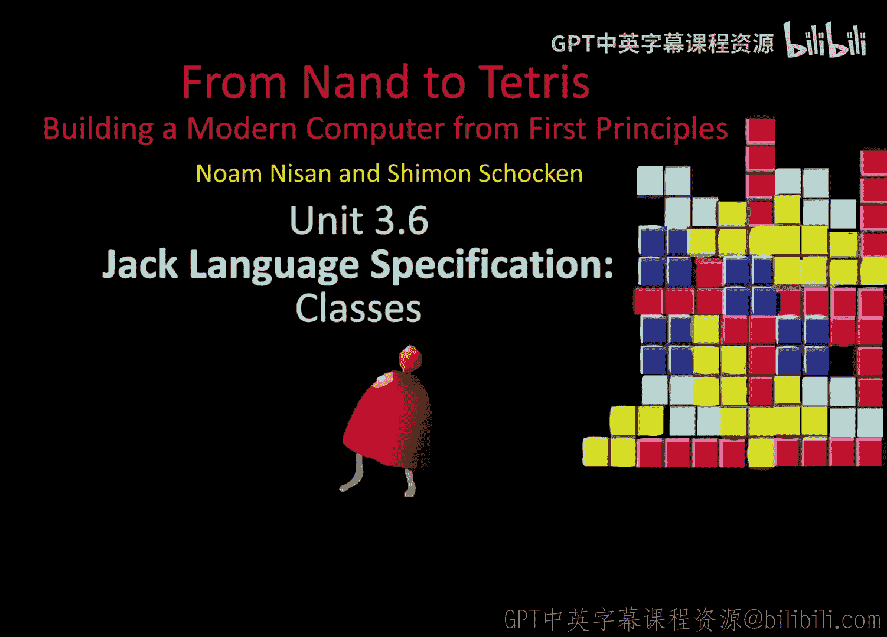

# 从零开始构建现代计算机2：3-6：Jack语言规范：类 🧱



在本节课中，我们将要学习Jack语言规范中的核心概念——类。我们将了解类的基本结构、两种主要用途，以及Jack语言如何通过操作系统库来支持高级编程。

---

## 类的结构

上一节我们介绍了Jack语言的基本元素，本节中我们来看看其最基础的编译单元——类。类在Jack语言中是最基本和核心的编译单元，这与Java、C#、C++等语言类似。

每个以`TheClass`命名的类都存储在一个独立的`.jack`文件中，并且该文件与应用程序中的所有其他类文件分开编译。我们要求类名必须与文件名相同，并且类名和文件名的首字符必须是大写字母。

以下是Jack语言中一个类的通用骨架：

```jack
class ClassName {
    // 字段变量声明（可选）
    field type varName;
    // 静态变量声明（可选）
    static type varName;
    // 子程序声明（构造函数、方法、函数）
    constructor ClassName(...) { ... }
    method returnType methodName(...) { ... }
    function returnType functionName(...) { ... }
}
```

它以一个类名开始。接着是字段变量声明，这是可选的，但如果存在，它们会出现在这里。然后是另一组零个或多个静态变量声明。最后，是所谓的“子程序”声明，这里指的是构造函数、方法和函数。它们通常构成了类内容的主体，但语法上要求字段和静态变量（如果存在）必须出现在子程序声明之前。

---

## 类的两种主要用途

了解了类的结构后，我们来看看类的语义和主要用途。类有多种不同的用途，软件架构和软件工程课程中描述了所谓的设计模式和不同形态的类。在我看来，类主要有两大类。

### 1. 提供功能的类

第一大类是提供功能的类。这类类的一个好例子是我们的操作系统`Math`类。正如你从其API中看到的，它只是一个常用数学函数的库。任何人都可以随意使用这些函数。这个库提供了这些函数的实现，并且希望是高效的实现。这类类的特殊之处在于它们只包含函数，没有字段、构造函数、方法，显然也没有对象。因此，这类类本质上是包含函数的库或模块。

### 2. 表示实体或对象的类

另一大类（其中包含更多子类别）是表示我们有时称为“实体”或“对象”的类。我们已经见过的例子有`Fraction`、`List`、`String`。这些类中的每一个都旨在表示该类的实例，即根据类的能力创建和操作的对象。如果一个类至少有一个方法，那么它必然是一个表示实体的类。通常，这样的类也会包含字段和方法，以表示实体的数据和允许对这些实体进行的操作。

最后，表示实体或对象的类也可以有函数。但如果程序员知道自己在做什么，那么这些函数最好只用于内部辅助目的。这些在Java中有时被称为“私有静态方法”。例如，如果你编写一个操作对象的方法，并且在这个过程中需要进行一些在其他几个方法中重复出现的、冗长复杂的计算，你可能希望将这个计算提取出来，放到类中的另一个函数里，并且只让类中的其他子程序使用它。这是完全可以的。你可以为内部目的创建这样的辅助函数。

然而，作为一个与本课程无关的一般性建议，你应该记住不要将这些辅助函数暴露给外部世界，即暴露给你这个旨在表示对象的特定类之外的其他类。如果你确实想创建一些与该类对象无关、并且可能对其他客户端也有帮助的功能，你应该把这些函数放到别处，放到单独的类中，而不是放在这个类里。

所以，一般性建议是：不要将库功能和对象表示功能混合在同一个类中，你应该将它们分开。再次强调，这些是一般的软件工程主张，与本课程没有直接关系。

---

## 一个设计示例

为了说明这个原则，我将展示一个实际上违反了该原则的例子。这个例子就是我们之前在课程中看到的`Fraction`类。

如果你看这个类，你会在这张幻灯片上看到一个构造函数、一个名为`reduce`的方法和一个名为`gcd`的函数。这个方法做了我刚才描述的事情：它计算两个数字（恰好是分子和分母）的最大公约数，然后使用结果达到某个目的。

那么，它有什么问题呢？首先，在语法和Jack语言的有效性等方面，一切都很好。编译器会很乐意翻译这个程序，并且它会完美运行。但从美学设计、实用角度来看，这是一个糟糕的解决方案，因为`gcd`是一个非常通用的函数，它在分数上下文之外也有很多用处。换句话说，其他处理各种其他事情（例如质数）的类也会受益于能够访问这个`gcd`函数。因此，重构这段`gcd`代码并将其放到一个单独的类中是很有意义的。这个类很可能就是我们操作系统的`Math`类，或者你自己的数学类，它是一个数学函数库。

所以，这里有一个例子，正好是我之前描述的两类类：`Fraction`表示一个对象，而`Math`是一个数学操作库，`gcd`是其中之一。这是一个好得多的解决方案。它有很多好处，其中之一是`Fraction`类将更紧凑、更专注、更切中要点，它只处理分数，不处理其他东西。而`Math`类现在扩展了额外的功能，现在许多其他客户端都可以使用`gcd`函数，而这个函数之前被埋在这个`Fraction`类中。

面向对象语言非常强大，具有强大的表达能力。但在未经良好训练的程序员手中，它们可能导致难以扩展和维护的、糟糕的程序。这些程序员不遵循这些最佳实践建议。所有这一切真的与Nand2Tetris无关，这只是一个广告，旨在建议你，如果你想成为一个严肃的开发者，你必须学习一些软件架构课程，或者至少一门关于软件设计、设计模式之类的课程，这些课程会教你如何正确地设计软件。

---

## Jack应用程序与操作系统库

继续前进，正如我们之前在课程中解释过的，一个Jack应用程序是一个或多个（希望是设计良好的）Jack类的集合，其中必须有一个名为`Main`的类。这个类应该至少有一个名为`main`的函数，`Main.main`成为整个应用程序的入口点。我在这里重复这一点只是为了完整性，因为我们之前讨论过。

最后，我想谈谈Jack附带的支持库，它类似于Java附带的支持库，至少在原则上是相似的。

这是我们一直使用的同一个代码示例。如果我仔细看这段代码，我会发现它有许多对操作系统例程的调用。这在Jack以及其他与围绕它们的某些操作系统层紧密协作的高级面向对象语言中是非常自然的。

操作系统的目的是多方面的。首先，它旨在弥合高级编程与主机硬件及外围设备（如键盘、屏幕、鼠标、扫描仪、打印机、摄像头、麦克风等）之间的各种差距。确实，你在这个代码示例中看到，如果你想从键盘读取一些东西，你有一个操作系统例程来做这件事：`Keyboard.readInt()`。相信我，编写这个例程很痛苦，因为你必须深入键盘，读取扫描码，将你点击的键转换为整数和字符串等等。当我们在这门课程后期开发操作系统时，你会发现这并不简单。但我再次承诺，我们将以最优雅的方式来完成，所以不会那么可怕。

但对于高级程序员来说，他或她可能根本不在乎所有这些可怕的细节，因为操作系统很好地、优雅地提供了这个抽象。操作系统的另一个目的是提供广泛使用的函数（例如平方根）的高效实现。最后，我们还希望操作系统能高效地表示常用的抽象数据类型，如数组、字符串、列表等。

在实现方面，伴随Jack的操作系统由八个类组成，我们将在下一张幻灯片中看到它们。再次强调，整个概念在精神上（我强调，是在精神上）与Java标准类库相似。你知道，我们的类库和Java类库之间的唯一区别是，我们的库包含8个类，而截至Java 8的Java标准类库，我认为包含超过4000个类。这是因为Java是一种工业级语言，所以你必须支持许多东西，如网络、文件、加密、压缩、多线程以及许多其他东西。当然，我们本可以用Jack做同样的事情，但我们没有必要，因为这不在课程范围内。但它们在某种意义上相似，即Jack标准库是完全开放的，我们可以以任何我们想要的方式扩展它，如果我们有精力构建一些高级课程，我们可能会这样做。

正如所承诺的，这里是支持Jack的八个操作系统类的描述。如果你想阅读完整的操作系统API，欢迎查阅Nand2Tetris书籍和网站，API在那里提供。

---

## 总结


本节课中我们一起学习了Jack语言中“类”的概念。我们了解了类的基本骨架结构，探讨了类的两种主要用途：作为功能库和作为实体/对象的表示。我们还通过一个`Fraction`类的例子，学习了良好的软件设计原则，即分离关注点。最后，我们介绍了Jack应用程序的结构以及其操作系统支持库的作用，它类似于Java的标准库，但规模更小，旨在为硬件交互和常用功能提供抽象。下一单元，我们将通过讨论方法来完成Jack语言的规范。